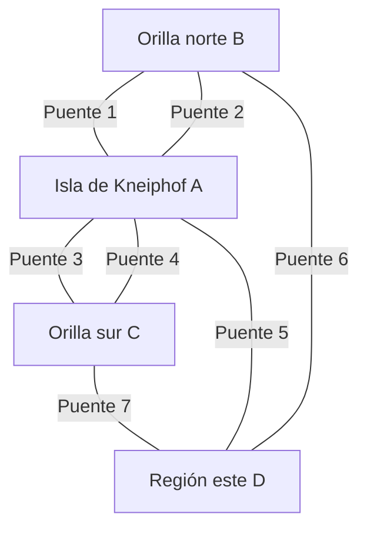

# Gráficas y Juegos - Recorridos Eulerianos y Hamiltonianos

## 4.1 El problema de los puentes de Königsberg.

---

### 1. Introducción Histórica

El **problema de los puentes de Königsberg** (actualmente Kaliningrado, Rusia) es considerado el primer problema en la historia de la **teoría de grafos**. Fue resuelto por el matemático suizo **Leonhard Euler** en 1736, sentando las bases para esta rama de las matemáticas.

El problema original planteaba la siguiente pregunta:
_¿Es posible dar un paseo por la ciudad que cruce cada uno de los siete puentes exactamente una vez y regrese al punto de partida?_

### 2. Modelado del Problema como Grafo

Euler tuvo la genial idea de abstraer el problema geográfico a una estructura matemática. Transformó:

- **Las regiones de tierra** (márgenes del río e islas) en **vértices** $(A, B, C, D)$.
- **Los puentes** que conectan estas regiones en **aristas**.

En Königsberg, el río Pregel rodeaba la isla de Kneiphof y luego se dividía en dos brazos, que separaban la orilla norte, la orilla sur y una segunda región al este. Con $A$ la isla de Kneiphof, $B$ la orilla norte, $C$ la orilla sur y $D$ la región del este, los siete puentes eran: dos entre $A$ y $B$, dos entre $A$ y $C$, uno entre $A$ y $D$, uno entre $B$ y $D$ y uno entre $C$ y $D$.



Como hay varios puentes entre las mismas regiones, el modelo es una **multigráfica**: admite aristas paralelas.

Este grafo abstracto, que representa la conectividad de la ciudad, se puede simplificar aún más. Lo crucial no son las distancias o formas, sino **qué está conectado y con cuántos puentes/aristas**.

### 3. El Concepto de Grado y el Teorema de Euler

#### Grado de un Vértice (Degree)

El **grado** de un vértice $deg(v)$ es el número de aristas que inciden en él. En el grafo de Königsberg, los grados son:

- $deg(A) = 5$ (2 puentes a B, 2 puentes a C y 1 puente a D)
- $deg(B) = 3$ (2 puentes a A y 1 puente a D)
- $deg(C) = 3$ (2 puentes a A y 1 puente a D)
- $deg(D) = 3$ (1 puente a cada una de A, B y C)

La suma de los grados es $14$, el doble de los $7$ puentes, como dice el lema del apretón de manos.

#### Teorema de Euler-Hierholzer (Para ciclos eulerianos)

Un grafo conexo $G$ (no necesariamente simple) contiene un **ciclo euleriano** (un ciclo que recorre cada arista exactamente una vez y termina donde empezó) **si y solo si**:
**Todos los vértices en $G$ tienen grado par.**
$$\text{Ciclo Euleriano existe} \iff \forall v \in V, deg(v) \equiv 0 \pmod{2}$$

Un grafo conexo contiene un **camino euleriano** (un camino que recorre cada arista exactamente una vez, pero no necesariamente termina donde empezó) **si y solo si**:
**Exactamente cero o dos vértices tienen grado impar.**
Si hay dos vértices de grado impar, estos serán el inicio y el final del camino.

### 4. La Resolución del Problema

Euler aplicó este razonamiento al grafo de Königsberg:

1.  **Inspeccionar los grados:** Todos los vértices $(A, B, C, D)$ tenían **grado impar**.
2.  **Aplicar el teorema:** Para que exista un ciclo euleriano, debe cumplirse que _todos_ los vértices tengan grado par. Para un camino euleriano, solo puede haber _cero o dos_ vértices con grado impar.
3.  **Conclusión:** El grafo tenía **cuatro vértices de grado impar**. Por lo tanto, **no es posible** encontrar ni un ciclo ni siquiera un camino que cruce cada puente exactamente una vez. La respuesta al problema original es **NO**.

### 5. Implementación de un Algoritmo para Verificar la Existencia de un Ciclo Euleriano

El siguiente código verifica si un grafo (representado como una lista de adyacencia) es conexo y si todos sus vértices tienen grado par, cumpliendo así con las condiciones para tener un ciclo euleriano.

```python
class Graph:
    def __init__(self, vertices):
        self.V = vertices
        self.graph = [[] for _ in range(vertices)]
        self.vertex_degree = [0] * vertices

    def add_edge(self, u, v):
        self.graph[u].append(v)
        self.graph[v].append(u)
        self.vertex_degree[u] += 1
        self.vertex_degree[v] += 1

    def is_connected(self):
        """Verifica si el grafo es conexo usando BFS."""
        visited = [False] * self.V
        from collections import deque
        queue = deque()

        # Encontrar el primer vértice con al menos una arista para empezar BFS
        start_vertex = 0
        for i in range(self.V):
            if self.vertex_degree[i] > 0:
                start_vertex = i
                break

        queue.append(start_vertex)
        visited[start_vertex] = True
        count = 1  # Contamos el vértice inicial

        while queue:
            u = queue.popleft()
            for v in self.graph[u]:
                if not visited[v]:
                    visited[v] = True
                    queue.append(v)
                    count += 1

        # Comparamos el número de vértices visitados con el número de vértices que tienen aristas
        total_vertices_with_edges = sum(1 for deg in self.vertex_degree if deg > 0)
        return count == total_vertices_with_edges

    def has_eulerian_circuit(self):
        """Verifica si el grafo tiene un ciclo euleriano."""
        # 1. Verificar si el grafo es conexo (o no tiene aristas)
        if not self.is_connected():
            return False

        # 2. Verificar que todos los vértices tengan grado par
        for degree in self.vertex_degree:
            if degree % 2 != 0:
                return False
        return True

    def has_eulerian_path(self):
        """Verifica si el grafo tiene un camino euleriano."""
        # 1. Verificar si el grafo es conexo (o no tiene aristas)
        if not self.is_connected():
            return False

        # 2. Contar vértices con grado impar
        odd_degree_count = 0
        for degree in self.vertex_degree:
            if degree % 2 != 0:
                odd_degree_count += 1

        # Un camino euleriano existe si hay 0 o 2 vértices de grado impar
        return odd_degree_count == 0 or odd_degree_count == 2

# --- EJEMPLO DE USO: KÖNIGSBERG ---
if __name__ == "__main__":
    # Vértices: 0 (isla A), 1 (orilla norte B), 2 (orilla sur C), 3 (región este D)
    g = Graph(4)
    # 7 puentes: AB, AB, AC, AC, AD, BD, CD
    g.add_edge(0, 1)  # Puente 1 (A-B)
    g.add_edge(0, 1)  # Puente 2 (A-B)
    g.add_edge(0, 2)  # Puente 3 (A-C)
    g.add_edge(0, 2)  # Puente 4 (A-C)
    g.add_edge(0, 3)  # Puente 5 (A-D)
    g.add_edge(1, 3)  # Puente 6 (B-D)
    g.add_edge(2, 3)  # Puente 7 (C-D)

    print("Análisis para el grafo de los Puentes de Königsberg:")
    print(f"¿El grafo es conexo? {g.is_connected()}")
    print(f"Grados de los vértices [A, B, C, D]: {g.vertex_degree}")
    print(f"¿Tiene un ciclo euleriano? {g.has_eulerian_circuit()}")
    print(f"¿Tiene un camino euleriano? {g.has_eulerian_path()}")
```

**Salida Esperada:**

```
Análisis para el grafo de los Puentes de Königsberg:
¿El grafo es conexo? True
Grados de los vértices [A, B, C, D]: [5, 3, 3, 3]
¿Tiene un ciclo euleriano? False
¿Tiene un camino euleriano? False
```

### 6. Importancia y Aplicaciones en Gráficas y Juegos

El problema de Königsberg y la teoría de recorridos eulerianos tienen aplicaciones directas en el diseño de juegos:

- **Diseño de Niveles y Mazmorras:** Un diseñador de niveles puede querer crear un mapa donde el jugador deba recorrer todos los "caminos" (aristas) exactamente una vez para resolver un puzle o encontrar una salida secreta. El teorema de Euler indica cómo debe ser la conectividad del nivel para que esto sea posible (pocos "cuartos" o "intersecciones" -vértices- con un número impar de salidas).

- **Sistemas de Recompensas y Coleccionables:** En juegos de mundo abierto, los "coleccionables" podrían estar ubicados en las "aristas" (caminos). Un ciclo euleriano garantizaría la existencia de una ruta óptima para recolectarlos todos sin pasar dos veces por el mismo camino, optimizando el tiempo del jugador.

- **Pathfinding para NPCs:** La IA de un personaje no jugador (NPC) que deba patrullar todas las calles de una ciudad (como un cartero o un vigilante) podría beneficiarse de algoritmos para encontrar caminos o ciclos eulerianos, asegurando una ruta eficiente que no repita calles.

- **Generación Procedural:** Los algoritmos para encontrar ciclos eulerianos se utilizan en la generación procedural de laberintos y niveles que tienen una solución de este tipo, añadiendo una capa de profundidad puzzles de routing.
