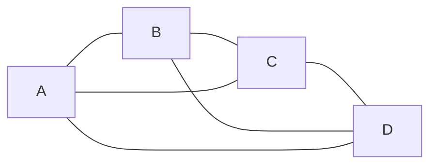
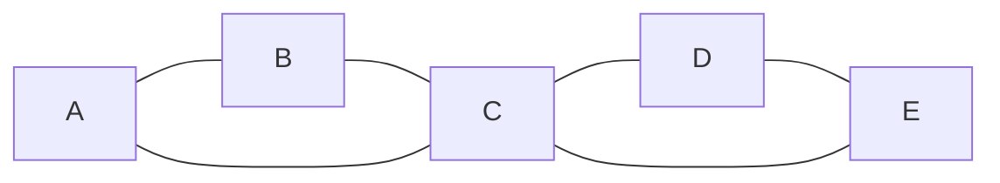
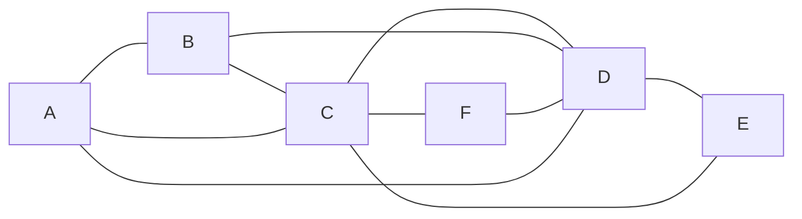
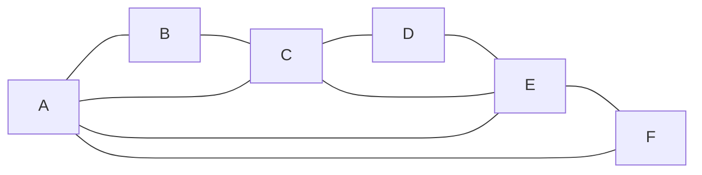

# Gráficas y Juegos - Recorridos Eulerianos y Hamiltonianos

## 4.2 Gráficas Eulerianas.

---

### 1. Definiciones Fundamentales

#### Gráfica Euleriana

Una **gráfica euleriana** es un grafo conexo que contiene un **ciclo euleriano**. Un ciclo euleriano es un ciclo que recorre cada arista del grafo exactamente una vez y regresa al vértice de partida.

#### Camino Euleriano

Un **camino euleriano** es un camino que recorre cada arista del grafo exactamente una vez, pero no necesariamente termina en el mismo vértice donde comenzó.

#### Teorema de Euler (1736)

Para un grafo conexo $G$:

1.  $G$ tiene un **ciclo euleriano** si y solo si **todos sus vértices tienen grado par**.

    $$ \text{Ciclo Euleriano} \iff \forall v \in V(G), \deg(v) \equiv 0 \pmod{2} $$

2.  $G$ tiene un **camino euleriano** (pero no ciclo) si y solo si **exactamente dos vértices tienen grado impar**. Estos dos vértices serán los extremos del camino.

    $$ \text{Camino Euleriano} \iff |\{v \in V(G) : \deg(v) \equiv 1 \pmod{2}\}| = 2 $$

### 2. Características de las Gráficas Eulerianas

- **Conexidad:** Una gráfica euleriana debe ser conexa (a menos que se consideren gráficas con aristas aisladas, pero el ciclo debe recorrer todas las aristas de componentes conexos).
- **Grados:** La condición de grados pares es necesaria y suficiente.
- **Ciclos:** Toda gráfica euleriana puede descomponerse en ciclos disjuntos en aristas.

### 3. Algoritmo de Hierholzer para Encontrar un Ciclo Euleriano

El algoritmo de Hierholzer (1873) es eficiente para encontrar un ciclo euleriano en una gráfica que cumple las condiciones. Con listas de adyacencia y borrando cada arista al usarla, su complejidad es $O(|E|)$. La implementación de abajo usa una matriz de adyacencia y recorre una fila completa para buscar cada arista, así que cuesta $O(|V| \cdot |E| + |V|^2)$.

#### Pasos del Algoritmo:

1.  Verificar que todos los vértices tienen grado par (y que el grafo es conexo).
2.  Escoger cualquier vértice $v$ y formar un ciclo $C$ comenzando en $v$.
3.  Mientras exista un vértice $u$ en $C$ que tenga aristas no visitadas:
    - Comenzar un nuevo ciclo $C'$ desde $u$, usando solo aristas no visitadas.
    - Insertar el ciclo $C'$ en el ciclo $C$ en el vértice $u$.
4.  El ciclo $C$ resultante es el ciclo euleriano.

```python
from collections import defaultdict

class EulerianGraph:
    def __init__(self, vertices):
        self.V = vertices
        self.graph = defaultdict(list)
        self.adj_matrix = [[0] * vertices for _ in range(vertices)]
        self.edge_count = 0

    def add_edge(self, u, v):
        self.graph[u].append(v)
        self.graph[v].append(u)
        self.adj_matrix[u][v] += 1
        self.adj_matrix[v][u] += 1
        self.edge_count += 1

    def is_eulerian(self):
        """Verifica si el grafo tiene ciclo euleriano"""
        if not self._is_connected():
            return False
        for i in range(self.V):
            if len(self.graph[i]) % 2 != 0:
                return False
        return True

    def _is_connected(self):
        """Verifica conexidad usando BFS"""
        visited = [False] * self.V
        # Encontrar primer vértice con grado > 0
        start_vertex = 0
        for i in range(self.V):
            if len(self.graph[i]) > 0:
                start_vertex = i
                break

        queue = [start_vertex]
        visited[start_vertex] = True
        count = 1

        while queue:
            u = queue.pop(0)
            for v in self.graph[u]:
                if not visited[v]:
                    visited[v] = True
                    queue.append(v)
                    count += 1

        # Verificar que todos los vértices con aristas estén conectados
        vertices_with_edges = sum(1 for i in range(self.V) if len(self.graph[i]) > 0)
        return count == vertices_with_edges

    def hierholzer_algorithm(self):
        """Implementación del algoritmo de Hierholzer"""
        if not self.is_eulerian():
            return None

        # Crear una copia de la matriz de adyacencia para tracking
        temp_adj = [row[:] for row in self.adj_matrix]
        circuit = []
        stack = []
        current_vertex = 0  # Puede empezar en cualquier vértice

        stack.append(current_vertex)

        while stack:
            current_vertex = stack[-1]
            # Buscar un vértice adyacente
            found = False
            for next_vertex in range(self.V):
                if temp_adj[current_vertex][next_vertex] > 0:
                    # Remover la arista
                    temp_adj[current_vertex][next_vertex] -= 1
                    temp_adj[next_vertex][current_vertex] -= 1
                    stack.append(next_vertex)
                    found = True
                    break

            if not found:
                # No hay más aristas desde este vértice
                circuit.append(stack.pop())

        return circuit[::-1]  # Invertir para obtener el orden correcto

# --- EJEMPLO DE USO ---
if __name__ == "__main__":
    # Crear una gráfica euleriana
    g = EulerianGraph(5)
    # Grafo completo K5 (todos los vértices de grado 4 - par)
    edges = [(0,1), (0,2), (0,3), (0,4),
             (1,2), (1,3), (1,4),
             (2,3), (2,4),
             (3,4)]

    for u, v in edges:
        g.add_edge(u, v)

    print("Análisis de la Gráfica Euleriana:")
    print(f"¿Es conexa? {g._is_connected()}")
    print(f"¿Tiene ciclo euleriano? {g.is_eulerian()}")

    if g.is_eulerian():
        eulerian_circuit = g.hierholzer_algorithm()
        print(f"Ciclo Euleriano encontrado: {eulerian_circuit}")
        print(f"Longitud del ciclo: {len(eulerian_circuit)}")
        print(f"Número de aristas: {g.edge_count}")
```

### 4. Ejemplos Visuales de Gráficas Eulerianas

#### Ejemplo 1: Una gráfica no euleriana, $K_4$



_Todos los vértices tienen grado 3, impar → no es euleriana. Como tiene cuatro vértices de grado impar, tampoco tiene camino euleriano._

#### Ejemplo 2: Gráfica euleriana, dos triángulos con un vértice común



_Grados: A=2, B=2, C=4, D=2, E=2, todos pares → es euleriana. Un ciclo euleriano es A-B-C-D-E-C-A._

#### Ejemplo 3: Gráfica no euleriana



_Grados: A=3, B=3, C=5, D=5, E=2, F=2 → no es euleriana. Tiene cuatro vértices de grado impar, así que tampoco tiene camino euleriano._

#### Ejemplo 4: Gráfica euleriana, hexágono con triángulo interior



_Grados: A=4, B=2, C=4, D=2, E=4, F=2, todos pares → es euleriana. Un ciclo euleriano es A-B-C-D-E-F-A-C-E-A, que usa las 9 aristas._

### 5. Aplicaciones en Gráficas y Juegos

#### 1. Diseño de Niveles y Mazmorras

- **Puzzles de Routing:** Crear laberintos donde el jugador debe recorrer todos los pasillos exactamente una vez.
- **Coleccionables:** Ubicar objetos en caminos que formen una gráfica euleriana para garantizar una ruta óptima.

#### 2. Inteligencia Artificial

- **Patrullaje:** NPCs que deben vigilar todas las calles de una ciudad (como policías o carteros).
- **Pathfinding Óptimo:** Encontrar la ruta más eficiente para recorrer todos los caminos de un mapa.

#### 3. Generación Procedural

- **Creación de Mundos:** Generar mapas que tengan ciclos eulerianos para garantizar exploración completa.
- **Balance de Niveles:** Asegurar que todos los caminos sean accesibles de manera equilibrada.

#### 4. Sistemas de Recompensas

- **Logros y Desafíos:** Implementar logros por "exploración completa" de un área.
- **Rutas Secretas:** Ocultar rutas eulerianas que lleven a recompensas especiales.

#### 5. Multiplayer y Competitivo

- **Carreras:** Diseñar circuitos de carreras que pasen por todos los puntos de control.
- **Estrategia:** Planificar movimientos que cubran todo el territorio disponible.

### 6. Teorema de Conversión a Euleriano

Cualquier grafo conexo con exactamente $2k$ vértices de grado impar puede volverse euleriano añadiendo $k$ aristas que conecten pares de vértices de grado impar. Si dos de ellos ya son adyacentes, la arista añadida es paralela y el resultado es una multigráfica. Además, un vértice de grado impar no puede quedar par sin recibir al menos una arista nueva, así que $k$ es el mínimo.

$$ \text{Aristas a añadir} = \frac{\text{número de vértices de grado impar}}{2} $$

Esta propiedad es útil para corregir diseños de niveles y hacerlos eulerianos.
