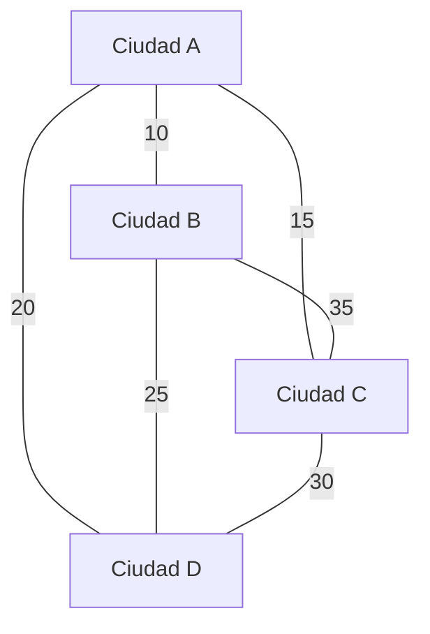

# Gráficas y Juegos - Recorridos Eulerianos y Hamiltonianos

## 4.3 El problema del agente viajero.

---

### 1. Definición del Problema

El **Problema del Agente Viajero (Traveling Salesman Problem - TSP)** es uno de los problemas más famosos en informática e investigación de operaciones. Se define como:

"Dado un conjunto de ciudades y las distancias entre cada par de ellas, ¿cuál es la ruta más corta posible que visita cada ciudad exactamente una vez y regresa a la ciudad de origen?"

Matemáticamente, si tenemos un grafo completo $G = (V, E)$ con $n$ vértices (ciudades) y una función de peso $w: E \rightarrow \mathbb{R}^+$ que representa la distancia o costo entre ciudades, queremos encontrar:

$$ \min_{\pi \in S_n} \left( \sum_{i=1}^{n-1} w(v_{\pi(i)}, v_{\pi(i+1)}) + w(v_{\pi(n)}, v_{\pi(1)}) \right) $$

donde $S_n$ es el conjunto de todas las permutaciones de $n$ elementos (todas las rutas posibles).

### 2. Relación con Ciclos Hamiltonianos

El TSP está directamente relacionado con la búsqueda de un **ciclo hamiltoniano** de peso mínimo en un grafo completo ponderado.

- **Ciclo Hamiltoniano:** Camino que visita cada vértice exactamente una vez y regresa al punto de inicio.
- **TSP:** Encuentra el ciclo hamiltoniano de menor costo total.

**Importante:** Mientras que determinar si un grafo tiene un ciclo hamiltoniano es NP-completo, el TSP es **NP-duro**, incluso para casos donde se cumple la desigualdad del triángulo.

### 3. Complejidad Computacional

El TSP pertenece a la clase de problemas **NP-duros**. Esto significa:

- No se conoce ningún algoritmo que lo resuelva en tiempo polinomial.
- La cantidad de soluciones posibles crece factorialmente: $(n-1)!/2$ para un grafo simétrico.
- Para $n = 15$ ciudades: ~43,000 millones de rutas posibles.
- Para $n = 20$ ciudades: ~60,000,000,000,000,000 rutas posibles.

### 4. Algoritmos de Solución

#### Fuerza Bruta

Prueba todas las permutaciones posibles. Solo viable para $n \leq 10$.

#### Programación Dinámica (Held-Karp)

Complejidad $O(n^2 \cdot 2^n)$, viable para $n \leq 20-25$.

```python
import numpy as np
from itertools import combinations

def tsp_dynamic_programming(distances):
    n = len(distances)
    # dp[mask][i] = costo mínimo visitando todas las ciudades en mask, terminando en i
    dp = [[float('inf')] * n for _ in range(1 << n)]
    parent = [[-1] * n for _ in range(1 << n)]

    # Inicializar: empezando desde la ciudad 0
    dp[1][0] = 0

    # Iterar sobre todos los subconjuntos de ciudades
    for mask in range(1 << n):
        for i in range(n):
            if not (mask & (1 << i)):
                continue
            if dp[mask][i] == float('inf'):
                continue

            # Intentar mover a todas las ciudades no visitadas
            for j in range(n):
                if mask & (1 << j):
                    continue
                new_mask = mask | (1 << j)
                new_cost = dp[mask][i] + distances[i][j]
                if new_cost < dp[new_mask][j]:
                    dp[new_mask][j] = new_cost
                    parent[new_mask][j] = i

    # Encontrar el camino de regreso al inicio
    final_mask = (1 << n) - 1
    min_cost = float('inf')
    last_city = -1

    for i in range(1, n):
        cost = dp[final_mask][i] + distances[i][0]
        if cost < min_cost:
            min_cost = cost
            last_city = i

    # Reconstruir el camino siguiendo los padres hasta volver a la ciudad 0
    path = []
    mask = final_mask
    current = last_city

    while current != 0:
        path.append(current)
        previous = parent[mask][current]
        mask ^= (1 << current)      # quitar la ciudad actual del subconjunto
        current = previous

    path.append(0)
    path.reverse()
    path.append(0)                  # el ciclo regresa al origen
    return min_cost, path

# Ejemplo de uso
if __name__ == "__main__":
    # Matriz de distancias (ejemplo con 4 ciudades)
    dist = [
        [0, 10, 15, 20],
        [10, 0, 35, 25],
        [15, 35, 0, 30],
        [20, 25, 30, 0]
    ]

    cost, path = tsp_dynamic_programming(dist)
    print(f"Costo mínimo: {cost}")
    print(f"Ruta óptima: {path}")
```

```text
Costo mínimo: 80
Ruta óptima: [0, 2, 3, 1, 0]
```

La ruta 0 → 2 → 3 → 1 → 0, es decir A → C → D → B → A, es la misma de la sección 5 recorrida en sentido contrario.

#### Algoritmos Aproximados

Para grafos métricos (que cumplen desigualdad del triángulo):

1. **Algoritmo del árbol de expansión mínima + recorrido en preorden:** garantiza una ruta de costo a lo más 2 veces el óptimo.
2. **Algoritmo de Christofides:** garantiza a lo más 1.5 veces el óptimo; añade al árbol un emparejamiento perfecto de peso mínimo entre los vértices de grado impar.

### 5. Visualización del Problema



**Ruta óptima:** A → B → D → C → A  
**Costo total:** 10 + 25 + 30 + 15 = 80

### 6. Variantes del TSP

#### TSP Métrico

Las distancias cumplen la desigualdad del triángulo:  
$w(u, v) \leq w(u, x) + w(x, v)$ para todos los vértices $u, v, x$

#### TSP Euclidiano

Las ciudades son puntos en el plano y las distancias son distancias euclidianas.

#### TSP con Ventanas de Tiempo

Cada ciudad debe ser visitada dentro de un intervalo de tiempo específico.

#### TSP Múltiples Agentes

Extensiones donde múltiples agentes colaboran para visitar todas las ciudades.

### 7. Aplicaciones en Gráficas y Juegos

#### 1. Diseño de Niveles

- **Rutas de patrullaje:** Optimizar caminos para NPCs que deben vigilar múltiples puntos.
- **Diseño de circuitos:** Crear pistas de carreras con puntos de control en orden óptimo.

#### 2. Inteligencia Artificial

- **Planificación de movimientos:** En estrategia en tiempo real, para unidades que deben visitar múltiples recursos.
- **Comportamiento de NPCs:** Mercaderes itinerantes que visitan ciudades en rutas óptimas.

#### 3. Generación Procedural

- **Diseño de mazmorras:** Conectar salas de manera eficiente minimizando backtracking.
- **Colocación de objetos:** Ubicar items en rutas que formen ciclos hamiltonianos interesantes.

#### 4. Optimización de Recursos

- **Gestión de recursos:** Minimizar tiempo de recolección en juegos de supervivencia.
- **Logística:** Optimizar rutas de suministros en juegos de estrategia.

#### 5. Puzzles y Desafíos

- **Rompecabezas de routing:** Niveles donde el jugador debe encontrar la ruta más corta.
- **Logros y retos:** Completar misiones en orden específico para minimizar tiempo.

### 8. Ejemplo en Videojuegos

En juegos como **"Paper Mario"** o **"The Legend of Zelda"**, el TSP aparece cuando:

- El jugador debe visitar múltiples templos en cualquier orden, pero algunos órdenes son más eficientes.
- Los diseñadores usan heurísticas para sugerir rutas óptimas mediante pistas narrativas.
- Los speedrunners resuelven instancias de TSP para optimizar sus tiempos.

### 9. Herramientas Prácticas

Para implementar TSP en juegos:

1. **Para n pequeño (<10):** Usar fuerza bruta
2. **Para n medio (10-20):** Usar programación dinámica
3. **Para n grande (>20):** Usar heurísticas como:
   - Algoritmos genéticos
   - Recocido simulado
   - Colonias de hormigas

```python
# Heurística simple: Vecino más cercano
def tsp_nearest_neighbor(distances):
    n = len(distances)
    unvisited = set(range(1, n))
    path = [0]
    current = 0
    total_cost = 0

    while unvisited:
        nearest = min(unvisited, key=lambda x: distances[current][x])
        total_cost += distances[current][nearest]
        path.append(nearest)
        unvisited.remove(nearest)
        current = nearest

    total_cost += distances[current][0]
    path.append(0)
    return total_cost, path
```
