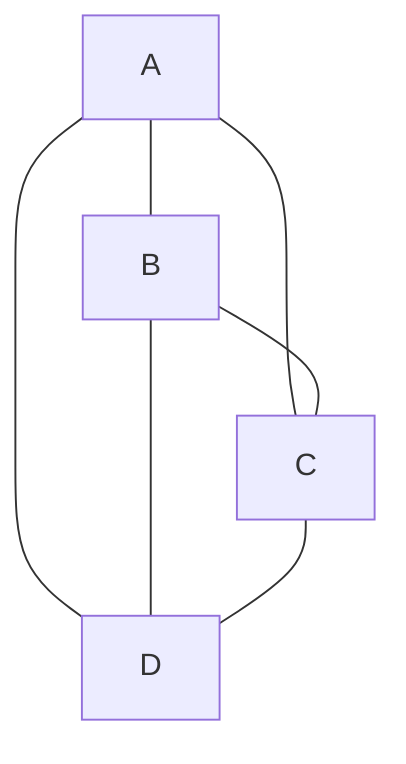
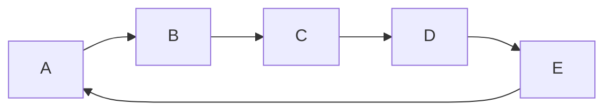
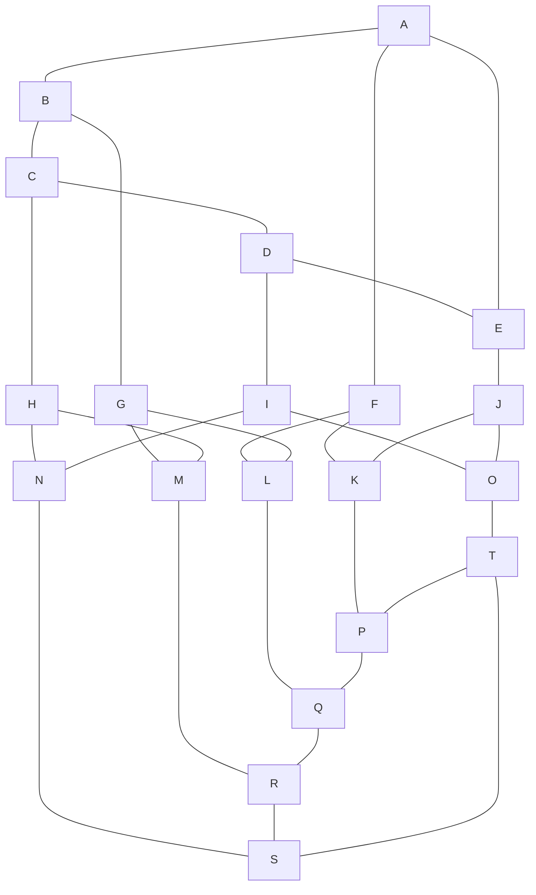
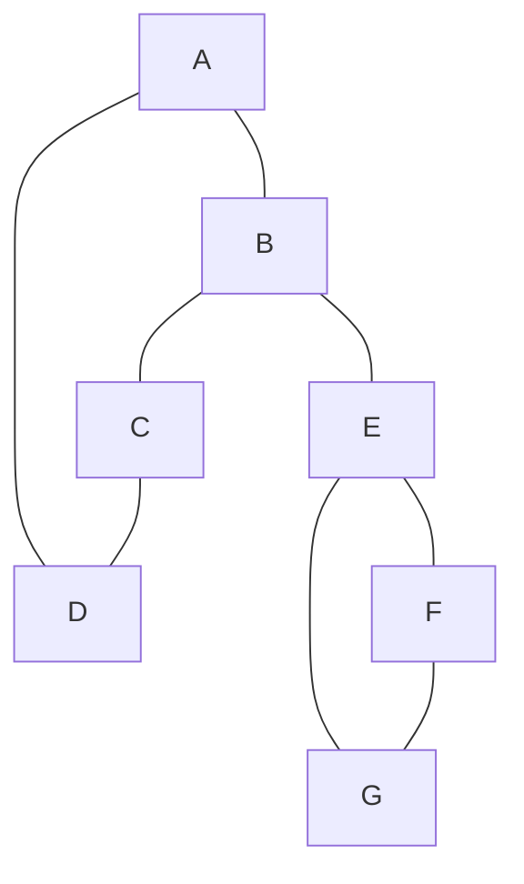
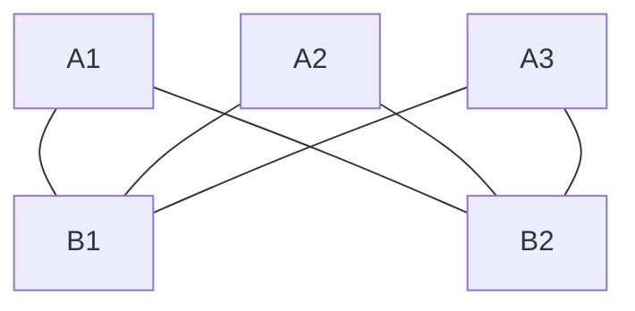

# Gráficas y Juegos - Recorridos Eulerianos y Hamiltonianos

## 4.4 Gráficas Hamiltonianas.

---

### 1. Definiciones Fundamentales

#### Camino Hamiltoniano

Un **camino hamiltoniano** es un camino en un grafo que visita cada vértice exactamente una vez.

#### Ciclo Hamiltoniano

Un **ciclo hamiltoniano** es un ciclo que visita cada vértice exactamente una vez y regresa al vértice de partida.

#### Gráfica Hamiltoniana

Una gráfica se denomina **hamiltoniana** si contiene un ciclo hamiltoniano.

#### Gráfica Semi-Hamiltoniana

Una gráfica se denomina **semi-hamiltoniana** si contiene un camino hamiltoniano pero no un ciclo hamiltoniano.

### 2. Condiciones Necesarias y Suficientes

A diferencia de las gráficas eulerianas, **NO existe** una caracterización completa y simple para las gráficas hamiltonianas. El problema de determinar si un grafo es hamiltoniano es **NP-completo**.

#### Condición Necesaria (pero no suficiente)

Si $G$ es hamiltoniano, entonces para todo subconjunto $S$ de vértices de $G$, el número de componentes conexas de $G - S$ es a lo sumo $|S|$.

$$ \text{G hamiltoniano} \implies \forall S \subseteq V(G), c(G - S) \leq |S| $$

#### Teorema de Dirac (1952)

Si $G$ es un grafo simple con $n \\geq 3$ vértices y el grado mínimo $ \delta(G) \geq \frac{n}{2}$, entonces $G$ es hamiltoniano.

$$\delta(G) \geq \frac{n}{2} \implies G \text{ es hamiltoniano}$$

#### Teorema de Ore (1960)

Si $G$ es un grafo simple con $ n \geq 3 $ vértices y para todo par de vértices no adyacentes $u$ y $v$ se cumple que $deg(u) + deg(v) \\geq n$, entonces $G$ es hamiltoniano.

$$\forall u,v \in V(G), uv \notin E(G) \implies deg(u) + deg(v) \geq n$$

### 3. Algoritmos para Detección de Ciclos Hamiltonianos

Dado que el problema es NP-completo, no existe un algoritmo eficiente para grafos grandes.

#### Fuerza Bruta (Backtracking)

```python
class HamiltonianGraph:
    def __init__(self, vertices):
        self.V = vertices
        self.graph = [[0] * vertices for _ in range(vertices)]
        self.path = []

    def add_edge(self, u, v):
        self.graph[u][v] = 1
        self.graph[v][u] = 1

    def is_safe(self, v, pos, path):
        # Verificar si el vértice es adyacente al anterior
        if self.graph[path[pos-1]][v] == 0:
            return False

        # Verificar si ya está en el camino
        if v in path:
            return False

        return True

    def hamiltonian_cycle_util(self, path, pos):
        # Caso base: todos los vértices están en el camino
        if pos == self.V:
            # Verificar si el último vértice es adyacente al primero
            if self.graph[path[pos-1]][path[0]] == 1:
                return True
            else:
                return False

        # Probar diferentes vértices como siguiente candidato
        for v in range(1, self.V):
            if self.is_safe(v, pos, path):
                path[pos] = v

                if self.hamiltonian_cycle_util(path, pos + 1):
                    return True

                # Backtrack
                path[pos] = -1

        return False

    def find_hamiltonian_cycle(self):
        path = [-1] * self.V
        path[0] = 0  # Empezar desde el vértice 0

        if not self.hamiltonian_cycle_util(path, 1):
            print("No se encontró ciclo hamiltoniano")
            return False

        self.path = path + [path[0]]  # Completar el ciclo
        print("Ciclo hamiltoniano encontrado:", self.path)
        return True

# Ejemplo de uso
if __name__ == "__main__":
    g = HamiltonianGraph(5)
    # Grafo completo K5 (debería ser hamiltoniano)
    for i in range(5):
        for j in range(i+1, 5):
            g.add_edge(i, j)

    g.find_hamiltonian_cycle()
```

### 4. Ejemplos Visuales de Gráficas Hamiltonianas

#### Ejemplo 1: Grafo Completo $K_n$



_Todo grafo completo con $n \\geq 3$ es hamiltoniano_

#### Ejemplo 2: Ciclo $C_n$



_Todo ciclo es hamiltoniano por definición_

#### Ejemplo 3: Grafo del Dodecaedro



_El grafo del dodecaedro es hamiltoniano_

### 5. Gráficas No Hamiltonianas

#### Ejemplo 1: Grafo con Vértice de Corte



_El vértice B y E son vértices de corte - difícil formar ciclo hamiltoniano_

#### Ejemplo 2: Grafo Bipartito Desbalanceado



$K_{3,2}$ no es hamiltoniano (conjuntos de diferente tamaño)_

### 6. Teorema de Grinberg (1968)

Para grafos planares, existe una condición necesaria para ciclos hamiltonianos:
$$\\sum_{k=3}^{n} (k-2)(f_k - f_k') = 0$$
donde $f_k$ es el número de caras de grado $k$ dentro del ciclo y $f_k'$ fuera del ciclo.

### 7. Aplicaciones en Gráficas y Juegos

#### 1. Diseño de Niveles

- **Rutas de exploración:** Diseñar niveles donde el jugador debe visitar todas las áreas en un orden específico.
- **Puzzles de routing:** Crear rompecabezas que requieran encontrar caminos hamiltonianos.

#### 2. Inteligencia Artificial

- **Planificación de movimientos:** NPCs que deben patrullar todos los puntos de control.
- **Optimización de rutas:** Encontrar el orden óptimo para visitar objetivos.

#### 3. Generación Procedural

- **Diseño de mazmorras:** Generar layouts donde exista un camino que visite todas las salas.
- **Creación de mundos:** Garantizar que todos los puntos de interés sean accesibles en una ruta continua.

#### 4. Sistemas de Misiones

- **Cadenas de misiones:** Diseñar secuencias de misiones que formen ciclos hamiltonianos.
- **Logros y retos:** Implementar logros por completar todos los objetivos en un solo recorrido.

#### 5. Multiplayer y Competitivo

- **Carreras:** Diseñar circuitos que pasen por todos los puntos de control exactamente una vez.
- **Estrategia:** Planificar movimientos que cubran todo el territorio disponible.

### 8. Relación con el Problema del Agente Viajero

Mientras que el problema hamiltoniano pregunta **"¿existe un ciclo?"**, el TSP pregunta **"¿cuál es el ciclo de menor peso?"**. Son problemas relacionados pero distintos:

- **Hamiltoniano:** Problema de decisión (SÍ/NO)
- **TSP:** Problema de optimización (encontrar mínimo)

### 9. Herramientas y Técnicas Prácticas

Para trabajar con gráficas hamiltonianas en juegos:

1. **Para grafos pequeños:** Usar backtracking con poda
2. **Para grafos estructurados:** Aplicar teoremas de Dirac/Ore
3. **Para grafos grandes:** Usar heurísticas y algoritmos aproximados
4. **Detección temprana:** Verificar condiciones necesarias antes de buscar ciclos

```python
def has_hamiltonian_cycle(graph):
    """
    Verificación rápida de condiciones necesarias
    """
    n = len(graph)

    # Teorema de Dirac
    min_degree = min(sum(row) for row in graph)
    if n >= 3 and min_degree >= n/2:
        return True

    # Otras verificaciones rápidas
    if n < 3:
        return False

    # Verificar conectividad
    if not is_connected(graph):
        return False

    return None  # No se puede determinar rápidamente

def is_connected(graph):
    n = len(graph)
    visited = [False] * n
    stack = [0]
    visited[0] = True
    count = 1

    while stack:
        u = stack.pop()
        for v in range(n):
            if graph[u][v] > 0 and not visited[v]:
                visited[v] = True
                stack.append(v)
                count += 1

    return count == n
```
