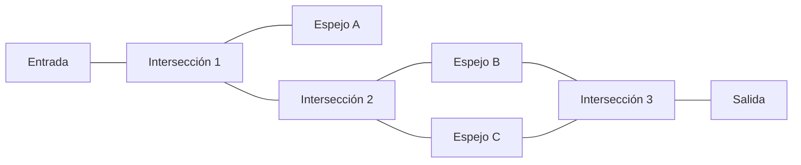
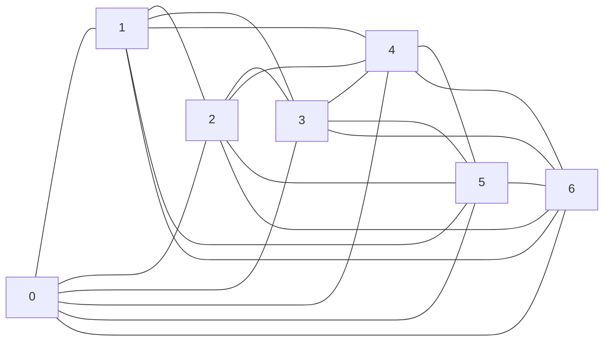

# Gráficas y Juegos - Recorridos Eulerianos y Hamiltonianos

## 4.5 Aplicaciones (la casa de los espejos, el juego de dominó, ajedrez, etc.).

---

### 1. Introducción

Los recorridos eulerianos y hamiltonianos son conceptos fundamentales en la teoría de grafos con diversas aplicaciones en el mundo real. Esta guía explora sus aplicaciones prácticas en problemas como la casa de los espejos, el juego de dominó y el ajedrez.

### 2. Definiciones Básicas

#### 2.1 Recorrido Euleriano

Un recorrido euleriano es un camino en un grafo que visita cada arista exactamente una vez. Si el camino comienza y termina en el mismo vértice, se llama **circuito euleriano.**

**Teorema de Euler:** Un grafo conexo tiene un circuito euleriano si y solo si todos sus vértices tienen grado par.

#### 2.2 Recorrido Hamiltoniano

Un recorrido hamiltoniano es un camino en un grafo que visita cada vértice exactamente una vez. Si el camino comienza y termina en el mismo vértice, se llama ciclo hamiltoniano.

A diferencia del problema euleriano, no existe una caracterización simple para determinar si un grafo tiene un ciclo hamiltoniano (es un problema NP-completo).

### 3. Aplicaciones Prácticas

#### 3.1 La Casa de los Espejos

**Problema:** Encontrar un camino que recorra todos los pasillos de un laberinto exactamente una vez.
**Modelado:** Representamos la casa de los espejos como un grafo donde:

- Vértices: Intersecciones o puntos de decisión
- Aristas: Pasillos o corredores

**Solución:** Buscar un recorrido euleriano en el grafo.



**Algoritmo para encontrar circuito euleriano:**

```python
def encontrar_circuito_euleriano(grafo):
    # Verificar si existe circuito euleriano (se supone que el grafo es conexo)
    for vertice in grafo:
        if len(grafo[vertice]) % 2 != 0:
            return None # No existe circuito euleriano

    # Algoritmo de Hierholzer
    circuito = []
    pila = [list(grafo.keys())[0]]

    while pila:
        vertice_actual = pila[-1]
        if grafo[vertice_actual]:
            siguiente_vertice = grafo[vertice_actual].pop()
            grafo[siguiente_vertice].remove(vertice_actual)
            pila.append(siguiente_vertice)
        else:
            circuito.append(pila.pop())

    return circuito[::-1]

# Ejemplo de uso

grafo_casa_espejos = {
    'Entrada': ['Intersección1'],
    'Intersección1': ['Entrada', 'EspejoA', 'Intersección2'],
    'EspejoA': ['Intersección1'],
    'Intersección2': ['Intersección1', 'EspejoB', 'EspejoC'],
    'EspejoB': ['Intersección2', 'Intersección3'],
    'EspejoC': ['Intersección2', 'Intersección3'],
    'Intersección3': ['EspejoB', 'EspejoC', 'Salida'],
    'Salida': ['Intersección3']
}

print(encontrar_circuito_euleriano(grafo_casa_espejos))   # None
```

En este ejemplo no hay recorrido euleriano: la Entrada, el Espejo A y la Salida tienen grado 1, y las tres intersecciones grado 3, así que hay seis vértices de grado impar. Para recorrer todos los pasillos habría que repetir algunos; el recorrido más corto que lo hace es el del **problema del cartero chino** (sección 4).

#### 3.2 El Juego de Dominó

**Problema:** Colocar todas las fichas de dominó formando una cadena donde los números coincidan.
**Modelado:** Representamos el problema como un grafo donde:

- Vértices: Números del 0 al 6 (para dominó estándar)
- Aristas: Fichas de dominó (cada ficha i-j es una arista entre i y j; las mulas i-i son lazos)

**Solución:** Buscar un recorrido euleriano en la multigráfica.

El dominó estándar tiene las 28 fichas $i\text{-}j$ con $0 \leq i \leq j \leq 6$: las 21 fichas con $i \neq j$ forman la gráfica completa $K_7$, y las 7 mulas son lazos. Cada número aparece en 6 aristas hacia los otros números y en un lazo, que suma 2 al grado, así que cada vértice tiene grado $6 + 2 = 8$, par. Por el teorema de Euler, **las 28 fichas se pueden colocar en una sola cadena cerrada**, que termina con el mismo número con el que empezó. Los lazos no afectan la existencia del recorrido: cada mula se intercala cuando la cadena pasa por su número.

La gráfica sin las mulas, $K_7$:



**Condición para solución en general,** por ejemplo con un juego incompleto de fichas: la multigráfica debe ser conexa, sin contar números que no aparecen, y tener exactamente 0 o 2 vértices de grado impar.
**Fórmula:** Para un grafo conexo, existe un recorrido euleriano si y solo si:

$$ \big| \{ v \in V : deg(v) \text{ es impar} \} \big| \in \{0, 2\} $$

#### 3.3 Problemas de Ajedrez

**Tour del Caballo**
**Problema:** Mover un caballo por todo el tablero de ajedrez visitando cada casilla exactamente una vez.
**Modelado:** Representamos el tablero como un grafo donde:

- Vértices: Casillas del tablero
- Aristas: Movimientos válidos del caballo

**Solución:** Buscar un recorrido hamiltoniano en el grafo.

```python
def imprimir_tablero(tablero, n):
    for fila in tablero:
        print(" ".join(f"{c:2d}" for c in fila))

def es_movimiento_valido(x, y, n, tablero):
    return (x >= 0 and y >= 0 and x < n and y < n and tablero[x][y] == -1)

def resolver_tour_caballo(n):
    # Inicializar tablero
    tablero = [[-1 for _ in range(n)] for _ in range(n)]
    # Movimientos posibles del caballo (8 direcciones)
    movimientos_x = [2, 1, -1, -2, -2, -1, 1, 2]
    movimientos_y = [1, 2, 2, 1, -1, -2, -2, -1]

    # Empezar en la posición (0,0)
    tablero[0][0] = 0

    # Backtracking para encontrar la solución
    if not resolver_tour_util(0, 0, 1, tablero, movimientos_x, movimientos_y, n):
        print("No existe solución")
        return False
    else:
        imprimir_tablero(tablero, n)
        return True

def resolver_tour_util(x, y, movimiento, tablero, mov_x, mov_y, n):
    if movimiento == n * n:
        return True

    # Probar todos los movimientos desde la posición actual
    for i in range(8):
        nuevo_x = x + mov_x[i]
        nuevo_y = y + mov_y[i]
        if es_movimiento_valido(nuevo_x, nuevo_y, n, tablero):
            tablero[nuevo_x][nuevo_y] = movimiento
            if resolver_tour_util(nuevo_x, nuevo_y, movimiento + 1, tablero, mov_x, mov_y, n):
                return True
            # Backtracking
            tablero[nuevo_x][nuevo_y] = -1

    return False
```

**Complejidad:** El tour del caballo es un caso particular del problema del camino hamiltoniano, que es NP-completo **en general**. Pero el tour del caballo en particular no es difícil: existen algoritmos de tiempo lineal en el número de casillas que construyen un tour para todo $n \geq 5$, y la heurística de Warnsdorff, que elige siempre la casilla con menos salidas libres, lo encuentra casi siempre sin retroceder. El backtracking de arriba, en cambio, puede tardar exponencialmente.

| Característica  | Problema Euleriano                                                 | Problema Hamiltoniano                        |
| --------------- | ------------------------------------------------------------------ | -------------------------------------------- |
| **Complejidad** | Polinomial (O(E))                                                  | NP-Completo                                  |
| **Condición**   | Todos los vértices con grado par (o exactamente 2 con grado impar) | No existe condición simple                   |
| **Aplicación**  | Recorrer todas las aristas (pasillos, conexiones)                  | Visitar todos los vértices (puntos, lugares) |

### 4. Ejercicios Prácticos

1. **Problema del Cartero Chino:** Encontrar el camino más corto que recorra todas las calles al menos una vez y regrese al punto de partida.
2. **Problema del Viajante (TSP):** Encontrar el camino más corto que visite todas las ciudades exactamente una vez y regrese al origen.

### 5. Conclusión

Los recorridos eulerianos y hamiltonianos tienen aplicaciones diversas en problemas del mundo real. Mientras los problemas eulerianos tienen solución eficiente, los problemas hamiltonianos son computacionalmente difíciles, lo que los hace interesantes para la investigación en algoritmos y optimización.

### 6. Referencias

- Euler, L. (1736). Solutio problematis ad geometriam situs pertinentis.
- Hamilton, W. R. (1856). Memorandum respecting a new system of roots of unity.
- Cormen, T. H., Leiserson, C. E., Rivest, R. L., & Stein, C. (2009). Introduction to Algorithms. MIT Press.
