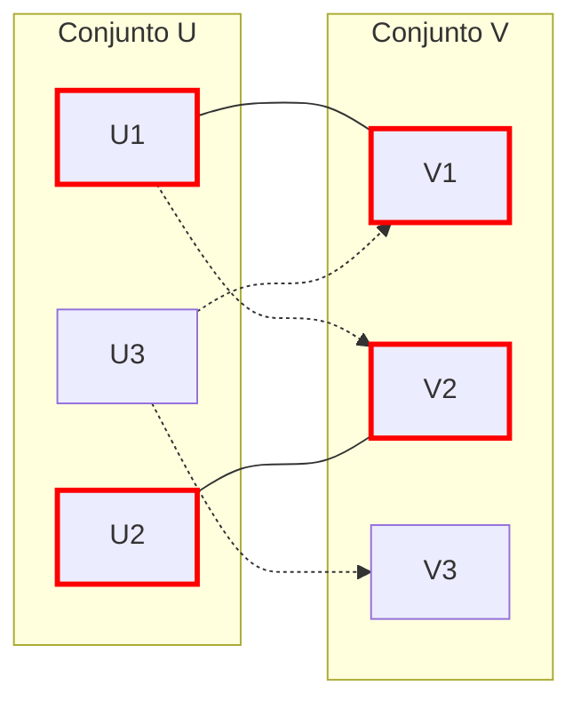

# Gráficas y Juegos - Apareamientos

## 5.2 Apareamientos.

---

### 1. Definición Básica

Un **apareamiento** (o **matching**) $M$ en una gráfica no dirigida $G = (V, E)$ es un subconjunto de aristas $M \subseteq E$ tal que ningún par de aristas en $M$ comparte un vértice común.

- **Vértice saturado**: Un vértice $v \in V$ es saturado por $M$ si existe una arista en $M$ incidente a $v$.
- **Apareamiento máximo**: Es un apareamiento que contiene el mayor número posible de aristas.
- **Apareamiento perfecto**: Es un apareamiento que satura todos los vértices de $G$. Solo es posible si $|V|$ es par.

### 2. Teorema de Hall (Teorema del Casamiento)

Para una gráfica bipartita $G = (X, Y, E)$, existe un apareamiento que satura todos los vértices de $X$ si y solo si:

$$ \forall A \subseteq X, |N(A)| \geq |A| $$

Donde $N(A)$ es el conjunto de vecinos de los vértices en $A$.

### 3. Algoritmo de Hopcroft-Karp (Para apareamientos bipartitos máximos)

Este algoritmo encuentra el apareamiento máximo en gráficas bipartitas en tiempo $O(\sqrt{n} \cdot m)$.

```python
from collections import deque

def hopcroft_karp(graph, U, V):
    pair_U = {u: None for u in U}
    pair_V = {v: None for v in V}
    dist = {}

    def bfs():
        queue = deque()
        for u in U:
            if pair_U[u] is None:
                dist[u] = 0
                queue.append(u)
            else:
                dist[u] = float('inf')
        dist[None] = float('inf')

        while queue:
            u = queue.popleft()
            if dist[u] < dist[None]:
                for v in graph[u]:
                    if dist[pair_V[v]] == float('inf'):
                        dist[pair_V[v]] = dist[u] + 1
                        queue.append(pair_V[v])
        return dist[None] != float('inf')

    def dfs(u):
        if u is None:
            return True
        for v in graph[u]:
            if dist[pair_V[v]] == dist[u] + 1:
                if dfs(pair_V[v]):
                    pair_V[v] = u
                    pair_U[u] = v
                    return True
        dist[u] = float('inf')
        return False

    matching = 0
    while bfs():
        for u in U:
            if pair_U[u] is None:
                if dfs(u):
                    matching += 1
    return matching, pair_U
```

### 4. Diagrama de un Apareamiento



En este diagrama, las líneas sólidas representan un apareamiento entre los conjuntos $U$ y $V$.

### 5. Aplicaciones de los Apareamientos

1. **Sistemas de recomendación**: Emparejamiento de usuarios con productos.
2. **Asignación de recursos**: Asignación de tareas a trabajadores.
3. **Redes de comunicaciones**: Emparejamiento en redes inalámbricas.
4. **Bioinformática**: Alineamiento de secuencias de ADN.

### 6. Ejemplo Práctico

Problema: Dada una gráfica bipartita donde $U = \{A, B, C\}$ y $V = \{D, E, F\}$ con las siguientes aristas:

- A: conectado a D, E
- B: conectado a E
- C: conectado a D, F

Encuentra el apareamiento máximo.

Solución:

1. A se empareja con D
2. B se empareja con E
3. C se empareja con F

Resultado: Apareamiento de tamaño 3 (es máximo y perfecto).

### 7. Ejercicios de Práctica

1. ¿Puede una gráfica con un número impar de vértices tener un apareamiento perfecto?
2. Encuentra el apareamiento máximo en la siguiente gráfica bipartita:
   - U = {1, 2, 3}, V = {a, b, c}
   - Aristas: 1-a, 1-b, 2-b, 3-c

### 8. Referencias

1. Bondy, J. A., & Murty, U. S. R. (2008). Graph Theory.
2. Kleinberg, J., & Tardos, É. (2006). Algorithm Design.
3. Hopcroft, J. E., & Karp, R. M. (1973). An $n^{5/2}$ algorithm for maximum matchings in bipartite graphs.
