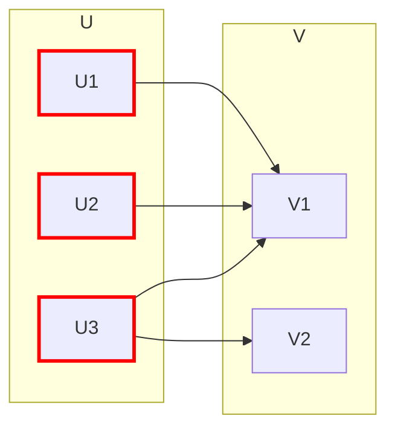

# Gráficas y Juegos - Apareamientos

## 5.3 Apareamientos en gráficas bipartitas (el Teorema de Hall).

---

### 1. Introducción a Gráficas Bipartitas

Una **gráfica bipartita** es una gráfica cuyo conjunto de vértices puede dividirse en dos conjuntos disjuntos $U$ y $V$ tales que toda arista en $E$ conecta un vértice en $U$ con un vértice en $V$.

- **Notación**: $G = (U, V, E)$ donde $U \cap V = \emptyset$ y $U \cup V$ es el conjunto de todos los vértices
- **Gráfica bipartita completa**: $K_{m,n}$ donde cada vértice de $U$ está conectado con todos los vértices de $V$

### 2. El Teorema de Hall (Teorema del Casamiento)

#### 2.1. Enunciado Formal

Para una gráfica bipartita $G = (U, V, E)$, existe un apareamiento que satura todos los vértices de $U$ si y solo si:

$$ \forall A \subseteq U, |N(A)| \geq |A| $$

Donde $N(A)$ es el **vecindario** de $A$, es decir, el conjunto de todos los vértices en $V$ adyacentes a al menos un vértice en $A$.

#### 2.2. Interpretación del Teorema

La **condición de Hall** establece que para todo subconjunto $A$ de $U$, debe haber al menos $|A|$ vértices en $V$ conectados a $A$.

#### 2.3. Contraejemplo (Cuando falla la condición)



Para $A = \{U1, U2, U3\}$, tenemos $|A| = 3$ pero $|N(A)| = 2$. La condición de Hall falla, por lo que no existe un apareamiento que sature $U$.

### 3. Implementación del Algoritmo para Verificar la Condición de Hall

```python
def verificar_condicion_hall(grafica, U, V):
    """
    Verifica la condición de Hall para una gráfica bipartita
    grafica: diccionario de adyacencia {vértice: [vecinos]}
    U: conjunto de vértices en la partición U
    V: conjunto de vértices en la partición V
    """
    from itertools import combinations

    # Generar todos los subconjuntos no vacíos de U
    for tamaño in range(1, len(U) + 1):
        for subconjunto in combinations(U, tamaño):
            vecindario = set()
            for vertice in subconjunto:
                vecindario.update(grafica[vertice])

            if len(vecindario) < len(subconjunto):
                print(f"Condición de Hall falla para el subconjunto: {set(subconjunto)}")
                print(f"|N(A)| = {len(vecindario)}, |A| = {len(subconjunto)}")
                return False

    return True

# Ejemplo de uso
grafica_ejemplo = {
    'U1': ['V1', 'V2'],
    'U2': ['V2', 'V3'],
    'U3': ['V1', 'V3']
}
U = ['U1', 'U2', 'U3']
V = ['V1', 'V2', 'V3']

print(verificar_condicion_hall(grafica_ejemplo, U, V))  # Devuelve True
```

### 4. Aplicación del Teorema de Hall

#### 4.1. Sistema de Asignación de Tareas

Problema: Asignar 3 trabajadores (U1, U2, U3) a 3 tareas (V1, V2, V3) donde:

- U1 puede hacer V1 o V2
- U2 puede hacer V2 o V3
- U3 puede hacer V1 o V3

¿Existe una asignación donde cada trabajador tenga una tarea?

Solución: Verificamos la condición de Hall:

- Para cualquier subconjunto de trabajadores, hay suficientes tareas disponibles. Los subconjuntos de un solo trabajador cumplen la condición porque cada uno puede hacer 2 tareas; faltan los de dos y tres trabajadores:

#### 4.2. Verificación Matemática

$$ \text{Para } A = \set{U1, U2}: N(A) = \set{V1, V2, V3}, |N(A)| = 3 \geq 2 $$
$$ \text{Para } A = \set{U1, U3}: N(A) = \set{V1, V2, V3}, |N(A)| = 3 \geq 2 $$
$$ \text{Para } A = \set{U2, U3}: N(A) = \set{V1, V2, V3}, |N(A)| = 3 \geq 2 $$
$$ \text{Para } A = \set{U1, U2, U3}: N(A) = \set{V1, V2, V3}, |N(A)| = 3 \geq 3 $$

La condición de Hall se cumple, por lo tanto existe un apareamiento perfecto; por ejemplo, U1-V1, U2-V2 y U3-V3.

### 5. Ejercicios de Práctica

1. Verifica si existe un apareamiento que sature U en esta gráfica:
   - U = {1, 2, 3}, V = {a, b, c}
   - Aristas: 1-a, 1-b, 2-b, 3-c

2. Demuestra por qué la siguiente gráfica NO cumple la condición de Hall:
   - U = {1, 2, 3, 4}, V = {a, b, c}
   - Aristas: 1-a, 1-b, 2-b, 3-c, 4-c

3. Encuentra el subconjunto A ⊆ U que viola la condición de Hall en el ejercicio anterior.

### 6. Extensiones del Teorema

#### 6.1. Teorema de Hall Generalizado

Para una gráfica bipartita $G = (U, V, E)$, el tamaño del apareamiento máximo es:

$$ |U| - \max_{A \subseteq U} (|A| - |N(A)|) $$

El máximo incluye $A = \emptyset$, que aporta $0$. Por eso, si la condición de Hall se cumple, el apareamiento máximo satura todo $U$. Este resultado se conoce como la fórmula de la deficiencia de König y Ore.

#### 6.2. Teorema de König-Egerváry

En una gráfica bipartita, el tamaño del apareamiento máximo es igual al tamaño de la cubierta de vértices mínima.

### 7. Referencias

1. Hall, P. (1935). On representatives of subsets.
2. Bondy, J. A., & Murty, U. S. R. (2008). Graph Theory.
3. West, D. B. (2001). Introduction to Graph Theory.
