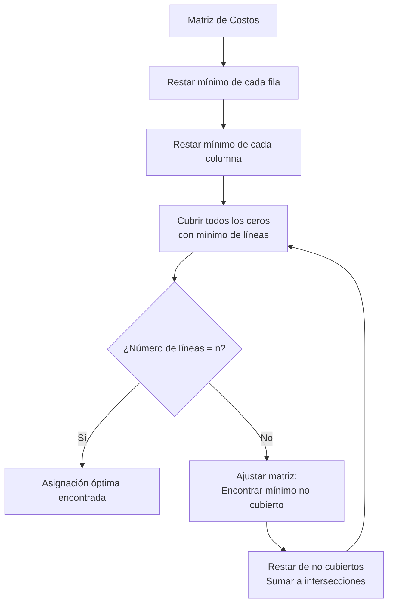

# Gráficas y Juegos - Apareamientos

## 5.4 Algoritmo Húngaro.

---

### 1. Introducción al Problema de Asignación

El **Algoritmo Húngaro** (o método húngaro) resuelve el problema de asignación en tiempo polinomial. Dada una matriz de costos $C = [c_{ij}]$ de tamaño $n \times n$, donde $c_{ij}$ representa el costo de asignar el trabajador $i$ a la tarea $j$, el objetivo es encontrar una asignación perfecta ( un apareamiento perfecto en la gráfica bipartita completa $K_{n,n}$ ) que minimice el costo total.

### 2. Fundamentos Matemáticos

#### 2.1. Teorema de König

Para cualquier matriz de costos, el valor óptimo de la asignación no cambia si:

1. Se resta una constante de toda una fila
2. Se resta una constante de toda una columna

#### 2.2. Idea General del Algoritmo

El algoritmo transforma la matriz de costos mediante operaciones en filas y columnas hasta encontrar un conjunto de $n$ ceros, uno en cada fila y columna, que corresponden a la asignación óptima.

### 3. Implementación del Algoritmo Húngaro

```python
import numpy as np

def algoritmo_hungaro(cost_matrix):
    """
    Implementación del algoritmo húngaro para el problema de asignación
    cost_matrix: matriz de costos n x n
    Devuelve: (costo_total, asignaciones)
    """
    n = cost_matrix.shape[0]

    # Paso 1: Restar el mínimo de cada fila
    reduced_matrix = cost_matrix - np.min(cost_matrix, axis=1, keepdims=True)

    # Paso 2: Restar el mínimo de cada columna
    reduced_matrix = reduced_matrix - np.min(reduced_matrix, axis=0, keepdims=True)

    # Paso 3: Cubrir todos los ceros con el mínimo número de líneas
    covered_rows, covered_cols = cover_zeros(reduced_matrix)

    # Pasos 4-6: Ajustar la matriz y repetir hasta encontrar asignación completa
    while not es_asignacion_completa(reduced_matrix, covered_rows, covered_cols):
        # Encontrar el mínimo valor no cubierto
        min_val = encontrar_minimo_no_cubierto(reduced_matrix, covered_rows, covered_cols)

        # Restar de elementos no cubiertos, sumar a elementos cubiertos dos veces
        ajustar_matriz(reduced_matrix, min_val, covered_rows, covered_cols)

        # Volver a cubrir ceros
        covered_rows, covered_cols = cover_zeros(reduced_matrix)

    # Encontrar la asignación óptima
    asignacion = encontrar_asignacion_optima(reduced_matrix)
    costo_total = calcular_costo_total(cost_matrix, asignacion)

    return costo_total, asignacion

def cover_zeros(matrix):
    """
    Cubre todos los ceros con el mínimo número de líneas usando el método de König
    """
    n = matrix.shape[0]
    covered_rows = np.zeros(n, dtype=bool)
    covered_cols = np.zeros(n, dtype=bool)

    # Crear matriz de marcado para ceros
    zero_matrix = (matrix == 0)

    # Marcar filas sin ceros asignados
    row_has_assignment = np.zeros(n, dtype=bool)
    col_has_assignment = np.zeros(n, dtype=bool)

    # Asignación temporal
    assignments = {}

    # Encontrar asignación inicial
    for i in range(n):
        for j in range(n):
            if zero_matrix[i, j] and not row_has_assignment[i] and not col_has_assignment[j]:
                assignments[i] = j
                row_has_assignment[i] = True
                col_has_assignment[j] = True
                break

    # Marcar filas sin asignación
    unassigned_rows = [i for i in range(n) if not row_has_assignment[i]]

    # Algoritmo de marcado
    marked_rows = set(unassigned_rows)
    marked_cols = set()

    while True:
        new_marked_cols = set()
        for row in marked_rows:
            for col in range(n):
                if zero_matrix[row, col] and col not in marked_cols:
                    new_marked_cols.add(col)

        if not new_marked_cols:
            break

        marked_cols.update(new_marked_cols)

        new_marked_rows = set()
        for col in new_marked_cols:
            for row in range(n):
                if row in assignments and assignments[row] == col and row not in marked_rows:
                    new_marked_rows.add(row)

        if not new_marked_rows:
            break

        marked_rows.update(new_marked_rows)

    # Las filas no marcadas y columnas marcadas forman la cobertura mínima
    for i in range(n):
        if i not in marked_rows:
            covered_rows[i] = True
        if i in marked_cols:
            covered_cols[i] = True

    return covered_rows, covered_cols

def es_asignacion_completa(matrix, covered_rows, covered_cols):
    """
    Verifica si la cobertura actual es completa (número de líneas = n)
    """
    return np.sum(covered_rows) + np.sum(covered_cols) >= matrix.shape[0]

def encontrar_minimo_no_cubierto(matrix, covered_rows, covered_cols):
    """
    Encuentra el valor mínimo no cubierto por las líneas
    """
    n = matrix.shape[0]
    min_val = float('inf')

    for i in range(n):
        for j in range(n):
            if not covered_rows[i] and not covered_cols[j]:
                if matrix[i, j] < min_val:
                    min_val = matrix[i, j]

    return min_val

def ajustar_matriz(matrix, min_val, covered_rows, covered_cols):
    """
    Ajusta la matriz restando el mínimo valor no cubierto y sumando a las intersecciones
    """
    n = matrix.shape[0]

    for i in range(n):
        for j in range(n):
            if not covered_rows[i] and not covered_cols[j]:
                # Restar de elementos no cubiertos
                matrix[i, j] -= min_val
            elif covered_rows[i] and covered_cols[j]:
                # Sumar a elementos cubiertos dos veces (intersecciones)
                matrix[i, j] += min_val

def encontrar_asignacion_optima(matrix):
    """
    Encuentra la asignación óptima usando los ceros en la matriz reducida
    """
    n = matrix.shape[0]
    zero_matrix = (matrix == 0)
    assignment = []

    # Algoritmo greedy para encontrar asignación completa
    assigned_cols = set()

    for i in range(n):
        for j in range(n):
            if zero_matrix[i, j] and j not in assigned_cols:
                assignment.append((i, j))
                assigned_cols.add(j)
                break

    return assignment

def calcular_costo_total(cost_matrix, assignment):
    """
    Calcula el costo total de la asignación óptima
    """
    total_cost = 0
    for row, col in assignment:
        total_cost += cost_matrix[row, col]
    return total_cost

# Ejemplo de uso
matriz_costos = np.array([
    [9, 2, 7, 8],
    [6, 4, 3, 7],
    [5, 8, 1, 8],
    [7, 6, 9, 4]
])

costo, asignacion = algoritmo_hungaro(matriz_costos.copy())
print(f"Costo total: {costo}")
print(f"Asignación: {asignacion}")

# Verificación
print("\nVerificación:")
for row, col in asignacion:
    print(f"Fila {row} -> Columna {col} (Costo: {matriz_costos[row, col]})")


# Ejemplo de uso
matriz_costos = np.array([
    [9, 2, 7, 8],
    [6, 4, 3, 7],
    [5, 8, 1, 8],
    [7, 6, 9, 4]
])

costo, asignacion = algoritmo_hungaro(matriz_costos)
print(f"Costo total: {costo}")
print(f"Asignación: {asignacion}")
```

### 4. Ejemplo Paso a Paso

#### 4.1. Matriz de Costos Inicial

$$ \begin{bmatrix} 9 & 2 & 7 & 8 \\\ 6 & 4 & 3 & 7 \\\ 5 & 8 & 1 & 8 \\\ 7 & 6 & 9 & 4 \\\ \end{bmatrix} $$

#### 4.2. Después de Restar Mínimos de Filas

$$ \begin{bmatrix} 7 & 0 & 5 & 6 \\\ 3 & 1 & 0 & 4 \\\ 4 & 7 & 0 & 7 \\\ 3 & 2 & 5 & 0 \\\ \end{bmatrix} $$

#### 4.3. Después de Restar Mínimos de Columnas

$$ \begin{bmatrix} 4 & 0 & 5 & 6 \\\ 0 & 1 & 0 & 4 \\\ 1 & 7 & 0 & 7 \\\ 0 & 2 & 5 & 0 \\\ \end{bmatrix} $$

### 5. Visualización del Proceso



### 6. Complejidad Computacional

- **Versión básica**: $O(n^4)$
- **Versión optimizada** (con árboles de augmentación): $O(n^3)$

### 7. Aplicaciones del Algoritmo Húngaro

1. **Asignación de tareas**: Trabajadores a proyectos
2. **Problemas de transporte**: Minimizar costos de envío
3. **Procesamiento de imágenes**: Matching de características
4. **Economía**: Asignación óptima de recursos

### 8. Ejercicios de Práctica

1. Resuelve manualmente el problema de asignación para la matriz:

$$ \begin{bmatrix} 10 & 19 & 8 & 15 \\\ 10 & 18 & 7 & 17 \\\ 13 & 16 & 9 & 14 \\\ 12 & 19 & 8 & 18 \\\ \end{bmatrix} $$

2. Implementa la función `cover_zeros` del algoritmo húngaro.

3. Explica por qué el algoritmo garantiza encontrar la solución óptima.

### 9. Variantes del Algoritmo

#### 9.1. Para Matrices No Cuadradas

Añadir filas o columnas ficticias con costos cero o muy altos.

#### 9.2. Problemas de Maximización

Transformar a minimización: $max\_matrix = M - cost\_matrix$ donde $M$ es el valor máximo.

### 10. Referencias

1. Kuhn, H. W. (1955). The Hungarian method for the assignment problem.
2. Munkres, J. (1957). Algorithms for the assignment and transportation problems.
3. Burkard, R. E., Dell'Amico, M., & Martello, S. (2009). Assignment Problems.
