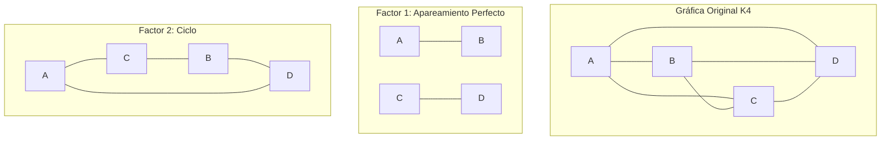

# Gráficas y Juegos - Apareamientos

## 5.5 Factorización.

---

### 1. Introducción a la Factorización de Gráficas

Una **factorización** de una gráfica $G$ es una descomposición de $G$ en subgráficas (factores) que son disjuntos en aristas y cuya unión es exactamente $G$. Formalmente, si $G = (V, E)$ es una gráfica, una factorización es un conjunto de subgráficas $F_1, F_2, ..., F_k$ tales que:

- $E(F_i) \cap E(F_j) = \emptyset$ para $i \neq j$
- $\bigcup_{i=1}^k E(F_i) = E(G)$

### 2. Tipos de Factorizaciones

#### 2.1. Factorización 1-Factorial

Descomposición de $G$ en apareamientos perfectos (1-factores).

#### 2.2. Factorización 2-Factorial

Descomposición de $G$ en ciclos (2-factores).

#### 2.3. Factorización k-Factorial

Descomposición de $G$ en subgráficas k-regulares.

### 3. Teorema de Petersen (1891)

Toda gráfica cúbica (3-regular) sin puentes admite una descomposición en un 1-factor y un 2-factor.

$$ \text{Si } G \text{ es cúbica y bridgeless, entonces } G = F_1 \cup F_2 \text{ donde} $$

$$ F_1 \text{ es un 1-factor y } F_2 \text{ es un 2-factor} $$

### 4. Implementación para Verificar Factorización

```python
def verificar_factorizacion(grafica, factores):
    """
    Verifica si una descomposición es una factorización válida
    grafica: dict de adyacencia de la gráfica original
    factores: lista de dicts de adyacencia de los factores
    """
    # Verificar que todas las aristas están en exactamente un factor
    aristas_original = obtener_aristas(grafica)
    aristas_factores = set()

    for factor in factores:
        aristas_factor = obtener_aristas(factor)
        # Verificar que no hay aristas repetidas entre factores
        if len(aristas_factores.intersection(aristas_factor)) > 0:
            return False
        aristas_factores = aristas_factores.union(aristas_factor)

    # Verificar que todas las aristas están cubiertas
    return aristas_original == aristas_factores

def obtener_aristas(grafica):
    """Convierte una gráfica en representación de dict a conjunto de aristas"""
    aristas = set()
    for u, vecinos in grafica.items():
        for v in vecinos:
            # Ordenar vértices para evitar duplicados (u,v) y (v,u)
            aristas.add((min(u, v), max(u, v)))
    return aristas

# Ejemplo de uso
grafica_completa = {
    'A': ['B', 'C', 'D'],
    'B': ['A', 'C', 'D'],
    'C': ['A', 'B', 'D'],
    'D': ['A', 'B', 'C']
}

factor_1 = {'A': ['B'], 'B': ['A'], 'C': ['D'], 'D': ['C']}
factor_2 = {'A': ['C'], 'B': ['D'], 'C': ['A'], 'D': ['B']}
factor_3 = {'A': ['D'], 'B': ['C'], 'C': ['B'], 'D': ['A']}

factores = [factor_1, factor_2, factor_3]
print(verificar_factorizacion(grafica_completa, factores))  # Devuelve True
```

### 5. Visualización de una Factorización



### 6. Teorema de la Factorización de Gráficas Completas

#### 6.1. Gráficas Completas con n par

$K_n$ puede ser descompuesta en $\frac{n-1}{2}$ 1-factores (apareamientos perfectos).

#### 6.2. Gráficas Completas con n impar

$K_n$ puede ser descompuesta en $\frac{n}{2}$ 2-factores (ciclos hamiltonianos).

### 7. Aplicaciones de la Factorización

1. **Diseño de torneos**: Organizar rondas donde cada equipo juegue exactamente una vez
2. **Programación de horarios**: Asignación de recursos sin conflictos
3. **Diseño de redes**: Descomposición de redes en subredes más simples
4. **Procesamiento paralelo**: Distribución de tareas en subprocesos

### 8. Algoritmo para Factorizar Gráficas Completas

```python
def factorizar_grafica_completa(n):
    """
    Genera una factorización 1-factorial para K_n (n par)
    Devuelve: lista de apareamientos perfectos
    """
    if n % 2 != 0:
        raise ValueError("n debe ser par para factorización 1-factorial")

    factores = []
    vertices = list(range(n))

    # Algoritmo de factorización por rotación
    for i in range(n - 1):
        apareamiento = []
        for j in range(n // 2):
            u = vertices[j]
            v = vertices[n - 1 - j]
            apareamiento.append((u, v))
        factores.append(apareamiento)
        # Rotar los vértices (excepto el primero)
        vertices = [vertices[0]] + vertices[2:] + [vertices[1]]

    return factores

# Ejemplo para K4
print(factorizar_grafica_completa(4))
# Salida: [[(0, 3), (1, 2)], [(0, 1), (2, 3)], [(0, 2), (3, 1)]]
```

### 9. Ejercicios de Práctica

1. Factoriza $K_6$ en 5 apareamientos perfectos usando el algoritmo de rotación.

2. Demuestra que la gráfica completa $K_n$ tiene $\frac{(n-1)!}{2}$ factorizaciones 1-factoriales diferentes cuando $n$ es par.

3. Verifica si la siguiente gráfica es factorizable en tres apareamientos perfectos:
   - Vértices: {A, B, C, D, E, F}
   - Aristas: Todos los pares excepto {A,B}, {C,D}, {E,F}

### 10. Referencias

1. Petersen, J. (1891). Die Theorie der regulären graphs.
2. Wallis, W. D. (1997). One-Factorizations.
3. Harary, F. (1969). Graph Theory.
4. Bondy, J. A., & Murty, U. S. R. (2008). Graph Theory.
