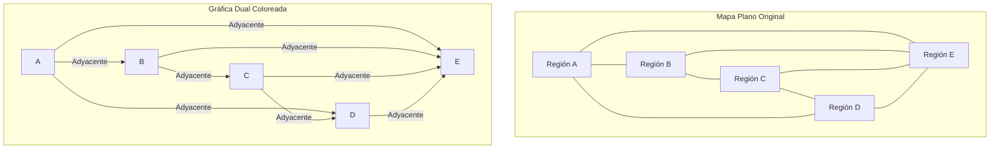
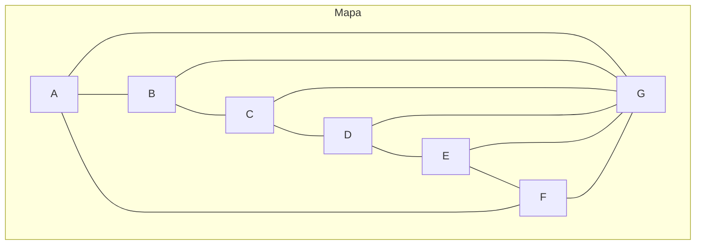

# Gráficas y Juegos - Coloración de vértices

## 6.1 El problema de los cuatro colores.

---

### 1. Introducción al Problema de los Cuatro Colores

El **Teorema de los Cuatro Colores** establece que:

$$ \text{Cualquier mapa plano puede colorearse con solo 4 colores, de tal forma que ninguna dos regiones adyacentes compartan el mismo color.} $$

Formulado inicialmente en 1852 por Francis Guthrie, fue demostrado en 1976 por Kenneth Appel y Wolfgang Haken, convirtiéndose en el primer teorema importante demostrado mediante el uso extensivo de computadoras.

### 2. Conceptos Fundamentales

#### 2.1. Gráficas Planas

Una gráfica es **plana** si puede dibujarse en el plano sin que ninguna de sus aristas se cruce.

#### 2.2. Coloración Propia

Una coloración propia de vértices es una asignación de colores a los vértices de una gráfica tal que ningún par de vértices adyacentes comparten el mismo color.

#### 2.3. Número Cromático

El **número cromático** $\chi(G)$ de una gráfica $G$ es el mínimo número de colores necesarios para una coloración propia.

### 3. Formulación en Términos de Gráficas

El problema se reformula en teoría de gráficas como:

$$ \text{Si } G \text{ es una gráfica plana, entonces } \chi(G) \leq 4. $$

### 4. Visualización del Teorema



### 5. Implementación de un Algoritmo de 4-Coloreado

```python
def cuatro_colorear(grafica):
    """
    Algoritmo simplificado para 4-colorear una gráfica plana
    Basado en el algoritmo de Appel-Haken (versión simplificada)
    """
    # Preprocesamiento: encontrar conjunto不可避免的configuraciones
    colores = {}  # Diccionario para almacenar el color de cada vértice

    # Ordenar vértices por grado (heurística)
    vertices_ordenados = sorted(grafica.keys(),
                               key=lambda v: len(grafica[v]),
                               reverse=True)

    # Paleta de 4 colores
    palette = [1, 2, 3, 4]

    for vertice in vertices_ordenados:
        # Encontrar colores usados por vértices adyacentes
        colores_adyacentes = set()
        for vecino in grafica[vertice]:
            if vecino in colores:
                colores_adyacentes.add(colores[vecino])

        # Asignar el primer color disponible
        for color in palette:
            if color not in colores_adyacentes:
                colores[vertice] = color
                break

    return colores

# Ejemplo de uso
grafica_plana = {
    'A': ['B', 'D', 'E'],
    'B': ['A', 'C', 'E'],
    'C': ['B', 'D', 'E'],
    'D': ['A', 'C', 'E'],
    'E': ['A', 'B', 'C', 'D']
}

coloracion = cuatro_colorear(grafica_plana)
print("Coloración resultante:", coloracion)
```

### 6. Configuraciones Inevitables

La demostración del teorema se basa en el concepto de **configuraciones inevitables**:

1. **Vértice de grado 2**
2. **Vértice de grado 3**
3. **Vértice de grado 4**
4. **Vértice de grado 5**

Appel y Haken demostraron que cualquier gráfica plana debe contener al menos una de estas configuraciones.

### 7. Reducibilidad

Una configuración es **reducible** si no puede aparecer en un contraejemplo mínimo al teorema. Appel y Haken demostraron que las 1,936 configuraciones en su lista inevitable son todas reducibles.

### 8. Ejemplo de Mapa que Requiere 4 Colores



Este mapa requiere exactamente 4 colores, ya que la región central (G) es adyacente a todas las regiones del ciclo exterior.

### 9. Aplicaciones del Teorema

1. **Diseño de circuitos impresos**: Minimización de capas en PCB
2. **Asignación de frecuencias**: En telecomunicaciones
3. **Calendarios deportivos**: Programación de enfrentamientos
4. **Scheduling de recursos**: Asignación de tareas sin conflictos

### 10. Ejercicios de Práctica

1. Intenta colorear el siguiente mapa con solo 3 colores:
   - Regiones: A, B, C, D, E
   - Adyacencias: A-B, A-C, A-D, B-C, B-E, C-D, D-E

2. Demuestra que la gráfica completa $K_4$ es plana y requiere 4 colores.

3. Explica por qué el teorema no se extiende a superficies de género mayor (ej. toro).

### 11. Referencias

1. Appel, K., & Haken, W. (1977). The solution of the four-color map problem.
2. Robertson, N., Sanders, D. P., Seymour, P., & Thomas, R. (1997). The four-color theorem.
3. Wilson, R. (2002). Four Colors Suffice: How the Map Problem Was Solved.
4. Bondy, J. A., & Murty, U. S. R. (2008). Graph Theory.
