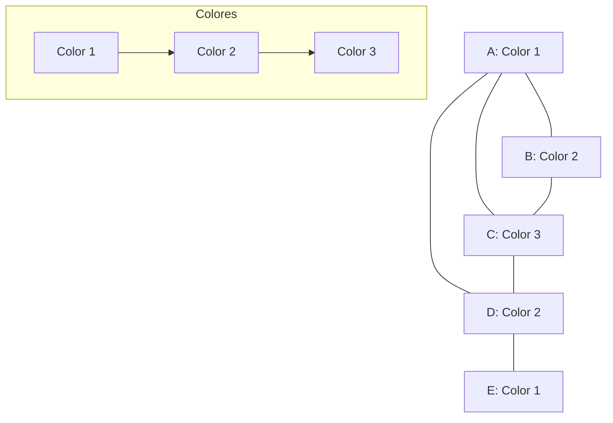

# Gráficas y Juegos - Coloración de vértices

## 6.2 Coloración.

---

### 1. Introducción a la Coloración de Gráficas

La **coloración de vértices** es una asignación de colores a los vértices de una gráfica de tal forma que ningún par de vértices adyacentes compartan el mismo color. Formalmente, para una gráfica $G = (V, E)$, una coloración es una función:

$$ c: V \rightarrow \{1, 2, ..., k\} $$

tal que si $(u, v) \in E$, entonces $c(u) \neq c(v)$.

### 2. Conceptos Fundamentales

#### 2.1. Número Cromático

El **número cromático** $\chi(G)$ es el mínimo número de colores necesarios para colorear $G$ propermente.

#### 2.2. Clique

Un **clique** es un subconjunto de vértices donde cada par es adyacente. El tamaño del clique más grande se denota como $\omega(G)$.

#### 2.3. Cota Inferior y Superior

$$ \omega(G) \leq \chi(G) \leq \Delta(G) + 1 $$

donde $\Delta(G)$ es el grado máximo de $G$.

### 3. Algoritmos de Coloración

#### 3.1. Algoritmo Voraz (Greedy)

```python
def coloracion_voraz(grafica):
    """
    Implementación del algoritmo voraz de coloración de gráficas
    grafica: diccionario de adyacencia {vértice: [vecinos]}
    Devuelve: asignación de colores {vértice: color}
    """
    colores = {}  # Diccionario para almacenar colores
    # Ordenar vértices por grado descendente (heurística)
    vertices_ordenados = sorted(grafica.keys(),
                               key=lambda v: len(grafica[v]),
                               reverse=True)

    for vertice in vertices_ordenados:
        # Encontrar colores usados por vecinos
        colores_prohibidos = set()
        for vecino in grafica[vertice]:
            if vecino in colores:
                colores_prohibidos.add(colores[vecino])

        # Asignar el color disponible más pequeño
        color = 1
        while color in colores_prohibidos:
            color += 1
        colores[vertice] = color

    return colores

## Ejemplo de uso
grafica_ejemplo = {
    'A': ['B', 'C', 'D'],
    'B': ['A', 'C'],
    'C': ['A', 'B', 'D'],
    'D': ['A', 'C', 'E'],
    'E': ['D']
}

coloracion = coloracion_voraz(grafica_ejemplo)
print("Coloración voraz:", coloracion)
print("Número cromático estimado:", max(coloracion.values()))
```

#### 3.2. Algoritmo de Welsh-Powell

Variante del algoritmo voraz que ofrece mejores resultados en la práctica.

### 4. Tipos Especiales de Gráficas y sus Números Cromáticos

#### 4.1. Gráficas Completas

$$ \chi(K_n) = n $$

#### 4.2. Gráficas Bipartitas

$$ \chi(G) = 2 \text{ para cualquier gráfica bipartita no vacía} $$

#### 4.3. Gráficas Planares

$$ \chi(G) \leq 4 \text{ (por el teorema de los 4 colores)} $$

#### 4.4. Ciclos

$$ \chi(C_n) = \begin{cases} 2 & \text{si } n \text{ es par} \\\ 3 & \text{si } n \text{ es impar} \end{cases} $$

### 5. Visualización de Coloración



### 6. Teoremas Importantes

#### 6.1. Teorema de Brooks

$$ \text{Si } G \text{ es una gráfica conexa que no es completa ni un ciclo impar, entonces } \chi(G) \leq \Delta(G) $$

#### 6.2. Teorema de Grötzsch

$$ \text{Toda gráfica planar sin triángulos es 3-coloreable} $$

### 7. Aplicaciones de la Coloración

1. **Scheduling**: Asignación de horarios sin conflictos
2. **Registro de compiladores**: Asignación de registros a variables
3. **Redes inalámbricas**: Asignación de frecuencias sin interferencia
4. **Sudoku**: Problema de coloración de gráficas 9×9

### 8. Ejemplo de Scheduling con Coloración

Problema: Asignar horarios a 5 exámenes (A, B, C, D, E) donde:

- A no puede coincidir con B, C
- B no puede coincidir con A, C, D
- C no puede coincidir con A, B
- D no puede coincidir con B, E
- E no puede coincidir con D

Solución: Modelar como gráfica y colorear.

```python
# Gráfica de conflictos de exámenes
grafica_examenes = {
    'A': ['B', 'C'],
    'B': ['A', 'C', 'D'],
    'C': ['A', 'B'],
    'D': ['B', 'E'],
    'E': ['D']
}

coloracion = coloracion_voraz(grafica_examenes)
print("Horarios de exámenes:", coloracion)
# Color 1: A, D
# Color 2: B, E
# Color 3: C
```

### 9. Ejercicios de Práctica

1. Calcula el número cromático de las siguientes gráficas:
   a) $K_5$
   b) Gráfica bipartita completa $K_{3,4}$
   c) Ciclo $C_7$

2. Implementa el algoritmo de Welsh-Powell y compáralo con el voraz.

3. Demuestra que $\chi(G) \geq \omega(G)$ para cualquier gráfica $G$.

### 10. Algoritmo Avanzado: Coloración por Búsqueda con Retroceso

```python
def coloracion_backtracking(grafica, k, colores=None, vertice=0):
    """
    Algoritmo de coloración con backtracking
    k: número máximo de colores a probar
    """
    if colores is None:
        colores = {}

    vertices = list(grafica.keys())
    if vertice == len(vertices):
        return True, colores

    v = vertices[vertice]
    for color in range(1, k + 1):
        # Verificar si el color es válido para el vértice
        es_valido = True
        for vecino in grafica[v]:
            if vecino in colores and colores[vecino] == color:
                es_valido = False
                break

        if es_valido:
            colores[v] = color
            exito, resultado = coloracion_backtracking(grafica, k, colores, vertice + 1)
            if exito:
                return True, resultado
            del colores[v]  # Backtrack

    return False, None

# Ejemplo de uso
exito, coloracion = coloracion_backtracking(grafica_ejemplo, 3)
print("Coloración con backtracking:", coloracion if exito else "No se puede colorear con 3 colores")
```

### 11. Referencias

1. Bondy, J. A., & Murty, U. S. R. (2008). Graph Theory.
2. West, D. B. (2001). Introduction to Graph Theory.
3. Welsh, D. J. A., & Powell, M. B. (1967). An upper bound for the chromatic number of a graph and its application to timetabling problems.
4. Brooks, R. L. (1941). On colouring the nodes of a network.
