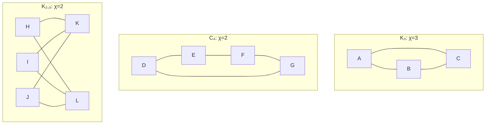

# Gráficas y Juegos - Coloración de vértices

## 6.3 Número cromático.

---

### 1. Definición del Número Cromático

El **número cromático** de una gráfica $G$, denotado como $\chi(G)$, es el mínimo número de colores necesarios para colorear los vértices de $G$ de tal forma que ningún par de vértices adyacentes compartan el mismo color.

Formalmente:

$$ \chi(G) = \min\{k \in \mathbb{Z}^+ \mid \exists c: V(G) \rightarrow \{1, 2, ..., k\} \text{ tal que } \forall uv \in E(G), c(u) \neq c(v)\} $$

### 2. Cotas del Número Cromático

#### 2.1. Cota Inferior

$$ \omega(G) \leq \chi(G)$$

donde $\omega(G)$ es el tamaño del clique más grande en $G$.

#### 2.2. Cota Superior (Teorema de Brooks)

Si $G$ no es una gráfica completa ni un ciclo impar, entonces:

$$ \chi(G) \leq \Delta(G) $$

donde $\Delta(G)$ es el grado máximo de $G$.

#### 2.3. Cota Superior General

$$ \chi(G) \leq \Delta(G) + 1 $$

### 3. Algoritmo para Calcular el Número Cromático

```python
def numero_cromatico(grafica):
    """
    Calcula una aproximación del número cromático usando el algoritmo voraz
    con diferentes órdenes de vértices y devuelve el mejor resultado
    """
    def coloracion_por_orden(vertices_orden):
        colores = {}
        for vertice in vertices_orden:
            colores_vecinos = set()
            for vecino in grafica[vertice]:
                if vecino in colores:
                    colores_vecinos.add(colores[vecino])

            color = 1
            while color in colores_vecinos:
                color += 1
            colores[vertice] = color
        return max(colores.values()) if colores else 0

    vertices = list(grafica.keys())

    # Diferentes órdenes para obtener mejor aproximación
    orden_grado_desc = sorted(vertices, key=lambda v: len(grafica[v]), reverse=True)
    orden_grado_asc = sorted(vertices, key=lambda v: len(grafica[v]))
    orden_aleatorio = vertices.copy()
    random.shuffle(orden_aleatorio)

    # Probar diferentes órdenes y quedarse con el mejor
    resultados = [
        coloracion_por_orden(orden_grado_desc),
        coloracion_por_orden(orden_grado_asc),
        coloracion_por_orden(orden_aleatorio)
    ]

    return min(resultados)

# Ejemplo de uso
import random

grafica_ejemplo = {
    'A': ['B', 'C', 'D'],
    'B': ['A', 'C'],
    'C': ['A', 'B', 'D'],
    'D': ['A', 'C', 'E'],
    'E': ['D', 'F'],
    'F': ['E']
}

chi_aprox = numero_cromatico(grafica_ejemplo)
print(f"Número cromático aproximado: {chi_aprox}")
```

### 4. Propiedades del Número Cromático

#### 4.1. Gráficas Completas

$$ \chi(K_n) = n $$

#### 4.2. Gráficas Bipartitas

$$ \chi(G) = 2 \text{ para cualquier gráfica bipartita no vacía} $$

#### 4.3. Gráficas Planas

$$ \chi(G) \leq 4 \text{ (Teorema de los Cuatro Colores)} $$

#### 4.4. Ciclos

$$ \chi(C_n) = \begin{cases} 2 & \text{si } n \text{ es par} \\\ 3 & \text{si } n \text{ es impar y } n > 1 \\\ 1 & \text{si } n = 1 \end{cases} $$

### 5. Visualización de Números Cromáticos



### 6. Relación con Otros Parámetros de Gráficas

#### 6.1. Desigualdad Básica

$$ \omega(G) \leq \chi(G) \leq \Delta(G) + 1 $$

#### 6.2. Número de Clique vs Número Cromático

Aunque $\omega(G) \leq \chi(G)$, la diferencia puede ser arbitrariamente grande.

#### 6.3. Gráficas Perfectas

Una gráfica $G$ es perfecta si para todo subgrafo inducido $H$ de $G$:

$$ \chi(H) = \omega(H) $$

### 7. Algoritmo Exacto para Número Cromático (Fuerza Bruta)

```python
def es_coloracion_valida(grafica, coloracion):
    """Verifica si una coloración es válida"""
    for vertice, vecinos in grafica.items():
        for vecino in vecinos:
            if coloracion[vertice] == coloracion[vecino]:
                return False
    return True

def numero_cromatico_exacto(grafica, k=1, coloracion_actual=None):
    """
    Algoritmo de fuerza bruta para encontrar el número cromático exacto
    usando backtracking
    """
    if coloracion_actual is None:
        coloracion_actual = {}

    vertices = list(grafica.keys())
    if len(coloracion_actual) == len(vertices):
        return k, coloracion_actual

    vertice_actual = vertices[len(coloracion_actual)]

    for color in range(1, k + 1):
        nueva_coloracion = coloracion_actual.copy()
        nueva_coloracion[vertice_actual] = color

        if es_coloracion_valida(grafica, nueva_coloracion):
            resultado = numero_cromatico_exacto(grafica, k, nueva_coloracion)
            if resultado is not None:
                return resultado

    # Si necesitamos más colores
    if k < len(vertices):
        nueva_coloracion = coloracion_actual.copy()
        nueva_coloracion[vertice_actual] = k + 1
        if es_coloracion_valida(grafica, nueva_coloracion):
            return numero_cromatico_exacto(grafica, k + 1, nueva_coloracion)

    return None

# Ejemplo para gráfica pequeña
grafica_pequena = {
    'A': ['B', 'C'],
    'B': ['A', 'C'],
    'C': ['A', 'B']
}

chi_exacto, coloracion = numero_cromatico_exacto(grafica_pequena)
print(f"Número cromático exacto: {chi_exacto}")
print(f"Coloración: {coloracion}")
```

### 8. Aplicaciones del Número Cromático

1. **Scheduling**: Número mínimo de horarios necesarios sin conflictos
2. **Asignación de registros**: En compiladores de lenguajes de programación
3. **Frecuencias inalámbricas**: Mínimo canales necesarios sin interferencia
4. **Puzzle de sudoku**: $\chi(G) = 9$ para la gráfica de restricciones

### 9. Ejercicios de Práctica

1. Calcula el número cromático de las siguientes gráficas:
   a) $K_5$
   b) $C_6$ (ciclo de 6 vértices)
   c) $K_{2,3}$ (gráfica bipartita completa)

2. Demuestra que para cualquier gráfica $G$, $\chi(G) \geq \frac{|V(G)|}{\alpha(G)}$, donde $\alpha(G)$ es el número de independencia.

3. Construye una gráfica con $\omega(G) = 2$ pero $\chi(G) = 4$.

### 10. Teoremas Importantes

#### 10.1. Teorema de los Cuatro Colores

$$ \text{Toda gráfica plana tiene } \chi(G) \leq 4 $$

#### 10.2. Teorema de Grötzsch

$$ \text{Toda gráfica planar sin triángulos tiene } \chi(G) \leq 3 $$

#### 10.3. Teorema de Mycielski

$$ \text{Para todo } k \geq 2, \text{ existe una gráfica con } \chi(G) = k \text{ y } \omega(G) = 2 $$

### 11. Referencias

1. Bondy, J. A., & Murty, U. S. R. (2008). Graph Theory.
2. West, D. B. (2001). Introduction to Graph Theory.
3. Jensen, T. R., & Toft, B. (1995). Graph Coloring Problems.
4. Mycielski, J. (1955). Sur le coloriage des graphes.
