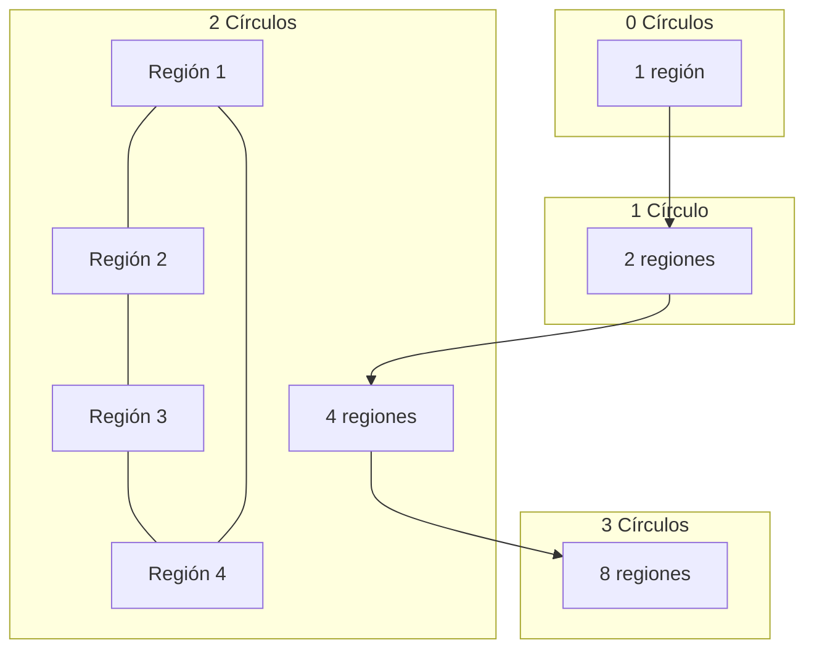

# Gráficas y Juegos - Planaridad

## 7.1 El problema de los vecinos.

---

### 1. Introducción al Problema de los Vecinos

El **Problema de los Vecinos** es un problema clásico en teoría de gráficas que pregunta:

"¿Cuál es el máximo número de regiones en que n círculos pueden dividir el plano?"

Este problema está relacionado con la planaridad y la fórmula de Euler, y tiene aplicaciones en geometría computacional y diseño de circuitos.

### 2. Fórmula para el Número Máximo de Regiones

Para n círculos, el número máximo de regiones L(n) está dado por:

$$ L(n) = n^2 - n + 2 $$

Esta fórmula puede demostrarse por inducción matemática.

### 3. Implementación Computacional

```python
def max_regiones_circulos(n):
    """
    Calcula el número máximo de regiones creadas por n círculos
    en el plano donde cada par de círculos se interseca en dos puntos
    y no tres círculos comparten un punto común
    """
    if n == 0:
        return 1
    return n * n - n + 2

# Calcular para varios valores de n
for n in range(11):
    print(f"Con {n} círculos: {max_regiones_circulos(n)} regiones")

# Verificación de la fórmula por recurrencia
print("\nVerificación por recurrencia:")
for n in range(1, 6):
    L_n = max_regiones_circulos(n)
    L_n_minus_1 = max_regiones_circulos(n-1)
    diferencia = L_n - L_n_minus_1
    print(f"L({n}) - L({n-1}) = {diferencia} = 2*({n}) - 2")
```

### 4. Visualización del Problema



### 5. Demostración de la Fórmula

#### 5.1. Caso Base

Para n = 0: L(0) = 0² - 0 + 2 = 2 (el plano completo es 1 región)

#### 5.2. Paso Inductivo

Al añadir el n-ésimo círculo:

- Interseca cada uno de los n-1 círculos existentes en 2 puntos
- Creando 2(n-1) nuevos puntos de intersección
- Estos dividen el nuevo círculo en 2(n-1) arcos
- Cada arco divide una región existente en 2
- Por tanto, añade 2(n-1) nuevas regiones

Así: L(n) = L(n-1) + 2(n-1)

### 6. Generalización para Elipses

Para n elipses en posición general (cada par se interseca en 4 puntos):

$$ L_{elipses}(n) = 2n^2 - n + 1 $$

```python
def max_regiones_elipses(n):
    """
    Calcula el número máximo de regiones creadas por n elipses
    donde cada par se interseca en 4 puntos y no tres comparten un punto común
    """
    if n == 0:
        return 1
    return 2 * n * n - n + 1

print("\nRegiones para elipses:")
for n in range(6):
    print(f"Con {n} elipses: {max_regiones_elipses(n)} regiones")
```

### 7. Relación con la Fórmula de Euler

Para una gráfica plana conexa:

$$ V - E + F = 2 $$

Donde:

- V = número de vértices (puntos de intersección)
- E = número de aristas (arcos de círculos)
- F = número de regiones (caras)

### 8. Aplicaciones del Problema

1. **Diseño de circuitos impresos**: División del plano por componentes circulares
2. **Geometría computacional**: Algoritmos de subdivisión espacial
3. **Procesamiento de imágenes**: Análisis de formas circulares
4. **Bioinformática**: Estudio de estructuras moleculares

### 9. Ejemplo con Código de Visualización

```python
import matplotlib.pyplot as plt
import numpy as np

def dibujar_circulos(n, radio=1):
    """
    Dibuja n círculos con centros equidistantes en un círculo mayor
    """
    fig, ax = plt.subplots(figsize=(8, 8))
    ax.set_aspect('equal')

    # Dibujar n círculos
    for i in range(n):
        angulo = 2 * np.pi * i / n
        x = radio * np.cos(angulo)
        y = radio * np.sin(angulo)
        circulo = plt.Circle((x, y), radio, fill=False, edgecolor='blue')
        ax.add_patch(circulo)

    plt.xlim(-2*radio, 2*radio)
    plt.ylim(-2*radio, 2*radio)
    plt.title(f'{n} círculos - {max_regiones_circulos(n)} regiones')
    plt.show()

# Dibujar para n = 0, 1, 2, 3, 4
for n in range(5):
    dibujar_circulos(n)
```

### 10. Ejercicios de Práctica

1. Calcula el número de regiones para 5 círculos en posición general.
2. Demuestra que la fórmula L(n) = n² - n + 2 es correcta por inducción matemática.
3. ¿Cuál es el número máximo de regiones con 4 elipses en posición general?
4. Generaliza la fórmula para k-ésimos cortes: ¿Cuántas regiones crean n parábolas?

### 11. Solución de los Ejercicios

```python
# Solución ejercicio 1
print(f"5 círculos: {max_regiones_circulos(5)} regiones")

# Solución ejercicio 3
print(f"4 elipses: {max_regiones_elipses(4)} regiones")

# Solución ejercicio 4 (aproximación)
def max_regiones_parabolas(n):
    """
    Aproximación para n parábolas en posición general
    Cada par se interseca en hasta 4 puntos
    """
    return 2 * n * n - n + 1  # Similar a elipses

print(f"4 parábolas: {max_regiones_parabolas(4)} regiones")
```

### 12. Referencias

1. Weisstein, E. W. "Circle Division by Lines." From MathWorld--A Wolfram Web Resource.
2. Cromwell, P. R. (1997). Polyhedra. Cambridge University Press.
3. Grünbaum, B. (1972). Arrangements and Spreads. American Mathematical Society.
4. O'Rourke, J. (1998). Computational Geometry in C. Cambridge University Press.
