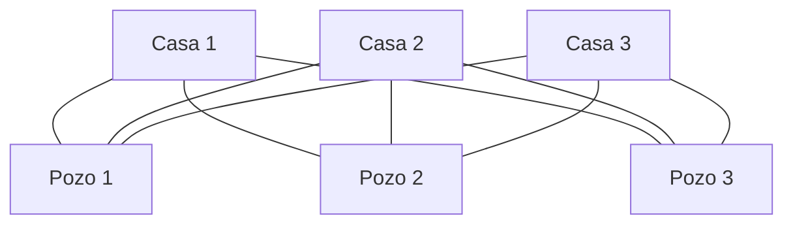

# Gráficas y Juegos - Planaridad

## 7.1 El problema de los vecinos.

---

### 1. El Problema de los Vecinos

El **problema de los vecinos**, también conocido como el de las **tres casas y los tres servicios**, es el ejemplo clásico con el que se introduce la planaridad:

"Tres vecinos enemistados comparten un terreno con tres pozos. Cada vecino quiere un sendero propio desde su casa hasta cada uno de los pozos, y no quiere que ningún sendero cruce el de otro vecino. ¿Es posible trazar los nueve senderos sin cruces?"

Modelado como gráfica, cada casa y cada pozo es un vértice y cada sendero es una arista. Como cada casa se une con cada pozo, la gráfica es la bipartita completa $K_{3,3}$, y la pregunta es si $K_{3,3}$ es **plana**: si se puede dibujar en el plano sin que sus aristas se crucen.



La respuesta es **no**: $K_{3,3}$ no es plana. Se pueden trazar ocho de los nueve senderos sin cruces, pero el noveno siempre cruza alguno.

### 2. La Fórmula de Euler

Para una gráfica plana conexa, dibujada sin cruces:

$$ V - E + F = 2 $$

Donde:

- $V$ = número de vértices
- $E$ = número de aristas
- $F$ = número de caras o regiones, contando la región exterior, que no está acotada

Por ejemplo, un cuadrado con una diagonal tiene $V = 4$, $E = 5$ y $F = 3$: dos triángulos y la región exterior, y $4 - 5 + 3 = 2$.

### 3. Demostración de que $K_{3,3}$ no es Plana

Supongamos que $K_{3,3}$ tiene un dibujo plano. Tiene $V = 6$ y $E = 9$, así que por la fórmula de Euler tendría

$$ F = 2 - V + E = 2 - 6 + 9 = 5 \text{ caras.} $$

Como $K_{3,3}$ es bipartita, no tiene ciclos de longitud impar, en particular no tiene triángulos: cada cara está rodeada por al menos 4 aristas. Si se suman las aristas de la frontera de todas las caras, cada arista se cuenta a lo más dos veces, una por cada lado, así que

$$ 4F \leq 2E, \qquad \text{es decir,} \qquad 4 \cdot 5 = 20 \leq 18, $$

una contradicción. Por lo tanto, $K_{3,3}$ no es plana. $\blacksquare$

El mismo argumento da una cota general: una gráfica plana simple, conexa, sin triángulos y con $V \geq 3$ cumple $E \leq 2V - 4$. Para $K_{3,3}$, $9 > 2 \cdot 6 - 4 = 8$. Con triángulos permitidos, cada cara tiene al menos 3 aristas y se obtiene $E \leq 3V - 6$, que descarta a $K_5$: $10 > 3 \cdot 5 - 6 = 9$.

$K_{3,3}$ y $K_5$ son las dos gráficas que caracterizan la planaridad: según el **teorema de Kuratowski** (subtema 7.3), una gráfica es plana si y solo si no contiene una subdivisión de ninguna de las dos.

```python
import networkx as nx

K33 = nx.complete_bipartite_graph(3, 3)
K5 = nx.complete_graph(5)
print("¿K3,3 es plana?", nx.check_planarity(K33)[0])   # False
print("¿K5 es plana?", nx.check_planarity(K5)[0])       # False

# Si se quita un solo sendero, el resto sí se puede dibujar sin cruces
K33_menos_una = K33.copy()
K33_menos_una.remove_edge(0, 3)
print("¿K3,3 menos una arista es plana?", nx.check_planarity(K33_menos_una)[0])   # True
```

### 4. Regiones del Plano Determinadas por Círculos

La fórmula de Euler también permite contar regiones en problemas geométricos. Un ejemplo clásico: ¿cuál es el máximo número de regiones en que $n$ círculos dividen el plano?

#### 4.1. Fórmula

Para $n \geq 1$ círculos en **posición general**, es decir, cada par se corta en dos puntos y no hay tres círculos con un punto común, el número de regiones es

$$ L(n) = n^2 - n + 2, $$

y $L(0) = 1$, pues sin círculos el plano completo es una sola región. La fórmula no se aplica a $n = 0$: daría 2.

#### 4.2. Demostración por Inducción

**Caso base:** con $n = 1$ círculo hay $L(1) = 2$ regiones, el interior y el exterior, y $1^2 - 1 + 2 = 2$.

**Paso inductivo:** al añadir el círculo número $n$, con $n \geq 2$:

- Corta a cada uno de los $n - 1$ círculos existentes en 2 puntos
- Se crean $2(n - 1)$ nuevos puntos de intersección
- Estos dividen el nuevo círculo en $2(n - 1)$ arcos
- Cada arco divide una región existente en 2
- Por tanto, se añaden $2(n - 1)$ nuevas regiones

Así, $L(n) = L(n - 1) + 2(n - 1)$, y si $L(n - 1) = (n - 1)^2 - (n - 1) + 2$, entonces

$$ L(n) = (n - 1)^2 - (n - 1) + 2 + 2(n - 1) = n^2 - n + 2. $$

#### 4.3. Comprobación con la Fórmula de Euler

Se ve el dibujo como una gráfica plana: los vértices son los $V = n(n - 1)$ puntos de intersección, dos por cada par de círculos, y las aristas son los arcos. Cada círculo queda cortado en $2(n - 1)$ arcos, así que $E = 2n(n - 1)$. Para $n \geq 2$ la gráfica es conexa y

$$ F = 2 - V + E = 2 - n(n - 1) + 2n(n - 1) = n^2 - n + 2. $$

```python
def max_regiones_circulos(n):
    """
    Número máximo de regiones creadas por n círculos en el plano,
    donde cada par de círculos se corta en dos puntos
    y no hay tres círculos con un punto común
    """
    if n == 0:
        return 1
    return n * n - n + 2

for n in range(11):
    print(f"Con {n} círculos: {max_regiones_circulos(n)} regiones")

# Verificación de la recurrencia L(n) - L(n-1) = 2(n-1) para n >= 2
print("\nVerificación por recurrencia:")
for n in range(2, 7):
    diferencia = max_regiones_circulos(n) - max_regiones_circulos(n - 1)
    print(f"L({n}) - L({n-1}) = {diferencia} = 2*({n} - 1)")
```

#### 4.4. Elipses y Parábolas

Dos elipses pueden cortarse en hasta 4 puntos. Al añadir la elipse número $n$, los $4(n - 1)$ puntos la dividen en $4(n - 1)$ arcos, y cada arco añade una región. Con $L(1) = 2$:

$$ L_{\text{elipses}}(n) = 2 + \sum_{k=2}^{n} 4(k - 1) = 2n^2 - 2n + 2, \qquad n \geq 1. $$

Dos parábolas también pueden cortarse en hasta 4 puntos, pero una parábola no es cerrada: $m$ puntos la dividen en $m + 1$ arcos, y la primera parábola ya divide el plano en 2. Así, la parábola número $n$ añade $4(n - 1) + 1$ regiones y

$$ L_{\text{parábolas}}(n) = 1 + \sum_{k=1}^{n} \big( 4(k - 1) + 1 \big) = 2n^2 - n + 1. $$

```python
def max_regiones_elipses(n):
    """n elipses en posición general: cada par se corta en 4 puntos"""
    if n == 0:
        return 1
    return 2 * n * n - 2 * n + 2

def max_regiones_parabolas(n):
    """n parábolas en posición general: cada par se corta en 4 puntos"""
    return 2 * n * n - n + 1

for n in range(6):
    print(f"n = {n}: {max_regiones_elipses(n)} regiones con elipses, "
          f"{max_regiones_parabolas(n)} con parábolas")
```

### 5. Ejemplo con Código de Visualización

```python
import matplotlib.pyplot as plt
import numpy as np

def dibujar_circulos(n, distancia=1.0, radio=1.5):
    """
    Dibuja n círculos de igual radio con centros repartidos en un círculo.
    Si radio == distancia, todos pasan por el origen y NO están en posición
    general; con radio = 1.5 * distancia se obtienen los n(n-1) puntos de
    intersección distintos que pide la fórmula.
    """
    fig, ax = plt.subplots(figsize=(8, 8))
    ax.set_aspect('equal')

    for i in range(n):
        angulo = 2 * np.pi * i / n
        x = distancia * np.cos(angulo)
        y = distancia * np.sin(angulo)
        circulo = plt.Circle((x, y), radio, fill=False, edgecolor='blue')
        ax.add_patch(circulo)

    limite = distancia + radio + 0.5
    plt.xlim(-limite, limite)
    plt.ylim(-limite, limite)
    plt.title(f'{n} círculos - {max_regiones_circulos(n)} regiones')
    plt.show()

for n in range(1, 5):
    dibujar_circulos(n)
```

### 6. Aplicaciones

1. **Diseño de circuitos impresos**: Un circuito se puede trazar en una sola capa sin cruces solo si su gráfica es plana; por el problema de los vecinos, tres componentes conectados cada uno con otros tres ya obligan a usar dos capas o un puente.
2. **Visualización de redes**: Dibujar diagramas con el mínimo de cruces.
3. **Geometría computacional**: Arreglos de curvas y subdivisiones del plano.
4. **Videojuegos**: Generación de mapas y redes de caminos sin cruces.

### 7. Ejercicios de Práctica

1. Dibuja $K_{3,3}$ con un solo cruce de aristas.
2. Usa la cota $E \leq 3V - 6$ para mostrar que toda gráfica plana simple tiene un vértice de grado a lo más 5.
3. Calcula el número de regiones para 5 círculos en posición general.
4. ¿Cuál es el número máximo de regiones con 4 elipses en posición general?
5. Demuestra por inducción la fórmula para $n$ parábolas.

### 8. Solución de los Ejercicios Numéricos

```python
print(f"5 círculos: {max_regiones_circulos(5)} regiones")    # 22
print(f"4 elipses: {max_regiones_elipses(4)} regiones")      # 26
```

### 9. Referencias

1. Bondy, J. A., & Murty, U. S. R. (2008). Graph Theory. Springer. Cap. 10.
2. West, D. B. (2001). Introduction to Graph Theory. Prentice Hall. Sección 6.1.
3. Weisstein, E. W. "Plane Division by Circles." From MathWorld--A Wolfram Web Resource.
4. Grünbaum, B. (1972). Arrangements and Spreads. American Mathematical Society.
