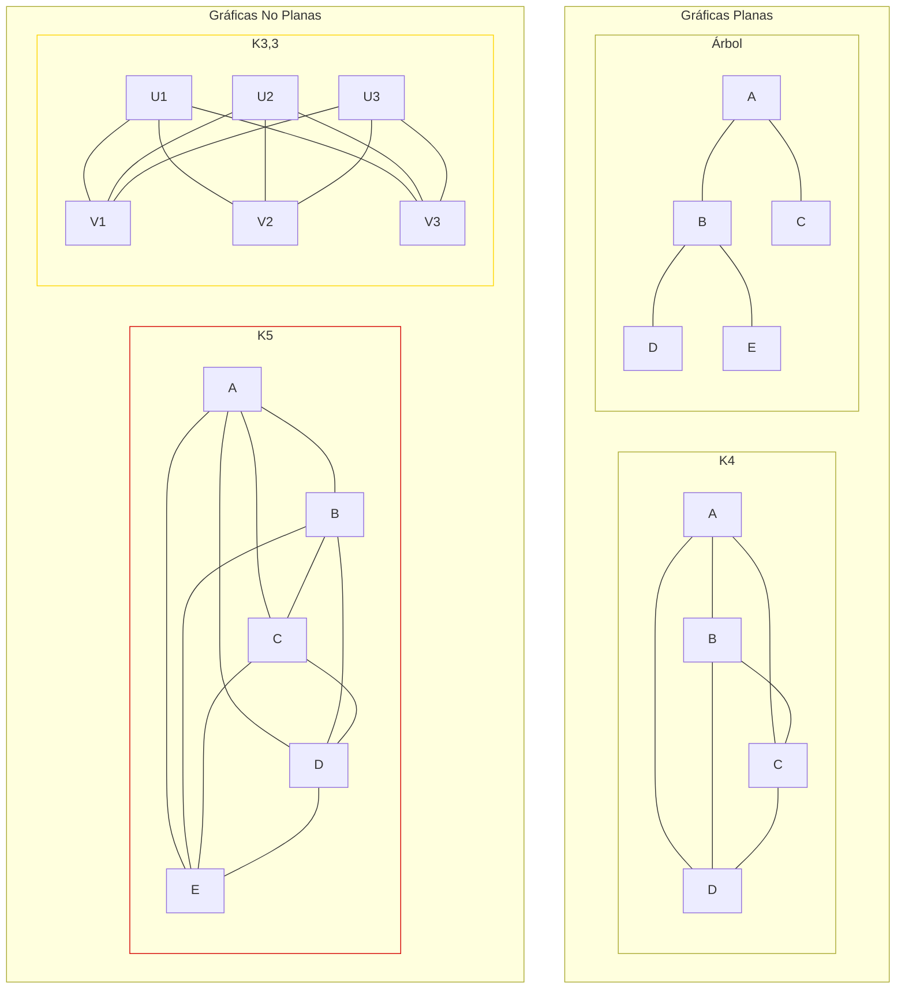

# Gráficas y Juegos - Planaridad

## 7.2 Gráficas planas.

---

### 1. Definición de Gráficas Planas

Una **gráfica plana** es una gráfica que puede ser dibujada en el plano sin que ninguna de sus aristas se cruce. Formalmente, una gráfica $G = (V, E)$ es plana si existe una representación en el plano donde:

- Los vértices son puntos distintos
- Las aristas son curvas simples que conectan sus vértices extremos
- Ninguna arista interseca a otra, excepto posiblemente en sus extremos

### 2. Fórmula de Euler para Gráficas Planas

Para cualquier gráfica plana conexa:

$$ V - E + F = 2 $$

Donde:

- $V$ = número de vértices
- $E$ = número de aristas
- $F$ = número de caras (regiones, incluyendo la región exterior infinita)

#### 2.1. Corolarios de la Fórmula de Euler

Para una gráfica plana **simple** y conexa con $V \geq 3$, como cada cara está rodeada por al menos 3 aristas:

$$ E \leq 3V - 6 $$

Para una gráfica plana simple y conexa sin triángulos, por ejemplo bipartita, con $V \geq 3$, como cada cara está rodeada por al menos 4 aristas:

$$ E \leq 2V - 4 $$

Estas cotas son condiciones **necesarias**: si no se cumplen, la gráfica no es plana, pero cumplirlas no garantiza que lo sea.

### 3. Implementación para Verificar Planaridad

```python
def es_grafica_plana(grafica):
    """
    Prueba rápida con las cotas de Euler, para gráficas simples y conexas.
    False: la gráfica NO es plana con seguridad.
    True: solo significa que las cotas no la descartan; puede no ser plana,
    como la gráfica de Petersen, con V = 10 y E = 15 <= 24.
    """
    V = len(grafica)
    E = sum(len(vecinos) for vecinos in grafica.values()) // 2

    # Condición necesaria pero no suficiente
    if V >= 3 and E > 3*V - 6:
        return False

    # Para gráficas bipartitas
    if es_bipartita(grafica) and E > 2*V - 4:
        return False

    # Verificación más compleja requeriría algoritmos como el de Hopcroft-Tarjan
    return True

def es_bipartita(grafica):
    """
    Verifica si una gráfica es bipartita usando BFS
    """
    color = {}
    for vertice in grafica:
        if vertice not in color:
            cola = [vertice]
            color[vertice] = 0
            while cola:
                actual = cola.pop(0)
                for vecino in grafica[actual]:
                    if vecino not in color:
                        color[vecino] = 1 - color[actual]
                        cola.append(vecino)
                    elif color[vecino] == color[actual]:
                        return False
    return True

# Ejemplo de uso
grafica_plana = {
    'A': ['B', 'C', 'D'],
    'B': ['A', 'C'],
    'C': ['A', 'B', 'D'],
    'D': ['A', 'C']
}

grafica_no_plana = {
    'A': ['B', 'C', 'D', 'E'],
    'B': ['A', 'C', 'D', 'E'],
    'C': ['A', 'B', 'D', 'E'],
    'D': ['A', 'B', 'C', 'E'],
    'E': ['A', 'B', 'C', 'D']
}

print(f"Gráfica 1, ¿pasa la prueba?: {es_grafica_plana(grafica_plana)}")    # True
print(f"Gráfica 2 (K5), ¿pasa la prueba?: {es_grafica_plana(grafica_no_plana)}")    # False
```

### 4. Gráficas No Planas: Teoremas de Kuratowski y Wagner

#### 4.1. Teorema de Kuratowski

Una gráfica es plana si y solo si no contiene una subdivisión de $K_5$ (gráfica completa de 5 vértices) ni de $K_{3,3}$ (gráfica bipartita completa de 3+3 vértices). Una subdivisión se obtiene reemplazando aristas por caminos.

#### 4.2. Teorema de Wagner

Una gráfica es plana si y solo si no contiene a $K_5$ ni a $K_{3,3}$ como menor. Un menor se obtiene borrando vértices y aristas y contrayendo aristas.

### 5. Visualización de Gráficas Planas y No Planas



### 6. Algoritmo para Encontrar Subdivisiones de K5 y K3,3

Buscar directamente una subdivisión de $K_5$ o $K_{3,3}$ es costoso. Los algoritmos de prueba de planaridad, en cambio, deciden en tiempo lineal y, si la gráfica no es plana, devuelven como certificado una **subgráfica de Kuratowski**. Para saber de cuál se trata basta ver los vértices de grado al menos 3, los que no vienen de subdividir aristas: en una subdivisión de $K_5$ son 5, de grado 4; en una de $K_{3,3}$ son 6, de grado 3.

```python
import networkx as nx

def subdivision_kuratowski(G):
    """
    Devuelve None si G es plana; si no, el tipo de subdivisión de Kuratowski
    que contiene, 'K5' o 'K3,3', junto con la subgráfica encontrada
    """
    es_plana, certificado = nx.check_planarity(G, counterexample=True)
    if es_plana:
        return None
    ramificaciones = [v for v in certificado if certificado.degree(v) >= 3]
    tipo = "K5" if len(ramificaciones) == 5 else "K3,3"
    return tipo, certificado

K5 = nx.complete_graph(5)
petersen = nx.petersen_graph()
print("K5:", subdivision_kuratowski(K5)[0])               # K5
print("Petersen:", subdivision_kuratowski(petersen)[0])   # K3,3
print("Cubo:", subdivision_kuratowski(nx.hypercube_graph(3)))   # None
```

La gráfica de Petersen es un ejemplo instructivo: tiene a $K_5$ como menor, contrayendo las cinco aristas que unen el pentágono exterior con la estrella interior, pero no contiene una subdivisión de $K_5$, porque es cúbica y una subdivisión de $K_5$ necesita vértices de grado 4. Lo que contiene es una subdivisión de $K_{3,3}$.

### 7. Aplicaciones de las Gráficas Planas

1. **Circuitos impresos (PCB)**: Diseño de layouts sin cruces
2. **Cartografía**: Teorema de los cuatro colores
3. **Redes de transporte**: Planificación urbana
4. **Bioinformática**: Estructuras de proteínas y ADN

### 8. Ejercicios de Práctica

1. Verifica si las siguientes gráficas son planas usando la fórmula de Euler:
   a) V=6, E=12
   b) V=8, E=12
   c) V=10, E=15

2. Demuestra que $K_5$ no es plana usando la fórmula de Euler.

3. Encuentra todas las caras en la siguiente gráfica plana:
   - Vértices: A, B, C, D
   - Aristas: A-B, B-C, C-D, D-A, A-C

### 9. Solución de los Ejercicios

```python
# Solución ejercicio 1
# True significa "la cota no la descarta", no "es plana".
# a) 12 <= 12: puede ser plana, por ejemplo el octaedro.
# b) 12 <= 18: puede ser plana, por ejemplo el cubo.
# c) 15 <= 24: puede ser plana, pero la gráfica de Petersen tiene esos
#    valores y no es plana; la cota no basta para decidir.
def verificar_plana_euler(V, E):
    return E <= 3*V - 6 if V >= 3 else True

print("Solución ejercicio 1:")
print(f"a) V=6, E=12: {verificar_plana_euler(6, 12)}")
print(f"b) V=8, E=12: {verificar_plana_euler(8, 12)}")
print(f"c) V=10, E=15: {verificar_plana_euler(10, 15)}")

# Solución ejercicio 2
print(f"\nK5 no es plana porque: 10 > 3*5 - 6 = 9")
```

### 10. Algoritmo de Hopcroft-Tarjan (Planarity Testing)

El algoritmo de Hopcroft-Tarjan es el primer algoritmo lineal para verificar planaridad:

1. Descomponer la gráfica en componentes biconexas
2. Encontrar un ciclo base
3. Incorporar las demás aristas mediante un DFS
4. Verificar si se pueden incorporar sin cruces

### 11. Referencias

1. Kuratowski, K. (1930). Sur le problème des courbes gauches en topologie.
2. Wagner, K. (1937). Über eine Eigenschaft der ebenen Komplexe.
3. Hopcroft, J., & Tarjan, R. (1974). Efficient planarity testing.
4. West, D. B. (2001). Introduction to Graph Theory.
5. Bondy, J. A., & Murty, U. S. R. (2008). Graph Theory.
