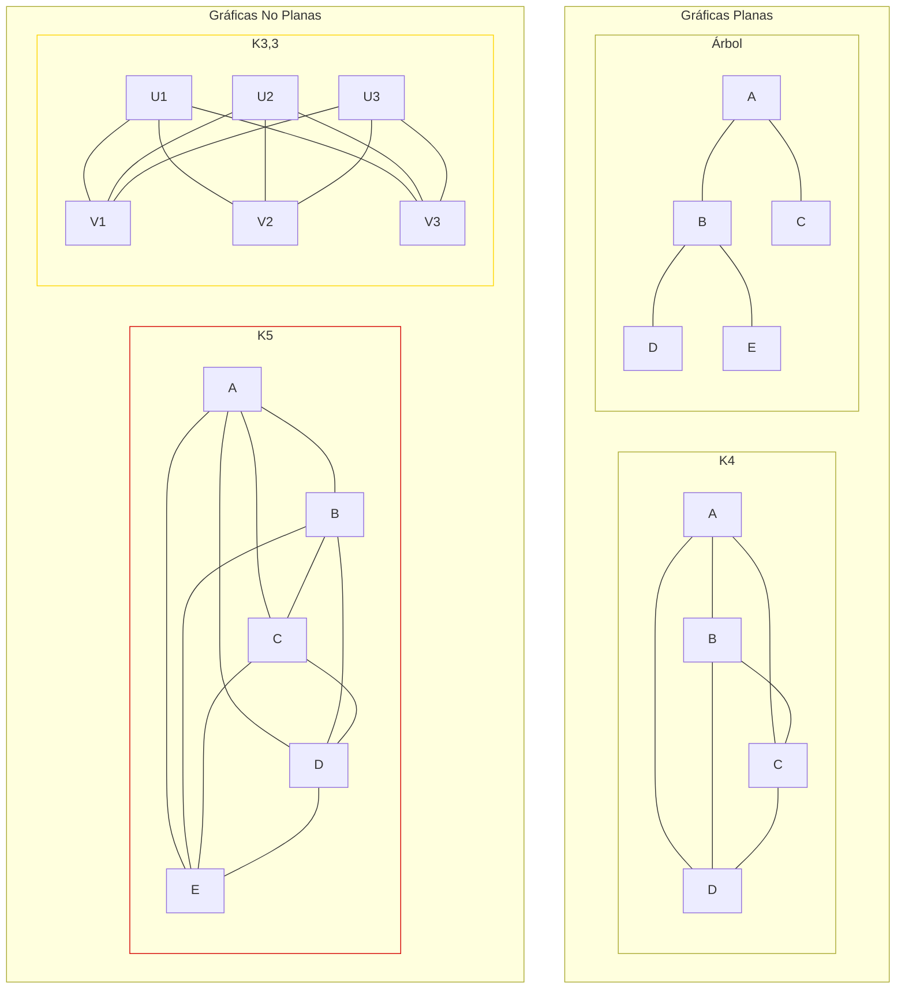

# Gráficas y Juegos - Planaridad

## 7.2 Gráficas planas.

---

### 1. Definición de Gráficas Planas

Una **gráfica plana** es una gráfica que puede ser dibujada en el plano sin que ninguna de sus aristas se cruce. Formalmente, una gráfica $G = (V, E)$ es plana si existe una representación en el plano donde:

- Los vértices son puntos distintos
- Las aristas son curvas simples que conectan sus vértices extremos
- Ninguna arista interseca a otra, excepto posiblemente en sus extremos

### 2. Fórmula de Euler para Gráficas Planas

Para cualquier gráfica plana conexa:

$$ V - E + F = 2 $$

Donde:

- $V$ = número de vértices
- $E$ = número de aristas
- $F$ = número de caras (regiones, incluyendo la región exterior infinita)

#### 2.1. Corolarios de la Fórmula de Euler

Para una gráfica plana conexa con $V \geq 3$:

$$ E \leq 3V - 6 $$

Para una gráfica plana bipartita conexa con $V \geq 3$:

$$ E \leq 2V - 4 $$

### 3. Implementación para Verificar Planaridad

```python
def es_grafica_plana(grafica):
    """
    Verifica si una gráfica es plana usando las condiciones de la fórmula de Euler
    Esta es una verificación necesaria pero no suficiente
    """
    V = len(grafica)
    E = sum(len(vecinos) for vecinos in grafica.values()) // 2

    # Condición necesaria pero no suficiente
    if V >= 3 and E > 3*V - 6:
        return False

    # Para gráficas bipartitas
    if es_bipartita(grafica) and E > 2*V - 4:
        return False

    # Verificación más compleja requeriría algoritmos como el de Hopcroft-Tarjan
    return True

def es_bipartita(grafica):
    """
    Verifica si una gráfica es bipartita usando BFS
    """
    color = {}
    for vertice in grafica:
        if vertice not in color:
            cola = [vertice]
            color[vertice] = 0
            while cola:
                actual = cola.pop(0)
                for vecino in grafica[actual]:
                    if vecino not in color:
                        color[vecino] = 1 - color[actual]
                        cola.append(vecino)
                    elif color[vecino] == color[actual]:
                        return False
    return True

# Ejemplo de uso
grafica_plana = {
    'A': ['B', 'C', 'D'],
    'B': ['A', 'C'],
    'C': ['A', 'B', 'D'],
    'D': ['A', 'C']
}

grafica_no_plana = {
    'A': ['B', 'C', 'D', 'E'],
    'B': ['A', 'C', 'D', 'E'],
    'C': ['A', 'B', 'D', 'E'],
    'D': ['A', 'B', 'C', 'E'],
    'E': ['A', 'B', 'C', 'D']
}

print(f"Gráfica 1 (plana): {es_grafica_plana(grafica_plana)}")
print(f"Gráfica 2 (K5, no plana): {es_grafica_plana(grafica_no_plana)}")
```

### 4. Gráficas No Planas: Teoremas de Kuratowski y Wagner

#### 4.1. Teorema de Kuratowski

Una gráfica es plana si y solo si no contiene una subdivisión de $K_5$ (gráfica completa de 5 vértices) o $K_{3,3}$ (gráfica bipartita completa de 3+3 vértices).

#### 4.2. Teorema de Wagner

Una gráfica es plana si y solo si no contiene a $K_5$ o $K_{3,3}$ como menor.

### 5. Visualización de Gráficas Planas y No Planas



### 6. Algoritmo para Encontrar Subdivisiones de K5 y K3,3

```python
def contiene_subdivisione_k5(grafica):
    """
    Verifica si la gráfica contiene una subdivisión de K5
    (Implementación simplificada)
    """
    # Un algoritmo completo sería muy complejo
    # Esta es una versión simplificada que busca vértices de alto grado
    for vertice in grafica:
        if len(grafica[vertice]) >= 4:
            # Podría ser parte de una subdivisión de K5
            return True
    return False

def contiene_subdivisione_k33(grafica):
    """
    Verifica si la gráfica contiene una subdivisión de K3,3
    (Implementación simplificada)
    """
    # Buscar conjuntos bipartitos de 3 vértices con muchas conexiones
    from itertools import combinations

    vertices = list(grafica.keys())
    for conjunto1 in combinations(vertices, 3):
        for conjunto2 in combinations(vertices, 3):
            if set(conjunto1).isdisjoint(set(conjunto2)):
                # Verificar si hay muchas conexiones entre los conjuntos
                conexiones = 0
                for v1 in conjunto1:
                    for v2 in conjunto2:
                        if v2 in grafica[v1]:
                            conexiones += 1
                if conexiones >= 8:  # K3,3 tiene 9 aristas
                    return True
    return False

# Ejemplo de uso
print(f"¿Contiene subdivisión de K5? {contiene_subdivisione_k5(grafica_no_plana)}")
print(f"¿Contiene subdivisión de K3,3? {contiene_subdivisione_k33(grafica_no_plana)}")
```

### 7. Aplicaciones de las Gráficas Planas

1. **Circuitos impresos (PCB)**: Diseño de layouts sin cruces
2. **Cartografía**: Teorema de los cuatro colores
3. **Redes de transporte**: Planificación urbana
4. **Bioinformática**: Estructuras de proteínas y ADN

### 8. Ejercicios de Práctica

1. Verifica si las siguientes gráficas son planas usando la fórmula de Euler:
   a) V=6, E=12
   b) V=8, E=12
   c) V=10, E=15

2. Demuestra que $K_5$ no es plana usando la fórmula de Euler.

3. Encuentra todas las caras en la siguiente gráfica plana:
   - Vértices: A, B, C, D
   - Aristas: A-B, B-C, C-D, D-A, A-C

### 9. Solución de los Ejercicios

```python
# Solución ejercicio 1
def verificar_plana_euler(V, E):
    return E <= 3*V - 6 if V >= 3 else True

print("Solución ejercicio 1:")
print(f"a) V=6, E=12: {verificar_plana_euler(6, 12)}")
print(f"b) V=8, E=12: {verificar_plana_euler(8, 12)}")
print(f"c) V=10, E=15: {verificar_plana_euler(10, 15)}")

# Solución ejercicio 2
print(f"\nK5 no es plana porque: 10 > 3*5 - 6 = 9")
```

### 10. Algoritmo de Hopcroft-Tarjan (Planarity Testing)

El algoritmo de Hopcroft-Tarjan es el primer algoritmo lineal para verificar planaridad:

1. Descomponer la gráfica en componentes biconexas
2. Encontrar un ciclo base
3. Incorporar las demás aristas mediante un DFS
4. Verificar si se pueden incorporar sin cruces

### 11. Referencias

1. Kuratowski, K. (1930). Sur le problème des courbes gauches en topologie.
2. Wagner, K. (1937). Über eine Eigenschaft der ebenen Komplexe.
3. Hopcroft, J., & Tarjan, R. (1974). Efficient planarity testing.
4. West, D. B. (2001). Introduction to Graph Theory.
5. Bondy, J. A., & Murty, U. S. R. (2008). Graph Theory.
