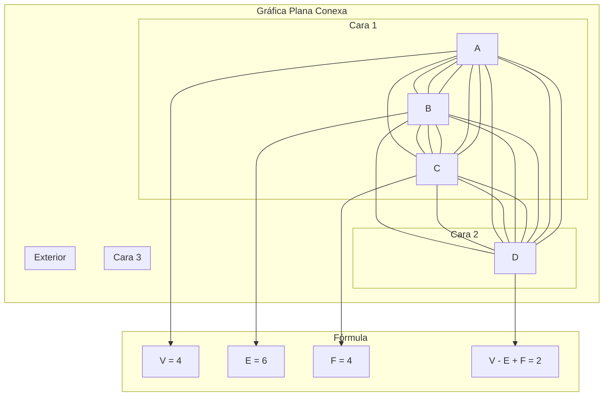

# Gráficas y Juegos - Planaridad

## 7.3 Fórmula de Euler.

---

### 1. Introducción a la Fórmula de Euler

La **Fórmula de Euler** es un resultado fundamental en teoría de gráficas planas que establece una relación entre el número de vértices (V), aristas (E) y caras (F) de una gráfica plana conexa:

$$ V - E + F = 2 $$

Esta fórmula, descubierta por Leonhard Euler en 1758, aplica para cualquier representación plana de una gráfica conexa.

### 2. Demostración por Inducción

Se hace inducción sobre el número de aristas $E$ de una gráfica plana conexa, dibujada sin cruces.

#### 2.1. Caso Base: Árbol

Si la gráfica no tiene ciclos, es un árbol: $E = V - 1$ y hay una sola cara, la exterior, porque sin ciclos no se encierra ninguna región. Entonces $V - E + F = V - (V - 1) + 1 = 2$.

#### 2.2. Paso Inductivo

Si la gráfica tiene un ciclo, se elige una arista $e$ de ese ciclo. Al quitarla:

- La gráfica sigue siendo conexa, porque el resto del ciclo une sus extremos
- $e$ separaba dos caras distintas, una dentro del ciclo y otra fuera, que al quitarla se funden en una sola
- La gráfica $G - e$ tiene $V$ vértices, $E - 1$ aristas y $F - 1$ caras

Por hipótesis de inducción, $V - (E - 1) + (F - 1) = 2$, y como $V - (E - 1) + (F - 1) = V - E + F$, también $V - E + F = 2$.

### 3. Implementación de la Fórmula de Euler

```python
def formula_euler(grafica, representacion_plana=None):
    """
    Calcula y verifica la fórmula de Euler para una gráfica plana
    grafica: dict de adyacencia
    representacion_plana: lista de caras (opcional)
    """
    V = len(grafica)
    E = sum(len(vecinos) for vecinos in grafica.values()) // 2

    # Si no se proporciona la representación plana, calcular F
    if representacion_plana is None:
        # Para gráficas conexas: F = E - V + 2 (por Euler). Ojo: en este caso
        # la "verificación" es circular, porque F se calculó con la misma fórmula
        F = E - V + 2
    else:
        F = len(representacion_plana)

    # Verificar la fórmula
    resultado = V - E + F
    es_valida = resultado == 2

    return {
        'V': V,
        'E': E,
        'F': F,
        'V - E + F': resultado,
        'Es_valida': es_valida
    }

# Ejemplo: Cubo (gráfica plana de un cubo)
grafica_cubo = {
    'A': ['B', 'D', 'E'],
    'B': ['A', 'C', 'F'],
    'C': ['B', 'D', 'G'],
    'D': ['A', 'C', 'H'],
    'E': ['A', 'F', 'H'],
    'F': ['B', 'E', 'G'],
    'G': ['C', 'F', 'H'],
    'H': ['D', 'E', 'G']
}

# Caras del cubo en representación plana
caras_cubo = [
    ['A', 'B', 'C', 'D'],    # Cara frontal
    ['A', 'E', 'H', 'D'],    # Cara izquierda
    ['A', 'B', 'F', 'E'],    # Cara superior
    ['B', 'C', 'G', 'F'],    # Cara derecha
    ['C', 'D', 'H', 'G'],    # Cara inferior
    ['E', 'F', 'G', 'H']     # Cara posterior
]

resultado = formula_euler(grafica_cubo, caras_cubo)
print("Fórmula de Euler para el cubo:")
print(f"V = {resultado['V']}, E = {resultado['E']}, F = {resultado['F']}")
print(f"V - E + F = {resultado['V - E + F']}")
print(f"¿Es válida? {resultado['Es_valida']}")
```

### 4. Generalización para Gráficas con k Componentes

Para una gráfica plana con k componentes conexas:

$$ V - E + F = 1 + k $$

```python
def formula_euler_generalizada(graficas):
    """
    Calcula la fórmula de Euler generalizada para múltiples componentes
    graficas: lista de gráficas (cada una es un dict de adyacencia)
    """
    V_total = 0
    E_total = 0
    F_total = 0

    for grafica in graficas:
        V = len(grafica)
        E = sum(len(vecinos) for vecinos in grafica.values()) // 2
        F = E - V + 2  # Asumiendo que cada componente es conexa (cálculo, no verificación)

        V_total += V
        E_total += E
        F_total += F - 1  # Restamos 1 por cada componente (la cara exterior se cuenta una vez)

    F_total += 1  # Añadimos la cara exterior global

    resultado = V_total - E_total + F_total
    k = len(graficas)
    es_valida = resultado == 1 + k

    return {
        'V': V_total,
        'E': E_total,
        'F': F_total,
        'V - E + F': resultado,
        'Componentes': k,
        'Esperado': 1 + k,
        'Es_valida': es_valida
    }

# Ejemplo con dos componentes
grafica_triangulo = {'A': ['B', 'C'], 'B': ['A', 'C'], 'C': ['A', 'B']}
grafica_cuadrado = {'D': ['E', 'H'], 'E': ['D', 'F'], 'F': ['E', 'G'], 'G': ['F', 'H'], 'H': ['D', 'G']}

resultado = formula_euler_generalizada([grafica_triangulo, grafica_cuadrado])
print(f"\nFórmula de Euler generalizada: {resultado['V']} - {resultado['E']} + {resultado['F']} = {resultado['V - E + F']}")
print(f"Componentes: {resultado['Componentes']}, Esperado: {resultado['Esperado']}")
print(f"¿Es válida? {resultado['Es_valida']}")
```

### 5. Visualización de la Fórmula de Euler



### 6. Aplicaciones de la Fórmula de Euler

#### 6.1. Demostración de que K5 no es plana

$K_5$ tiene V=5, E=10. Si fuera plana, tendría F = E - V + 2 = 7 caras.
Cada cara tiene al menos 3 aristas, y cada arista pertenece a 2 caras:

$2E \geq 3F \Rightarrow 20 \geq 21$ (contradicción).

#### 6.2. Demostración de que K3,3 no es plana

$K_{3,3}$ tiene V=6, E=9. Si fuera plana, tendría F = E - V + 2 = 5 caras.
Como es bipartita, cada cara tiene al menos 4 aristas:

$2E \geq 4F \Rightarrow 18 \geq 20$ (contradicción).

### 7. Ejercicios de Práctica

1. Verifica la fórmula de Euler para las siguientes gráficas planas:
   a) Tetraedro: V=4, E=6
   b) Octaedro: V=6, E=12
   c) Icosaedro: V=12, E=30

2. Demuestra que para cualquier gráfica plana simple y conexa con $V \geq 3$: $E \leq 3V - 6$

3. Calcula el número de caras para una gráfica plana con 8 vértices y 12 aristas.

### 8. Solución de los Ejercicios

```python
# Solución ejercicio 1: se cuentan las caras de cada sólido por separado
# (el tetraedro tiene 4 triángulos, el octaedro 8 y el icosaedro 20)
# y se comprueba que V - E + F = 2
def verificar_euler(V, E, F):
    return V - E + F == 2

print("Solución ejercicio 1:")
print(f"a) Tetraedro (V=4, E=6, F=4): {verificar_euler(4, 6, 4)}")
print(f"b) Octaedro (V=6, E=12, F=8): {verificar_euler(6, 12, 8)}")
print(f"c) Icosaedro (V=12, E=30, F=20): {verificar_euler(12, 30, 20)}")

# Solución ejercicio 3
def calcular_caras(V, E):
    return E - V + 2

print(f"\nSolución ejercicio 3: F = {calcular_caras(8, 12)}")
```

### 9. Teorema de la Desigualdad de las Aristas

Para una gráfica plana simple y conexa con $V \geq 3$:

$$ E \leq 3V - 6 $$

Y si la gráfica no tiene triángulos:

$$ E \leq 2V - 4 $$

```python
def verificar_desigualdad_aristas(V, E, sin_triangulos=False):
    """
    Verifica la desigualdad de aristas para gráficas planas
    """
    if sin_triangulos:
        return E <= 2*V - 4
    else:
        return E <= 3*V - 6

# Ejemplo
print("\nVerificación de desigualdades:")
print(f"K5 (V=5, E=10): {verificar_desigualdad_aristas(5, 10)}")
print(f"K3,3 (V=6, E=9, sin triángulos): {verificar_desigualdad_aristas(6, 9, True)}")
```

### 10. Referencias

1. Euler, L. (1758). Elementa doctrinae solidorum.
2. Bondy, J. A., & Murty, U. S. R. (2008). Graph Theory.
3. West, D. B. (2001). Introduction to Graph Theory.
4. Wilson, R. J. (1996). Introduction to Graph Theory.
