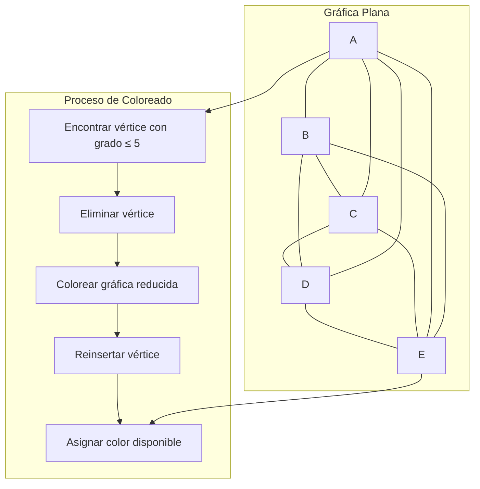

# Gráficas y Juegos - Planaridad

## 7.4 El teorema de los cinco colores

---

### 1. Enunciado del Teorema

El **Teorema de los Cinco Colores** establece que:

$$ \text{Toda gráfica plana es 5-coloreable} $$

Esto significa que cualquier mapa plano puede colorearse con solo 5 colores de forma que regiones adyacentes no compartan el mismo color.

### 2. Demostración del Teorema

#### 2.1. Base de la Demostración

La demostración se basa en:

1. La fórmula de Euler para gráficas planas: $V - E + F = 2$
2. El hecho de que toda gráfica plana tiene al menos un vértice de grado $\leq 5$
3. Un argumento de contracción e inducción

#### 2.2. Pasos de la Demostración

1. Por inducción sobre el número de vértices
2. Caso base: Gráficas con $\leq 5$ vértices son trivialmente 5-coloreables
3. Paso inductivo: Sea $G$ una gráfica plana con $n$ vértices
4. $G$ tiene un vértice $v$ con $deg(v) \leq 5$
5. Por hipótesis inductiva, $G - v$ es 5-coloreable
6. Si $deg(v) < 5$, podemos colorear $v$ fácilmente
7. Si $deg(v) = 5$, necesitamos un argumento de recoloreo

### 3. Implementación del Algoritmo de 5-Coloreado

```python
def cinco_colorear(grafica_plana):
    """
    Implementa el algoritmo de 5-coloreado para gráficas planas
    Basado en la demostración del teorema de los cinco colores
    """
    if not grafica_plana:
        return {}

    # Hacer una copia para no modificar la original
    grafica = {v: list(vecinos) for v, vecinos in grafica_plana.items()}
    colores = {}

    # Caso base: si hay 5 o menos vértices
    if len(grafica) <= 5:
        for i, vertice in enumerate(grafica):
            colores[vertice] = i + 1
        return colores

    # Encontrar un vértice de grado <= 5
    vertice_grado_min = None
    for vertice, vecinos in grafica.items():
        if len(vecinos) <= 5:
            vertice_grado_min = vertice
            break

    if vertice_grado_min is None:
        # Esto no debería pasar en gráficas planas (por teorema)
        raise ValueError("La gráfica no parece ser plana")

    # Eliminar el vértice y colorear recursivamente
    v = vertice_grado_min
    vecinos_v = grafica[v]

    # Eliminar v de la gráfica
    del grafica[v]
    for vecino in vecinos_v:
        if v in grafica[vecino]:
            grafica[vecino].remove(v)

    # Colorear recursivamente
    colores = cinco_colorear(grafica)

    # Restaurar v y asignarle color
    colores_vecinos = set()
    for vecino in vecinos_v:
        if vecino in colores:
            colores_vecinos.add(colores[vecino])

    # Encontrar un color disponible (1-5)
    for color in range(1, 6):
        if color not in colores_vecinos:
            colores[v] = color
            break

    return colores

# Ejemplo de uso
grafica_plana_ejemplo = {
    'A': ['B', 'C', 'D', 'E', 'F'],
    'B': ['A', 'C', 'F'],
    'C': ['A', 'B', 'D'],
    'D': ['A', 'C', 'E'],
    'E': ['A', 'D', 'F'],
    'F': ['A', 'B', 'E']
}

coloracion = cinco_colorear(grafica_plana_ejemplo)
print("Coloración de 5 colores:", coloracion)
```

### 4. Visualización del Teorema



### 5. Comparación con el Teorema de los Cuatro Colores

| Aspecto           | Teorema de 5 Colores      | Teorema de 4 Colores      |
| ----------------- | ------------------------- | ------------------------- |
| **Año**           | 1890 (Heawood)            | 1976 (Appel-Haken)        |
| **Demostración**  | Constructiva, simple      | Computacional, compleja   |
| **Colores**       | 5                         | 4                         |
| **Aplicabilidad** | Todas las gráficas planas | Todas las gráficas planas |

### 6. Ejemplo de Recoloreo para Vértices de Grado 5

Cuando tenemos un vértice $v$ de grado 5, podemos:

1. Considerar los colores de sus vecinos $v_1, v_2, v_3, v_4, v_5$
2. Si hay menos de 5 colores distintos, colorear $v$ con el color faltante
3. Si hay exactamente 5 colores, buscar una cadena de recoloreo

```python
def manejar_vertice_grado_5(grafica, v, vecinos_v, colores):
    """
    Maneja el caso cuando un vértice tiene exactamente 5 vecinos con colores distintos
    """
    # Verificar si podemos recolorear una cadena
    colores_vecinos = [colores[vecino] for vecino in vecinos_v]

    # Buscar dos vecinos que no sean adyacentes entre sí
    for i in range(5):
        for j in range(i + 1, 5):
            if vecinos_v[j] not in grafica[vecinos_v[i]]:
                # Podemos intentar intercambiar colores
                if puede_recolorear(grafica, vecinos_v[i], colores_vecinos[i], colores_vecinos[j]):
                    colores[vecinos_v[i]] = colores_vecinos[j]
                    # Ahora hay un color disponible para v
                    for color in range(1, 6):
                        if color not in colores_vecinos:
                            colores[v] = color
                            return True
    return False

def puede_recolorear(grafica, vertice, color_actual, color_nuevo):
    """
    Verifica si podemos cambiar el color de un vértice sin conflictos
    """
    for vecino in grafica[vertice]:
        if vecino in colores and colores[vecino] == color_nuevo:
            return False
    return True
```

### 7. Aplicaciones del Teorema

1. **Cartografía**: Coloreado de mapas con restricciones de colores
2. **Diseño de circuitos**: Asignación de capas en PCB
3. **Scheduling**: Asignación de horarios sin conflictos
4. **Registro de compiladores**: Asignación de registros a variables

### 8. Ejercicios de Práctica

1. Aplica el algoritmo de 5-coloreado a la gráfica plana completa $K_4$
2. Demuestra que el teorema es óptimo mostrando una gráfica plana que requiere 4 colores
3. Implementa la función `manejar_vertice_grado_5` completa

### 9. Solución de los Ejercicios

```python
# Solución ejercicio 1
K4 = {
    'A': ['B', 'C', 'D'],
    'B': ['A', 'C', 'D'],
    'C': ['A', 'B', 'D'],
    'D': ['A', 'B', 'C']
}

coloracion_k4 = cinco_colorear(K4)
print("Coloración de K4:", coloracion_k4)

# Solución ejercicio 2: K4 requiere 4 colores
print(f"K4 necesita {max(coloracion_k4.values())} colores")

# Gráfica que requiere 4 colores (rueda W4)
rueda_W4 = {
    'Centro': ['A', 'B', 'C', 'D'],
    'A': ['Centro', 'B', 'D'],
    'B': ['Centro', 'A', 'C'],
    'C': ['Centro', 'B', 'D'],
    'D': ['Centro', 'A', 'C']
}

coloracion_rueda = cinco_colorear(rueda_W4)
print("Coloración de rueda W4:", coloracion_rueda)
print(f"W4 necesita {max(coloracion_rueda.values())} colores")
```

### 10. Teorema de Heawood

Percy John Heawood demostró en 1890 que:

1. El teorema de los cinco colores es válido
2. Encontró un error en la demostración original de los cuatro colores
3. Su demostración es constructiva y elegante

### 11. Referencias

1. Heawood, P. J. (1890). Map-colour theorem.
2. Appel, K., & Haken, W. (1977). The solution of the four-color-map problem.
3. Wilson, R. J. (2002). Four Colors Suffice.
4. Bondy, J. A., & Murty, U. S. R. (2008). Graph Theory.
