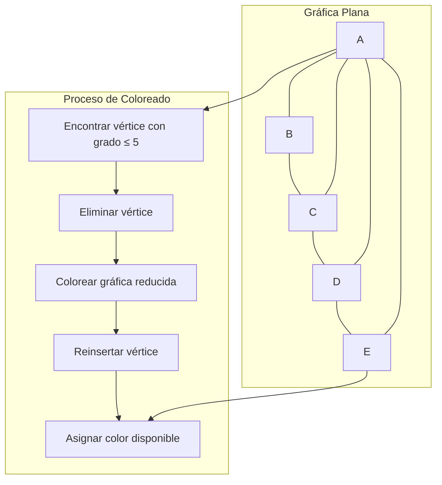

# Gráficas y Juegos - Planaridad

## 7.4 El teorema de los cinco colores

---

### 1. Enunciado del Teorema

El **Teorema de los Cinco Colores** establece que:

$$ \text{Toda gráfica plana es 5-coloreable} $$

Esto significa que cualquier mapa plano puede colorearse con solo 5 colores de forma que regiones adyacentes no compartan el mismo color.

### 2. Demostración del Teorema

#### 2.1. Base de la Demostración

La demostración se basa en:

1. La fórmula de Euler para gráficas planas: $V - E + F = 2$
2. El hecho de que toda gráfica plana tiene al menos un vértice de grado $\leq 5$
3. Un argumento de contracción e inducción

#### 2.2. Pasos de la Demostración

1. Por inducción sobre el número de vértices
2. Caso base: Gráficas con $\leq 5$ vértices son trivialmente 5-coloreables
3. Paso inductivo: Sea $G$ una gráfica plana con $n$ vértices
4. $G$ tiene un vértice $v$ con $deg(v) \leq 5$
5. Por hipótesis inductiva, $G - v$ es 5-coloreable
6. Si $deg(v) < 5$, podemos colorear $v$ fácilmente
7. Si $deg(v) = 5$, necesitamos un argumento de recoloreo

### 3. Implementación del Algoritmo de 5-Coloreado

Para programar el caso de grado 5 sin necesitar el dibujo plano se usa una variante de la demostración: si $v$ tiene grado 5, dos de sus vecinos $x$ y $y$ no son adyacentes, porque si los cinco fueran adyacentes entre sí formarían un $K_5$, que no es plano. Se **contraen** $x$ y $y$ con $v$ en un solo vértice; la gráfica resultante sigue siendo plana y tiene menos vértices, así que se colorea recursivamente. Al deshacer la contracción, $x$ y $y$ reciben el mismo color, de modo que los cinco vecinos de $v$ usan a lo más 4 colores y queda uno libre para $v$.

```python
def cinco_colorear(grafica_plana):
    """
    5-coloreado de una gráfica plana, siguiendo la demostración del teorema.
    grafica_plana: dict {vértice: lista de vecinos}, gráfica simple y plana
    """
    grafica = {v: set(vecinos) for v, vecinos in grafica_plana.items()}
    if len(grafica) <= 5:
        return {v: i + 1 for i, v in enumerate(grafica)}

    # Toda gráfica plana tiene un vértice de grado <= 5
    v = min(grafica, key=lambda u: len(grafica[u]))
    if len(grafica[v]) > 5:
        raise ValueError("La gráfica no es plana")
    vecinos_v = grafica[v]

    if len(vecinos_v) <= 4:
        # Caso fácil: se quita v, se colorea el resto y a v le sobra un color
        reducida = {u: vecinos - {v} for u, vecinos in grafica.items() if u != v}
        colores = cinco_colorear(reducida)
    else:
        # Grado 5: dos vecinos x, y no adyacentes (si no, habría un K5)
        x, y = next((a, b) for a in vecinos_v for b in vecinos_v
                     if a != b and b not in grafica[a])
        # Contraer v, x, y en el vértice x: x hereda los vecinos de y
        reducida = {u: set(vecinos) for u, vecinos in grafica.items() if u not in (v, y)}
        for u in reducida:
            reducida[u].discard(v)
            if y in reducida[u]:
                reducida[u].discard(y)
                if u != x:
                    reducida[u].add(x)
                    reducida[x].add(u)
        colores = cinco_colorear(reducida)
        colores[y] = colores[x]   # x y y no son adyacentes: pueden compartir color

    usados = {colores[u] for u in vecinos_v}
    colores[v] = min(c for c in range(1, 6) if c not in usados)
    return colores

def es_coloracion_propia(grafica, colores):
    return all(colores[u] != colores[w] for u in grafica for w in grafica[u])

# Ejemplo de uso: rueda con centro A y borde B-C-D-E-F
grafica_plana_ejemplo = {
    'A': ['B', 'C', 'D', 'E', 'F'],
    'B': ['A', 'C', 'F'],
    'C': ['A', 'B', 'D'],
    'D': ['A', 'C', 'E'],
    'E': ['A', 'D', 'F'],
    'F': ['A', 'B', 'E']
}

coloracion = cinco_colorear(grafica_plana_ejemplo)
print("Coloración de 5 colores:", coloracion)
print("¿Es propia?", es_coloracion_propia(grafica_plana_ejemplo, coloracion))
```

La contracción no rompe la planaridad: contraer una arista de un dibujo plano da otro dibujo plano, y $x$ y $y$ están unidos a través de $v$.

### 4. Visualización del Teorema



### 5. Comparación con el Teorema de los Cuatro Colores

| Aspecto           | Teorema de 5 Colores      | Teorema de 4 Colores      |
| ----------------- | ------------------------- | ------------------------- |
| **Año**           | 1890 (Heawood)            | 1976 (Appel-Haken)        |
| **Demostración**  | Constructiva, simple      | Computacional, compleja   |
| **Colores**       | 5                         | 4                         |
| **Aplicabilidad** | Todas las gráficas planas | Todas las gráficas planas |

### 6. Recoloreo con Cadenas de Kempe para Vértices de Grado 5

La demostración clásica de Heawood trata el caso de grado 5 sin contracciones. Sean $v_1, \ldots, v_5$ los vecinos de $v$ en el orden en que aparecen alrededor de $v$ en el dibujo plano:

1. Si los vecinos usan menos de 5 colores, $v$ toma el color faltante.
2. Si usan los 5 colores, con $v_i$ de color $i$, se considera la **cadena de Kempe** de $v_1$: la componente conexa que contiene a $v_1$ en la subgráfica formada por los vértices de colores 1 y 3.
3. Si $v_3$ no está en esa cadena, se intercambian los colores 1 y 3 en toda la cadena. La coloración sigue siendo propia, $v_1$ pasa a tener color 3 y el color 1 queda libre para $v$.
4. Si $v_3$ sí está en la cadena, hay un camino de colores 1 y 3 de $v_1$ a $v_3$ que, junto con $v$, forma un ciclo que separa a $v_2$ de $v_4$ en el plano. Entonces la cadena de colores 2 y 4 que contiene a $v_2$ no puede llegar a $v_4$, y se intercambian los colores 2 y 4 en ella: el color 2 queda libre para $v$.

El mismo argumento falla con cuatro colores para vértices de grado 5; ese fue el error de la demostración de Kempe (1879) que Heawood señaló.

### 7. Aplicaciones del Teorema

1. **Cartografía**: Coloreado de mapas con restricciones de colores
2. **Diseño de circuitos**: Asignación de capas en PCB
3. **Scheduling**: Asignación de horarios sin conflictos
4. **Registro de compiladores**: Asignación de registros a variables

### 8. Ejercicios de Práctica

1. Aplica el algoritmo de 5-coloreado a la gráfica plana completa $K_4$
2. Muestra una gráfica plana que requiere 4 colores. ¿Por qué eso no basta para saber si 5 colores son necesarios?
3. Implementa el recoloreo con cadenas de Kempe de la sección 6

### 9. Solución de los Ejercicios

```python
# Solución ejercicio 1
K4 = {
    'A': ['B', 'C', 'D'],
    'B': ['A', 'C', 'D'],
    'C': ['A', 'B', 'D'],
    'D': ['A', 'B', 'C']
}

coloracion_k4 = cinco_colorear(K4)
print("Coloración de K4:", coloracion_k4)

# Solución ejercicio 2. El algoritmo garantiza a lo más 5 colores, pero no usa
# necesariamente el mínimo; para saber cuántos se NECESITAN se prueba si existe
# una coloración con k colores, por fuerza bruta
from itertools import product

def necesita(grafica):
    vertices = list(grafica)
    for k in range(1, len(vertices) + 1):
        for asignacion in product(range(k), repeat=len(vertices)):
            c = dict(zip(vertices, asignacion))
            if all(c[u] != c[w] for u in grafica for w in grafica[u]):
                return k

print(f"K4 necesita {necesita(K4)} colores")      # 4: todos son adyacentes

# Las ruedas: un centro unido a todos los vértices de un ciclo
rueda_W4 = {   # borde de 4 vértices, par
    'Centro': ['A', 'B', 'C', 'D'],
    'A': ['Centro', 'B', 'D'],
    'B': ['Centro', 'A', 'C'],
    'C': ['Centro', 'B', 'D'],
    'D': ['Centro', 'A', 'C']
}
print(f"W4 necesita {necesita(rueda_W4)} colores")   # 3: el borde par usa 2
print(f"W5 necesita {necesita(grafica_plana_ejemplo)} colores")   # 4: el borde impar usa 3

# Que existan gráficas planas que requieren 4 colores no dice si alguna
# requiere 5; responder eso es justamente el teorema de los cuatro colores.
```

### 10. Teorema de Heawood

Percy John Heawood demostró en 1890 que:

1. El teorema de los cinco colores es válido
2. Encontró un error en la demostración original de los cuatro colores
3. Su demostración es constructiva y elegante

### 11. Referencias

1. Heawood, P. J. (1890). Map-colour theorem.
2. Appel, K., & Haken, W. (1977). The solution of the four-color-map problem.
3. Wilson, R. J. (2002). Four Colors Suffice.
4. Bondy, J. A., & Murty, U. S. R. (2008). Graph Theory.
