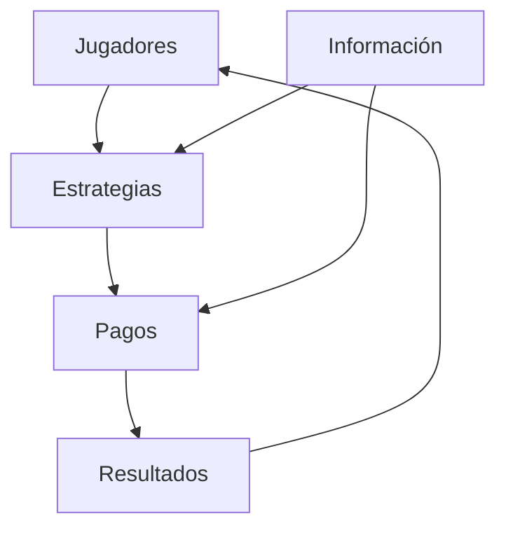
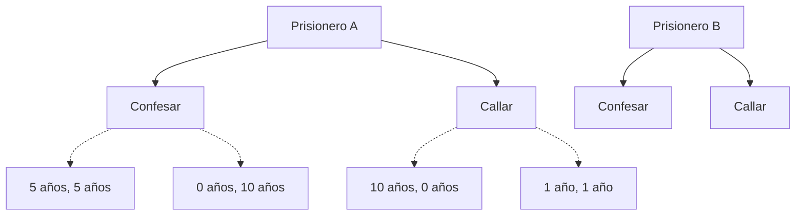

# Gráficas y Juegos - Juegos

## 8.1 Introducción a la Teoría de Juegos.

---

### ¿Qué es la Teoría de Juegos?

**Definición:** Marco matemático para modelar situaciones estratégicas donde el resultado de las decisiones de un participante depende de las decisiones de otros.

> "El estudio de modelos matemáticos de conflicto y cooperación entre tomadores de decisiones inteligentes y racionales." - Roger Myerson

#### Características principales:

- **Interdependencia estratégica**: Las decisiones de un jugador afectan a otros
- **Racionalidad**: Los jugadores buscan maximizar su beneficio
- **Reglas definidas**: Estructura clara de acciones y recompensas

### Elementos Fundamentales

#### 1. Jugadores

Entidades que toman decisiones (2 o más jugadores)

#### 2. Estrategias

Conjunto de acciones disponibles para cada jugador

#### 3. Pagos (Payoffs)

Recompensas o resultados para cada combinación de estrategias

#### 4. Información

Qué conocen los jugadores sobre el juego y los demás



### Tipos de Juegos

#### 1. Juegos de Suma Cero vs. Suma No Cero

- **Suma cero**: Lo que gana un jugador, lo pierde otro
- **Suma no cero**: Posibilidad de ganancias mutuas

#### 2. Cooperativos vs. No Cooperativos

- **Cooperativos**: Jugadores pueden formar alianzas
- **No cooperativos**: Jugadores actúan independientemente

#### 3. Simultáneos vs. Secuenciales

- **Simultáneos**: Decisiones al mismo tiempo
- **Secuenciales**: Decisiones en turnos

### Estrategias y Equilibrios

#### Estrategia Dominante

Estrategia que produce el mejor resultado sin importar lo que hagan los demás jugadores.

#### Equilibrio de Nash

Situación donde ningún jugador puede mejorar su resultado cambiando unilateralmente su estrategia.

#### Ejemplo: Dilema del Prisionero



**Matriz de pagos:**

|                 | B: Confesar | B: Callar |
| --------------- | ----------- | --------- |
| **A: Confesar** | (-5, -5)    | (0, -10)  |
| **A: Callar**   | (-10, 0)    | (-1, -1)  |

### Aplicaciones en Videojuegos

#### 1. IA de Personajes No Jugables (NPCs)

```python
class NPCStrategy:
    def __init__(self, game_state):
        self.game_state = game_state

    def choose_action(self):
        # Evaluar posibles acciones del jugador
        player_actions = self.predict_player_actions()

        # Calcular el valor de la mejor respuesta; para devolver la ACCIÓN
        # habría que guardar cuál acción alcanza ese valor
        best_value = self.minimax(self.game_state, 3, True)

        return best_value

    def minimax(self, state, depth, maximizing_player):
        if depth == 0 or state.is_terminal():
            return state.evaluate()

        if maximizing_player:
            value = -float('inf')
            for action in state.get_legal_actions('npc'):
                new_state = state.apply_action('npc', action)
                value = max(value, self.minimax(new_state, depth-1, False))
            return value
        else:
            value = float('inf')
            for action in state.get_legal_actions('player'):
                new_state = state.apply_action('player', action)
                value = min(value, self.minimax(new_state, depth-1, True))
            return value
```

#### 2. Sistemas de Economía en Juegos

- Precios dinámicos basados en oferta/demanda
- Subastas y mecanismos de comercio
- Balance de recursos

#### 3. Diseño de Niveles Multiplayer

- Puntos de control estratégicos
- Balance de armas y habilidades
- Mecánicas de cooperación/competencia

### Implementación Práctica

#### Simulación de Equilibrio de Nash

```python
import numpy as np

def find_nash_equilibrium(payoff_matrix):
    """
    Encuentra los equilibrios de Nash en estrategias PURAS de un juego
    bimatricial finito; payoff_matrix[i, j] = (pago del jugador 1, pago del jugador 2).
    Los equilibrios mixtos no se detectan.
    """
    nash_equilibria = []
    rows, cols = payoff_matrix.shape[0], payoff_matrix.shape[1]

    for i in range(rows):
        for j in range(cols):
            # Verificar si (i, j) es equilibrio de Nash
            is_nash = True

            # Jugador 1 no quiere desviarse
            for k in range(rows):
                if payoff_matrix[k, j, 0] > payoff_matrix[i, j, 0]:
                    is_nash = False
                    break

            # Jugador 2 no quiere desviarse
            if is_nash:
                for l in range(cols):
                    if payoff_matrix[i, l, 1] > payoff_matrix[i, j, 1]:
                        is_nash = False
                        break

            if is_nash:
                nash_equilibria.append((i, j))

    return nash_equilibria

# Ejemplo: Dilema del Prisionero
payoff_matrix = np.array([
    [[-5, -5], [0, -10]],   # A: Confesar
    [[-10, 0], [-1, -1]]    # A: Callar
])

print("Equilibrios de Nash:", find_nash_equilibrium(payoff_matrix))
```

#### Algoritmo Minimax para Juegos de 2 Jugadores

```python
def minimax(board, depth, is_maximizing, alpha=-float('inf'), beta=float('inf')):
    if depth == 0 or board.is_terminal():
        return board.evaluate()

    if is_maximizing:
        max_eval = -float('inf')
        for move in board.get_legal_moves():
            board.make_move(move)
            eval = minimax(board, depth-1, False, alpha, beta)
            board.undo_move(move)
            max_eval = max(max_eval, eval)
            alpha = max(alpha, eval)
            if beta <= alpha:
                break
        return max_eval
    else:
        min_eval = float('inf')
        for move in board.get_legal_moves():
            board.make_move(move)
            eval = minimax(board, depth-1, True, alpha, beta)
            board.undo_move(move)
            min_eval = min(min_eval, eval)
            beta = min(beta, eval)
            if beta <= alpha:
                break
        return min_eval
```

### Ejemplos Comunes en Videojuegos

#### 1. Piedra, Papel o Tijeras

**Equilibrio mixto:** Estrategia óptima es aleatorizar con probabilidad 1/3 para cada opción.

#### 2. Juegos de Estrategia en Tiempo Real (RTS)

- Gestión de recursos vs. producción militar
- Scouting vs. economía
- Timing attacks

#### 3. Juegos de Cartas Coleccionables

- Construcción de mazos (rock-paper-scissors meta)
- Gestión de recursos/mana
- Lectura del oponente

### Conceptos Avanzados

#### Teorema Minimax

"En todo juego finito de suma cero de dos jugadores existe un valor del juego y estrategias óptimas, posiblemente mixtas, para ambos jugadores." (von Neumann, 1928). No requiere información perfecta: piedra, papel o tijeras tiene valor 0 con la estrategia mixta 1/3, 1/3, 1/3. Con información perfecta, como en el ajedrez, existen además estrategias óptimas puras (teorema de Zermelo).

#### Equilibrio Correlacionado

Extensión del equilibrio de Nash donde los jugadores pueden coordinar mediante señales externas.

#### Teoría de Subastas

Mecanismos para asignar recursos mediante ofertas competitivas.

### Ejercicios Prácticos

1. Identificar equilibrios de Nash en diferentes matrices de pago
2. Implementar algoritmos de búsqueda (minimax, alpha-beta pruning)
3. Diseñar mecánicas de juego basadas en teoría de juegos
4. Analizar juegos existentes desde perspectiva teórica

### Recursos Adicionales

- Libros: "Theory of Games and Economic Behavior" von Neumann & Morgenstern
- Cursos: Game Theory Online (Coursera/edX)
- Herramientas: Gambit (software para análisis de teoría de juegos)
- Papers: Investigaciones sobre equilibrio en juegos multiplayer
