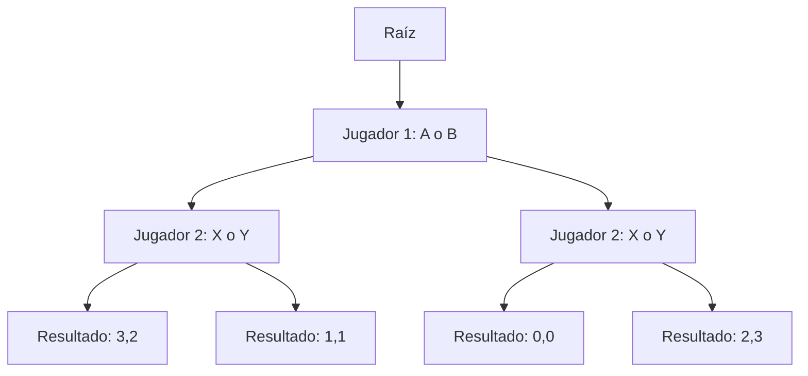
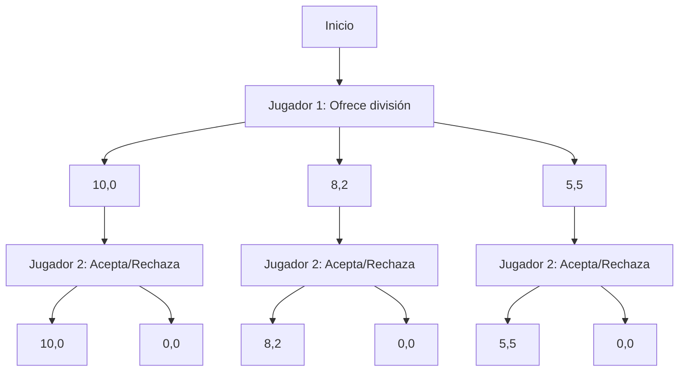
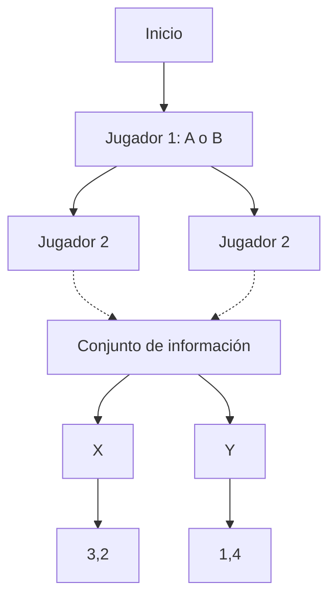
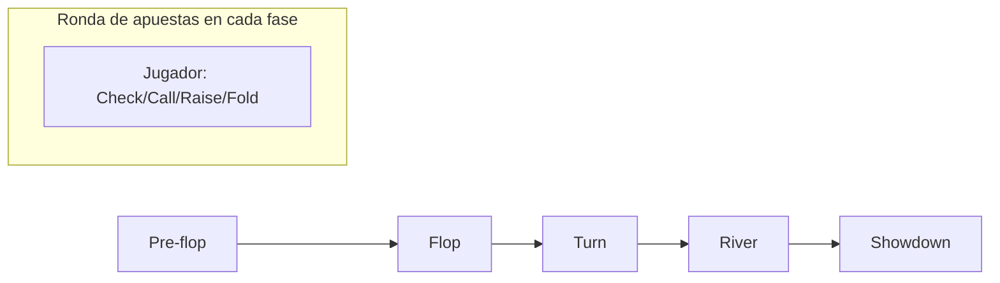
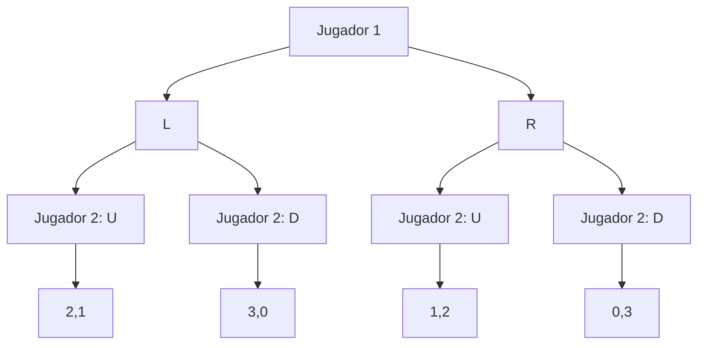

# Gráficas y Juegos - Juegos

## 8.2 Juegos en forma extensiva.

---

### Definición

Un **juego en forma extensiva** es una representación de un juego que especifica:

- El orden de los movimientos
- Las opciones disponibles para cada jugador en cada turno
- La información que posee cada jugador al tomar decisiones
- Las recompensas para cada combinación de acciones

### Elementos Fundamentales

#### 1. Jugadores

$N = \{1, 2, ..., n\}$ conjunto de jugadores

#### 2. Árbol de Juego

Estructura que representa las decisiones secuenciales



#### 3. Conjuntos de Información

Indican qué información tiene cada jugador al moverse

### Representación Matemática

Un juego en forma extensiva se define como la tupla:

$$ \Gamma = (N, H, P, I, u) $$

Donde:

- $N$: Conjunto de jugadores
- $H$: Conjunto de historias o secuencias de acciones
- $P$: Función que asigna jugadores a nodos de decisión
- $I$: Conjuntos de información
- $u$: Función de utilidad/pago

### Ejemplo: Juego del Ultimátum



### Equilibrio de Nash Perfecto en Subjuegos

Para encontrar equilibrios, usamos **inducción hacia atrás**:

#### Algoritmo de Inducción hacia Atrás

```typescript
function backwardInduction(game: GameTree): StrategyProfile {
  // Recorrer el árbol desde las hojas hacia la raíz
  for (let node of game.nodes.reverse()) {
    if (node.isTerminal()) continue;

    const player = node.getPlayer();
    const bestResponse = findBestResponse(node, player);
    node.setStrategy(bestResponse);
  }
  return game.getRootStrategy();
}
```

### Representación en Código

```typescript
interface ExtensiveFormGame {
  players: Player[];
  tree: GameTree;
  informationSets: InformationSet[];
}

interface GameNode {
  id: string;
  player: Player | null; // null para nodos de chance
  actions: GameAction[];
  children: Map<GameAction, GameNode>;
  payoffs?: number[]; // Para nodos terminales
}

interface InformationSet {
  nodes: GameNode[];
  player: Player;
}

class ExtensiveGameSolver {
  solveSubgamePerfectEquilibrium(game: ExtensiveFormGame): Map<Player, Strategy> {
    // Implementación de inducción hacia atrás
    const strategies = new Map<Player, Strategy>();

    this.backwardInduction(game.tree.root, strategies);
    return strategies;
  }

  private backwardInduction(node: GameNode, strategies: Map<Player, Strategy>): void {
    if (node.isTerminal()) return;

    // Procesar hijos primero
    for (const action of node.actions) {
      this.backwardInduction(node.children.get(action)!, strategies);
    }

    // Encontrar mejor respuesta
    const bestAction = this.findBestAction(node);
    const playerStrategy = strategies.get(node.player!) || new Strategy();
    playerStrategy.setAction(node, bestAction);
    strategies.set(node.player!, playerStrategy);
  }
}
```

### Juegos con Información Imperfecta

Cuando los jugadores no tienen información completa:



### Aplicaciones Prácticas

#### 1. Poker Texas Hold'em



#### 2. Negociaciones Comerciales

Secuencias de oferta-contraoferta con información imperfecta

### Ejercicio Práctico

Resuelve el siguiente juego usando inducción hacia atrás:



**Solución:**

1. Jugador 2 elige U en nodo izquierdo (1 > 0)
2. Jugador 2 elige D en nodo derecho (3 > 2)
3. Jugador 1 elige L (2 > 1)
4. Equilibrio: (L, (U si L, D si R))

### Fórmulas Importantes

#### Valor de un nodo

$$ V_i(h) = \max_{a \in A(h)} u_i(a | h) $$

#### Pago esperado

$$ EU_i(\sigma) = \sum_{z \in Z} p(z|\sigma) u_i(z) $$

Donde $p(z|\sigma)$ es la probabilidad de alcanzar el nodo terminal $z$ bajo el perfil de estrategias $\sigma$.

### Herramientas de Software

- **Gambit**: Biblioteca para análisis de juegos
- **OpenSpiel**: Framework de Google para investigación en juegos
- **Axelrod**: Biblioteca para teoría de juegos iterados

### Referencias

- Osborne, M. J., & Rubinstein, A. (1994). A Course in Game Theory
- Fudenberg, D., & Tirole, J. (1991). Game Theory
- Leyton-Brown, K., & Shoham, Y. (2008). Essentials of Game Theory
