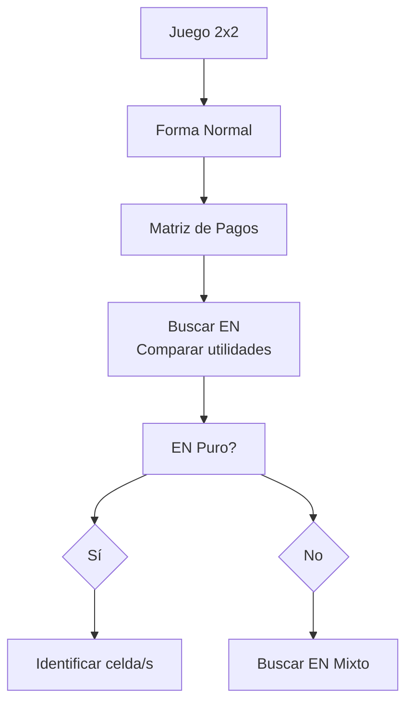

# Gráficas y Juegos - Juegos

## 8.3 Equilibrio de Nash.

---

### 1. Definición Formal

El **Equilibrio de Nash** es un concepto de la teoría de juegos donde ningún jugador puede mejorar su resultado unilateralmente cambiando su estrategia mientras los demás mantienen las suyas. Para un juego con $n$ jugadores, un perfil de estrategias

$ s^* = \left( s_1^* , s_2^* , ... , s_n^* \right) $

constituye un equilibrio de Nash si para cada jugador $i$:

$$ u_i \left( s_i^* , s_{-i}^* \right) \geq u_i \left(s_i , s_{-i}^* \right) \quad \forall s_i \in S_i $$

Donde:

- $u_i$ es la función de utilidad del jugador $i$
- $s_{-i}^*$ representa las estrategias de todos los jugadores excepto $i$
- $S_i$ es el conjunto de estrategias disponibles para el jugador $i$

### 2. Representación Matricial (Juegos 2x2)



#### Ejemplo: Dilema del Prisionero

<section>
<div>

|              | Confesar | Callar   |
| ------------ | -------- | -------- |
| **Confesar** | (-5, -5) | (0, -10) |
| **Callar**   | (-10, 0) | (-1, -1) |

</div>
<div>

**Análisis:** El equilibrio de Nash es (Confesar, Confesar) ya que:

- Si el jugador 2 confiesa, el 1 prefiere confesar (-5 > -10)
- Si el jugador 2 calla, el 1 prefiere confesar (0 > -1)
- Situación simétrica para el jugador 2

</div>
</section>

### 3. Algoritmo para Encontrar Equilibrios de Nash

```typescript
interface Strategy {
  player: number;
  action: string;
  payoff: number;
}

interface NashEquilibrium {
  strategies: string[];
  payoffs: number[];
}

function findPureNashEquilibria(payoffMatrix: Strategy[][][]): NashEquilibrium[] {
  const equilibria: NashEquilibrium[] = [];
  const rows = payoffMatrix.length;
  const cols = payoffMatrix[0].length;

  for (let i = 0; i < rows; i++) {
    for (let j = 0; j < cols; j++) {
      const currentCell = payoffMatrix[i][j];
      const isNash = isNashEquilibrium(payoffMatrix, i, j);

      if (isNash) {
        equilibria.push({
          strategies: [currentCell[0].action, currentCell[1].action],
          payoffs: [currentCell[0].payoff, currentCell[1].payoff],
        });
      }
    }
  }

  return equilibria;
}

function isNashEquilibrium(matrix: Strategy[][][], row: number, col: number): boolean {
  // Verificar si ningún jugador puede mejorar cambiando unilateralmente
  const cell = matrix[row][col];
  const player1Best = findBestResponse(matrix, 0, col, row);
  const player2Best = findBestResponse(matrix, 1, row, col);

  return cell[0].payoff >= player1Best.payoff && cell[1].payoff >= player2Best.payoff;
}
```

### 4. Equilibrio de Nash en Estrategias Mixtas

Para estrategias mixtas, donde los jugadores randomizan sobre acciones puras:

$$ u_i \left(\sigma_i^* , \sigma_{-i}^* \right) \geq u_i \left(\sigma_i , \sigma_{-i}^* \right) \quad \forall \sigma_i \in \Sigma_i $$

Donde $\Sigma_i$ es el conjunto de distribuciones de probabilidad sobre $S_i$.

#### Ejemplo: Piedra, Papel o Tijeras

La única estrategia mixta de equilibrio es donde cada jugador juega cada acción con probabilidad $\frac{1}{3}$.

### 5. Teorema de Nash (1950)

**Todo juego finito con un número finito de jugadores tiene al menos un equilibrio de Nash en estrategias mixtas.**

### 6. Aplicación Práctica: Calculadora de EN

```python
def calcular_equilibrio_mixto_2x2(matrix):
    """
    Calcula el equilibrio de Nash completamente mixto de un juego 2x2
    matrix: [[(a11, b11), (a12, b12)], [(a21, b21), (a22, b22)]]
    Devuelve ((p, 1-p), (q, 1-q)): p = prob. de que el jugador 1 juegue la
    fila 1 y q = prob. de que el jugador 2 juegue la columna 1, o None si
    no hay un equilibrio completamente mixto.
    """
    (a11, b11), (a12, b12) = matrix[0]
    (a21, b21), (a22, b22) = matrix[1]

    # p hace indiferente al jugador 2 entre sus columnas:
    # p*b11 + (1-p)*b21 = p*b12 + (1-p)*b22
    den_p = b11 - b12 - b21 + b22
    # q hace indiferente al jugador 1 entre sus filas:
    # q*a11 + (1-q)*a12 = q*a21 + (1-q)*a22
    den_q = a11 - a12 - a21 + a22
    if den_p == 0 or den_q == 0:
        return None   # caso degenerado: algún jugador nunca es indiferente

    p = (b22 - b21) / den_p
    q = (a22 - a12) / den_q
    if not (0 < p < 1 and 0 < q < 1):
        return None   # no hay equilibrio con ambas acciones en juego
    return (p, 1 - p), (q, 1 - q)

batalla = [[(2, 1), (0, 0)], [(0, 0), (1, 2)]]
print(calcular_equilibrio_mixto_2x2(batalla))
# ((0.666..., 0.333...), (0.333..., 0.666...)), como en el ejercicio 1

volados = [[(1, -1), (-1, 1)], [(-1, 1), (1, -1)]]
print(calcular_equilibrio_mixto_2x2(volados))   # ((0.5, 0.5), (0.5, 0.5))

prisionero = [[(-5, -5), (0, -10)], [(-10, 0), (-1, -1)]]
print(calcular_equilibrio_mixto_2x2(prisionero))   # None: confesar es dominante
```

### 7. Ejercicios Prácticos

#### Ejercicio 1: Batalla de los Sexos

<section>
<div>

|            | Fútbol | Teatro |
| ---------- | ------ | ------ |
| **Fútbol** | (2, 1) | (0, 0) |
| **Teatro** | (0, 0) | (1, 2) |

**Encuentra:** Todos los equilibrios de Nash (puros y mixtos)

</div>
<div>

**Solución:**

- **Equilibrios puros:** (Fútbol, Fútbol) y (Teatro, Teatro)
- **Equilibrio mixto:**
  - Jugador 1: $\frac{2}{3}$ Fútbol, $\frac{1}{3}$ Teatro
  - Jugador 2: $\frac{1}{3}$ Fútbol, $\frac{2}{3}$ Teatro

</div>
</section>

### 8. Limitaciones y Críticas

1. **Multiplicidad:** Puede haber múltiples equilibrios
2. **Ineficiencia:** No necesariamente óptimo Pareto (ej: dilema del prisionero)
3. **Supuestos:** Jugadores racionales con conocimiento común

### 9. Recursos Adicionales

- "A Beautiful Mind" (película sobre John Nash)
- "Game Theory: An Introduction" por Steven Tadelis
- Simulador online de teoría de juegos
