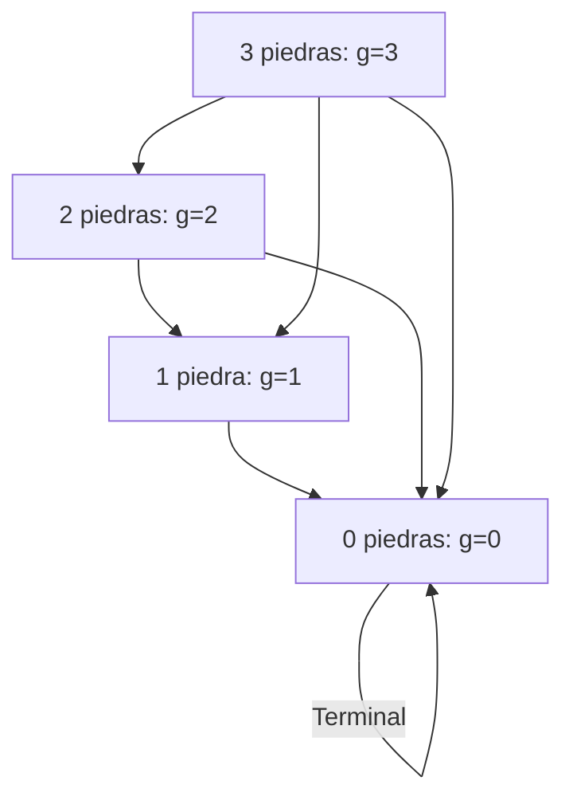
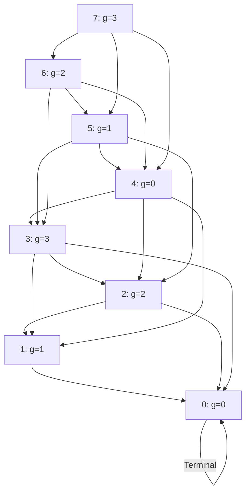

# Gráficas y Juegos - Juegos tipo Nim

## 9.1 Digráficas.

---

### Definición

Una **digráfica** (o gráfica dirigida) es una estructura matemática utilizada para modelar juegos tipo Nim, donde:

- Los vértices representan posiciones del juego
- Las aristas dirigidas representan movimientos válidos entre posiciones
- Existe un vértice inicial (posición inicial del juego)
- Los vértices terminales representan posiciones finales (ganadas/perdidas)

### Representación Matemática

Una digráfica de juego se define como:

$$ G = (V, E, v_0, T, \phi) $$

Donde:

- $V$: Conjunto de vértices (posiciones del juego)
- $E \subseteq V \times V$: Conjunto de aristas dirigidas (movimientos)
- $v_0 \in V$: Vértice inicial (posición inicial)
- $T \subseteq V$: Vértices terminales (posiciones finales)
- $\phi: T \rightarrow \{\text{GANADA}, \text{PERDIDA}\}$: Función que clasifica posiciones terminales

### Conceptos Fundamentales

#### 1. Números de Grundy

Para cada vértice $v \in V$, el número de Grundy se calcula como:

$$ g(v) = \text{mex}\{g(u) : (v, u) \in E\} $$

Donde $\text{mex}$ (mínimo excluido) es el menor entero no negativo que no está en el conjunto.

#### 2. Posiciones Perdedoras y Ganadoras

- $g(v) = 0$: Posición perdedora (jugador que mueve pierde con juego perfecto)
- $g(v) > 0$: Posición ganadora (jugador que mueve puede forzar victoria)

#### Ejemplo: Digráfica de Nim Simplificado



### Cálculo de Números de Grundy

#### Algoritmo Recursivo

```typescript
interface Digraph {
  vertices: number[];
  edges: Map<number, number[]>;
  terminalPositions: number[];
}

function calculateGrundyNumbers(graph: Digraph): Map<number, number> {
  const grundy = new Map<number, number>();

  // Inicializar vértices terminales
  for (const v of graph.terminalPositions) {
    grundy.set(v, 0); // Posiciones terminales tienen Grundy = 0
  }

  // Función recursiva para calcular Grundy
  function computeGrundy(vertex: number): number {
    if (grundy.has(vertex)) return grundy.get(vertex)!;

    const successors = graph.edges.get(vertex) || [];
    const grundyValues = new Set<number>();

    for (const succ of successors) {
      grundyValues.add(computeGrundy(succ));
    }

    const mex = findMex(grundyValues);
    grundy.set(vertex, mex);
    return mex;
  }

  // Calcular para todos los vértices
  for (const v of graph.vertices) {
    if (!grundy.has(v)) {
      computeGrundy(v);
    }
  }

  return grundy;
}

function findMex(numbers: Set<number>): number {
  let mex = 0;
  while (numbers.has(mex)) {
    mex++;
  }
  return mex;
}
```

### Teorema de Sprague-Grundy

Para cualquier juego impartial (como Nim), la posición es equivalente a un montón de Nim de tamaño $g(v)$:

$$ g(v_1 \oplus v_2 \oplus \cdots \oplus v_n) = g(v_1) \oplus g(v_2) \oplus \cdots \oplus g(v_n) $$

Donde $\oplus$ representa la operación XOR bit a bit.

### Implementación del Juego Nim con Digráficas

```typescript
class NimGame {
  private graph: Digraph;
  private currentPosition: number;
  private grundyNumbers: Map<number, number>;

  constructor(initialStones: number, maxTake: number) {
    this.graph = this.buildDigraph(initialStones, maxTake);
    this.grundyNumbers = calculateGrundyNumbers(this.graph);
    this.currentPosition = initialStones;
  }

  private buildDigraph(maxStones: number, maxTake: number): Digraph {
    const vertices: number[] = [];
    const edges = new Map<number, number[]>();
    const terminalPositions: number[] = [];

    // Crear vértices para 0 hasta maxStones piedras
    for (let i = 0; i <= maxStones; i++) {
      vertices.push(i);
      if (i === 0) {
        terminalPositions.push(i);
        edges.set(i, []);
      } else {
        const moves: number[] = [];
        for (let take = 1; take <= Math.min(i, maxTake); take++) {
          moves.push(i - take);
        }
        edges.set(i, moves);
      }
    }

    return { vertices, edges, terminalPositions };
  }

  // Determinar si la posición actual es ganadora
  isWinningPosition(): boolean {
    return this.grundyNumbers.get(this.currentPosition)! > 0;
  }

  // Encontrar movimiento óptimo
  findOptimalMove(): number | null {
    if (!this.isWinningPosition()) return null;

    const currentGrundy = this.grundyNumbers.get(this.currentPosition)!;
    const possibleMoves = this.graph.edges.get(this.currentPosition)!;

    for (const move of possibleMoves) {
      const newGrundy = this.grundyNumbers.get(move)!;
      if ((currentGrundy ^ newGrundy) === 0) {
        return this.currentPosition - move;
      }
    }

    return possibleMoves[0]; // Movimiento cualquiera si no hay óptimo
  }

  // Realizar movimiento
  makeMove(stonesToTake: number): void {
    if (stonesToTake <= 0 || stonesToTake > this.currentPosition) {
      throw new Error('Movimiento inválido');
    }

    this.currentPosition -= stonesToTake;
  }
}
```

### Ejemplo: Nim con 7 Piedras (máximo 3 por turno)



**Análisis:**

- Posiciones perdedoras (g=0): 0, 4
- Posiciones ganadoras (g>0): 1, 2, 3, 5, 6, 7
- Desde 7 (g=3), movimiento óptimo: llevar a posición con g=0 (quitar 3 piedras)

### Aplicación del Teorema de Sprague-Grundy

Para múltiples montones de Nim:

$$ g(v_1, v_2, \ldots, v_n) = g(v_1) \oplus g(v_2) \oplus \cdots \oplus g(v_n) $$

La posición es perdedora si y solo si el XOR de todos los números de Grundy es 0.

### Ejercicio Práctico

Dado un juego con las siguientes reglas:

- 2 montones de piedras (5 y 3 piedras)
- Máximo 3 piedras por turno
- Se puede tomar de cualquier montón

**Calcula:**

1. Números de Grundy para cada montón
2. XOR total de los números de Grundy
3. Determina si la posición es ganadora o perdedora
4. Encuentra el movimiento óptimo (si existe)

### Fórmulas Importantes

#### Cálculo recursivo de Grundy

$$ g(v) = \text{mex}\{g(u) : u \in \text{sucesores}(v)\} $$

#### XOR de números de Grundy

$$ G_{\text{total}} = g_1 \oplus g_2 \oplus \cdots \oplus g_n $$

#### Condición de posición perdedora

$$ G_{\text{total}} = 0 $$

### Optimizaciones Computacionales

#### Programación Dinámica

```typescript
function calculateGrundyDP(maxStones: number, maxTake: number): number[] {
  const grundy = new Array(maxStones + 1).fill(0);

  for (let stones = 1; stones <= maxStones; stones++) {
    const values = new Set<number>();
    for (let take = 1; take <= Math.min(stones, maxTake); take++) {
      values.add(grundy[stones - take]);
    }
    grundy[stones] = findMex(values);
  }

  return grundy;
}
```

### Variantes de Nim Modeladas con Digráficas

1. Nim Normal

- Tomar cualquier número de piedras de un montón
- $ g(n) = n $

2. Nim con Restricción de Tomar

- Máximo $k$ piedras por turno
- $ g(n) = n \mod (k + 1) $

3. Nim de Fibonacci

- No tomar dos veces seguidas el mismo número
- Requiere digráfica con estado extendido

### Referencias

- Sprague, R. P. (1935). Über mathematische Kampfspiele
- Grundy, P. M. (1939). Mathematics and games
- Berlekamp, E. R., Conway, J. H., & Guy, R. K. (2001). Winning Ways for Your Mathematical Plays
- Ferguson, T. S. (2014). Game Theory
