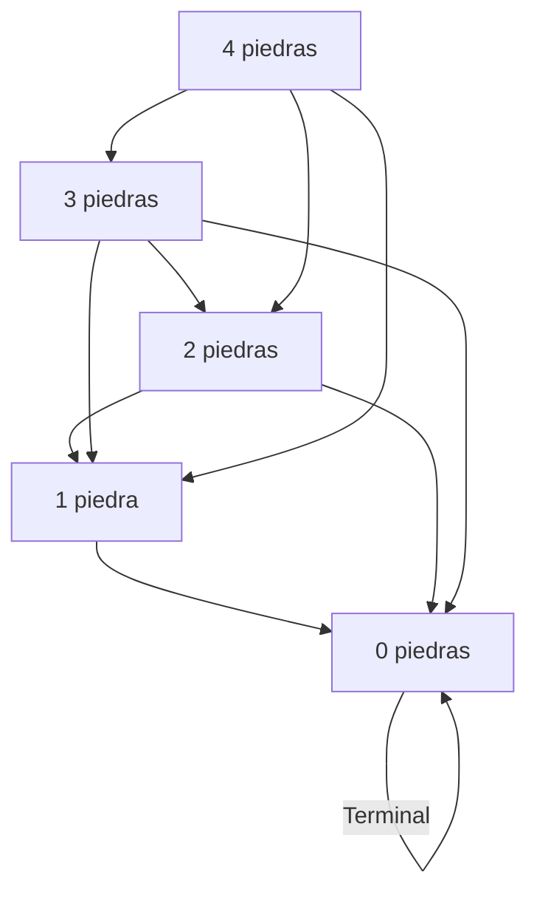

# Gráficas y Juegos - Juegos tipo Nim

## 9.2 Núcleos.

---

### Definición

En teoría de juegos combinatorios, el **núcleo** (kernel) de una digráfica es un concepto fundamental que identifica un conjunto de vértices con propiedades especiales. Para juegos tipo Nim, el núcleo representa las posiciones perdedoras desde las cuales todo movimiento lleva a una posición ganadora para el oponente.

### Definición Formal

Dada una digráfica $G = (V, E)$, un **núcleo** $K \subseteq V$ es un conjunto de vértices que satisface:

1. **Independencia**: No existen aristas entre vértices del núcleo

   $$ \forall u, v \in K, (u, v) \notin E $$

2. **Absorción**: Desde cualquier vértice fuera del núcleo, existe una arista hacia el núcleo

   $$ \forall v \in V \setminus K, \exists u \in K \text{ tal que } (v, u) \in E $$

### Relación con Juegos Imparciales

En juegos tipo Nim, el núcleo corresponde exactamente a las **posiciones perdedoras** (P-posiciones). Desde cualquier posición en el núcleo, todos los movimientos llevan a posiciones fuera del núcleo (N-posiciones).

### Cálculo del Núcleo

#### Algoritmo Iterativo para Encontrar el Núcleo

```typescript
interface Digraph {
  vertices: number[];
  edges: Map<number, number[]>;
}

function findKernel(graph: Digraph): number[] {
  // Inicializar todos los vértices como candidatos al núcleo
  let kernel = new Set<number>(graph.vertices);
  let changed: boolean;

  do {
    changed = false;

    // Paso 1: Eliminar vértices que violan la independencia
    for (const u of kernel) {
      for (const v of kernel) {
        if (u !== v && graph.edges.get(u)?.includes(v)) {
          kernel.delete(u);
          changed = true;
          break;
        }
      }
      if (changed) break;
    }

    // Paso 2: Eliminar vértices que violan la absorción
    if (!changed) {
      for (const v of graph.vertices) {
        if (!kernel.has(v)) {
          let hasEdgeToKernel = false;
          for (const u of kernel) {
            if (graph.edges.get(v)?.includes(u)) {
              hasEdgeToKernel = true;
              break;
            }
          }
          if (!hasEdgeToKernel) {
            // Encontrar algún vértice que tenga arista a v y agregarlo al kernel
            for (const w of graph.vertices) {
              if (graph.edges.get(w)?.includes(v) && kernel.has(w)) {
                kernel.delete(w);
                changed = true;
                break;
              }
            }
          }
        }
      }
    }
  } while (changed);

  return Array.from(kernel);
}
```

### Ejemplo: Núcleo en Juego Nim Simple

Consideremos un juego Nim con un montón de hasta 4 piedras, donde se pueden tomar 1, 2 o 3 piedras por turno.



**Núcleo identificado:** {0, 4}

- 0 es posición terminal (perdedora)
- 4 es posición perdedora (todos los movimientos llevan a posiciones ganadoras)

### Teorema Fundamental

#### Teorema del Núcleo en Juegos Imparciales

Para cualquier juego impartial finito sin empates:

- El núcleo existe y es único
- Corresponde exactamente a las P-posiciones (posiciones perdedoras)
- Desde cualquier posición no en el núcleo, existe un movimiento a una posición en el núcleo

### Aplicación en Estrategias Ganadoras

#### Determinación de Movimientos Óptimos

```typescript
class NimGameWithKernel {
  private graph: Digraph;
  private kernel: number[];

  constructor(
    private stones: number,
    private maxTake: number,
  ) {
    this.graph = this.buildGraph();
    this.kernel = findKernel(this.graph);
  }

  private buildGraph(): Digraph {
    const vertices: number[] = [];
    const edges = new Map<number, number[]>();

    for (let i = 0; i <= this.stones; i++) {
      vertices.push(i);
      const moves: number[] = [];
      for (let take = 1; take <= Math.min(i, this.maxTake); take++) {
        moves.push(i - take);
      }
      edges.set(i, moves);
    }

    return { vertices, edges };
  }

  isWinningPosition(): boolean {
    return !this.kernel.includes(this.stones);
  }

  findWinningMove(): number | null {
    if (!this.isWinningPosition()) return null;

    const currentPosition = this.stones;
    const possibleMoves = this.graph.edges.get(currentPosition) || [];

    for (const move of possibleMoves) {
      if (this.kernel.includes(move)) {
        return currentPosition - move;
      }
    }

    return null;
  }
}
```

### Núcleo en Juegos con Múltiples Montones

Para juegos Nim con múltiples montones, el núcleo se determina mediante la operación XOR (nim-sum):

#### Teorema de Bouton

Una posición $(x_1, x_2, \ldots, x_n)$ en Nim múltiple está en el núcleo si y solo si:

$$ x_1 \oplus x_2 \oplus \cdots \oplus x_n = 0 $$

Donde $\oplus$ representa la operación XOR bit a bit.

### Implementación para Nim Múltiple

```typescript
class MultiPileNim {
  private piles: number[];

  constructor(piles: number[]) {
    this.piles = piles;
  }

  isInKernel(): boolean {
    return this.calculateNimSum() === 0;
  }

  private calculateNimSum(): number {
    return this.piles.reduce((sum, pile) => sum ^ pile, 0);
  }

  findWinningMove(): { pile: number; take: number } | null {
    const nimSum = this.calculateNimSum();
    if (nimSum === 0) return null; // Está en el núcleo

    for (let i = 0; i < this.piles.length; i++) {
      const targetSize = this.piles[i] ^ nimSum;
      if (targetSize < this.piles[i]) {
        return {
          pile: i,
          take: this.piles[i] - targetSize,
        };
      }
    }

    return null;
  }
}
```

#### Ejemplo: Núcleo en Nim con Tres Montones

Consideremos la posición (3, 4, 5):

- 3 ⊕ 4 ⊕ 5 = 011 ⊕ 100 ⊕ 101 = 010 = 2 ≠ 0
- No está en el núcleo (posición ganadora)

Movimiento óptimo: Desde el montón de 4, tomar 2 piedras:

- 4 ⊕ 2 = 100 ⊕ 010 = 110 = 6
- Pero necesitamos: 3 ⊕ x ⊕ 5 = 0 ⇒ x = 3 ⊕ 5 = 6
- Tomar 4 - 6 = -2? ¡Error!

Corrección:

- Para el montón i, queremos: piles[i] ⊕ nimSum < piles[i]
- Para montón 1 (3): 3 ⊕ 2 = 1 < 3 ⇒ tomar 3 - 1 = 2 piedras
- Nueva posición: (1, 4, 5) con 1 ⊕ 4 ⊕ 5 = 0

#### Propiedades del Núcleo

**Unicidad**
El núcleo de cualquier digráfica acíclica es único.

**Existencia**
Toda digráfica finita acíclica tiene un núcleo.

**Computabilidad**
El problema de determinar si un vértice está en el núcleo es:

- P para digráficas acíclicas
- NP-duro para digráficas generales

### Ejercicios Prácticos

1. Nim Simple: Para un montón de 7 piedras (máximo 3 por turno):

   - Construye la digráfica
   - Encuentra el núcleo
   - Determina las posiciones ganadoras y perdedoras

2. Nim Múltiple: Para la posición (5, 7, 9):

   - Calcula el nim-sum
   - Determina si está en el núcleo
   - Encuentra el movimiento óptimo (si existe)

3. Juego Personalizado: Define un juego con reglas específicas:

   - Construye la digráfica
   - Encuentra el núcleo
   - Implementa la estrategia ganadora

### Aplicaciones Beyond Nim

El concepto de núcleo se aplica a diversos juegos:

- Kayles
- Dawson's Chess
- Wythoff's Game
- Y muchos otros juegos combinatorios

### Referencias

- von Neumann, J., & Morgenstern, O. (1944). Theory of Games and Economic Behavior
- Berlekamp, E. R., Conway, J. H., & Guy, R. K. (2001). Winning Ways for Your Mathematical Plays
- Ferguson, T. S. (2014). Game Theory
- Schrijver, A. (2003). Combinatorial Optimization: Polyhedra and Efficiency
