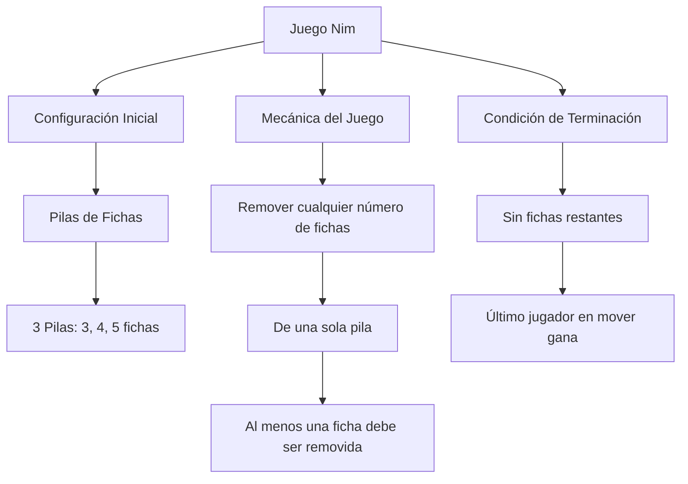

# Gráficas y Juegos - Juegos tipo Nim

## 9.3 Juegos tipo Nim.

---

### 1. Definición y Conceptos Básicos

Los **juegos tipo Nim** son juegos matemáticos de estrategia imparcial para dos jugadores, donde:

- Los jugadores alternan turnos
- El juego termina cuando un jugador no puede hacer un movimiento
- El último jugador en mover gana (variante normal)
- Son juegos de suma cero e información perfecta

**Características principales:**

- Estado del juego representado por pilas de fichas
- Movimiento consiste en remover fichas de una pila
- Juego completamente determinista con juego perfecto

### 2. Representación del Juego



### 3. El Nim-Sum

La **nim-sum** es la operación XOR binaria aplicada a los tamaños de las pilas:

$$ \text{nim-sum} = x_1 \oplus x_2 \oplus \cdots \oplus x_n $$

Donde:

- $x_i$ es el número de fichas en la pila $i$
- $\oplus$ representa la operación XOR a nivel de bits

#### Cálculo del Nim-Sum:

```
3 ⊕ 4 ⊕ 5 = ?
3 = 011
4 = 100
5 = 101
010 = 2
```

### 4. Teorema Fundamental de Nim

**Un estado es perdedor si y solo si el nim-sum es cero:**

$$ \text{Estado perdedor} \iff x_1 \oplus x_2 \oplus \cdots \oplus x_n = 0 $$

**Un estado es ganador si el nim-sum es diferente de cero:**

$$ \text{Estado ganador} \iff x_1 \oplus x_2 \oplus \cdots \oplus x_n \neq 0 $$

### 5. Algoritmo para Determinar Movimientos Óptimos

```python
def calcular_movimiento_optimo(pilas):
    """
    Encuentra el movimiento óptimo en un juego Nim
    Devuelve (pila, cantidad_a_remover) o None si no hay movimiento ganador
    """
    nim_sum = 0
    for pila in pilas:
        nim_sum ^= pila

    if nim_sum == 0:
        return None  # Estado perdedor

    for i, pila in enumerate(pilas):
        objetivo = pila ^ nim_sum
        if objetivo < pila:
            return (i, pila - objetivo)

    return None

# Ejemplo de uso
pilas = [3, 4, 5]
movimiento = calcular_movimiento_optimo(pilas)
print(f"Remover {movimiento[1]} fichas de la pila {movimiento[0]}")
```

### 6. Implementación Completa del Juego Nim

```typescript
class JuegoNim {
  private pilas: number[];
  private jugadorActual: number;

  constructor(pilasIniciales: number[]) {
    this.pilas = [...pilasIniciales];
    this.jugadorActual = 1;
  }

  private calcularNimSum(): number {
    return this.pilas.reduce((sum, pila) => sum ^ pila, 0);
  }

  esMovimientoValido(pila: number, cantidad: number): boolean {
    return pila >= 0 && pila < this.pilas.length && cantidad > 0 && cantidad <= this.pilas[pila];
  }

  hacerMovimiento(pila: number, cantidad: number): boolean {
    if (!this.esMovimientoValido(pila, cantidad)) {
      return false;
    }

    this.pilas[pila] -= cantidad;
    this.jugadorActual = 3 - this.jugadorActual; // Alterna entre 1 y 2
    return true;
  }

  haTerminado(): boolean {
    return this.pilas.every((pila) => pila === 0);
  }

  getGanador(): number {
    if (!this.haTerminado()) return 0;
    // Tras el último movimiento, jugadorActual ya cambió al jugador que no puede
    // mover. En la variante normal el último en mover GANA: es el otro jugador
    return 3 - this.jugadorActual;
  }

  getMovimientoOptimo(): [number, number] | null {
    const nimSum = this.calcularNimSum();
    if (nimSum === 0) return null;

    for (let i = 0; i < this.pilas.length; i++) {
      const objetivo = this.pilas[i] ^ nimSum;
      if (objetivo < this.pilas[i]) {
        return [i, this.pilas[i] - objetivo];
      }
    }

    return null;
  }
}
```

### 7. Ejemplo Paso a Paso

**Estado inicial:** Pilas [3, 4, 5]

- Nim-sum: 3 ⊕ 4 ⊕ 5 = 2 ≠ 0 → Estado ganador

**Movimiento óptimo:**

- Para pila 0: 3 ⊕ 2 = 1 → remover 2 fichas (3-1)
- Para pila 1: 4 ⊕ 2 = 6 → no válido (6 > 4)
- Para pila 2: 5 ⊕ 2 = 7 → no válido (7 > 5)

**Mejor movimiento:** Remover 2 fichas de la pila 0

### 8. Variantes de Nim

#### 8.1 Nim de Montón Único

- Solo una pila de fichas
- Movimiento: remover 1 a k fichas
- Estrategia: dejar múltiplos de (k+1) fichas

#### 8.2 Nim de Restricción de Movimiento

- Límite en fichas que se pueden remover por turno
- Generalización del montón único

#### 8.3 Nim Misère

- El último jugador en mover **pierde**
- La estrategia es la misma que en Nim normal mientras haya al menos una pila con 2 o más fichas. Cuando el movimiento dejaría todas las pilas con 0 o 1 ficha, se elige dejar un número **impar** de pilas con una ficha, en lugar de uno par
- Equivalentemente, las posiciones perdedoras son las de nim-sum 0 con alguna pila mayor que 1, y las de nim-sum 1 con todas las pilas de tamaño 0 o 1

### 9. Ejercicios Prácticos

#### Ejercicio 1:

**Estado:** Pilas [7, 8, 9]

1. Calcula el nim-sum
2. Determina si el estado es ganador o perdedor
3. Encuentra el movimiento óptimo

#### Ejercicio 2:

**Estado:** Pilas [5, 6, 7]

- Jugador A remueve 2 fichas de la pila 1
- Encuentra la mejor respuesta para el Jugador B

### 10. Aplicaciones y Relaciones

- **Teoría de juegos combinatorios**
- **Análisis de posiciones ganadoras/perdedoras**
- **Base para juegos más complejos**
- **Aplicaciones en inteligencia artificial**

### 11. Recursos Adicionales

- "Winning Ways for Your Mathematical Plays" por Berlekamp, Conway, y Guy
- "On Numbers and Games" por John Horton Conway
- Simuladores online de juegos Nim
- Competencias de programación con problemas de juegos imparciales
