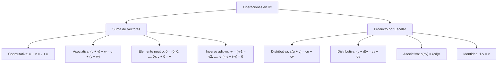
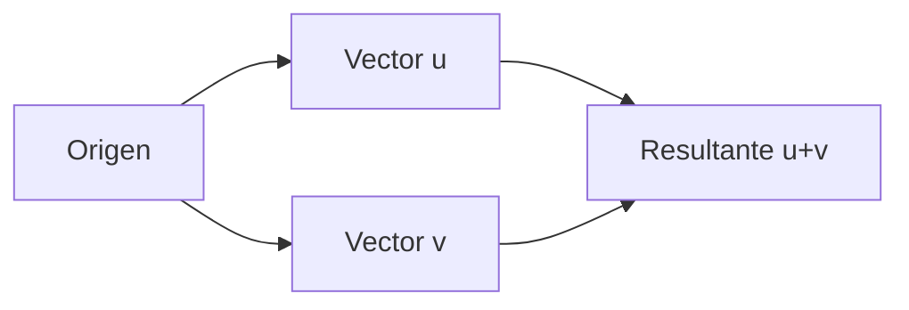
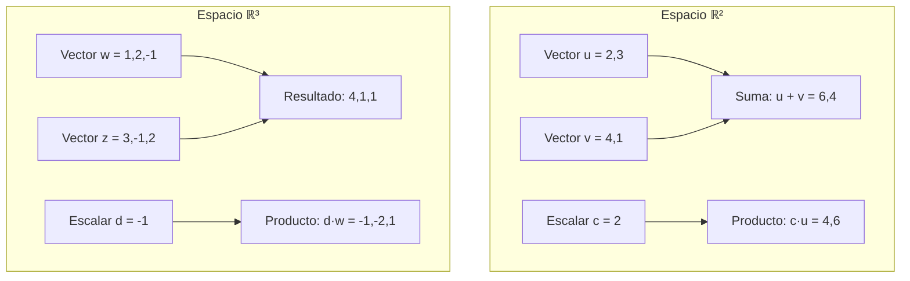

# Matemáticas para Ciencias Aplicadas II - Espacio Euclidiano de dimensión n

## 1.1 Suma de vectores. Producto por escalares.

---

### 1. Definición del Espacio Euclidiano ℝⁿ

El espacio euclidiano de dimensión $n$, denotado por $\mathbb{R}^n$, es el conjunto de todas las n-tuplas ordenadas de números reales:

$$\mathbb{R}^n = \{(x_1, x_2, \ldots, x_n) \mid x_i \in \mathbb{R} \text{ para } i = 1, 2, \ldots, n\}$$

Cada elemento $\vec{v} = (v_1, v_2, \ldots, v_n)$ se llama **vector**.

### 2. Operaciones Básicas con Vectores

#### 2.1 Suma de Vectores

Dados dos vectores $\vec{u} = (u_1, u_2, \ldots, u_n)$ y $\vec{v} = (v_1, v_2, \ldots, v_n)$ en $\mathbb{R}^n$, su suma se define como:

$$ \vec{u} + \vec{v} = (u_1 + v_1, u_2 + v_2, \ldots, u_n + v_n) $$

#### 2.2 Producto por Escalar

Dado un vector $\vec{v} = (v_1, v_2, \ldots, v_n)$ y un escalar $c \in \mathbb{R}$, el producto por escalar se define como:

$$ c \cdot \vec{v} = (c \cdot v_1, c \cdot v_2, \ldots, c \cdot v_n) $$

### 3. Propiedades Algebraicas



### 4. Representación Geométrica en ℝ² y ℝ³

#### 4.1 Interpretación Geométrica de la Suma



#### 4.2 Interpretación Geométrica del Producto por Escalar

- $c > 1$: Alargamiento del vector
- $0 < c < 1$: Acortamiento del vector
- $c < 0$: Cambio de dirección y escalamiento
- $c = -1$: Vector opuesto (misma magnitud, dirección contraria)

### 5. Implementación Computacional en Python

```python
import numpy as np

class VectorND:
    def __init__(self, componentes):
        self.componentes = np.array(componentes)
        self.dimension = len(componentes)

    def __add__(self, otro):
        """Suma de dos vectores"""
        if self.dimension != otro.dimension:
            raise ValueError("Los vectores deben tener la misma dimensión")
        return VectorND(self.componentes + otro.componentes)

    def __mul__(self, escalar):
        """Producto por escalar"""
        return VectorND(self.componentes * escalar)

    def __rmul__(self, escalar):
        """Producto por escalar (desde la izquierda)"""
        return self.__mul__(escalar)

    def __sub__(self, otro):
        """Resta de vectores (suma con el inverso aditivo)"""
        return self + (-1 * otro)

    def __str__(self):
        return f"Vector{self.dimension}D{tuple(self.componentes)}"

    def magnitud(self):
        """Calcula la magnitud del vector"""
        return np.sqrt(np.sum(self.componentes**2))

# Ejemplo de uso
v1 = VectorND([1, 2, 3])
v2 = VectorND([4, 5, 6])

print(f"v1 = {v1}")
print(f"v2 = {v2}")
print(f"v1 + v2 = {v1 + v2}")
print(f"3 * v1 = {3 * v1}")
print(f"v1 - v2 = {v1 - v2}")
print(f"Magnitud de v1: {v1.magnitud():.2f}")
```

### 6. Ejemplos y Ejercicios

#### Ejemplo 1: Suma en ℝ³

Dados $\vec{u} = (2, -1, 3)$ y $\vec{v} = (1, 4, -2)$:

$$\vec{u} + \vec{v} = (2 + 1, -1 + 4, 3 + (-2)) = (3, 3, 1)$$

#### Ejemplo 2: Producto por Escalar

Dado $\vec{w} = (4, -2, 1)$ y $c = 3$:

$$c \cdot \vec{w} = (3 \times 4, 3 \times (-2), 3 \times 1) = (12, -6, 3)$$

#### Ejercicio 1:

Sean $\vec{a} = (1, -2, 0, 4)$, $\vec{b} = (3, 1, -1, 2)$, $c = 2$, $d = -1$. Calcula:

1. $\vec{a} + \vec{b}$
2. $c \cdot \vec{a}$
3. $d \cdot \vec{b}$
4. $c \cdot \vec{a} + d \cdot \vec{b}$

### 7. Aplicaciones Prácticas

#### 7.1 Física: Fuerzas Resultantes

La suma vectorial representa la fuerza resultante de múltiples fuerzas actuando sobre un objeto.

#### 7.2 Gráficos por Computadora

Transformaciones geométricas usando productos por escalar:

- Escalamiento de objetos
- Cambio de dirección
- Normalización de vectores

#### 7.3 Machine Learning

- Operaciones en espacios de alta dimensión
- Combinación lineal de características
- Transformaciones de datos

### 8. Propiedades Importantes (Demostraciones)

#### 8.1 Conmutatividad de la Suma

$$ \vec{u} + \vec{v} = (u_1 + v_1, \ldots, u_n + v_n) = (v_1 + u_1, \ldots, v_n + u_n) = \vec{v} + \vec{u} $$

#### 8.2 Distributividad del Producto por Escalar

$$ c \cdot (\vec{u} + \vec{v}) = c \cdot (u_1 + v_1, \ldots, u_n + v_n) = (c(u_1 + v_1), \ldots, c(u_n + v_n)) = c\vec{u} + c\vec{v} $$

### 9. Visualización de Operaciones



### 10. Recursos Adicionales

- "Linear Algebra and Its Applications" por Gilbert Strang
- "Calculus, Vol. II" por Tom M. Apostol (capítulos sobre espacios vectoriales)
- Software de visualización: GeoGebra, Desmos 3D
- Librerías Python: NumPy, Matplotlib para visualización
- Tutoriales online de álgebra lineal interactiva
