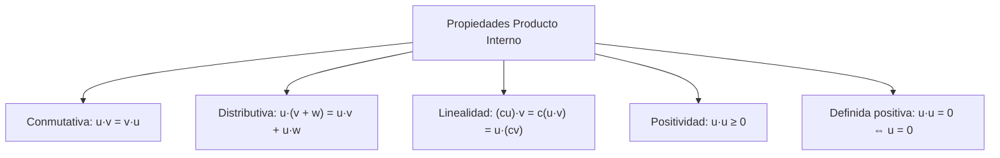
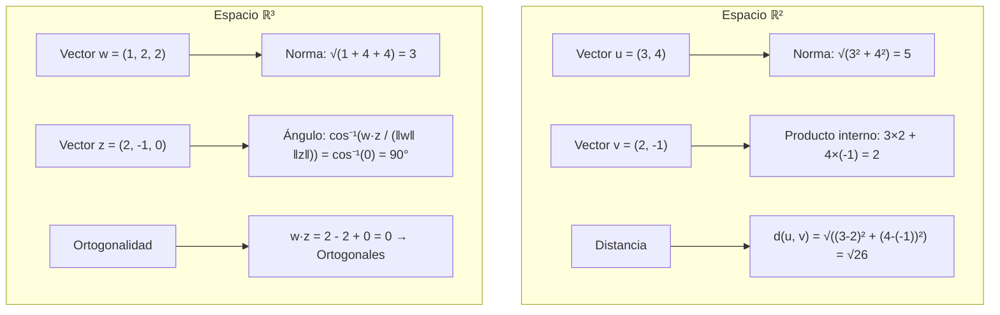

# Matemáticas para Ciencias Aplicadas II - Espacio Euclidiano de dimensión n

## 1.2 Producto interno. Distancia.

---

### 1. Producto Interno (Producto Punto)

#### 1.1 Definición Formal

Dados dos vectores $\vec{u} = (u_1, u_2, \ldots, u_n)$ y $\vec{v} = (v_1, v_2, \ldots, v_n)$ en $\mathbb{R}^n$, el **producto interno** (o producto escalar) se define como:

$$\vec{u} \cdot \vec{v} = \sum_{i=1}^{n} u_i v_i = u_1v_1 + u_2v_2 + \cdots + u_nv_n$$

#### 1.2 Propiedades del Producto Interno



### 2. Norma (Longitud) de un Vector

#### 2.1 Definición

La **norma** (o longitud) de un vector $\vec{v} = (v_1, v_2, \ldots, v_n)$ se define como:

$$\|\vec{v}\| = \sqrt{\vec{v} \cdot \vec{v}} = \sqrt{v_1^2 + v_2^2 + \cdots + v_n^2}$$

#### 2.2 Propiedades de la Norma

- $\|\vec{v}\| \geq 0$ para todo $\vec{v} \in \mathbb{R}^n$
- $\|\vec{v}\| = 0$ si y solo si $\vec{v} = \vec{0}$
- $\|c\vec{v}\| = |c| \cdot \|\vec{v}\|$ (homogeneidad)
- $\|\vec{u} + \vec{v}\| \leq \|\vec{u}\| + \|\vec{v}\|$ (desigualdad triangular)

### 3. Distancia entre Vectores

#### 3.1 Definición

La **distancia** entre dos vectores $\vec{u}$ y $\vec{v}$ en $\mathbb{R}^n$ se define como:

$$d(\vec{u}, \vec{v}) = \|\vec{u} - \vec{v}\| = \sqrt{(u_1 - v_1)^2 + (u_2 - v_2)^2 + \cdots + (u_n - v_n)^2}$$

#### 3.2 Propiedades de la Distancia

- $d(\vec{u}, \vec{v}) \geq 0$ (no negatividad)
- $d(\vec{u}, \vec{v}) = 0$ si y solo si $\vec{u} = \vec{v}$
- $d(\vec{u}, \vec{v}) = d(\vec{v}, \vec{u})$ (simetría)
- $d(\vec{u}, \vec{w}) \leq d(\vec{u}, \vec{v}) + d(\vec{v}, \vec{w})$ (desigualdad triangular)

### 4. Ángulo entre Vectores

#### 4.1 Fórmula del Ángulo

El ángulo $\theta$ entre dos vectores no nulos $\vec{u}$ y $\vec{v}$ está dado por:

$$\cos \theta = \frac{\vec{u} \cdot \vec{v}}{\|\vec{u}\| \cdot \|\vec{v}\|}$$

#### 4.2 Vectores Ortogonales

Dos vectores $\vec{u}$ y $\vec{v}$ son **ortogonales** (perpendiculares) si:

$$\vec{u} \cdot \vec{v} = 0$$

### 5. Implementación Computacional

```python
import numpy as np
import math

class VectorOperations:
    def __init__(self, componentes):
        self.vec = np.array(componentes)
        self.n = len(componentes)

    def producto_interno(self, otro):
        """Calcula el producto interno entre dos vectores"""
        if self.n != otro.n:
            raise ValueError("Vectores de dimensiones diferentes")
        return np.dot(self.vec, otro.vec)

    def norma(self):
        """Calcula la norma (longitud) del vector"""
        return math.sqrt(self.producto_interno(self))

    def distancia(self, otro):
        """Calcula la distancia entre dos vectores"""
        diferencia = self.vec - otro.vec
        return math.sqrt(np.dot(diferencia, diferencia))

    def angulo(self, otro):
        """Calcula el ángulo entre dos vectores en radianes"""
        cos_theta = self.producto_interno(otro) / (self.norma() * otro.norma())
        return math.acos(np.clip(cos_theta, -1.0, 1.0))

    def es_ortogonal(self, otro):
        """Verifica si dos vectores son ortogonales"""
        return abs(self.producto_interno(otro)) < 1e-10

    def normalizar(self):
        """Devuelve el vector unitario en la misma dirección"""
        magnitud = self.norma()
        if magnitud == 0:
            raise ValueError("No se puede normalizar el vector cero")
        return VectorOperations(self.vec / magnitud)

# Ejemplo de uso
v1 = VectorOperations([3, 4, 0])
v2 = VectorOperations([1, 2, 2])

print(f"v1 = {v1.vec}")
print(f"v2 = {v2.vec}")
print(f"Producto interno: {v1.producto_interno(v2)}")
print(f"Norma de v1: {v1.norma():.2f}")
print(f"Distancia entre v1 y v2: {v1.distancia(v2):.2f}")
print(f"Ángulo entre v1 y v2: {math.degrees(v1.angulo(v2)):.2f}°")
print(f"¿Son ortogonales? {v1.es_ortogonal(v2)}")
print(f"Vector unitario de v1: {v1.normalizar().vec}")
```

### 6. Ejemplos y Ejercicios

#### Ejemplo 1: Cálculo Básico

Dados $\vec{u} = (2, -1, 3)$ y $\vec{v} = (4, 0, -2)$:

- Producto interno: $\vec{u} \cdot \vec{v} = 2\times4 + (-1)\times0 + 3\times(-2) = 8 + 0 - 6 = 2$
- Norma de $\vec{u}$: $\|\vec{u}\| = \sqrt{4 + 1 + 9} = \sqrt{14} \approx 3.74$
- Distancia: $d(\vec{u}, \vec{v}) = \sqrt{(2-4)^2 + (-1-0)^2 + (3-(-2))^2} = \sqrt{4 + 1 + 25} = \sqrt{30} \approx 5.48$

#### Ejemplo 2: Ortogonalidad

Verificar si $\vec{w} = (1, 2, -1)$ y $\vec{z} = (3, -1, 1)$ son ortogonales:

$\vec{w} \cdot \vec{z} = 1\times3 + 2\times(-1) + (-1)\times1 = 3 - 2 - 1 = 0$ → **Son ortogonales**

#### Ejercicio 1:

Para $\vec{a} = (1, -2, 3, 0)$ y $\vec{b} = (4, 1, -1, 2)$:

1. Calcula $\vec{a} \cdot \vec{b}$
2. Encuentra $\|\vec{a}\|$ y $\|\vec{b}\|$
3. Calcula la distancia $d(\vec{a}, \vec{b})$
4. Determina el coseno del ángulo entre ellos

### 7. Aplicaciones Prácticas

#### 7.1 Geometría Analítica

- Cálculo de distancias entre puntos
- Determinación de perpendicularidad
- Proyección de vectores

#### 7.2 Física

- Trabajo mecánico: $W = \vec{F} \cdot \vec{d}$
- Componentes de fuerzas
- Energía y potencia

#### 7.3 Machine Learning

- Cálculo de similitud entre vectores de características
- Métricas de distancia (euclidiana, coseno)
- Normalización de datos

### 8. Visualización Geométrica



### 9. Teoremas Importantes

#### 9.1 Desigualdad de Cauchy-Schwarz

Para cualesquiera $\vec{u}, \vec{v} \in \mathbb{R}^n$:

$$ |\vec{u} \cdot \vec{v}| \leq \|\vec{u}\| \cdot \|\vec{v}\| $$

#### 9.2 Teorema de Pitágoras

Si $\vec{u}$ y $\vec{v}$ son ortogonales, entonces:

$$ \|\vec{u} + \vec{v}\|^2 = \|\vec{u}\|^2 + \|\vec{v}\|^2 $$

### 10. Recursos Adicionales

- "Linear Algebra and Its Applications" por Gilbert Strang
- "Calculus, Vol. II" por Tom M. Apostol (capítulos sobre producto interno)
- Software de visualización: GeoGebra, Desmos 3D
- Librerías Python: NumPy, SciPy para operaciones vectoriales
- Tutoriales online de geometría analítica en n-dimensiones
