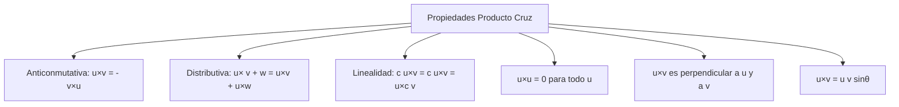
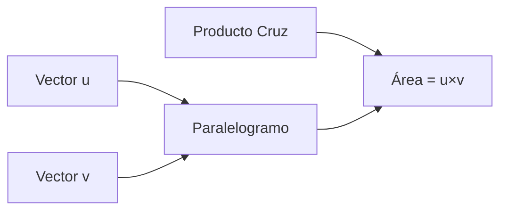
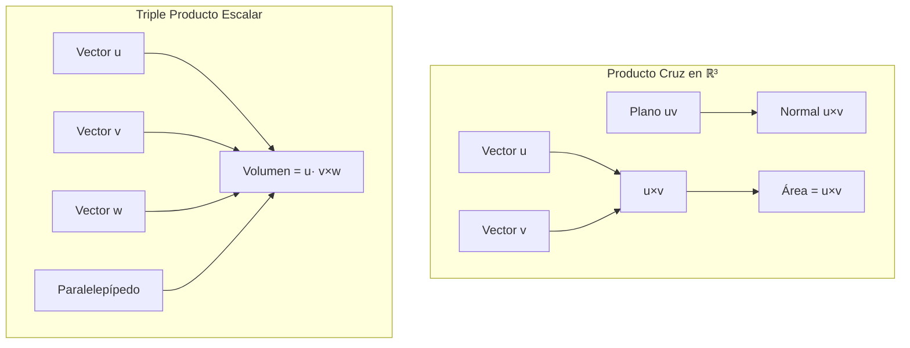

# Matemáticas para Ciencias Aplicadas II - Espacio Euclidiano de dimensión n

## 1.3 Producto cruz. Triple producto escalar.

---

### 1. Producto Cruz (Producto Vectorial)

#### 1.1 Definición en ℝ³

El **producto cruz** de dos vectores $\vec{u} = (u_1, u_2, u_3)$ y $\vec{v} = (v_1, v_2, v_3)$ en $\mathbb{R}^3$ es un nuevo vector definido como:

$$ \vec{u} \times \vec{v} = (u_2v_3 - u_3v_2, u_3v_1 - u_1v_3, u_1v_2 - u_2v_1) $$

#### 1.2 Notación Determinante

El producto cruz se puede expresar usando notación determinante:

$$ \vec{u} \times \vec{v} = \begin{vmatrix} \hat{i} & \hat{j} & \hat{k} \\\ u_1 & u_2 & u_3 \\\ v_1 & v_2 & v_3 \\\ \end{vmatrix} = \hat{i}(u_2v_3 - u_3v_2) - \hat{j}(u_1v_3 - u_3v_1) + \hat{k}(u_1v_2 - u_2v_1) $$

#### 1.3 Propiedades del Producto Cruz



### 2. Interpretación Geométrica del Producto Cruz

#### 2.1 Magnitud y Dirección

- **Magnitud**: $\|\vec{u} \times \vec{v}\| = \|\vec{u}\| \|\vec{v}\| \sin\theta$
- **Dirección**: Perpendicular al plano que contiene a $\vec{u}$ y $\vec{v}$
- **Sentido**: Regla de la mano derecha

#### 2.2 Área del Paralelogramo

El área del paralelogramo formado por $\vec{u}$ y $\vec{v}$ es:

$$ A = \|\vec{u} \times \vec{v}\| $$



### 3. Triple Producto Escalar

#### 3.1 Definición

El **triple producto escalar** de tres vectores $\vec{u}, \vec{v}, \vec{w} \in \mathbb{R}^3$ se define como:

$$ \vec{u} \cdot (\vec{v} \times \vec{w}) = \begin{vmatrix} u_1 & u_2 & u_3 \\\ v_1 & v_2 & v_3 \\\ w_1 & w_2 & w_3 \\\ \end{vmatrix} $$

#### 3.2 Propiedades

- $\vec{u} \cdot (\vec{v} \times \vec{w}) = \vec{v} \cdot (\vec{w} \times \vec{u}) = \vec{w} \cdot (\vec{u} \times \vec{v})$
- $\vec{u} \cdot (\vec{v} \times \vec{w}) = -\vec{u} \cdot (\vec{w} \times \vec{v})$
- Es cero si los vectores son coplanares

#### 3.3 Volumen del Paralelepípedo

El volumen del paralelepípedo formado por $\vec{u}, \vec{v}, \vec{w}$ es:

$$ V = |\vec{u} \cdot (\vec{v} \times \vec{w})| $$

### 4. Implementación Computacional

```python
import numpy as np

class Vector3DOperations:
    def __init__(self, x, y, z):
        self.vec = np.array([x, y, z])

    def producto_cruz(self, otro):
        """Calcula el producto cruz entre dos vectores 3D"""
        return Vector3DOperations(
            self.vec[1] * otro.vec[2] - self.vec[2] * otro.vec[1],
            self.vec[2] * otro.vec[0] - self.vec[0] * otro.vec[2],
            self.vec[0] * otro.vec[1] - self.vec[1] * otro.vec[0]
        )

    def producto_punto(self, otro):
        """Calcula el producto punto entre dos vectores"""
        return np.dot(self.vec, otro.vec)

    def triple_producto_escalar(self, v2, v3):
        """Calcula el triple producto escalar u· v2×v3 """
        cruz = v2.producto_cruz(v3)
        return self.producto_punto(cruz)

    def norma(self):
        """Calcula la norma del vector"""
        return np.linalg.norm(self.vec)

    def area_paralelogramo(self, otro):
        """Calcula el área del paralelogramo formado por dos vectores"""
        cruz = self.producto_cruz(otro)
        return cruz.norma()

    def volumen_paralelepipedo(self, v2, v3):
        """Calcula el volumen del paralelepípedo formado por tres vectores"""
        return abs(self.triple_producto_escalar(v2, v3))

    def __str__(self):
        return f"({self.vec[0]}, {self.vec[1]}, {self.vec[2]})"

# Ejemplo de uso
u = Vector3DOperations(2, -1, 3)
v = Vector3DOperations(4, 0, -2)
w = Vector3DOperations(1, 2, 1)

print(f"u = {u}")
print(f"v = {v}")
print(f"w = {w}")
print(f"u × v = {u.producto_cruz(v)}")
print(f"u · v × w = {u.triple_producto_escalar(v, w)}")
print(f"Área paralelogramo(u,v): {u.area_paralelogramo(v):.2f}")
print(f"Volumen paralelepípedo(u,v,w): {u.volumen_paralelepipedo(v, w):.2f}")
```

### 5. Ejemplos y Ejercicios

#### Ejemplo 1: Cálculo de Producto Cruz

Dados $\vec{u} = (2, -1, 3)$ y $\vec{v} = (4, 0, -2)$:

$$\vec{u} \times \vec{v} = ((-1)\times(-2) - 3\times0, 3\times4 - 2\times(-2), 2\times0 - (-1)\times4) = (2, 16, 4)$$

#### Ejemplo 2: Triple Producto Escalar

Para $\vec{u} = (1, 2, 3)$, $\vec{v} = (4, 5, 6)$, $\vec{w} = (7, 8, 10)$:

$$ \vec{u} \cdot (\vec{v} \times \vec{w}) = \begin{vmatrix} 1 & 2 & 3 \\\ 4 & 5 & 6 \\\ 7 & 8 & 10 \\\ \end{vmatrix} = 1(5\times10 - 6\times8) - 2(4\times10 - 6\times7) + 3(4\times8 - 5\times7) = -3 $$

#### Ejercicio 1:

Para $\vec{a} = (1, 0, 2)$, $\vec{b} = (3, -1, 1)$, $\vec{c} = (2, 4, -1)$:

1. Calcula $\vec{a} \times \vec{b}$
2. Encuentra $\vec{b} \times \vec{c}$
3. Calcula $\vec{a} \cdot (\vec{b} \times \vec{c})$
4. Determina el volumen del paralelepípedo

### 6. Aplicaciones Prácticas

#### 6.1 Física

- Torque: $\vec{\tau} = \vec{r} \times \vec{F}$
- Momento angular: $\vec{L} = \vec{r} \times \vec{p}$
- Fuerza de Lorentz: $\vec{F} = q(\vec{E} + \vec{v} \times \vec{B})$

#### 6.2 Geometría Computacional

- Determinación de normal a superficies
- Cálculo de áreas y volúmenes
- Verificación de perpendicularidad

#### 6.3 Ingeniería

- Análisis de esfuerzos y momentos
- Cinemática de cuerpos rígidos
- Campos electromagnéticos

### 7. Visualización Geométrica



### 8. Propiedades Algebraicas

#### 8.1 Identidades Vectoriales

- $\vec{u} \times (\vec{v} \times \vec{w}) = (\vec{u} \cdot \vec{w})\vec{v} - (\vec{u} \cdot \vec{v})\vec{w}$
- $(\vec{u} \times \vec{v}) \times \vec{w} = (\vec{u} \cdot \vec{w})\vec{v} - (\vec{v} \cdot \vec{w})\vec{u}$
- $\vec{u} \times (\vec{v} \times \vec{w}) + \vec{v} \times (\vec{w} \times \vec{u}) + \vec{w} \times (\vec{u} \times \vec{v}) = \vec{0}$

#### 8.2 Relación con Ortogonalidad

- $\vec{u} \cdot (\vec{u} \times \vec{v}) = 0$ (siempre)
- $\vec{v} \cdot (\vec{u} \times \vec{v}) = 0$ (siempre)

### 9. Casos Especiales y Limitaciones

#### 9.1 Vectores Paralelos

Si $\vec{u}$ y $\vec{v}$ son paralelos ( $\theta = 0$ o $\pi$ ):

- $\vec{u} \times \vec{v} = \vec{0}$
- $\sin\theta = 0$

#### 9.2 Restricción a ℝ³

El producto cruz está definido **exclusivamente** en $\mathbb{R}^3$. En $\mathbb{R}^n$ con $n \neq 3$, se generaliza con el producto exterior.

### 10. Recursos Adicionales

- "Vector Calculus" por Jerrold E. Marsden
- "Advanced Engineering Mathematics" por Erwin Kreyszig
- Software de visualización: GeoGebra 3D, MATLAB
- Librerías Python: NumPy, SymPy para cálculo simbólico
- Tutoriales online de álgebra vectorial aplicada
