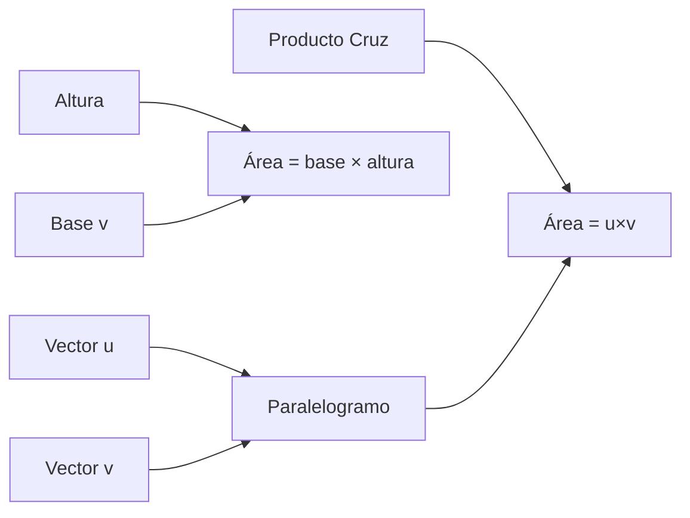
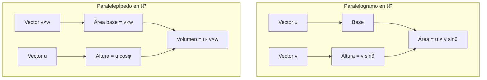

# Matemáticas para Ciencias Aplicadas II - Espacio Euclidiano de dimensión n

## 1.4 Área de paralelogramos y volumen de paralelepípedos.

---

### 1. Área de un Paralelogramo en ℝ² y ℝ³

#### 1.1 Definición Geométrica

Un **paralelogramo** es un cuadrilátero con lados opuestos paralelos. Dados dos vectores $\vec{u}$ y $\vec{v}$ que forman dos lados adyacentes:

#### 1.2 Fórmula del Área

El área del paralelogramo generado por $\vec{u}$ y $\vec{v}$ está dada por:

$$ A = \|\vec{u} \times \vec{v}\| = \|\vec{u}\| \|\vec{v}\| \sin\theta $$

Donde $\theta$ es el ángulo entre los vectores.

#### 1.3 Caso Especial en ℝ²

Para $\vec{u} = (u_1, u_2)$ y $\vec{v} = (v_1, v_2)$ en ℝ²:

$$A = |u_1v_2 - u_2v_1| = |\det(\vec{u}, \vec{v})|$$



### 2. Volumen de un Paralelepípedo en ℝ³

#### 2.1 Definición Geométrica

Un **paralelepípedo** es un poliedro de seis caras paralelas dos a dos. Dados tres vectores $\vec{u}$, $\vec{v}$, $\vec{w}$ que forman aristas concurrentes:

#### 2.2 Fórmula del Volumen

El volumen del paralelepípedo generado por $\vec{u}$, $\vec{v}$, $\vec{w}$ está dado por:

$$V = |\vec{u} \cdot (\vec{v} \times \vec{w})| = |\det(\vec{u}, \vec{v}, \vec{w})|$$

#### 2.3 Interpretación Geométrica

- $\vec{v} \times \vec{w}$: Vector normal al plano base
- $|\vec{u} \cdot (\vec{v} \times \vec{w})|$: Valor absoluto del producto escalar con la altura

### 3. Generalización a n Dimensiones

#### 3.1 Área de Paralelogramo en ℝⁿ

Para $\vec{u}, \vec{v} \in \mathbb{R}^n$, el área del paralelogramo es:

$$A = \sqrt{\|\vec{u}\|^2 \|\vec{v}\|^2 - (\vec{u} \cdot \vec{v})^2} = \|\vec{u}\| \|\vec{v}\| \sqrt{1 - \cos^2\theta}$$

#### 3.2 Volumen de Paralelepípedo en ℝⁿ

Para vectores $\vec{v}_1, \vec{v}_2, \ldots, \vec{v}_k \in \mathbb{R}^n$, el volumen del paralelepípedo k-dimensional es:

$$V = \sqrt{\det(G)}$$

Donde $G$ es la **matriz de Gram** con elementos $G_{ij} = \vec{v}_i \cdot \vec{v}_j$.

### 4. Implementación Computacional

```python
import numpy as np
from scipy.linalg import det

class GeometriaVectorial:
    def __init__(self, *vectores):
        self.vectores = [np.array(v) for v in vectores]
        self.dimension = len(vectores[0])

    def area_paralelogramo_2d(self):
        """Área de paralelogramo en ℝ²"""
        if self.dimension != 2 or len(self.vectores) != 2:
            raise ValueError("Se requieren 2 vectores en ℝ²")
        u, v = self.vectores
        return abs(u[0]*v[1] - u[1]*v[0])

    def area_paralelogramo_3d(self):
        """Área de paralelogramo en ℝ³ usando producto cruz"""
        if self.dimension != 3 or len(self.vectores) != 2:
            raise ValueError("Se requieren 2 vectores en ℝ³")
        u, v = self.vectores
        cruz = np.cross(u, v)
        return np.linalg.norm(cruz)

    def area_paralelogramo_nd(self):
        """Área de paralelogramo en ℝⁿ para n ≥ 2"""
        if len(self.vectores) != 2:
            raise ValueError("Se requieren exactamente 2 vectores")
        u, v = self.vectores
        return np.sqrt(np.linalg.norm(u)**2 * np.linalg.norm(v)**2 - np.dot(u, v)**2)

    def volumen_paralelepipedo_3d(self):
        """Volumen de paralelepípedo en ℝ³ usando triple producto escalar"""
        if self.dimension != 3 or len(self.vectores) != 3:
            raise ValueError("Se requieren 3 vectores en ℝ³")
        u, v, w = self.vectores
        triple_product = np.dot(u, np.cross(v, w))
        return abs(triple_product)

    def volumen_paralelepipedo_nd(self):
        """Volumen de paralelepípedo k-dimensional en ℝⁿ usando matriz de Gram"""
        k = len(self.vectores)
        # Construir matriz de Gram
        G = np.zeros((k, k))
        for i in range(k):
            for j in range(k):
                G[i, j] = np.dot(self.vectores[i], self.vectores[j])
        return np.sqrt(det(G))

    def es_coplanario(self):
        """Verifica si los vectores son coplanares (volumen = 0)"""
        try:
            return self.volumen_paralelepipedo_3d() < 1e-10
        except:
            # Para n-dimensiones, verificar si el determinante de Gram es cero
            k = len(self.vectores)
            G = np.zeros((k, k))
            for i in range(k):
                for j in range(k):
                    G[i, j] = np.dot(self.vectores[i], self.vectores[j])
            return abs(det(G)) < 1e-10

# Ejemplo de uso
u = [3, 1]
v = [1, 4]
geo_2d = GeometriaVectorial(u, v)
print(f"Área paralelogramo 2D: {geo_2d.area_paralelogramo_2d():.2f}")

u3 = [2, -1, 3]
v3 = [4, 0, -2]
w3 = [1, 2, 1]
geo_3d = GeometriaVectorial(u3, v3, w3)
print(f"Área paralelogramo 3D: {geo_3d.area_paralelogramo_3d():.2f}")
print(f"Volumen paralelepípedo 3D: {geo_3d.volumen_paralelepipedo_3d():.2f}")
print(f"¿Vectores coplanares? {geo_3d.es_coplanario()}")
```

### 5. Ejemplos y Ejercicios

#### Ejemplo 1: Área en ℝ²

Dados $\vec{u} = (3, 1)$ y $\vec{v} = (1, 4)$:

$$A = |3\times4 - 1\times1| = |12 - 1| = 11$$

#### Ejemplo 2: Volumen en ℝ³

Dados $\vec{u} = (2, -1, 3)$, $\vec{v} = (4, 0, -2)$, $\vec{w} = (1, 2, 1)$:

$$\vec{v} \times \vec{w} = (0\times1 - (-2)\times2, (-2)\times1 - 4\times1, 4\times2 - 0\times1) = (4, -6, 8)$$
$$\vec{u} \cdot (\vec{v} \times \vec{w}) = 2\times4 + (-1)\times(-6) + 3\times8 = 8 + 6 + 24 = 38$$
$$V = |38| = 38$$

#### Ejercicio 1:

Para $\vec{a} = (1, 2)$, $\vec{b} = (3, -1)$:

1. Calcula el área del paralelogramo
2. Verifica usando la fórmula general

#### Ejercicio 2:

Para $\vec{p} = (1, 0, 2)$, $\vec{q} = (3, -1, 1)$, $\vec{r} = (2, 4, -1)$:

1. Calcula el volumen del paralelepípedo
2. Determina si son coplanares

### 6. Aplicaciones Prácticas

#### 6.1 Geometría Computacional

- Cálculo de áreas de polígonos
- Determinación de volúmenes de poliedros
- Colisiones y detección de intersecciones

#### 6.2 Física e Ingeniería

- Cálculo de momentos de inercia
- Análisis de esfuerzos y deformaciones
- Dinámica de fluidos y campos vectoriales

#### 6.3 Machine Learning

- Cálculo de determinantes en espacios de características
- Análisis de independencia lineal
- Transformaciones geométricas de datos

### 7. Propiedades Matemáticas

#### 7.1 Relación con Determinantes

El área/volumen es el valor absoluto del determinante de la matriz formada por los vectores:

- ℝ²: $A = |\det(\vec{u}, \vec{v})|$
- ℝ³: $V = |\det(\vec{u}, \vec{v}, \vec{w})|$

#### 7.2 Invarianza bajo Rotaciones

El área y volumen son invariantes bajo rotaciones y reflexiones.

#### 7.3 Multiplicatividad

Para escalar $\alpha$: $A(\alpha\vec{u}, \vec{v}) = |\alpha| A(\vec{u}, \vec{v})$

### 8. Visualización Geométrica



### 9. Casos Especiales

#### 9.1 Vectores Paralelos

Si $\vec{u}$ y $\vec{v}$ son paralelos → Área = 0

#### 9.2 Vectores Coplanares

Si $\vec{u}$, $\vec{v}$, $\vec{w}$ son coplanares → Volumen = 0

#### 9.3 Vectores Ortogonales

Si $\vec{u} \perp \vec{v}$ → $A = \|\vec{u}\| \|\vec{v}\|$

### 10. Recursos Adicionales

- "Linear Algebra and Its Applications" por Gilbert Strang
- "Calculus" por Michael Spivak (capítulos sobre geometría analítica)
- "Vector Calculus" por Jerrold E. Marsden
- Software de visualización: GeoGebra, Desmos 3D
- Librerías Python: NumPy, SciPy, Matplotlib
- Tutoriales online de geometría computacional
