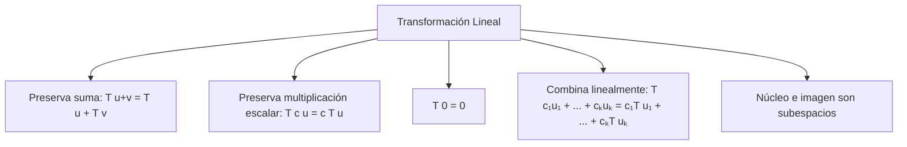
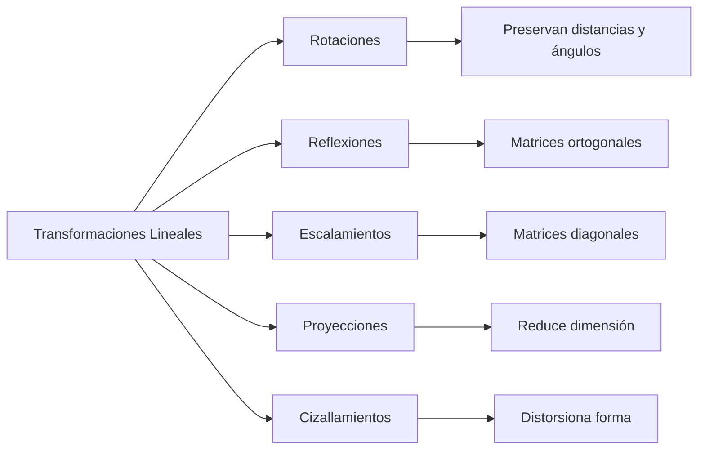
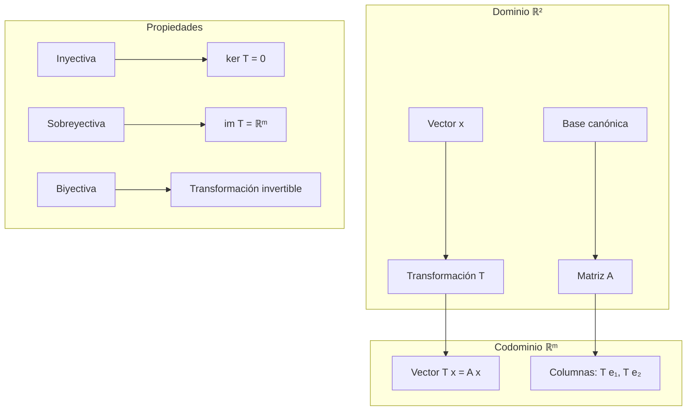

# Matemáticas para Ciencias Aplicadas II - Espacio Euclidiano de dimensión n

## 1.5 Transformación lineal y matrices.

---

### 1. Transformaciones Lineales

#### 1.1 Definición Formal

Una **transformación lineal** $T: \mathbb{R}^n \rightarrow \mathbb{R}^m$ es una función que satisface:

1. **Aditividad**: $T(\vec{u} + \vec{v}) = T(\vec{u}) + T(\vec{v})$ para todo $\vec{u}, \vec{v} \in \mathbb{R}^n$
2. **Homogeneidad**: $T(c\vec{u}) = cT(\vec{u})$ para todo $\vec{u} \in \mathbb{R}^n$ y $c \in \mathbb{R}$

#### 1.2 Propiedades Fundamentales



### 2. Representación Matricial

#### 2.1 Matriz Asociada a una Transformación Lineal

Para $T: \mathbb{R}^n \rightarrow \mathbb{R}^m$, existe una única matriz $A \in \mathbb{R}^{m \times n}$ tal que:

$$T(\vec{x}) = A\vec{x}$$

La matriz $A$ se construye aplicando $T$ a los vectores de la base canónica:

$$A = [T(\vec{e}_1) \mid T(\vec{e}_2) \mid \cdots \mid T(\vec{e}_n)]$$

#### 2.2 Composición de Transformaciones

Si $T: \mathbb{R}^n \rightarrow \mathbb{R}^m$ y $S: \mathbb{R}^m \rightarrow \mathbb{R}^p$ son lineales con matrices $A$ y $B$, entonces:

$$ (S \circ T)(\vec{x}) = B(A\vec{x}) = (BA)\vec{x} $$

### 3. Núcleo e Imagen

#### 3.1 Definiciones

- **Núcleo (Kernel)**: $\ker(T) = \{\vec{x} \in \mathbb{R}^n \mid T(\vec{x}) = \vec{0}\}$
- **Imagen (Range)**: $\operatorname{im}(T) = \{T(\vec{x}) \in \mathbb{R}^m \mid \vec{x} \in \mathbb{R}^n\}$

#### 3.2 Teorema de la Dimensión

$$ \dim(\ker(T)) + \dim(\operatorname{im}(T)) = n $$

### 4. Implementación Computacional

```python
import numpy as np

class TransformacionLineal:
    def __init__(self, matriz):
        self.A = np.array(matriz)
        self.m, self.n = self.A.shape

    def aplicar(self, vector):
        """Aplica la transformación a un vector"""
        return np.dot(self.A, vector)

    def composicion(self, otra):
        """Compone esta transformación con otra"""
        if self.m != otra.n:
            raise ValueError("Dimensiones incompatibles para composición")
        return TransformacionLineal(np.dot(otra.A, self.A))

    def nucleo(self):
        """Calcula una base para el núcleo"""
        # Resolver A x = 0
        U, s, Vh = np.linalg.svd(self.A)
        # Los vectores de Vh correspondientes a valores singulares cero
        tolerancia = 1e-10
        rango = np.sum(s > tolerancia)
        base_nucleo = Vh[rango:].T
        return base_nucleo

    def imagen(self):
        """Calcula una base para la imagen"""
        U, s, Vh = np.linalg.svd(self.A)
        tolerancia = 1e-10
        rango = np.sum(s > tolerancia)
        base_imagen = U[:, :rango]
        return base_imagen

    def es_inyectiva(self):
        """Verifica si la transformación es inyectiva"""
        return np.linalg.matrix_rank(self.A) == self.n

    def es_sobreyectiva(self):
        """Verifica si la transformación es sobreyectiva"""
        return np.linalg.matrix_rank(self.A) == self.m

    def matriz_inversa(self):
        """Calcula la inversa si existe"""
        if self.m != self.n:
            raise ValueError("La matriz no es cuadrada")
        return np.linalg.inv(self.A)

# Ejemplo de uso
# Transformación de rotación 2D por 45 grados
theta = np.pi/4
A_rot = [[np.cos(theta), -np.sin(theta)],
         [np.sin(theta), np.cos(theta)]]

T_rot = TransformacionLineal(A_rot)
vector = np.array([1, 0])
resultado = T_rot.aplicar(vector)

print(f"Vector original: {vector}")
print(f"Vector rotado: {resultado}")
print(f"¿Es inyectiva? {T_rot.es_inyectiva()}")
print(f"¿Es sobreyectiva? {T_rot.es_sobreyectiva()}")
```

### 5. Tipos de Transformaciones Lineales

#### 5.1 Transformaciones Comunes



#### 5.2 Ejemplos Matriciales

- **Rotación 2D**: $\begin{bmatrix} \cos\theta & -\sin\theta \\ \sin\theta & \cos\theta \end{bmatrix}$
- **Escalamiento**: $\begin{bmatrix} s_x & 0 \\ 0 & s_y \end{bmatrix}$
- **Cizallamiento**: $\begin{bmatrix} 1 & k \\ 0 & 1 \end{bmatrix}$
- **Proyección**: $\begin{bmatrix} 1 & 0 \\ 0 & 0 \end{bmatrix}$

### 6. Ejemplos y Ejercicios

#### Ejemplo 1: Transformación de Proyección

Sea $T: \mathbb{R}^3 \rightarrow \mathbb{R}^2$ definida por $T(x, y, z) = (x, y)$

Matriz asociada: $A = \begin{bmatrix} 1 & 0 & 0 \\ 0 & 1 & 0 \end{bmatrix}$

#### Ejemplo 2: Composición de Transformaciones

Rotar 90° y luego escalar por 2:

$A_{\text{rot}} = \begin{bmatrix} 0 & -1 \\\ 1 & 0 \end{bmatrix}$,

$A_{\text{esc}} = \begin{bmatrix} 2 & 0 \\\ 0 & 2 \end{bmatrix}$

$A_{\text{compuesta}} = A_{\text{esc}} A_{\text{rot}} = \begin{bmatrix} 0 & -2 \\ 2 & 0 \end{bmatrix}$

#### Ejercicio 1:

Para $T(x, y) = (2x + y, x - 3y, 4x)$:

1. Encuentra la matriz asociada
2. Determina si es inyectiva
3. Encuentra una base para el núcleo e imagen

### 7. Aplicaciones Prácticas

#### 7.1 Gráficos por Computadora

- Transformaciones geométricas (rotación, escala, traslación)
- Proyecciones 3D a 2D
- Animaciones y transformaciones de objetos

#### 7.2 Procesamiento de Imágenes

- Transformaciones afines
- Corrección de distorsión
- Registro de imágenes

#### 7.3 Machine Learning

- Reducción de dimensionalidad (PCA)
- Transformaciones de características
- Capas lineales en redes neuronales

### 8. Propiedades Algebraicas

#### 8.1 Espacios Vectoriales de Transformaciones

El conjunto $\mathcal{L}(\mathbb{R}^n, \mathbb{R}^m)$ de todas las transformaciones lineales forma un espacio vectorial con:

- $(T + S)(\vec{x}) = T(\vec{x}) + S(\vec{x})$
- $(cT)(\vec{x}) = cT(\vec{x})$

#### 8.2 Isomorfismo con Matrices

Existe un isomorfismo natural:

$$ \mathcal{L}(\mathbb{R}^n, \mathbb{R}^m) \cong \mathbb{R}^{m \times n} $$

### 9. Visualización de Transformaciones



### 10. Recursos Adicionales

- "Linear Algebra and Its Applications" por Gilbert Strang
- "Introduction to Linear Algebra" por Serge Lang
- "Matrix Analysis" por Roger A. Horn y Charles R. Johnson
- Software: MATLAB, NumPy, GeoGebra
- Tutoriales online de álgebra lineal aplicada
- Visualizaciones interactivas de transformaciones lineales
