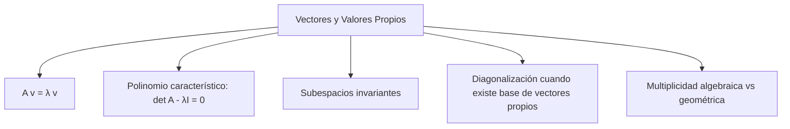
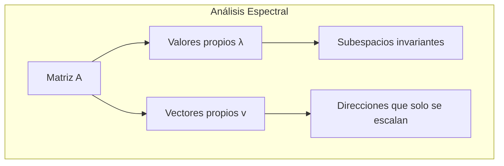
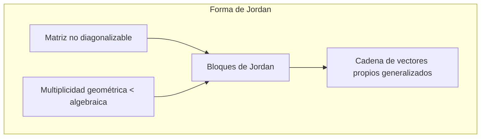
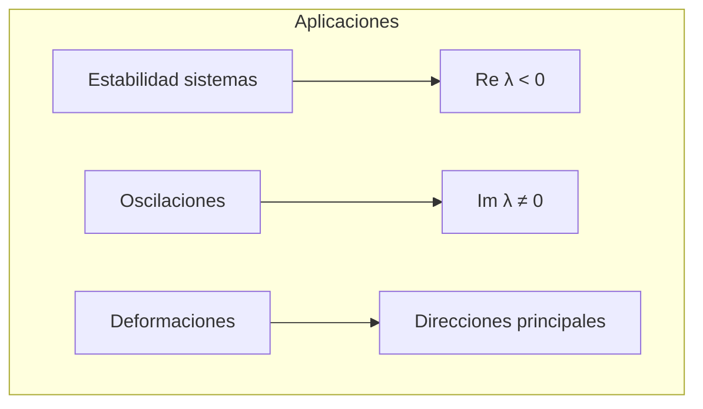

# Matemáticas para Ciencias Aplicadas II - Espacio Euclidiano de dimensión n

## 1.6 Vector propio. Forma canónica de Jordan en 2 y 3 dimensiones.

---

### 1. Vectores Propios y Valores Propios

#### 1.1 Definición Formal

Sea $A$ una matriz cuadrada de $n \times n$. Un **vector propio** $\vec{v} \neq \vec{0}$ satisface:

$$ A\vec{v} = \lambda\vec{v} $$

donde $\lambda$ es el **valor propio** (escalar) asociado.

#### 1.2 Ecuación Característica

Los valores propios se encuentran resolviendo:

$$ \det(A - \lambda I) = 0 $$

donde $I$ es la matriz identidad.

#### 1.3 Propiedades Fundamentales



### 2. Forma Canónica de Jordan

#### 2.1 Concepto General

Cuando una matriz no es diagonalizable, puede llevarse a la **forma canónica de Jordan**, que es casi diagonal:

$$ A = PJP^{-1} $$

donde $J$ es una matriz por bloques de Jordan.

#### 2.2 Bloques de Jordan

Un bloque de Jordan de tamaño $k$ asociado al valor propio $\lambda$ es:

$$ J_k(\lambda) = \begin{bmatrix} \lambda & 1 & 0 & \cdots & 0 \\\ 0 & \lambda & 1 & \cdots & 0 \\\ \vdots & \vdots & \ddots & \ddots & \vdots \\\ 0 & 0 & \cdots & \lambda & 1 \\\ 0 & 0 & \cdots & 0 & \lambda \\\ \end{bmatrix} $$

### 3. Caso 2D: Formas de Jordan en ℝ²

#### 3.1 Caso 1: Dos valores propios distintos

$$ J = \begin{bmatrix} \lambda_1 & 0 \\ 0 & \lambda_2 \end{bmatrix} $$

#### 3.2 Caso 2: Un valor propio, matriz diagonalizable

$$ J = \begin{bmatrix} \lambda & 0 \\ 0 & \lambda \end{bmatrix} $$

#### 3.3 Caso 3: Un valor propio, no diagonalizable

$$ J = \begin{bmatrix} \lambda & 1 \\ 0 & \lambda \end{bmatrix} $$

### 4. Caso 3D: Formas de Jordan en ℝ³

#### 4.1 Posibles configuraciones:


#### 4.2 Ejemplos de bloques en 3D:

- $\begin{bmatrix} \lambda & 1 & 0 \\ 0 & \lambda & 1 \\ 0 & 0 & \lambda \end{bmatrix}$ (Un bloque 3×3)
- $\begin{bmatrix} \lambda & 1 & 0 \\ 0 & \lambda & 0 \\ 0 & 0 & \mu \end{bmatrix}$ (Bloque 2×2 y valor propio simple)

### 5. Implementación Computacional

```python
import numpy as np
from scipy.linalg import eig, jordan

class AlgebraLinealAvanzada:
    def __init__(self, matriz):
        self.A = np.array(matriz)
        self.n = self.A.shape[0]

    def valores_propios(self):
        """Calcula valores y vectores propios"""
        valores, vectores = eig(self.A)
        return valores, vectores

    def forma_jordan(self):
        """Calcula la forma canónica de Jordan"""
        try:
            # Nota: jordan puede no funcionar para matrices no diagonalizables
            # en versiones recientes de SciPy, esta es una implementación simplificada
            valores, vectores = eig(self.A)

            # Para matrices 2x2 y 3x3 podemos determinar la forma manualmente
            if self.n == 2:
                return self._jordan_2d()
            elif self.n == 3:
                return self._jordan_3d()
            else:
                raise ValueError("Solo implementado para 2D y 3D")
        except:
            return "Matriz no diagonalizable - requiere análisis manual"

    def _jordan_2d(self):
        """Forma de Jordan para matrices 2x2"""
        valores, vectores = eig(self.A)

        if len(np.unique(valores)) == 2:
            # Dos valores propios distintos
            J = np.diag(valores)
            P = vectores
        else:
            # Un valor propio
            lambda_val = valores[0]
            # Verificar si es diagonalizable
            if np.linalg.matrix_rank(vectores) == 2:
                J = np.diag([lambda_val, lambda_val])
            else:
                # No diagonalizable - forma de Jordan
                J = np.array([[lambda_val, 1], [0, lambda_val]])
                # Encontrar vector propio generalizado
                # Resolver (A - λI)v₂ = v₁ donde v₁ es el vector propio
                A_minus_lambda = self.A - lambda_val * np.eye(2)
                v1 = vectores[:, 0]  # Vector propio
                # Resolver para v2
                v2 = np.linalg.lstsq(A_minus_lambda, v1, rcond=None)[0]
                P = np.column_stack([v1, v2])

        return J, P

    def polinomio_caracteristico(self):
        """Calcula el polinomio característico"""
        return np.poly(self.A)

    def multiplicidades(self):
        """Calcula multiplicidades algebraica y geométrica"""
        valores, vectores = eig(self.A)
        multiplicidad_alg = {}
        multiplicidad_geom = {}

        for valor in valores:
            multiplicidad_alg[valor] = np.sum(np.isclose(valores, valor))
            # Dimensión del espacio propio
            A_minus_lambda = self.A - valor * np.eye(self.n)
            multiplicidad_geom[valor] = self.n - np.linalg.matrix_rank(A_minus_lambda)

        return multiplicidad_alg, multiplicidad_geom

# Ejemplo de uso
A_2d = [[2, 1], [0, 2]]  # Matriz no diagonalizable
algebra = AlgebraLinealAvanzada(A_2d)

valores, vectores = algebra.valores_propios()
print(f"Valores propios: {valores}")
print(f"Vectores propios:\n{vectores}")

J, P = algebra._jordan_2d()
print(f"Forma de Jordan:\n{J}")
print(f"Matriz de cambio:\n{P}")
```

### 6. Ejemplos y Ejercicios

#### Ejemplo 1: Matriz 2D Diagonalizable

$$ A = \begin{bmatrix} 3 & 0 \\ 0 & -1 \end{bmatrix} $$

- Valores propios: $ \lambda_1 = 3$, $\lambda_2 = -1 $
- Forma de Jordan: $ \begin{bmatrix} 3 & 0 \\ 0 & -1 \end{bmatrix} $

#### Ejemplo 2: Matriz 2D No Diagonalizable

$$ A = \begin{bmatrix} 2 & 1 \\ 0 & 2 \end{bmatrix}$$

- Valor propio: $ \lambda = 2$ (multiplicidad 2)
- Forma de Jordan: $ \begin{bmatrix} 2 & 1 \\ 0 & 2 \end{bmatrix} $

#### Ejemplo 3: Matriz 3D con Bloque de Jordan

$$ A = \begin{bmatrix} 3 & 1 & 0 \\ 0 & 3 & 1 \\ 0 & 0 & 3 \end{bmatrix} $$

- Valor propio: $ \lambda = 3 $ (multiplicidad 3)
- Forma de Jordan: $ \begin{bmatrix} 3 & 1 & 0 \\ 0 & 3 & 1 \\ 0 & 0 & 3 \end{bmatrix} $

#### Ejercicio 1:

Para $A = \begin{bmatrix} 1 & 2 \\ 0 & 1 \end{bmatrix}$:

1. Encuentra valores y vectores propios
2. Determina si es diagonalizable
3. Encuentra su forma de Jordan

### 7. Aplicaciones Prácticas

#### 7.1 Sistemas Dinámicos

- Análisis de estabilidad de sistemas lineales
- Solución de ecuaciones diferenciales lineales
- Sistemas de control automático

#### 7.2 Mecánica Cuántica

- Operadores y estados propios
- Valores de energía en sistemas cuánticos
- Problemas de autovalores

#### 7.3 Gráficos por Computadora

- Transformaciones geométricas
- Compresión de datos
- Análisis de deformaciones

### 8. Teoremas Importantes

#### 8.1 Teorema de Cayley-Hamilton

Toda matriz satisface su propio polinomio característico:

$$p_A(A) = 0$$

#### 8.2 Teorema Espectral

Matrices simétricas reales son diagonalizables con base ortonormal de vectores propios.

#### 8.3 Descomposición de Jordan

Toda matriz cuadrada es similar a una matriz de Jordan.

### 9. Visualización de Espacios Propios







### 10. Recursos Adicionales

- "Linear Algebra Done Right" por Sheldon Axler
- "Matrix Analysis" por Roger A. Horn y Charles R. Johnson
- "Differential Equations and Linear Algebra" por Gilbert Strang
- Software: MATLAB, NumPy, SciPy, Wolfram Mathematica
- Tutoriales online de álgebra lineal avanzada
- Visualizaciones interactivas de espacios propios
