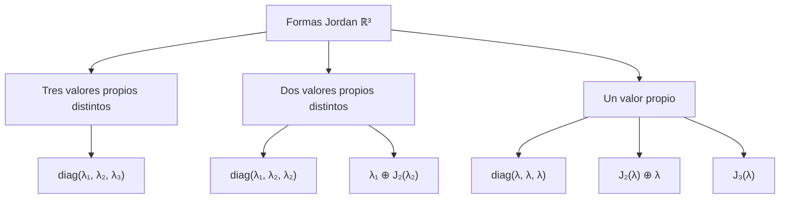
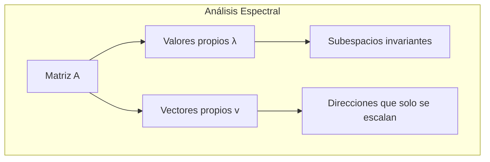
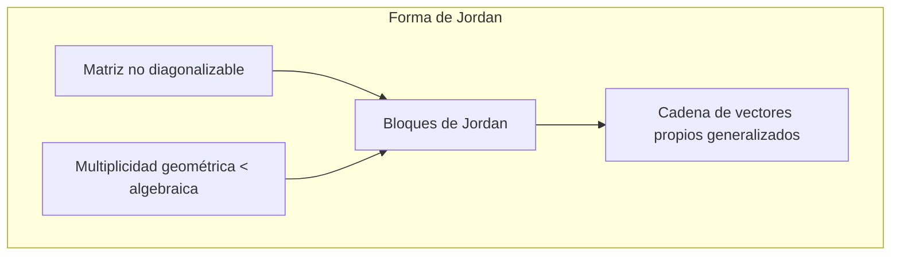
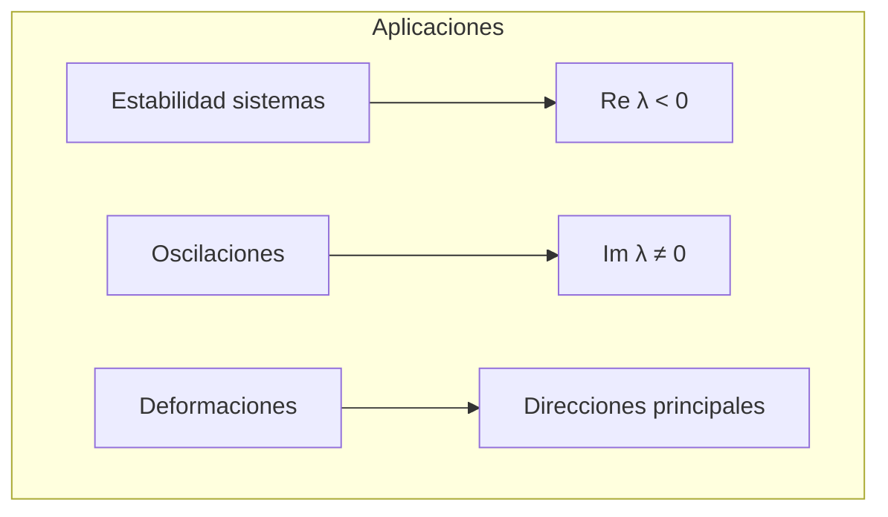

# Matemáticas para Ciencias Aplicadas II - Espacio Euclidiano de dimensión n

## 1.6 Vector propio. Forma canónica de Jordan en 2 y 3 dimensiones.

---

### 1. Vectores Propios y Valores Propios

#### 1.1 Definición Formal

Sea $A$ una matriz cuadrada de $n \times n$. Un **vector propio** $\vec{v} \neq \vec{0}$ satisface:

$$ A\vec{v} = \lambda\vec{v} $$

donde $\lambda$ es el **valor propio** (escalar) asociado.

#### 1.2 Ecuación Característica

Los valores propios se encuentran resolviendo:

$$ \det(A - \lambda I) = 0 $$

donde $I$ es la matriz identidad.

#### 1.3 Propiedades Fundamentales


### 2. Forma Canónica de Jordan

#### 2.1 Concepto General

Cuando una matriz no es diagonalizable, puede llevarse a la **forma canónica de Jordan**, que es casi diagonal, siempre que su polinomio característico se factorice en factores lineales. Esto ocurre siempre sobre $\mathbb{C}$. Sobre $\mathbb{R}$ falla si hay valores propios complejos, como en una rotación:

$$ A = PJP^{-1} $$

donde $J$ es una matriz por bloques de Jordan.

#### 2.2 Bloques de Jordan

Un bloque de Jordan de tamaño $k$ asociado al valor propio $\lambda$ es:

$$ J_k(\lambda) = \begin{bmatrix} \lambda & 1 & 0 & \cdots & 0 \\\ 0 & \lambda & 1 & \cdots & 0 \\\ \vdots & \vdots & \ddots & \ddots & \vdots \\\ 0 & 0 & \cdots & \lambda & 1 \\\ 0 & 0 & \cdots & 0 & \lambda \\\ \end{bmatrix} $$

### 3. Caso 2D: Formas de Jordan en ℝ²

#### 3.1 Caso 1: Dos valores propios distintos

$$ J = \begin{bmatrix} \lambda_1 & 0 \\ 0 & \lambda_2 \end{bmatrix} $$

#### 3.2 Caso 2: Un valor propio, matriz diagonalizable

$$ J = \begin{bmatrix} \lambda & 0 \\ 0 & \lambda \end{bmatrix} $$

#### 3.3 Caso 3: Un valor propio, no diagonalizable

$$ J = \begin{bmatrix} \lambda & 1 \\ 0 & \lambda \end{bmatrix} $$

### 4. Caso 3D: Formas de Jordan en ℝ³

#### 4.1 Posibles configuraciones:



#### 4.2 Ejemplos de bloques en 3D:

- $\begin{bmatrix} \lambda & 1 & 0 \\ 0 & \lambda & 1 \\ 0 & 0 & \lambda \end{bmatrix}$ (Un bloque 3×3)
- $\begin{bmatrix} \lambda & 1 & 0 \\ 0 & \lambda & 0 \\ 0 & 0 & \mu \end{bmatrix}$ (Bloque 2×2 y valor propio simple)

### 5. Implementación Computacional

```python
import numpy as np
import sympy as sp

class AlgebraLinealAvanzada:
    def __init__(self, matriz):
        self.A = np.array(matriz, dtype=float)
        self.A_exacta = sp.Matrix(matriz)      # para cálculos exactos
        self.n = self.A.shape[0]

    def valores_propios(self):
        """Calcula valores y vectores propios (numéricos)"""
        valores, vectores = np.linalg.eig(self.A)
        return valores, vectores

    def forma_jordan(self):
        """
        Forma canónica de Jordan exacta: devuelve (P, J) con A = P J P^(-1).
        Se calcula con aritmética exacta porque es numéricamente inestable:
        una perturbación mínima de la matriz cambia la forma de Jordan.
        """
        P, J = self.A_exacta.jordan_form()
        return P, J

    def polinomio_caracteristico(self):
        """Calcula el polinomio característico"""
        lam = sp.symbols('lambda')
        return sp.factor(self.A_exacta.charpoly(lam).as_expr())

    def multiplicidades(self):
        """Multiplicidades algebraica y geométrica de cada valor propio"""
        resultado = {}
        for valor, mult_alg in self.A_exacta.eigenvals().items():
            # Dimensión del espacio propio = n - rango(A - λI)
            mult_geom = self.n - (self.A_exacta - valor * sp.eye(self.n)).rank()
            resultado[valor] = (mult_alg, mult_geom)
        return resultado

# Ejemplo de uso
A_2d = [[2, 1], [0, 2]]  # Matriz no diagonalizable
algebra = AlgebraLinealAvanzada(A_2d)

valores, vectores = algebra.valores_propios()
print(f"Valores propios: {valores}")
print(f"Polinomio característico: {algebra.polinomio_caracteristico()}")
print(f"Multiplicidades (algebraica, geométrica): {algebra.multiplicidades()}")

P, J = algebra.forma_jordan()
print(f"Forma de Jordan: {J}")
print(f"Matriz de cambio: {P}")

# Un ejemplo en 3D con un bloque J2(2) y un bloque J1(3)
B = AlgebraLinealAvanzada([[2, 1, 0], [0, 2, 0], [0, 0, 3]])
print(f"Multiplicidades: {B.multiplicidades()}")
print(f"Forma de Jordan 3D: {B.forma_jordan()[1]}")
```

```text
Valores propios: [2. 2.]
Polinomio característico: (lambda - 2)**2
Multiplicidades (algebraica, geométrica): {2: (2, 1)}
Forma de Jordan: Matrix([[2, 1], [0, 2]])
Matriz de cambio: Matrix([[1, 0], [0, 1]])
Multiplicidades: {2: (2, 1), 3: (1, 1)}
Forma de Jordan 3D: Matrix([[2, 1, 0], [0, 2, 0], [0, 0, 3]])
```

La multiplicidad geométrica 1 menor que la algebraica 2 indica que la matriz no es diagonalizable: falta un vector propio, que se sustituye por un vector propio **generalizado** $\vec{v}_2$ con $(A - \lambda I)\vec{v}_2 = \vec{v}_1$.

### 6. Ejemplos y Ejercicios

#### Ejemplo 1: Matriz 2D Diagonalizable

$$ A = \begin{bmatrix} 3 & 0 \\ 0 & -1 \end{bmatrix} $$

- Valores propios: $ \lambda_1 = 3$, $\lambda_2 = -1 $
- Forma de Jordan: $ \begin{bmatrix} 3 & 0 \\ 0 & -1 \end{bmatrix} $

#### Ejemplo 2: Matriz 2D No Diagonalizable

$$ A = \begin{bmatrix} 2 & 1 \\ 0 & 2 \end{bmatrix}$$

- Valor propio: $ \lambda = 2$ (multiplicidad 2)
- Forma de Jordan: $ \begin{bmatrix} 2 & 1 \\ 0 & 2 \end{bmatrix} $

#### Ejemplo 3: Matriz 3D con Bloque de Jordan

$$ A = \begin{bmatrix} 3 & 1 & 0 \\ 0 & 3 & 1 \\ 0 & 0 & 3 \end{bmatrix} $$

- Valor propio: $ \lambda = 3 $ (multiplicidad 3)
- Forma de Jordan: $ \begin{bmatrix} 3 & 1 & 0 \\ 0 & 3 & 1 \\ 0 & 0 & 3 \end{bmatrix} $

#### Ejercicio 1:

Para $A = \begin{bmatrix} 1 & 2 \\ 0 & 1 \end{bmatrix}$:

1. Encuentra valores y vectores propios
2. Determina si es diagonalizable
3. Encuentra su forma de Jordan

### 7. Aplicaciones Prácticas

#### 7.1 Sistemas Dinámicos

- Análisis de estabilidad de sistemas lineales
- Solución de ecuaciones diferenciales lineales
- Sistemas de control automático

#### 7.2 Mecánica Cuántica

- Operadores y estados propios
- Valores de energía en sistemas cuánticos
- Problemas de autovalores

#### 7.3 Gráficos por Computadora

- Transformaciones geométricas
- Compresión de datos
- Análisis de deformaciones

### 8. Teoremas Importantes

#### 8.1 Teorema de Cayley-Hamilton

Toda matriz satisface su propio polinomio característico:

$$p_A(A) = 0$$

#### 8.2 Teorema Espectral

Matrices simétricas reales son diagonalizables con base ortonormal de vectores propios.

#### 8.3 Descomposición de Jordan

Toda matriz cuadrada con entradas complejas es similar a una matriz de Jordan, única salvo el orden de los bloques.

### 9. Visualización de Espacios Propios







### 10. Recursos Adicionales

- "Linear Algebra Done Right" por Sheldon Axler
- "Matrix Analysis" por Roger A. Horn y Charles R. Johnson
- "Differential Equations and Linear Algebra" por Gilbert Strang
- Software: MATLAB, NumPy, SciPy, Wolfram Mathematica
- Tutoriales online de álgebra lineal avanzada
- Visualizaciones interactivas de espacios propios
