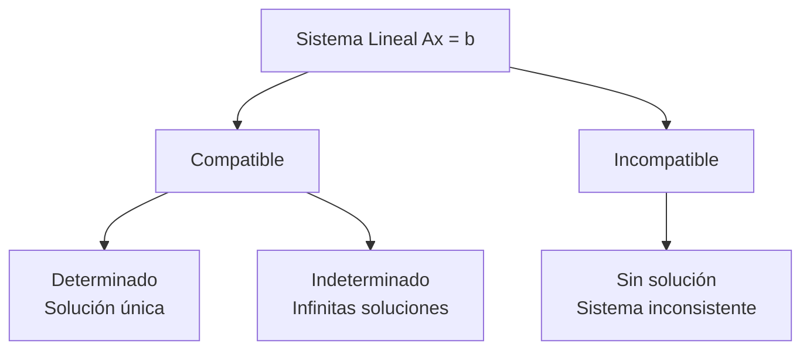
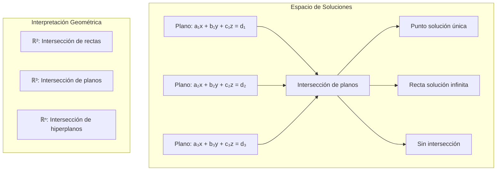

# Matemáticas para Ciencias Aplicadas II - Espacio Euclidiano de dimensión n

## 1.7 Ecuaciones Lineales.

---

### 1. Sistemas de Ecuaciones Lineales

#### 1.1 Definición Formal

Un **sistema de ecuaciones lineales** con $m$ ecuaciones y $n$ incógnitas tiene la forma:

$$ \begin{cases} a_{11}x_1 + a_{12}x_2 + \cdots + a_{1n}x_n = b_1 \\\ a_{21}x_1 + a_{22}x_2 + \cdots + a_{2n}x_n = b_2 \\\ \vdots \\\ a_{m1}x_1 + a_{m2}x_2 + \cdots + a_{mn}x_n = b_m \\\ \end{cases} $$

#### 1.2 Representación Matricial

El sistema se puede escribir como:

$$A\vec{x} = \vec{b}$$

donde:

- $A \in \mathbb{R}^{m \times n}$ es la **matriz de coeficientes**
- $\vec{x} \in \mathbb{R}^n$ es el **vector de incógnitas**
- $\vec{b} \in \mathbb{R}^m$ es el **vector de términos independientes**

### 2. Clasificación de Sistemas Lineales

#### 2.1 Tipos de Soluciones



#### 2.2 Teorema de Rouché-Frobenius

Un sistema $A\vec{x} = \vec{b}$ es:

- **Compatible** si y solo si $\operatorname{rang}(A) = \operatorname{rang}(A|\vec{b})$
- **Determinado** si además $\operatorname{rang}(A) = n$
- **Indeterminado** si es compatible y $\operatorname{rang}(A) < n$. Las soluciones dependen de $n - \operatorname{rang}(A)$ parámetros libres

### 3. Métodos de Resolución

#### 3.1 Eliminación Gaussiana

Transformar la matriz aumentada $[A|\vec{b}]$ a forma escalonada:

$$ [A|\vec{b}] \sim \begin{bmatrix} 1 & a_{12}' & \cdots & a_{1n}' & b_1' \\\ 0 & 1 & \cdots & a_{2n}' & b_2' \\\ \vdots & \vdots & \ddots & \vdots & \vdots \\\ 0 & 0 & \cdots & 1 & b_r' \\\ 0 & 0 & \cdots & 0 & 0 \\\ \end{bmatrix} $$

#### 3.2 Sustitución Regresiva

Resolver desde la última ecuación hacia la primera.

### 4. Implementación Computacional

```python
import numpy as np

class SistemaEcuaciones:
    def __init__(self, A, b):
        self.A = np.array(A, dtype=float)
        self.b = np.array(b, dtype=float)
        self.m, self.n = self.A.shape

    def eliminacion_gaussiana(self):
        """Resuelve el sistema usando eliminación gaussiana"""
        # Matriz aumentada
        Ab = np.column_stack([self.A, self.b])

        # Eliminación hacia adelante
        for i in range(min(self.m, self.n)):
            # Pivoteo parcial
            max_row = np.argmax(np.abs(Ab[i:, i])) + i
            Ab[[i, max_row]] = Ab[[max_row, i]]

            # Eliminación
            for j in range(i + 1, self.m):
                factor = Ab[j, i] / Ab[i, i]
                Ab[j, i:] -= factor * Ab[i, i:]

        # Sustitución regresiva
        x = np.zeros(self.n)
        for i in range(min(self.m, self.n) - 1, -1, -1):
            if np.abs(Ab[i, i]) > 1e-10:  # Evitar división por cero
                x[i] = (Ab[i, -1] - np.dot(Ab[i, i+1:self.n], x[i+1:])) / Ab[i, i]

        return x

    def rango(self):
        """Calcula el rango de la matriz"""
        return np.linalg.matrix_rank(self.A)

    def rango_aumentada(self):
        """Calcula el rango de la matriz aumentada"""
        Ab = np.column_stack([self.A, self.b])
        return np.linalg.matrix_rank(Ab)

    def es_compatible(self):
        """Verifica si el sistema es compatible"""
        return self.rango() == self.rango_aumentada()

    def es_determinado(self):
        """Verifica si el sistema es determinado"""
        return self.es_compatible() and self.rango() == self.n

    def resolver(self):
        """Resuelve el sistema usando métodos numéricos"""
        if self.m == self.n and self.es_determinado():
            try:
                return np.linalg.solve(self.A, self.b)
            except np.linalg.LinAlgError:
                return self.eliminacion_gaussiana()
        else:
            # Sistema no cuadrado o no determinado: lstsq devuelve la solución
            # de mínimos cuadrados de norma mínima. Si el sistema es
            # incompatible, NO es una solución exacta; si es indeterminado,
            # es solo una de las infinitas soluciones
            return np.linalg.lstsq(self.A, self.b, rcond=None)[0]

    def espacio_solucion(self):
        """Encuentra el espacio solución para sistemas homogéneos"""
        if not np.allclose(self.b, 0):
            raise ValueError("El sistema no es homogéneo")

        # Encontrar núcleo de A
        U, s, Vh = np.linalg.svd(self.A)
        tolerancia = 1e-10
        rango = np.sum(s > tolerancia)
        base_nucleo = Vh[rango:].T

        return base_nucleo

# Ejemplo de uso
A = [[2, 1, -1],
     [-3, -1, 2],
     [-2, 1, 2]]
b = [8, -11, -3]

sistema = SistemaEcuaciones(A, b)
print(f"¿Es compatible? {sistema.es_compatible()}")
print(f"¿Es determinado? {sistema.es_determinado()}")
solucion = sistema.resolver()
print(f"Solución: {solucion}")
```

### 5. Sistemas Homogéneos y No Homogéneos

#### 5.1 Sistemas Homogéneos ( $A\vec{x} = \vec{0}$ )

- Siempre tienen solución trivial $\vec{x} = \vec{0}$
- Soluciones no triviales existen si $\operatorname{rang}(A) < n$
- El conjunto solución forma un subespacio vectorial

#### 5.2 Relación con Sistemas No Homogéneos

Si $\vec{x}_p$ es solución particular de $A\vec{x} = \vec{b}$, entonces la solución general es:

$$\vec{x} = \vec{x}_p + \vec{x}_h$$

donde $\vec{x}_h$ es solución del sistema homogéneo asociado.

### 6. Ejemplos y Ejercicios

#### Ejemplo 1: Sistema Compatible Determinado

$$ \begin{cases} 2x + y = 5 \\\ x - y = 1 \\\ \end{cases} $$
Solución única: $x = 2$, $y = 1$

#### Ejemplo 2: Sistema Compatible Indeterminado

$$ \begin{cases} x + y + z = 6 \\\ 2x + y - z = 1 \\\ \end{cases} $$
Infinitas soluciones: restando la primera ecuación de la segunda se obtiene $x - 2z = -5$. Con $z = t$ como parámetro libre, $x = 2t - 5$ y $y = 6 - x - z = 11 - 3t$:

$$ (x, y, z) = (-5, 11, 0) + t\,(2, -3, 1), \qquad t \in \mathbb{R} $$

Por ejemplo, $t = 3$ da $(1, 2, 3)$, que cumple $1 + 2 + 3 = 6$ y $2 + 2 - 3 = 1$.

#### Ejemplo 3: Sistema Incompatible

$$ \begin{cases} x + y = 2 \\\ x + y = 3 \\\ \end{cases} $$
No tiene solución

#### Ejercicio 1:

Para el sistema:

$$ \begin{cases} 3x - 2y + z = 1 \\\ x + y - z = 2 \\\ 2x - y + 2z = 3 \\\ \end{cases} $$

1. Clasifica el sistema
2. Encuentra la solución si existe
3. Determina el rango de la matriz

### 7. Aplicaciones Prácticas

#### 7.1 Ingeniería y Física

- Análisis de circuitos eléctricos
- Estática de estructuras
- Balance de materiales

#### 7.2 Economía y Investigación de Operaciones

- Modelos de input-output
- Optimización lineal
- Análisis de redes

#### 7.3 Gráficos por Computadora

- Transformaciones geométricas
- Interpolación de datos
- Ajuste de curvas

### 8. Métodos Numéricos Avanzados

#### 8.1 Descomposición LU

$$ A = LU $$
donde $L$ es triangular inferior y $U$ es triangular superior.

#### 8.2 Métodos Iterativos

- Jacobi
- Gauss-Seidel
- Relajación sucesiva

#### 8.3 Mínimos Cuadrados

Para sistemas sobredeterminados:

$$ \min_{\vec{x}} \|A\vec{x} - \vec{b}\|^2 $$

### 9. Visualización de Soluciones



### 10. Recursos Adicionales

- "Linear Algebra and Its Applications" por Gilbert Strang
- "Matrix Analysis" por Roger A. Horn y Charles R. Johnson
- "Numerical Linear Algebra" por Lloyd N. Trefethen
- Software: MATLAB, NumPy, SciPy, Wolfram Mathematica
- Tutoriales online de álgebra lineal aplicada
- Visualizaciones interactivas de sistemas lineales
