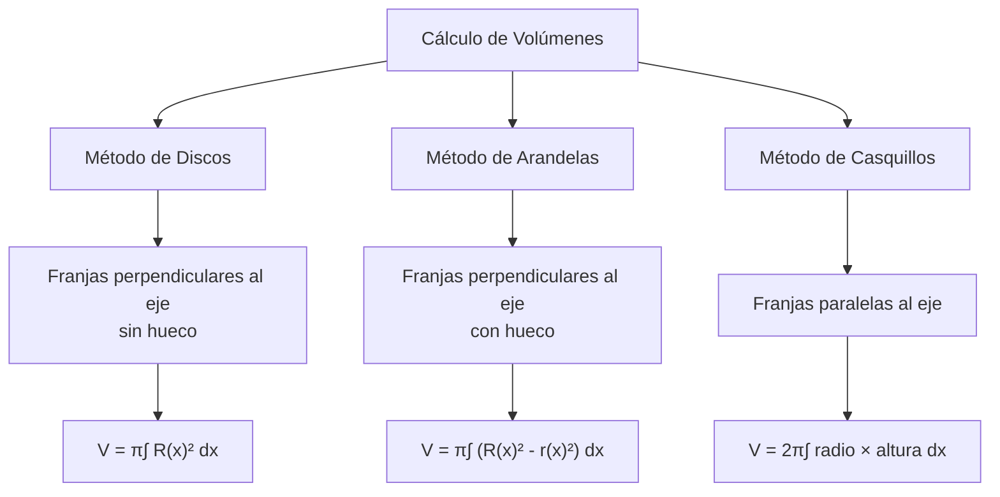
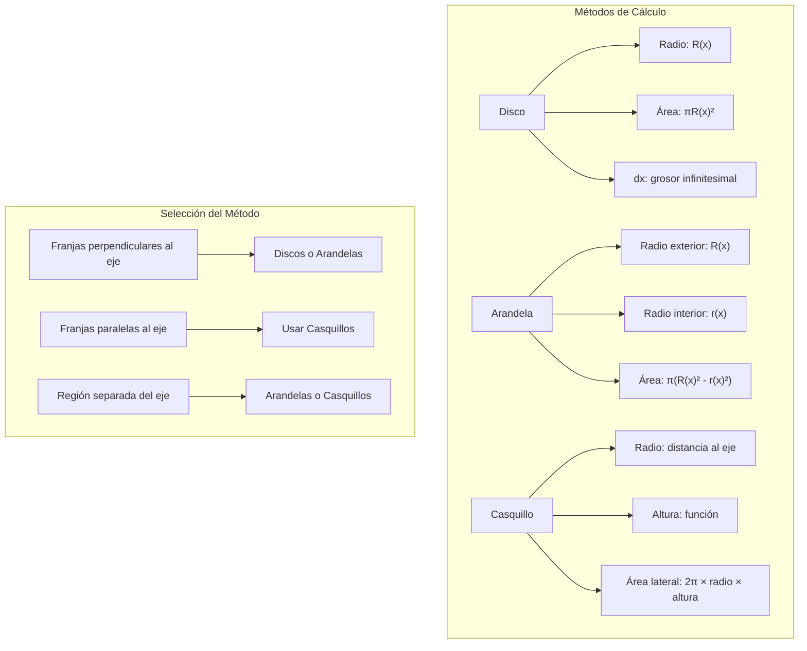

# Matemáticas para Ciencias Aplicadas II - Sólidos de revolución

## 2.1 Volúmenes de sólidos.

---

### 1. Definición de Sólidos de Revolución

Un **sólido de revolución** es una figura geométrica tridimensional obtenida al rotar una región plana alrededor de una recta en el mismo plano, llamada **eje de rotación**.

#### 1.1 Elementos Fundamentales

- **Región plana**: Área en el plano que se hace girar
- **Eje de rotación**: Recta alrededor de la cual se gira la región
- **Generatriz**: Curva que genera la superficie al girar

### 2. Métodos para Calcular Volúmenes

#### 2.1 Método de los Discos

Cuando la región gira alrededor de un eje horizontal o vertical:

$$V = \pi \int_{a}^{b} [R(x)]^2 dx \quad \text{(eje horizontal)}$$
$$V = \pi \int_{c}^{d} [R(y)]^2 dy \quad \text{(eje vertical)}$$

donde $R(x)$ o $R(y)$ es el radio del disco.

#### 2.2 Método de las Arandelas

Cuando hay un radio exterior e interior:

$$V = \pi \int_{a}^{b} \left([R(x)]^2 - [r(x)]^2\right) dx$$

#### 2.3 Método de los Casquillos Cilíndricos

Se corta la región en franjas **paralelas** al eje de rotación; cada franja genera un casquillo cilíndrico. Es útil, por ejemplo, para girar alrededor del eje $y$ una región descrita como $0 \leq y \leq f(x)$, $a \leq x \leq b$, sin despejar $x$ en términos de $y$:

$$V = 2\pi \int_{a}^{b} (\text{radio})(\text{altura})  dx = 2\pi \int_a^b x f(x) \, dx \quad \text{(eje } y\text{, con } a \geq 0\text{)}$$

Los discos y arandelas, en cambio, cortan la región en franjas **perpendiculares** al eje.



### 3. Implementación Computacional

```python
import numpy as np
from scipy import integrate
import matplotlib.pyplot as plt
from matplotlib import animation
from mpl_toolkits.mplot3d import Axes3D

class SolidoRevolucion:
    def __init__(self, funcion, limites, eje_rotacion='x'):
        self.funcion = funcion
        self.limites = limites  # [a, b]
        self.eje_rotacion = eje_rotacion

    def volumen_discos(self):
        """Calcula el volumen usando el método de discos"""
        if self.eje_rotacion == 'x':
            def integrando(x):
                return np.pi * (self.funcion(x))**2
        else:  # eje y
            def integrando(y):
                return np.pi * (self.funcion(y))**2

        resultado, error = integrate.quad(integrando, self.limites[0], self.limites[1])
        return resultado

    def volumen_arandelas(self, funcion_interior):
        """Calcula el volumen usando el método de arandelas"""
        if self.eje_rotacion == 'x':
            def integrando(x):
                return np.pi * ((self.funcion(x))**2 - (funcion_interior(x))**2)
        else:
            def integrando(y):
                return np.pi * ((self.funcion(y))**2 - (funcion_interior(y))**2)

        resultado, error = integrate.quad(integrando, self.limites[0], self.limites[1])
        return resultado

    def volumen_casquillos(self, distancia_al_eje):
        """Calcula el volumen usando el método de casquillos cilíndricos"""
        if self.eje_rotacion == 'x':
            def integrando(y):
                return 2 * np.pi * distancia_al_eje(y) * self.funcion(y)
        else:
            def integrando(x):
                return 2 * np.pi * distancia_al_eje(x) * self.funcion(x)

        resultado, error = integrate.quad(integrando, self.limites[0], self.limites[1])
        return resultado

    def graficar_solido(self, num_puntos=100):
        """Genera una visualización 3D del sólido"""
        fig = plt.figure(figsize=(10, 8))
        ax = fig.add_subplot(111, projection='3d')

        # Generar puntos para la superficie
        u = np.linspace(self.limites[0], self.limites[1], num_puntos)
        v = np.linspace(0, 2*np.pi, num_puntos)
        U, V = np.meshgrid(u, v)

        if self.eje_rotacion == 'x':
            X = U
            Y = self.funcion(U) * np.cos(V)
            Z = self.funcion(U) * np.sin(V)
        else:
            X = self.funcion(U) * np.cos(V)
            Y = U
            Z = self.funcion(U) * np.sin(V)

        # Graficar la superficie
        ax.plot_surface(X, Y, Z, alpha=0.8, cmap='viridis')
        ax.set_xlabel('X')
        ax.set_ylabel('Y')
        ax.set_zlabel('Z')
        plt.title('Sólido de Revolución')
        plt.show()

# Ejemplo de uso
def f(x):
    return np.sqrt(x)  # y = √x

def g(x):
    return x**2  # y = x²

solido = SolidoRevolucion(f, [0, 4], 'x')
volumen_discos = solido.volumen_discos()
print(f"Volumen por discos: {volumen_discos:.4f}")

# Ejemplo con arandelas
solido_arandelas = SolidoRevolucion(f, [0, 1], 'x')
volumen_arandelas = solido_arandelas.volumen_arandelas(g)
print(f"Volumen por arandelas: {volumen_arandelas:.4f}")

# Graficar el sólido
solido.graficar_solido()
```

### 4. Ejemplos y Ejercicios

#### Ejemplo 1: Volumen de una Esfera

Girar $y = \sqrt{r^2 - x^2}$ alrededor del eje x entre $-r$ y $r$:

$$V = \pi \int_{-r}^{r} (r^2 - x^2) dx = \frac{4}{3}\pi r^3$$

#### Ejemplo 2: Volumen de un Cono

Girar $y = \frac{r}{h}x$ alrededor del eje x entre $0$ y $h$, lo que da un cono de radio $r$ y altura $h$:

$$V = \pi \int_{0}^{h} \left(\frac{r}{h}x\right)^2 dx = \pi \frac{r^2}{h^2} \cdot \frac{h^3}{3} = \frac{1}{3}\pi r^2 h$$

#### Ejemplo 3: Volumen por Arandelas

Región entre $y = x$ y $y = x^2$ gira alrededor del eje x:

Para $0 \leq x \leq 1$ se cumple $x^2 \leq x$, así que el radio exterior es $x$ y el interior es $x^2$:

$$V = \pi \int_{0}^{1} \left[(x)^2 - (x^2)^2\right] dx = \pi \left[ \frac{x^3}{3} - \frac{x^5}{5} \right]_0^1 = \pi \left( \frac{1}{3} - \frac{1}{5} \right) = \frac{2\pi}{15}$$

#### Ejercicio 1:

Calcular el volumen del sólido generado al girar la región limitada por $y = \sin(x)$, $y = 0$, $x = 0$, $x = \pi$ alrededor del eje x.

### 5. Aplicaciones Prácticas

#### 5.1 Ingeniería y Diseño

- Cálculo de capacidad de tanques y recipientes
- Diseño de piezas mecánicas rotacionales
- Análisis estructural de elementos simétricos

#### 5.2 Física y Química

- Cálculo de momentos de inercia
- Determinación de centros de masa
- Análisis de fluidos en recipientes

#### 5.3 Arquitectura y Diseño Industrial

- Diseño de columnas y elementos estructurales
- Cálculo de materiales para construcción
- Optimización de formas aerodinámicas

### 6. Teoremas y Propiedades Importantes

#### 6.1 Teorema de Pappus-Guldinus

Si una región plana gira alrededor de un eje de su plano que no la atraviesa, el volumen del sólido es igual al área de la región multiplicada por la distancia recorrida por su centroide:

$$V = A \cdot 2\pi d$$

donde $d$ es la distancia del centroide al eje de rotación.

#### 6.2 Propiedad de Aditividad

El volumen total es la suma de los volúmenes de las partes cuando se divide el sólido.

### 7. Visualización de Métodos



### 8. Casos Especiales y Consideraciones

#### 8.1 Ejes de Rotación No Convencionales

- Cuando el eje de rotación no es horizontal ni vertical
- Uso de traslaciones y transformaciones
- Método de casquillos adaptado

#### 8.2 Funciones Paramétricas

Para curvas definidas paramétricamente $(x(t), y(t))$:

$$V = \pi \int_{t_1}^{t_2} [y(t)]^2 \frac{dx}{dt} dt$$

al girar alrededor del eje $x$, si $x(t)$ es creciente en $[t_1, t_2]$. Si es decreciente, se intercambian los límites o se toma el valor absoluto.

#### 8.3 Coordenadas Polares

Para regiones definidas en coordenadas polares $r = f(\theta)$.

### 9. Recursos Adicionales

- "Calculus" por James Stewart
- "Advanced Engineering Mathematics" por Erwin Kreyszig
- Software: GeoGebra, Wolfram Mathematica, MATLAB
- Librerías Python: NumPy, SciPy, Matplotlib
- Tutoriales online de cálculo integral aplicado
- Visualizaciones interactivas de sólidos de revolución
