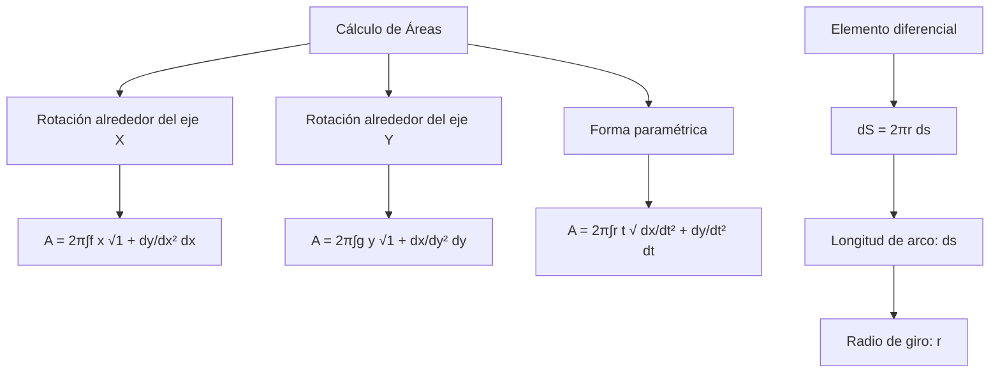
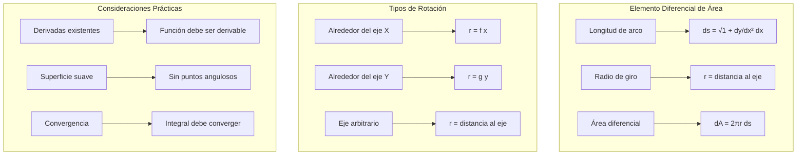

# Matemáticas para Ciencias Aplicadas II - Sólidos de revolución

## 2.2 Área de superficies de revolución.

---

### 1. Definición de Superficie de Revolución

Una **superficie de revolución** es la superficie exterior de un sólido de revolución, generada al rotar una curva plana alrededor de una recta (eje de rotación) contenida en el mismo plano.

#### 1.1 Elementos Fundamentales

- **Curva generatriz**: Curva que se hace girar
- **Eje de rotación**: Recta alrededor de la cual gira la curva
- **Superficie lateral**: Área exterior del sólido generado

### 2. Fórmulas para el Cálculo del Área

#### 2.1 Rotación alrededor del Eje X

Para una curva $y = f(x)$ entre $x = a$ y $x = b$:

$$A = 2\pi \int_{a}^{b} f(x) \sqrt{1 + \left(\frac{dy}{dx}\right)^2}  dx$$

#### 2.2 Rotación alrededor del Eje Y

Para una curva $x = g(y)$ entre $y = c$ y $y = d$:

$$A = 2\pi \int_{c}^{d} g(y) \sqrt{1 + \left(\frac{dx}{dy}\right)^2}  dy$$

#### 2.3 Forma Paramétrica

Para una curva definida paramétricamente $(x(t), y(t))$ entre $t = \alpha$ y $t = \beta$:

$$A = 2\pi \int_{\alpha}^{\beta} r(t) \sqrt{\left(\frac{dx}{dt}\right)^2 + \left(\frac{dy}{dt}\right)^2}  dt$$

donde $r(t)$ es la distancia al eje de rotación.



### 3. Implementación Computacional

```python
import numpy as np
from scipy import integrate, misc
import matplotlib.pyplot as plt
from mpl_toolkits.mplot3d import Axes3D

class SuperficieRevolucion:
    def __init__(self, funcion, limites, eje_rotacion='x'):
        self.funcion = funcion
        self.limites = limites  # [a, b]
        self.eje_rotacion = eje_rotacion

    def derivada(self, x, h=1e-5):
        """Calcula la derivada numérica"""
        return misc.derivative(self.funcion, x, dx=h)

    def longitud_arco_diferencial(self, x):
        """Calcula el elemento diferencial de longitud de arco"""
        deriv = self.derivada(x)
        return np.sqrt(1 + deriv**2)

    def area_superficie_x(self):
        """Calcula el área cuando gira alrededor del eje X"""
        def integrando(x):
            return 2 * np.pi * self.funcion(x) * self.longitud_arco_diferencial(x)

        resultado, error = integrate.quad(integrando, self.limites[0], self.limites[1])
        return resultado

    def area_superficie_y(self):
        """Calcula el área cuando gira alrededor del eje Y"""
        # Para rotación alrededor del eje Y, necesitamos x = g(y)
        # Asumimos que la función es invertible en el intervalo
        def integrando(y):
            # Encontrar x correspondiente a y (esto requiere función inversa)
            # Para simplificar, asumimos que podemos expresar x en términos de y
            # En la práctica,可能需要 numerical inverse
            return 2 * np.pi * y * self.longitud_arco_diferencial(y)

        # Esto es una simplificación - en casos reales se necesita más cuidado
        resultado, error = integrate.quad(integrando, self.limites[0], self.limites[1])
        return resultado

    def area_superficie_parametrica(self, x_func, y_func, t_limites):
        """Calcula el área para una curva paramétrica"""
        def integrando(t):
            dx_dt = misc.derivative(x_func, t)
            dy_dt = misc.derivative(y_func, t)
            radio = y_func(t)  # Para rotación alrededor del eje X
            return 2 * np.pi * radio * np.sqrt(dx_dt**2 + dy_dt**2)

        resultado, error = integrate.quad(integrando, t_limites[0], t_limites[1])
        return resultado

    def graficar_superficie(self, num_puntos=100):
        """Genera una visualización 3D de la superficie"""
        fig = plt.figure(figsize=(12, 10))
        ax = fig.add_subplot(111, projection='3d')

        # Generar puntos para la superficie
        u = np.linspace(self.limites[0], self.limites[1], num_puntos)
        v = np.linspace(0, 2*np.pi, num_puntos)
        U, V = np.meshgrid(u, v)

        if self.eje_rotacion == 'x':
            X = U
            Y = self.funcion(U) * np.cos(V)
            Z = self.funcion(U) * np.sin(V)
        else:
            X = self.funcion(U) * np.cos(V)
            Y = U
            Z = self.funcion(U) * np.sin(V)

        # Graficar la superficie
        superficie = ax.plot_surface(X, Y, Z, alpha=0.8, cmap='viridis',
                                   antialiased=True, linewidth=0)

        # Configuración del gráfico
        ax.set_xlabel('X')
        ax.set_ylabel('Y')
        ax.set_zlabel('Z')
        ax.set_title('Superficie de Revolución')
        fig.colorbar(superficie, ax=ax, shrink=0.5, aspect=20)
        plt.show()

    def comparar_volumen_area(self):
        """Compara el volumen y área de un sólido"""
        # Calcular volumen (método de discos)
        def integrando_volumen(x):
            return np.pi * (self.funcion(x))**2

        volumen, _ = integrate.quad(integrando_volumen, self.limites[0], self.limites[1])
        area = self.area_superficie_x()

        return volumen, area

# Ejemplo de uso
def f(x):
    return np.sqrt(x)  # y = √x

def g(x):
    return x**2  # y = x²

# Crear superficie para y = √x entre 0 y 4
superficie = SuperficieRevolucion(f, [1, 4], 'x')
area = superficie.area_superficie_x()
print(f"Área de la superficie: {area:.4f}")

# Comparar volumen y área
volumen, area = superficie.comparar_volumen_area()
print(f"Volumen: {volumen:.4f}, Área: {area:.4f}")

# Graficar la superficie
superficie.graficar_superficie()
```

### 4. Ejemplos y Ejercicios

#### Ejemplo 1: Área de una Esfera

Girar $y = \sqrt{r^2 - x^2}$ alrededor del eje x entre $-r$ y $r$:

$$A = 2\pi \int_{-r}^{r} \sqrt{r^2 - x^2} \sqrt{1 + \left(\frac{-x}{\sqrt{r^2 - x^2}}\right)^2} dx = 4\pi r^2$$

#### Ejemplo 2: Área de un Cono

Girar $y = \frac{h}{r}x$ alrededor del eje x entre $0$ y $r$:

$$A = 2\pi \int_{0}^{r} \frac{h}{r}x \sqrt{1 + \left(\frac{h}{r}\right)^2} dx = \pi r \sqrt{r^2 + h^2}$$

#### Ejemplo 3: Área de un Paraboloide

Girar $y = \sqrt{x}$ alrededor del eje x entre $0$ y $4$:

$$A = 2\pi \int_{0}^{4} \sqrt{x} \sqrt{1 + \left(\frac{1}{2\sqrt{x}}\right)^2} dx$$

#### Ejercicio 1:

Calcular el área de la superficie generada al girar $y = \sin(x)$ entre $x = 0$ y $x = \pi$ alrededor del eje x.

### 5. Aplicaciones Prácticas

#### 5.1 Ingeniería y Diseño

- Cálculo de áreas superficiales en tanques y recipientes
- Diseño de intercambiadores de calor
- Optimización de superficies aerodinámicas

#### 5.2 Arquitectura y Construcción

- Cálculo de materiales para cúpulas y bóvedas
- Diseño de estructuras rotacionales
- Estimación de costos de revestimiento

#### 5.3 Física y Química

- Cálculo de áreas superficiales en reactores químicos
- Análisis de transferencia de calor
- Estudio de fenómenos de superficie

### 6. Teoremas y Propiedades Importantes

#### 6.1 Teorema de Pappus para Áreas

El área de una superficie de revolución es igual a la longitud de la curva generatriz multiplicada por la distancia recorrida por su centroide:

$$ A = L \cdot 2\pi d $$

donde $L$ es la longitud de la curva y $d$ es la distancia del centroide al eje.

#### 6.2 Relación entre Volumen y Área

Para figuras similares, la relación área/volumen sigue leyes de escala importantes en física e ingeniería.

### 7. Casos Especiales y Consideraciones

#### 7.1 Superficies con Múltiples Componentes

Cuando la superficie tiene varias partes, el área total es la suma de las áreas de cada componente.

#### 7.2 Ejes de Rotación Arbitrarios

Para ejes no coordenados, se usa traslación y el método de la distancia al eje.

#### 7.3 Funciones No Suaves

Cuando la derivada no existe en algunos puntos, se divide la integral en subintervalos.

### 8. Visualización de Métodos



### 9. Técnicas Avanzadas

#### 9.1 Coordenadas Polares

Para curvas en coordenadas polares $r = f(\theta)$:

$$ A = 2\pi \int_{\alpha}^{\beta} f(\theta)\sin\theta \sqrt{f(\theta)^2 + f'(\theta)^2} d\theta $$

#### 9.2 Métodos Numéricos

Para funciones complejas sin primitiva elemental:

- Integración numérica
- Métodos de aproximación
- Simulación por elementos finitos

### 10. Recursos Adicionales

- "Calculus" por James Stewart
- "Advanced Engineering Mathematics" por Erwin Kreyszig
- "Differential Geometry" por Manfredo P. do Carmo
- Software: Mathematica, MATLAB, GeoGebra 3D
- Librerías Python: NumPy, SciPy, Matplotlib, SymPy
- Tutoriales online de superficies de revolución
- Visualizaciones interactivas de cálculo integral
