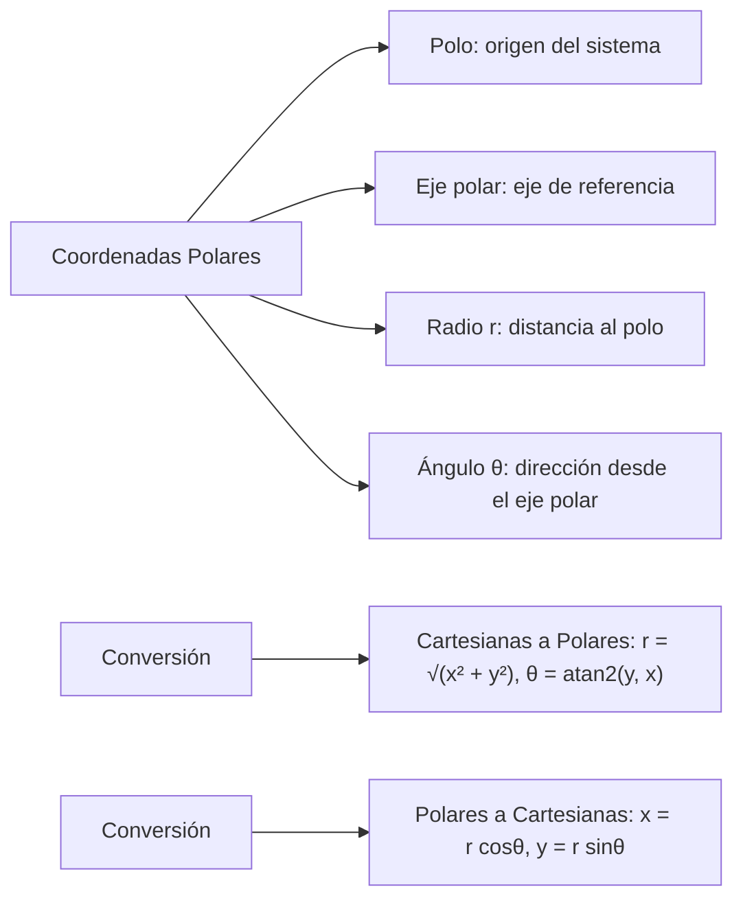
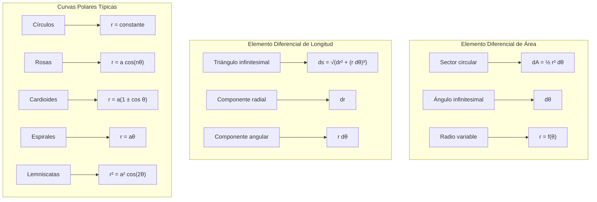

# Matemáticas para Ciencias Aplicadas II - Sólidos de revolución

## 2.3 Coordenadas polares. Área y Longitud en coordenadas polares.

---

### 1. Sistema de Coordenadas Polares

#### 1.1 Definición Fundamental

Las **coordenadas polares** representan puntos en el plano mediante:

- $r$: distancia desde el origen (radio)
- $\theta$: ángulo desde el eje polar (ángulo polar)

**Relación con coordenadas cartesianas:**
$$x = r \cos\theta$$
$$y = r \sin\theta$$
$$r = \sqrt{x^2 + y^2}$$
$$\theta = \arctan\left(\frac{y}{x}\right) \quad \text{si } x > 0$$

Si $x < 0$ hay que sumar $\pi$ al arcotangente, y si $x = 0$, $\theta = \pm \frac{\pi}{2}$ según el signo de $y$. En programación se usa `atan2(y, x)`, que considera el cuadrante.

#### 1.2 Elementos del Sistema Polar



### 2. Curvas en Coordenadas Polares

#### 2.1 Ecuaciones Polares Comunes

- **Círculo**: $r = a$ (radio constante)
- **Rosa**: $r = a \cos(n\theta)$ o $r = a \sin(n\theta)$
- **Cardioide**: $r = a(1 \pm \cos\theta)$ o $r = a(1 \pm \sin\theta)$
- **Lemniscata**: $r^2 = a^2 \cos(2\theta)$
- **Espiral**: $r = a\theta$

#### 2.2 Simetrías en Coordenadas Polares

Cada condición es suficiente, no necesaria: una curva puede tener la simetría aunque su ecuación no la cumpla tal cual, porque un mismo punto tiene varias representaciones polares.

- **Simetría respecto al eje polar**: $r(\theta) = r(-\theta)$
- **Simetría respecto al eje vertical**: $r(\theta) = r(\pi - \theta)$
- **Simetría respecto al polo**: $r(\theta) = r(\theta + \pi)$

### 3. Área en Coordenadas Polares

#### 3.1 Fórmula del Área

El área barrida por $r = f(\theta)$ entre $\theta = \alpha$ y $\theta = \beta$ es:

$$A = \frac{1}{2} \int_{\alpha}^{\beta} [f(\theta)]^2 d\theta = \frac{1}{2} \int_{\alpha}^{\beta} r^2 d\theta$$

#### 3.2 Área entre Dos Curvas

Para $r_1(\theta)$ y $r_2(\theta)$ con $r_1(\theta) \geq r_2(\theta)$:

$$A = \frac{1}{2} \int_{\alpha}^{\beta} \left([r_1(\theta)]^2 - [r_2(\theta)]^2\right) d\theta$$

### 4. Longitud de Arco en Coordenadas Polares

#### 4.1 Fórmula de la Longitud

La longitud de la curva $r = f(\theta)$ entre $\theta = \alpha$ y $\theta = \beta$ es:

$$L = \int_{\alpha}^{\beta} \sqrt{[f(\theta)]^2 + [f'(\theta)]^2} d\theta = \int_{\alpha}^{\beta} \sqrt{r^2 + \left(\frac{dr}{d\theta}\right)^2} d\theta$$

### 5. Implementación Computacional

```python
import numpy as np
from scipy import integrate
import matplotlib.pyplot as plt
import sympy as sp

class CoordenadasPolares:
    def __init__(self, funcion):
        self.funcion = funcion
        self.theta = sp.symbols('theta')

    def area_polar(self, alpha, beta):
        """Calcula el área en coordenadas polares"""
        r = self.funcion(self.theta)
        area_expr = sp.Rational(1, 2) * r**2
        area = sp.integrate(area_expr, (self.theta, alpha, beta))
        return float(area.evalf())

    def longitud_arco_polar(self, alpha, beta):
        """Calcula la longitud de arco en coordenadas polares"""
        r = self.funcion(self.theta)
        dr_dtheta = sp.diff(r, self.theta)
        integrando = sp.sqrt(r**2 + dr_dtheta**2)
        longitud = sp.integrate(integrando, (self.theta, alpha, beta))
        return float(longitud.evalf())

    def graficar_curva_polar(self, theta_lim=[0, 2*np.pi], num_puntos=1000):
        """Grafica una curva en coordenadas polares"""
        theta_vals = np.linspace(theta_lim[0], theta_lim[1], num_puntos)
        r_vals = [float(self.funcion(theta).evalf()) for theta in theta_vals]

        # Convertir a coordenadas cartesianas
        x_vals = r_vals * np.cos(theta_vals)
        y_vals = r_vals * np.sin(theta_vals)

        plt.figure(figsize=(10, 8))
        plt.plot(x_vals, y_vals, 'b-', linewidth=2)
        plt.grid(True, alpha=0.3)
        plt.axhline(0, color='black', linewidth=0.5)
        plt.axvline(0, color='black', linewidth=0.5)
        plt.xlabel('X')
        plt.ylabel('Y')
        plt.title('Curva en Coordenadas Polares')
        plt.axis('equal')
        plt.show()

    def area_entre_curvas(self, otra_funcion, alpha, beta):
        """Calcula el área entre dos curvas polares"""
        r1 = self.funcion(self.theta)
        r2 = otra_funcion(self.theta)
        area_expr = sp.Rational(1, 2) * (r1**2 - r2**2)
        area = sp.integrate(area_expr, (self.theta, alpha, beta))
        return float(area.evalf())

    def punto_medio_polar(self, alpha, beta):
        """Calcula las coordenadas del centroide"""
        r = self.funcion(self.theta)
        area = self.area_polar(alpha, beta)

        # Coordenada x del centroide
        x_num = sp.integrate(sp.Rational(1, 3) * r**3 * sp.cos(self.theta),
                           (self.theta, alpha, beta))
        x_centroide = float(x_num.evalf()) / area

        # Coordenada y del centroide
        y_num = sp.integrate(sp.Rational(1, 3) * r**3 * sp.sin(self.theta),
                           (self.theta, alpha, beta))
        y_centroide = float(y_num.evalf()) / area

        return x_centroide, y_centroide

# Ejemplos de uso
def rosa_4_petalos(theta):
    return 3 * sp.cos(2 * theta)

def cardioide(theta):
    return 2 * (1 + sp.cos(theta))

# Crear instancias y calcular
rosa = CoordenadasPolares(rosa_4_petalos)
area_rosa = rosa.area_polar(0, 2*np.pi)
longitud_rosa = rosa.longitud_arco_polar(0, 2*np.pi)

cardio = CoordenadasPolares(cardioide)
area_cardio = cardio.area_polar(0, 2*np.pi)
longitud_cardio = cardio.longitud_arco_polar(0, 2*np.pi)

print(f"Rosa 4 pétalos - Área: {area_rosa:.4f}, Longitud: {longitud_rosa:.4f}")
print(f"Cardioide - Área: {area_cardio:.4f}, Longitud: {longitud_cardio:.4f}")

# Graficar las curvas
rosa.graficar_curva_polar()
cardio.graficar_curva_polar([0, 2*np.pi])
```

### 6. Ejemplos y Ejercicios

#### Ejemplo 1: Área de un Círculo

Para $r = a$ (constante) entre $0$ y $2\pi$:

$$A = \frac{1}{2} \int_{0}^{2\pi} a^2 d\theta = \frac{1}{2} a^2 \cdot 2\pi = \pi a^2$$

#### Ejemplo 2: Área de una Rosa

Para $r = 3\cos(2\theta)$ entre $0$ y $2\pi$:

$$A = \frac{1}{2} \int_{0}^{2\pi} 9\cos^2(2\theta) d\theta = \frac{9\pi}{2}$$

#### Ejemplo 3: Longitud de un Cardioide

Para $r = 2(1 + \cos\theta)$ entre $0$ y $2\pi$:

$$L = \int_{0}^{2\pi} \sqrt{4(1 + \cos\theta)^2 + 4\sin^2\theta} d\theta = 16$$

#### Ejercicio 1:

Calcular el área y longitud de la lemniscata $r^2 = 4\cos(2\theta)$.

### 7. Aplicaciones Prácticas

#### 7.1 Ingeniería y Física

- Diseño de antenas y reflectores parabólicos
- Análisis de campos electromagnéticos
- Estudio de órbitas planetarias

#### 7.2 Arquitectura y Diseño

- Diseño de estructuras con simetría radial
- Patrones decorativos y artísticos
- Optimización de formas aerodinámicas

#### 7.3 Geografía y Navegación

- Sistemas de posicionamiento y coordenadas
- Cartografía y proyecciones geográficas
- Navegación marítima y aérea

### 8. Teoremas y Propiedades Importantes

#### 8.1 Teorema de Green en Polares

Para calcular áreas usando integrales de línea:

$$A = \frac{1}{2} \oint_C (x dy - y dx) = \frac{1}{2} \int_{\alpha}^{\beta} r^2 d\theta$$

#### 8.2 Fórmula del Centroide

Las coordenadas del centroide de un área polar son:

$$\bar{x} = \frac{1}{A} \int_{\alpha}^{\beta} \frac{1}{3} r^3 \cos\theta d\theta$$
$$\bar{y} = \frac{1}{A} \int_{\alpha}^{\beta} \frac{1}{3} r^3 \sin\theta d\theta$$

### 9. Visualización de Conceptos



### 10. Técnicas Avanzadas

#### 10.1 Integrales Impropias en Polares

Para curvas que se extienden al infinito o tienen singularidades.

#### 10.2 Coordenadas Polares Generalizadas

Extensión a tres dimensiones (coordenadas cilíndricas y esféricas).

#### 10.3 Aplicación en Cálculo Vectorial

- Gradiente, divergencia y rotacional en polares
- Ecuaciones diferenciales en coordenadas polares
- Problemas de valores en la frontera

### 11. Recursos Adicionales

- "Calculus" por James Stewart
- "Advanced Engineering Mathematics" por Erwin Kreyszig
- "Vector Calculus" por Jerrold E. Marsden
- Software: GeoGebra, Desmos, Wolfram Mathematica
- Librerías Python: NumPy, SciPy, Matplotlib, SymPy
- Tutoriales online de coordenadas polares
- Visualizaciones interactivas de curvas polares
