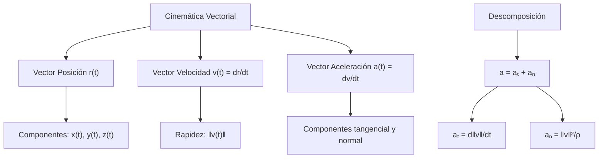
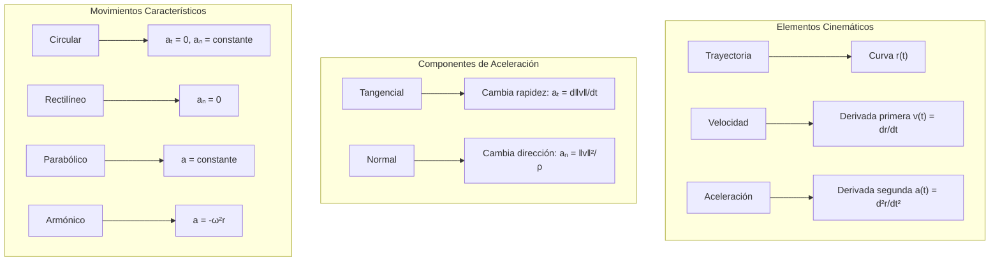

# Matemáticas para Ciencias Aplicadas II - Curvas

## 3.1 Trayectoria y velocidad.

---

### 1. Conceptos Fundamentales

#### 1.1 Trayectoria

Una **trayectoria** es una curva en el espacio que describe la posición de una partícula en función del tiempo. Se representa mediante una función vectorial:

$$\vec{r}(t) = (x(t), y(t), z(t))$$

donde $t$ es el parámetro tiempo.

#### 1.2 Vector Posición

El **vector posición** $\vec{r}(t)$ describe la ubicación instantánea de la partícula:

$$\vec{r}(t) = x(t)\hat{i} + y(t)\hat{j} + z(t)\hat{k}$$

### 2. Velocidad y Aceleración

#### 2.1 Vector Velocidad

La **velocidad instantánea** es la derivada del vector posición:

$$\vec{v}(t) = \frac{d\vec{r}}{dt} = \left(\frac{dx}{dt}, \frac{dy}{dt}, \frac{dz}{dt}\right)$$

#### 2.2 Vector Aceleración

La **aceleración instantánea** es la derivada del vector velocidad:

$$\vec{a}(t) = \frac{d\vec{v}}{dt} = \frac{d^2\vec{r}}{dt^2} = \left(\frac{d^2x}{dt^2}, \frac{d^2y}{dt^2}, \frac{d^2z}{dt^2}\right)$$

#### 2.3 Magnitudes y Componentes



### 3. Componentes Tangencial y Normal

#### 3.1 Vector Tangente Unitario

$$\vec{T}(t) = \frac{\vec{v}(t)}{\|\vec{v}(t)\|} = \frac{d\vec{r}/dt}{\|d\vec{r}/dt\|}$$

#### 3.2 Componentes de la Aceleración

$$\vec{a} = a_T \vec{T} + a_N \vec{N}$$
donde:

- $a_T = \frac{d}{dt}\|\vec{v}\|$ (componente tangencial)
- $a_N = \frac{\|\vec{v}\|^2}{\rho}$ (componente normal)
- $\rho$ es el radio de curvatura

### 4. Implementación Computacional

```python
import numpy as np
import matplotlib.pyplot as plt
from scipy import integrate
from math import comb

def derivative(func, x0, dx=1e-5, n=1, order=None):
    """Derivada numérica de orden n por diferencias centrales.
    Sustituye a scipy.misc.derivative, que se eliminó en SciPy 1.12."""
    return sum((-1)**k * comb(n, k) * func(x0 + (n / 2 - k) * dx)
               for k in range(n + 1)) / dx**n
from mpl_toolkits.mplot3d import Axes3D

class Trayectoria:
    def __init__(self, x_func, y_func, z_func=None):
        self.x_func = x_func
        self.y_func = y_func
        self.z_func = z_func
        self.dimension = 3 if z_func else 2

    def posicion(self, t):
        """Calcula la posición en el tiempo t"""
        if self.dimension == 3:
            return np.array([self.x_func(t), self.y_func(t), self.z_func(t)])
        else:
            return np.array([self.x_func(t), self.y_func(t)])

    def velocidad(self, t, h=1e-5):
        """Calcula la velocidad numéricamente"""
        if self.dimension == 3:
            dx = derivative(self.x_func, t, dx=h)
            dy = derivative(self.y_func, t, dx=h)
            dz = derivative(self.z_func, t, dx=h)
            return np.array([dx, dy, dz])
        else:
            dx = derivative(self.x_func, t, dx=h)
            dy = derivative(self.y_func, t, dx=h)
            return np.array([dx, dy])

    def aceleracion(self, t, h=1e-5):
        """Calcula la aceleración numéricamente"""
        if self.dimension == 3:
            d2x = derivative(self.x_func, t, dx=h, n=2)
            d2y = derivative(self.y_func, t, dx=h, n=2)
            d2z = derivative(self.z_func, t, dx=h, n=2)
            return np.array([d2x, d2y, d2z])
        else:
            d2x = derivative(self.x_func, t, dx=h, n=2)
            d2y = derivative(self.y_func, t, dx=h, n=2)
            return np.array([d2x, d2y])

    def rapidez(self, t):
        """Calcula la rapidez (magnitud de la velocidad)"""
        v = self.velocidad(t)
        return np.linalg.norm(v)

    def vector_tangente(self, t):
        """Calcula el vector tangente unitario"""
        v = self.velocidad(t)
        magnitud_v = np.linalg.norm(v)
        if magnitud_v == 0:
            return np.zeros_like(v)
        return v / magnitud_v

    def componentes_aceleracion(self, t):
        """Descompone la aceleración en componentes tangencial y normal"""
        a = self.aceleracion(t)
        v = self.velocidad(t)
        T = self.vector_tangente(t)

        a_tangencial = np.dot(a, T) * T
        a_normal = a - a_tangencial

        return a_tangencial, a_normal

    def longitud_arco(self, t_inicial, t_final, num_puntos=1000):
        """Calcula la longitud de arco de la trayectoria"""
        t_values = np.linspace(t_inicial, t_final, num_puntos)
        longitud = 0

        for i in range(1, len(t_values)):
            t1 = t_values[i-1]
            t2 = t_values[i]
            v = self.velocidad((t1 + t2)/2)
            dt = t2 - t1
            longitud += np.linalg.norm(v) * dt

        return longitud

    def graficar_trayectoria(self, t_range, num_puntos=100):
        """Grafica la trayectoria en 2D o 3D"""
        t_values = np.linspace(t_range[0], t_range[1], num_puntos)

        if self.dimension == 3:
            fig = plt.figure(figsize=(12, 10))
            ax = fig.add_subplot(111, projection='3d')

            x_vals = [self.x_func(t) for t in t_values]
            y_vals = [self.y_func(t) for t in t_values]
            z_vals = [self.z_func(t) for t in t_values]

            ax.plot(x_vals, y_vals, z_vals, 'b-', linewidth=2)
            ax.set_xlabel('X')
            ax.set_ylabel('Y')
            ax.set_zlabel('Z')
            ax.set_title('Trayectoria 3D')

        else:
            plt.figure(figsize=(10, 8))
            x_vals = [self.x_func(t) for t in t_values]
            y_vals = [self.y_func(t) for t in t_values]

            plt.plot(x_vals, y_vals, 'b-', linewidth=2)
            plt.xlabel('X')
            plt.ylabel('Y')
            plt.title('Trayectoria 2D')
            plt.grid(True, alpha=0.3)
            plt.axis('equal')

        plt.show()

    def graficar_vectores_movimiento(self, t_values):
        """Grafica vectores de posición, velocidad y aceleración"""
        fig, ax = plt.subplots(figsize=(12, 10))

        # Graficar trayectoria
        t_range = [min(t_values), max(t_values)]
        self.graficar_trayectoria(t_range)

        # Graficar vectores en tiempos específicos
        for t in t_values:
            r = self.posicion(t)
            v = self.velocidad(t)
            a = self.aceleracion(t)

            # Vector posición (desde origen)
            ax.quiver(0, 0, r[0], r[1], angles='xy', scale_units='xy', scale=1,
                     color='red', width=0.005, label='Posición' if t == t_values[0] else "")

            # Vector velocidad (desde posición)
            ax.quiver(r[0], r[1], v[0], v[1], angles='xy', scale_units='xy', scale=1,
                     color='blue', width=0.005, label='Velocidad' if t == t_values[0] else "")

            # Vector aceleración (desde posición)
            ax.quiver(r[0], r[1], a[0], a[1], angles='xy', scale_units='xy', scale=1,
                     color='green', width=0.005, label='Aceleración' if t == t_values[0] else "")

        ax.legend()
        plt.show()

# Ejemplo de uso: Movimiento circular uniforme
def movimiento_circular(t):
    omega = 2  # Velocidad angular
    R = 3      # Radio
    return R * np.cos(omega * t), R * np.sin(omega * t)

# Ejemplo de uso: Tiro parabólico
def tiro_parabolico(t):
    v0 = 20    # Velocidad inicial
    theta = np.pi/4  # Ángulo de 45°
    g = 9.8    # Gravedad

    x = v0 * np.cos(theta) * t
    y = v0 * np.sin(theta) * t - 0.5 * g * t**2
    return x, y

# Crear trayectorias
circular = Trayectoria(lambda t: 3*np.cos(2*t), lambda t: 3*np.sin(2*t))
parabolico = Trayectoria(lambda t: 20*np.cos(np.pi/4)*t,
                        lambda t: 20*np.sin(np.pi/4)*t - 4.9*t**2)

# Calcular propiedades
t = 1.0
print(f"Trayectoria circular en t={t}:")
print(f"Posición: {circular.posicion(t)}")
print(f"Velocidad: {circular.velocidad(t)}")
print(f"Aceleración: {circular.aceleracion(t)}")
print(f"Rapidez: {circular.rapidez(t):.2f}")

# Graficar
circular.graficar_trayectoria([0, 2*np.pi])
parabolico.graficar_trayectoria([0, 3])
```

### 5. Ejemplos y Ejercicios

#### Ejemplo 1: Movimiento Circular Uniforme

$$\vec{r}(t) = (R\cos(\omega t), R\sin(\omega t))$$
$$\vec{v}(t) = (-R\omega\sin(\omega t), R\omega\cos(\omega t))$$
$$\vec{a}(t) = (-R\omega^2\cos(\omega t), -R\omega^2\sin(\omega t))$$

#### Ejemplo 2: Tiro Parabólico

$$\vec{r}(t) = (v_0\cos\theta\cdot t, v_0\sin\theta\cdot t - \frac{1}{2}gt^2)$$
$$\vec{v}(t) = (v_0\cos\theta, v_0\sin\theta - gt)$$
$$\vec{a}(t) = (0, -g)$$

#### Ejemplo 3: Hélice Circular

$$\vec{r}(t) = (R\cos t, R\sin t, vt)$$
$$\vec{v}(t) = (-R\sin t, R\cos t, v)$$
$$\vec{a}(t) = (-R\cos t, -R\sin t, 0)$$

#### Ejercicio 1:

Para $\vec{r}(t) = (t^2, t^3, 2t)$:

1. Encuentra $\vec{v}(t)$ y $\vec{a}(t)$
2. Calcula la rapidez en $t = 1$
3. Encuentra los vectores tangente y normal

### 6. Aplicaciones Prácticas

#### 6.1 Física e Ingeniería

- Mecánica clásica y celeste
- Dinámica de partículas
- Análisis de trayectorias de proyectiles

#### 6.2 Robótica y Automatización

- Planificación de trayectorias
- Control de movimientos
- Cinemática de robots

#### 6.3 Gráficos por Computadora

- Animación de objetos
- Simulación de movimientos
- Efectos especiales

### 7. Propiedades Matemáticas

#### 7.1 Longitud de Arco

$$s(t) = \int_{t_0}^{t} \|\vec{v}(\tau)\| d\tau$$

#### 7.2 Curvatura y Torsión

- **Curvatura**: $\kappa = \frac{\|\vec{v} \times \vec{a}\|}{\|\vec{v}\|^3}$
- **Torsión**: $\tau = \frac{(\vec{v} \times \vec{a}) \cdot \vec{a}'}{\|\vec{v} \times \vec{a}\|^2}$

#### 7.3 Sistema de Referencia de Frenet-Serret

$$\frac{d\vec{T}}{ds} = \kappa\vec{N}$$
$$\frac{d\vec{N}}{ds} = -\kappa\vec{T} + \tau\vec{B}$$
$$\frac{d\vec{B}}{ds} = -\tau\vec{N}$$

### 8. Visualización de Movimientos



### 9. Casos Especiales

#### 9.1 Movimiento Rectilíneo Uniforme

- $\vec{a} = \vec{0}$
- $\vec{v} =$ constante
- Trayectoria recta

#### 9.2 Movimiento Circular Uniforme

- $a_T = 0$
- $a_N = \frac{v^2}{R} =$ constante
- Trayectoria circular

#### 9.3 Movimiento Armónico Simple

- $\vec{a} = -\omega^2 \vec{r}$
- Trayectoria elíptica o lineal

### 10. Recursos Adicionales

- "Calculus" por James Stewart
- "Classical Mechanics" por Herbert Goldstein
- "Vector Calculus" por Jerrold E. Marsden
- Software: GeoGebra, Mathematica, MATLAB
- Librerías Python: NumPy, SciPy, Matplotlib
- Simulaciones interactivas de física
- Tutoriales online de cinemática vectorial
