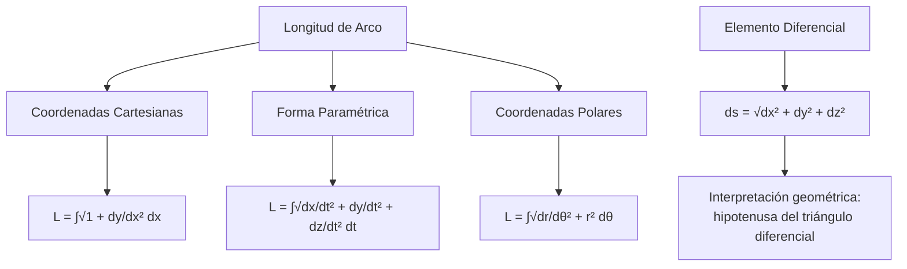
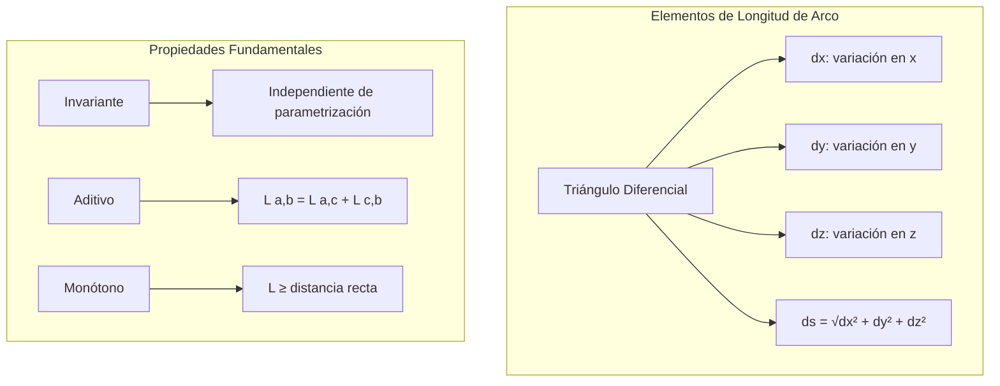
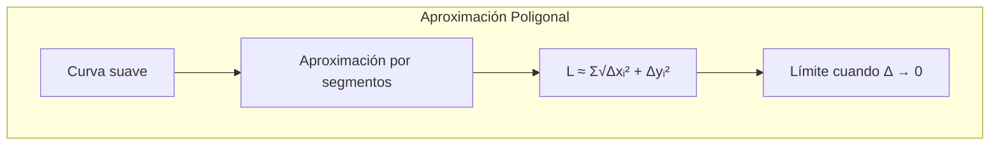

# Matemáticas para Ciencias Aplicadas II - Curvas

## 3.2 Longitud de arco.

---

### 1. Concepto de Longitud de Arco

#### 1.1 Definición Fundamental

La **longitud de arco** de una curva es la medida de la distancia a lo largo de la curva entre dos puntos. Para una curva suave descrita por una función vectorial $\vec{r}(t)$, la longitud de arco desde $t = a$ hasta $t = b$ es:

$$L = \int_{a}^{b} \left\|\frac{d\vec{r}}{dt}\right\| dt = \int_{a}^{b} \sqrt{\left(\frac{dx}{dt}\right)^2 + \left(\frac{dy}{dt}\right)^2 + \left(\frac{dz}{dt}\right)^2} dt$$

#### 1.2 Diferencial de Longitud de Arco

El elemento diferencial de longitud de arco $ds$ se define como:

$$ds = \left\|\frac{d\vec{r}}{dt}\right\| dt = \sqrt{dx^2 + dy^2 + dz^2}$$

### 2. Fórmulas por Tipo de Representación

#### 2.1 Coordenadas Cartesianas (2D)

Para $y = f(x)$ entre $x = a$ y $x = b$:

$$L = \int_{a}^{b} \sqrt{1 + \left(\frac{dy}{dx}\right)^2} dx$$

#### 2.2 Forma Paramétrica

Para $\vec{r}(t) = (x(t), y(t), z(t))$ entre $t = a$ y $t = b$:

$$L = \int_{a}^{b} \sqrt{\left(\frac{dx}{dt}\right)^2 + \left(\frac{dy}{dt}\right)^2 + \left(\frac{dz}{dt}\right)^2} dt$$

#### 2.3 Coordenadas Polares

Para $r = f(\theta)$ entre $\theta = \alpha$ y $\theta = \beta$:

$$L = \int_{\alpha}^{\beta} \sqrt{\left(\frac{dr}{d\theta}\right)^2 + r^2} d\theta$$



### 3. Función de Longitud de Arco

#### 3.1 Definición

La **función de longitud de arco** $s(t)$ mide la distancia acumulada desde un punto fijo:

$$s(t) = \int_{a}^{t} \left\|\frac{d\vec{r}}{d\tau}\right\| d\tau = \int_{a}^{t} \sqrt{\left(\frac{dx}{d\tau}\right)^2 + \left(\frac{dy}{d\tau}\right)^2 + \left(\frac{dz}{d\tau}\right)^2} d\tau$$

#### 3.2 Propiedades

- $s'(t) = \|\vec{v}(t)\|$ (rapidez)
- $ds = \|\vec{v}(t)\| dt$
- Parámetro longitud de arco: $t$ tal que $\|\vec{r}'(t)\| = 1$

### 4. Implementación Computacional

```python
import numpy as np
from scipy import integrate, misc
import matplotlib.pyplot as plt
from mpl_toolkits.mplot3d import Axes3D

class LongitudArco:
    def __init__(self, funcion, tipo='cartesianas', dimension=2):
        self.funcion = funcion
        self.tipo = tipo
        self.dimension = dimension

    def longitud_entre_puntos(self, a, b, num_puntos=1000):
        """Calcula la longitud de arco entre dos puntos"""
        if self.tipo == 'cartesianas' and self.dimension == 2:
            return self._longitud_cartesianas_2d(a, b)
        elif self.tipo == 'parametrica':
            return self._longitud_parametrica(a, b, num_puntos)
        elif self.tipo == 'polares':
            return self._longitud_polares(a, b, num_puntos)
        else:
            raise ValueError("Tipo no soportado")

    def _longitud_cartesianas_2d(self, a, b):
        """Longitud para y = f(x)"""
        def integrando(x):
            derivada = misc.derivative(self.funcion, x)
            return np.sqrt(1 + derivada**2)

        resultado, error = integrate.quad(integrando, a, b)
        return resultado

    def _longitud_parametrica(self, a, b, num_puntos):
        """Longitud para curva paramétrica"""
        if self.dimension == 2:
            def rapidez(t):
                x_t = misc.derivative(lambda tau: self.funcion(tau)[0], t)
                y_t = misc.derivative(lambda tau: self.funcion(tau)[1], t)
                return np.sqrt(x_t**2 + y_t**2)
        else:  # dimensión 3
            def rapidez(t):
                x_t = misc.derivative(lambda tau: self.funcion(tau)[0], t)
                y_t = misc.derivative(lambda tau: self.funcion(tau)[1], t)
                z_t = misc.derivative(lambda tau: self.funcion(tau)[2], t)
                return np.sqrt(x_t**2 + y_t**2 + z_t**2)

        resultado, error = integrate.quad(rapidez, a, b)
        return resultado

    def _longitud_polares(self, alpha, beta, num_puntos):
        """Longitud para curva en coordenadas polares"""
        def rapidez_angular(theta):
            r = self.funcion(theta)
            dr_dtheta = misc.derivative(self.funcion, theta)
            return np.sqrt(dr_dtheta**2 + r**2)

        resultado, error = integrate.quad(rapidez_angular, alpha, beta)
        return resultado

    def funcion_longitud_arco(self, t0, t_values):
        """Calcula la función de longitud de arco s(t)"""
        s_values = np.zeros_like(t_values)

        for i in range(1, len(t_values)):
            s_values[i] = s_values[i-1] + self.longitud_entre_puntos(
                t_values[i-1], t_values[i], 1000)

        return s_values

    def parametro_longitud_arco(self, t_range, num_puntos=1000):
        """Encuentra la parametrización por longitud de arco"""
        t_values = np.linspace(t_range[0], t_range[1], num_puntos)
        s_values = self.funcion_longitud_arco(t_range[0], t_values)

        # Función inversa: t en función de s
        from scipy import interpolate
        t_de_s = interpolate.interp1d(s_values, t_values,
                                    bounds_error=False, fill_value="extrapolate")
        return t_de_s

    def graficar_longitud_arco(self, intervalo, num_puntos=1000):
        """Grafica la curva y muestra elementos de longitud de arco"""
        t_values = np.linspace(intervalo[0], intervalo[1], num_puntos)

        if self.tipo == 'cartesianas' and self.dimension == 2:
            x_values = t_values
            y_values = [self.funcion(x) for x in x_values]
            plt.figure(figsize=(12, 8))
            plt.plot(x_values, y_values, 'b-', linewidth=2, label='Curva')

            # Mostrar algunos elementos ds
            for i in range(0, len(x_values), len(x_values)//10):
                dx = x_values[i+1] - x_values[i] if i < len(x_values)-1 else 0
                dy = y_values[i+1] - y_values[i] if i < len(y_values)-1 else 0
                ds = np.sqrt(dx**2 + dy**2)

                plt.quiver(x_values[i], y_values[i], dx, dy,
                          angles='xy', scale_units='xy', scale=1,
                          color='red', width=0.005, alpha=0.7)

                plt.text(x_values[i], y_values[i], f'ds={ds:.2f}',
                        fontsize=8, ha='right')

            plt.xlabel('x')
            plt.ylabel('y')
            plt.title('Longitud de Arco - Coordenadas Cartesianas')
            plt.legend()
            plt.grid(True, alpha=0.3)
            plt.axis('equal')

        plt.show()

    def calcular_propiedades_curva(self, t_values):
        """Calcula diversas propiedades de la curva"""
        resultados = []

        for t in t_values:
            if self.tipo == 'parametrica' and self.dimension == 2:
                # Derivadas numéricas
                h = 1e-5
                x_t = misc.derivative(lambda tau: self.funcion(tau)[0], t, dx=h)
                y_t = misc.derivative(lambda tau: self.funcion(tau)[1], t, dx=h)
                x_tt = misc.derivative(lambda tau: self.funcion(tau)[0], t, dx=h, n=2)
                y_tt = misc.derivative(lambda tau: self.funcion(tau)[1], t, dx=h, n=2)

                rapidez = np.sqrt(x_t**2 + y_t**2)
                curvatura = np.abs(x_t*y_tt - y_t*x_tt) / (rapidez**3) if rapidez > 0 else 0

                resultados.append({
                    't': t,
                    'rapidez': rapidez,
                    'curvatura': curvatura,
                    'vector_tangente': np.array([x_t, y_t]) / rapidez if rapidez > 0 else np.zeros(2)
                })

        return resultados

# Ejemplos de uso
# 1. Longitud de circunferencia: y = √(r² - x²)
def semicircunferencia(x):
    return np.sqrt(1 - x**2)  # radio 1

arco_circ = LongitudArco(semicircunferencia, 'cartesianas', 2)
longitud_semi = arco_circ.longitud_entre_puntos(-1, 1)
print(f"Longitud semicircunferencia (radio 1): {longitud_semi:.4f}")
print(f"Longitud teórica (π): {np.pi:.4f}")

# 2. Curva paramétrica: hélice
def helice(t):
    return np.array([np.cos(t), np.sin(t), t/5])

arco_helice = LongitudArco(helice, 'parametrica', 3)
longitud_helice = arco_helice.longitud_entre_puntos(0, 4*np.pi)
print(f"Longitud de hélice (4π vueltas): {longitud_helice:.4f}")

# 3. Coordenadas polares: cardioide
def cardioide(theta):
    return 1 + np.cos(theta)

arco_polar = LongitudArco(cardioide, 'polares')
longitud_cardioide = arco_polar.longitud_entre_puntos(0, 2*np.pi)
print(f"Longitud de cardioide: {longitud_cardioide:.4f}")

# Graficar
arco_circ.graficar_longitud_arco([-0.99, 0.99])
```

### 5. Ejemplos y Ejercicios

#### Ejemplo 1: Segmento de Recta

Para $y = 2x + 1$ entre $x = 0$ y $x = 3$:

$$L = \int_{0}^{3} \sqrt{1 + 2^2} dx = \int_{0}^{3} \sqrt{5} dx = 3\sqrt{5}$$

#### Ejemplo 2: Circunferencia

Para $x^2 + y^2 = r^2$ (semicircunferencia superior):

$$L = \int_{-r}^{r} \sqrt{1 + \left(\frac{-x}{\sqrt{r^2 - x^2}}\right)^2} dx = \pi r$$

#### Ejemplo 3: Curva Paramétrica

Para $\vec{r}(t) = (\cos t, \sin t, t)$ entre $t = 0$ y $t = 2\pi$:

$$L = \int_{0}^{2\pi} \sqrt{(-\sin t)^2 + (\cos t)^2 + 1^2} dt = \int_{0}^{2\pi} \sqrt{2} dt = 2\pi\sqrt{2}$$

#### Ejercicio 1:

Calcular la longitud de $y = x^{3/2}$ entre $x = 0$ y $x = 4$.

### 6. Aplicaciones Prácticas

#### 6.1 Ingeniería y Física

- Cálculo de distancias en trayectorias curvas
- Diseño de carreteras y vías férreas
- Análisis de cables suspendidos

#### 6.2 Gráficos por Computadora

- Renderizado de curvas suaves
- Animación de trayectorias
- Modelado 3D de superficies

#### 6.3 Geografía y Cartografía

- Medición de longitudes de ríos y costas
- Planificación de rutas
- Análisis de formas geográficas

### 7. Propiedades Matemáticas

#### 7.1 Invariante bajo Reparametrización

La longitud de arco es independiente de la parametrización:

$$L = \int \left\|\frac{d\vec{r}}{dt}\right\| dt = \int \left\|\frac{d\vec{r}}{du}\right\| du$$

#### 7.2 Desigualdad de la Cuerda

La longitud de arco siempre es mayor o igual que la distancia en línea recta:

$$L \geq \|\vec{r}(b) - \vec{r}(a)\|$$

#### 7.3 Aditividad

Para $a < c < b$:

$$L(a,b) = L(a,c) + L(c,b)$$

### 8. Visualización de Conceptos





### 9. Casos Especiales

#### 9.1 Curvas con Longitud Infinita

Algunas curvas fractales o muy irregulares pueden tener longitud infinita en intervalos finitos.

#### 9.2 Curvas Cerradas

Para curvas cerradas suaves, la longitud está bien definida y es finita.

#### 9.3 Curvas No Rectificables

Curvas tan irregulares que no tienen longitud bien definida.

### 10. Recursos Adicionales

- "Calculus" por James Stewart
- "Differential Geometry of Curves and Surfaces" por Manfredo P. do Carmo
- "Advanced Engineering Mathematics" por Erwin Kreyszig
- Software: GeoGebra, Mathematica, MATLAB
- Librerías Python: NumPy, SciPy, Matplotlib, SymPy
- Tutoriales online de geometría diferencial
- Visualizaciones interactivas de longitud de arco
