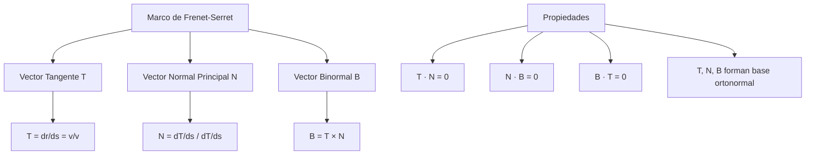
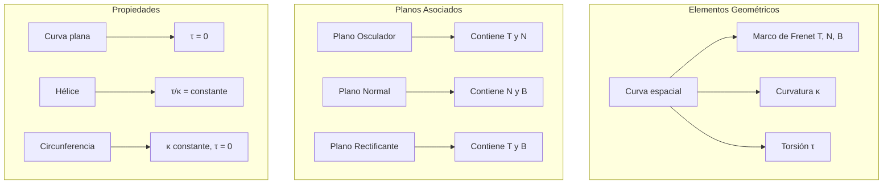

# Matemáticas para Ciencias Aplicadas II - Curvas

## 3.3 Geometría de curvas en el espacio.

---

### 1. Conceptos Fundamentales de Curvas Espaciales

#### 1.1 Representación de Curvas en el Espacio

Una **curva en el espacio** $\mathbb{R}^3$ se representa mediante una función vectorial:

$$\vec{r}(t) = (x(t), y(t), z(t)) = x(t)\hat{i} + y(t)\hat{j} + z(t)\hat{k}$$

donde $t$ es el parámetro (usualmente tiempo o longitud de arco).

#### 1.2 Clasificación de Curvas

- **Curva plana**: Situada en un plano
- **Curva alabeada**: No contenida en un plano
- **Curva cerrada**: $\vec{r}(a) = \vec{r}(b)$
- **Curva simple**: Sin autointersecciones

### 2. Marco de Referencia de Frenet-Serret

#### 2.1 Vectores Fundamentales



#### 2.2 Fórmulas de Frenet-Serret

$$\frac{d\vec{T}}{ds} = \kappa \vec{N}$$
$$\frac{d\vec{N}}{ds} = -\kappa \vec{T} + \tau \vec{B}$$
$$\frac{d\vec{B}}{ds} = -\tau \vec{N}$$

### 3. Curvatura y Torsión

#### 3.1 Curvatura $(\kappa)$

Mide cuánto se dobla la curva:

$$\kappa = \left\|\frac{d\vec{T}}{ds}\right\| = \frac{\|\vec{v} \times \vec{a}\|}{\|\vec{v}\|^3}$$

#### 3.2 Torsión $(\tau)$

Mide cuánto se tuerce la curva fuera del plano osculador:

$$\tau = \frac{(\vec{v} \times \vec{a}) \cdot \vec{a}'}{\|\vec{v} \times \vec{a}\|^2}$$

#### 3.3 Planos Asociados

- **Plano osculador**: Contiene $\vec{T}$ y $\vec{N}$
- **Plano normal**: Contiene $\vec{N}$ y $\vec{B}$
- **Plano rectificante**: Contiene $\vec{T}$ y $\vec{B}$

### 4. Implementación Computacional

```python
import numpy as np
from scipy import misc, linalg
import matplotlib.pyplot as plt
from mpl_toolkits.mplot3d import Axes3D

class GeometriaCurvas:
    def __init__(self, funcion_vectorial):
        self.funcion = funcion_vectorial

    def vectores_frenet(self, t, h=1e-5):
        """Calcula los vectores de Frenet-Serret"""
        # Posición y derivadas
        r = self.funcion(t)
        v = np.array([misc.derivative(lambda tau: self.funcion(tau)[i], t, dx=h)
                     for i in range(3)])
        a = np.array([misc.derivative(lambda tau: self.funcion(tau)[i], t, dx=h, n=2)
                     for i in range(3)])

        # Vector tangente
        velocidad = linalg.norm(v)
        if velocidad < 1e-10:
            return None, None, None, 0, 0

        T = v / velocidad

        # Curvatura y vector normal
        dv_dt = linalg.norm(v)
        dT_dt = np.array([misc.derivative(lambda tau: T[i], t, dx=h)
                         for i in range(3)])

        kappa = linalg.norm(dT_dt) / dv_dt if dv_dt > 0 else 0

        if linalg.norm(dT_dt) < 1e-10:
            N = np.zeros(3)
        else:
            N = dT_dt / linalg.norm(dT_dt)

        # Vector binormal
        B = np.cross(T, N)
        if linalg.norm(B) > 0:
            B = B / linalg.norm(B)

        # Torsión
        if linalg.norm(np.cross(v, a)) < 1e-10:
            tau = 0
        else:
            a_prime = np.array([misc.derivative(lambda tau: a[i], t, dx=h, n=1)
                              for i in range(3)])
            tau = np.dot(np.cross(v, a), a_prime) / (linalg.norm(np.cross(v, a))**2)

        return T, N, B, kappa, tau

    def calcular_propiedades(self, t_values):
        """Calcula propiedades geométricas en múltiples puntos"""
        resultados = []
        for t in t_values:
            T, N, B, kappa, tau = self.vectores_frenet(t)
            if T is not None:
                resultados.append({
                    't': t,
                    'T': T,
                    'N': N,
                    'B': B,
                    'kappa': kappa,
                    'tau': tau,
                    'plano_osculador': (T, N),
                    'plano_normal': (N, B),
                    'plano_rectificante': (T, B)
                })
        return resultados

    def graficar_curva_y_marco(self, t_range, num_puntos=100, num_vectores=10):
        """Grafica la curva y los vectores de Frenet"""
        t_values = np.linspace(t_range[0], t_range[1], num_puntos)
        puntos = np.array([self.funcion(t) for t in t_values])

        fig = plt.figure(figsize=(15, 12))
        ax = fig.add_subplot(111, projection='3d')

        # Graficar curva
        ax.plot(puntos[:, 0], puntos[:, 1], puntos[:, 2], 'b-', linewidth=2, alpha=0.7, label='Curva')

        # Graficar vectores de Frenet
        indices_vectores = np.linspace(0, len(t_values)-1, num_vectores, dtype=int)

        for idx in indices_vectores:
            t = t_values[idx]
            punto = puntos[idx]
            T, N, B, kappa, tau = self.vectores_frenet(t)

            if T is not None:
                # Vector tangente (rojo)
                ax.quiver(punto[0], punto[1], punto[2],
                         T[0], T[1], T[2],
                         color='red', length=0.5, linewidth=2, label='T' if idx == indices_vectores[0] else "")

                # Vector normal (verde)
                ax.quiver(punto[0], punto[1], punto[2],
                         N[0], N[1], N[2],
                         color='green', length=0.3, linewidth=2, label='N' if idx == indices_vectores[0] else "")

                # Vector binormal (azul)
                ax.quiver(punto[0], punto[1], punto[2],
                         B[0], B[1], B[2],
                         color='blue', length=0.3, linewidth=2, label='B' if idx == indices_vectores[0] else "")

        ax.set_xlabel('X')
        ax.set_ylabel('Y')
        ax.set_zlabel('Z')
        ax.set_title('Curva en el Espacio con Marco de Frenet-Serret')
        ax.legend()
        plt.show()

    def es_curva_plana(self, t_values, tolerancia=1e-5):
        """Determina si la curva es plana (torsión ≈ 0)"""
        for t in t_values:
            _, _, _, _, tau = self.vectores_frenet(t)
            if abs(tau) > tolerancia:
                return False
        return True

    def radio_de_curvatura(self, kappa):
        """Calcula el radio de curvatura"""
        return 1 / kappa if kappa > 0 else float('inf')

    def centro_de_curvatura(self, t):
        """Calcula el centro de curvatura"""
        r = self.funcion(t)
        T, N, _, kappa, _ = self.vectores_frenet(t)
        if kappa > 0:
            return r + (1/kappa) * N
        return r

# Ejemplos de curvas
def helice_circular(t):
    """Hélice circular: r(t) = (cos t, sin t, t/5)"""
    return np.array([np.cos(t), np.sin(t), t/5])

def circunferencia_3d(t):
    """Circunferencia en el plano xy"""
    return np.array([np.cos(t), np.sin(t), 0])

def curva_parametrica(t):
    """Curva paramétrica más compleja"""
    return np.array([t * np.cos(t), t * np.sin(t), np.exp(-t/10)])

# Uso de la clase
helice = GeometriaCurvas(helice_circular)
circunferencia = GeometriaCurvas(circunferencia_3d)

# Calcular propiedades
t_ejemplo = np.pi/2
T, N, B, kappa, tau = helice.vectores_frenet(t_ejemplo)

print(f"En t = {t_ejemplo:.2f}:")
print(f"Vector Tangente T: {T}")
print(f"Vector Normal N: {N}")
print(f"Vector Binormal B: {B}")
print(f"Curvatura κ: {kappa:.4f}")
print(f"Torsión τ: {tau:.4f}")

# Verificar si es plana
print(f"¿La circunferencia es plana? {circunferencia.es_curva_plana([0, np.pi, 2*np.pi])}")

# Graficar
helice.graficar_curva_y_marco([0, 4*np.pi], num_vectores=8)
```

### 5. Ejemplos y Ejercicios

#### Ejemplo 1: Hélice Circular

$$\vec{r}(t) = (a\cos t, a\sin t, bt)$$

- $\kappa = \frac{a}{a^2 + b^2}$ (constante)
- $\tau = \frac{b}{a^2 + b^2}$ (constante)
- Curva alabeada con curvatura y torsión constantes

#### Ejemplo 2: Circunferencia

$$\vec{r}(t) = (a\cos t, a\sin t, 0)$$

- $\kappa = \frac{1}{a}$ (constante)
- $\tau = 0$ (curva plana)
- Radio de curvatura: $a$

#### Ejemplo 3: Curva Cúbica

$$\vec{r}(t) = (t, t^2, t^3)$$

- Curvatura y torsión variables
- Curva alabeada

#### Ejercicio 1:

Para $\vec{r}(t) = (e^t\cos t, e^t\sin t, e^t)$:

1. Calcular $\vec{T}$, $\vec{N}$, $\vec{B}$
2. Encontrar $\kappa$ y $\tau$
3. Determinar si es curva plana

### 6. Aplicaciones Prácticas

#### 6.1 Ingeniería y Física

- Diseño de carreteras y vías férreas
- Mecánica de robots y brazos articulados
- Trayectorias de partículas en campos electromagnéticos

#### 6.2 Gráficos por Computadora

- Animación de movimientos realistas
- Modelado de superficies complejas
- Renderizado de curvas suaves

#### 6.3 Biología y Medicina

- Estudio de estructuras helicoidales (ADN, proteínas)
- Análisis de trayectorias celulares
- Modelado de vasos sanguíneos

### 7. Teoremas Importantes

#### 7.1 Teorema Fundamental de Curvas

Dadas las funciones $\kappa(s) > 0$ y $\tau(s)$ continuas, existe una única curva (salvo movimientos rígidos) con esa curvatura y torsión.

#### 7.2 Teorema de Lancret

Una curva es hélice si y solo si la razón $\tau/\kappa$ es constante.

#### 7.3 Fórmulas de Frenet-Serret

Describen completamente la geometría local de la curva.

### 8. Visualización de Conceptos



### 9. Casos Especiales

#### 9.1 Línea Recta

- $\kappa = 0$
- $\tau = 0$
- Todos los puntos son equivalentes

#### 9.2 Circunferencia

- $\kappa = \text{constante} > 0$
- $\tau = 0$
- Curva plana

#### 9.3 Hélice Circular

- $\kappa = \text{constante} > 0$
- $\tau = \text{constante} \neq 0$
- Razón $\tau/\kappa$ constante

### 10. Recursos Adicionales

- "Differential Geometry of Curves and Surfaces" por Manfredo P. do Carmo
- "Elementary Differential Geometry" por Andrew Pressley
- "Calculus and Analytic Geometry" por George B. Thomas
- Software: GeoGebra 3D, Mathematica, MATLAB
- Librerías Python: NumPy, SciPy, Matplotlib, SymPy
- Tutoriales online de geometría diferencial
- Visualizaciones interactivas de curvas espaciales
