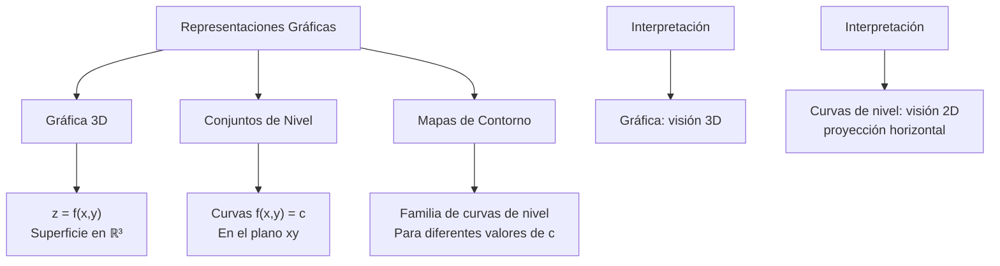
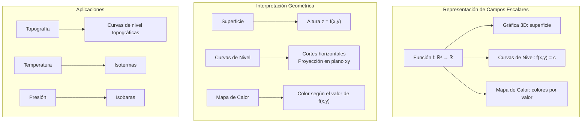

# Matemáticas para Ciencias Aplicadas II - Campos escalares

## 4.1 Funciones reales de varias variables. Representación gráfica de funciones reales (gráficas y conjuntos de nivel).

---

### 1. Funciones Reales de Varias Variables

#### 1.1 Definición Formal

Una **función real de varias variables** es una aplicación que asigna a cada punto de un subconjunto de $\mathbb{R}^n$ un número real:

$$f: D \subseteq \mathbb{R}^n \rightarrow \mathbb{R}$$
$$(x_1, x_2, \ldots, x_n) \mapsto f(x_1, x_2, \ldots, x_n)$$

#### 1.2 Dominio y Rango

- **Dominio**: Conjunto de puntos donde la función está definida
- **Rango**: Conjunto de valores que toma la función

#### 1.3 Ejemplos Comunes

- $f(x,y) = \sqrt{1 - x^2 - y^2}$ (semiesfera superior)
- $g(x,y,z) = x^2 + y^2 + z^2$ (distancia al cuadrado)
- $h(x,y) = e^{-(x^2 + y^2)}$ (campo gaussiano)

### 2. Representación Gráfica de Funciones

#### 2.1 Gráfica de una Función

Para $f: \mathbb{R}^2 \rightarrow \mathbb{R}$, la **gráfica** es el conjunto:

$$\{(x, y, z) \in \mathbb{R}^3 \mid z = f(x, y)\}$$

#### 2.2 Conjuntos de Nivel

Para $c \in \mathbb{R}$, el **conjunto de nivel** $c$ es:

$$L_c = \{(x_1, \ldots, x_n) \in D \mid f(x_1, \ldots, x_n) = c\}$$



### 3. Conjuntos de Nivel en Diferentes Dimensiones

#### 3.1 Para funciones $f: \mathbb{R}^2 \rightarrow \mathbb{R}$

- **Curvas de nivel**: $f(x,y) = c$ (curvas en el plano)

#### 3.2 Para funciones $f: \mathbb{R}^3 \rightarrow \mathbb{R}$

- **Superficies de nivel**: $f(x,y,z) = c$ (superficies en el espacio)

#### 3.3 Propiedades

- Curvas de nivel diferentes no se intersectan
- Proporcionan información sobre la topografía de la función
- Muestran regiones donde la función es constante

### 4. Implementación Computacional

```python
import numpy as np
import matplotlib.pyplot as plt
from matplotlib import cm
from mpl_toolkits.mplot3d import Axes3D

class CampoEscalar:
    def __init__(self, funcion, dominio=None):
        self.funcion = funcion
        self.dominio = dominio if dominio else [-5, 5, -5, 5]  # [x_min, x_max, y_min, y_max]

    def evaluar(self, x, y):
        """Evalúa la función en un punto (x,y)"""
        return self.funcion(x, y)

    def graficar_superficie_3d(self, resolucion=100):
        """Grafica la superficie 3D de la función"""
        x_min, x_max, y_min, y_max = self.dominio
        x = np.linspace(x_min, x_max, resolucion)
        y = np.linspace(y_min, y_max, resolucion)
        X, Y = np.meshgrid(x, y)
        Z = self.funcion(X, Y)

        fig = plt.figure(figsize=(15, 10))
        ax = fig.add_subplot(111, projection='3d')

        # Graficar superficie
        superficie = ax.plot_surface(X, Y, Z, cmap=cm.viridis,
                                   alpha=0.8, antialiased=True)

        # Configuración
        ax.set_xlabel('X')
        ax.set_ylabel('Y')
        ax.set_zlabel('Z')
        ax.set_title('Gráfica 3D de la función')
        fig.colorbar(superficie, ax=ax, shrink=0.5, aspect=20)
        plt.show()

    def graficar_curvas_nivel(self, niveles=20, resolucion=100):
        """Grafica las curvas de nivel de la función"""
        x_min, x_max, y_min, y_max = self.dominio
        x = np.linspace(x_min, x_max, resolucion)
        y = np.linspace(y_min, y_max, resolucion)
        X, Y = np.meshgrid(x, y)
        Z = self.funcion(X, Y)

        plt.figure(figsize=(12, 10))

        # Curvas de nivel
        contorno = plt.contour(X, Y, Z, levels=niveles, cmap='viridis')
        plt.clabel(contorno, inline=True, fontsize=8)

        # Mapa de calor
        plt.imshow(Z, extent=[x_min, x_max, y_min, y_max],
                  origin='lower', cmap='hot', alpha=0.5)

        plt.colorbar(label='Valor de z')
        plt.xlabel('X')
        plt.ylabel('Y')
        plt.title('Curvas de Nivel y Mapa de Calor')
        plt.grid(True, alpha=0.3)
        plt.axis('equal')
        plt.show()

    def graficar_superficie_interactiva(self):
        """Crea una visualización 3D interactiva con Plotly (pip install plotly)"""
        import plotly.graph_objects as go
        x_min, x_max, y_min, y_max = self.dominio
        x = np.linspace(x_min, x_max, 50)
        y = np.linspace(y_min, y_max, 50)
        X, Y = np.meshgrid(x, y)
        Z = self.funcion(X, Y)

        fig = go.Figure(data=[go.Surface(z=Z, x=X, y=Y, colorscale='viridis')])

        fig.update_layout(
            title='Superficie 3D Interactiva',
            scene=dict(
                xaxis_title='X',
                yaxis_title='Y',
                zaxis_title='Z'
            ),
            width=800,
            height=600
        )

        fig.show()

    def encontrar_curva_nivel(self, valor_c, puntos_iniciales, tolerancia=1e-6):
        """Encuentra puntos en una curva de nivel específica usando método de Newton"""
        resultados = []

        for punto_inicial in puntos_iniciales:
            x, y = punto_inicial
            for _ in range(100):  # Máximo de iteraciones
                f_val = self.funcion(x, y)
                if abs(f_val - valor_c) < tolerancia:
                    resultados.append((x, y))
                    break

                # Aproximación numérica de gradiente
                h = 1e-6
                df_dx = (self.funcion(x + h, y) - self.funcion(x - h, y)) / (2 * h)
                df_dy = (self.funcion(x, y + h) - self.funcion(x, y - h)) / (2 * h)

                # Método de Newton modificado
                if abs(df_dx) > tolerancia or abs(df_dy) > tolerancia:
                    x = x - (f_val - valor_c) * df_dx / (df_dx**2 + df_dy**2)
                    y = y - (f_val - valor_c) * df_dy / (df_dx**2 + df_dy**2)

        return resultados

    def analizar_dominio(self):
        """Analiza el dominio natural de la función"""
        # Esta es una implementación simplificada
        # En la práctica, se necesitaría análisis simbólico
        print("Análisis del dominio:")
        print("El dominio depende de las restricciones de la función")
        print("Por ejemplo:")
        print("- Evitar división por cero")
        print("- Argumentos de raíces deben ser ≥ 0")
        print("- Argumentos de logaritmos deben ser > 0")

    def crear_animacion_niveles(self, valores_c, resolucion=100):
        """Crea una animación mostrando diferentes curvas de nivel"""
        x_min, x_max, y_min, y_max = self.dominio
        x = np.linspace(x_min, x_max, resolucion)
        y = np.linspace(y_min, y_max, resolucion)
        X, Y = np.meshgrid(x, y)
        Z = self.funcion(X, Y)

        fig, ax = plt.subplots(figsize=(10, 8))

        for i, c in enumerate(valores_c):
            ax.clear()
            # Curvas de nivel
            contorno = ax.contour(X, Y, Z, levels=[c], colors='red', linewidths=2)
            # Fondo con mapa de calor
            im = ax.imshow(Z, extent=[x_min, x_max, y_min, y_max],
                          origin='lower', cmap='gray', alpha=0.3)

            ax.set_title(f'Curva de Nivel: f(x,y) = {c:.2f}')
            ax.set_xlabel('X')
            ax.set_ylabel('Y')
            ax.grid(True, alpha=0.3)
            plt.pause(1)  # Pausa entre frames

        plt.show()

# Ejemplos de funciones
def funcion_paraboloide(x, y):
    return x**2 + y**2

def funcion_silla(x, y):
    return x**2 - y**2

def funcion_gaussiana(x, y):
    return np.exp(-(x**2 + y**2)/2)

def funcion_seno(x, y):
    return np.sin(x) * np.cos(y)

def funcion_racional(x, y):
    return 1 / (1 + x**2 + y**2)

# Uso de la clase
print("=== Ejemplo: Paraboloide ===")
paraboloide = CampoEscalar(funcion_paraboloide, [-3, 3, -3, 3])
paraboloide.graficar_superficie_3d()
paraboloide.graficar_curvas_nivel(niveles=10)

print("=== Ejemplo: Silla de Montar ===")
silla = CampoEscalar(funcion_silla, [-2, 2, -2, 2])
silla.graficar_curvas_nivel(niveles=15)

print("=== Ejemplo: Campana Gaussiana ===")
gauss = CampoEscalar(funcion_gaussiana, [-3, 3, -3, 3])
gauss.graficar_superficie_3d()

# Encontrar puntos en curva de nivel específica
puntos_nivel = gauss.encontrar_curva_nivel(0.5, [[1, 0], [0, 1], [-1, 0]])
print(f"Puntos donde f(x,y) = 0.5: {puntos_nivel}")
```

### 5. Ejemplos y Ejercicios

#### Ejemplo 1: Paraboloide Elíptico

$$f(x,y) = x^2 + y^2$$

- Curvas de nivel: circunferencias $x^2 + y^2 = c$
- Para $c > 0$: circunferencias concéntricas
- Para $c = 0$: punto único (origen)
- Para $c < 0$: conjunto vacío

#### Ejemplo 2: Silla de Montar

$$f(x,y) = x^2 - y^2$$

- Curvas de nivel: hipérbolas $x^2 - y^2 = c$
- Para $c = 0$: rectas $y = \pm x$

#### Ejemplo 3: Función Gaussiana

$$f(x,y) = e^{-(x^2 + y^2)}$$

- Curvas de nivel: circunferencias $x^2 + y^2 = -\ln(c)$ para $0 < c < 1$. Para $c = 1$ el conjunto de nivel es solo el origen, y para $c \leq 0$ o $c > 1$ es vacío
- La función toma valores en $(0, 1]$

#### Ejercicio 1:

Para $f(x,y) = \sqrt{4 - x^2 - y^2}$:

1. Determinar el dominio
2. Graficar curvas de nivel para $c = 0, 1, 2$
3. Interpretar geométricamente

### 6. Aplicaciones Prácticas

#### 6.1 Topografía y Cartografía

- Mapas de elevación (curvas de nivel topográficas)
- Análisis de terrenos y pendientes
- Planificación de rutas

#### 6.2 Física e Ingeniería

- Campos de temperatura y presión
- Potenciales electromagnéticos
- Distribución de tensiones en materiales

#### 6.3 Economía y Ciencias Sociales

- Mapas de densidad de población
- Distribución de recursos
- Análisis de mercados y preferencias

### 7. Propiedades Matemáticas

#### 7.1 Continuidad

Una función $f$ es continua en $\vec{a}$ si:

$$\lim_{\vec{x} \to \vec{a}} f(\vec{x}) = f(\vec{a})$$

#### 7.2 Conjuntos de Nivel y Topografía

- Curvas de nivel cercanas indican pendientes pronunciadas
- Curvas de nivel espaciadas indican pendientes suaves
- Puntos críticos donde las curvas se degeneran

### 8. Visualización de Conceptos



### 9. Técnicas Avanzadas

#### 9.1 Visualización 3D Interactiva

- Uso de librerías como Plotly para gráficos interactivos
- Rotación y zoom para mejor comprensión espacial

#### 9.2 Mapas de Contorno con Color

- Combinación de curvas de nivel con mapas de calor
- Mejor comprensión de la distribución de valores

#### 9.3 Animación de Niveles

- Visualización de cómo cambian las curvas con el valor de c
- Comprensión dinámica del comportamiento de la función

### 10. Recursos Adicionales

- "Calculus" por James Stewart
- "Advanced Engineering Mathematics" por Erwin Kreyszig
- "Multivariable Mathematics" por Theodore Shifrin
- Software: GeoGebra, Mathematica, MATLAB
- Librerías Python: Matplotlib, Plotly, NumPy, SciPy
- Tutoriales online de visualización 3D
- Aplicaciones interactivas de cálculo multivariable
