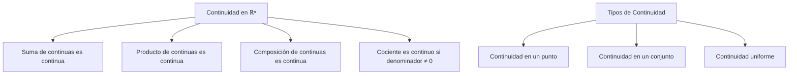
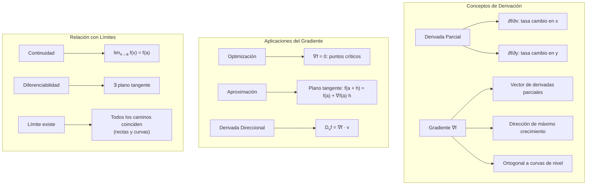

# Matemáticas para Ciencias Aplicadas II - Campos escalares

## 4.2 Límite y derivada.

---

### 1. Límite de Campos Escalares

#### 1.1 Definición Formal de Límite

Sea $f: D \subseteq \mathbb{R}^n \rightarrow \mathbb{R}$ y $\vec{a} \in \mathbb{R}^n$ un punto de acumulación de $D$. Decimos que:

$$\lim_{\vec{x} \to \vec{a}} f(\vec{x}) = L$$

si para todo $\epsilon > 0$, existe $\delta > 0$ tal que:

$$0 < \|\vec{x} - \vec{a}\| < \delta \Rightarrow |f(\vec{x}) - L| < \epsilon$$

#### 1.2 Límites por Curvas

Para demostrar que **no existe** el límite, basta encontrar dos curvas que pasen por $\vec{a}$ y conduzcan a límites distintos. Las más simples son rectas en las direcciones $\vec{v}$ y $\vec{w}$:

$$\lim_{t \to 0} f(\vec{a} + t\vec{v}) \neq \lim_{t \to 0} f(\vec{a} + t\vec{w})$$

El recíproco no vale: que todas las rectas den el mismo valor no garantiza que el límite exista. Por ejemplo, $f(x,y) = \frac{x^2 y}{x^4 + y^2}$ tiende a 0 por toda recta que pasa por el origen, pero vale $\frac{1}{2}$ sobre la parábola $y = x^2$.

### 2. Continuidad de Campos Escalares

#### 2.1 Definición de Continuidad

$f$ es continua en $\vec{a}$ si:

1. $f(\vec{a})$ está definido
2. $\lim_{\vec{x} \to \vec{a}} f(\vec{x})$ existe
3. $\lim_{\vec{x} \to \vec{a}} f(\vec{x}) = f(\vec{a})$

#### 2.2 Propiedades de Funciones Continuas



### 3. Derivadas Parciales

#### 3.1 Definición de Derivada Parcial

La **derivada parcial** de $f$ respecto a $x_i$ en $\vec{a}$ es:

$$\frac{\partial f}{\partial x_i}(\vec{a}) = \lim_{h \to 0} \frac{f(\vec{a} + h\vec{e}_i) - f(\vec{a})}{h}$$

donde $\vec{e}_i$ es el i-ésimo vector canónico.

#### 3.2 Interpretación Geométrica

- $\frac{\partial f}{\partial x}$: Pendiente en dirección x
- $\frac{\partial f}{\partial y}$: Pendiente en dirección y
- Representan la tasa de cambio instantánea

### 4. Vector Gradiente

#### 4.1 Definición del Gradiente

El **gradiente** de $f$ en $\vec{a}$ es el vector de derivadas parciales:

$$\nabla f(\vec{a}) = \left( \frac{\partial f}{\partial x_1}(\vec{a}), \frac{\partial f}{\partial x_2}(\vec{a}), \ldots, \frac{\partial f}{\partial x_n}(\vec{a}) \right)$$

#### 4.2 Interpretación del Gradiente

- Dirección: Máxima tasa de crecimiento de $f$
- Magnitud: Tasa máxima de cambio
- Ortogonal a las curvas de nivel, en los puntos donde $\nabla f \neq \vec{0}$

### 5. Implementación Computacional

```python
import numpy as np
import matplotlib.pyplot as plt
from mpl_toolkits.mplot3d import Axes3D
import sympy as sp

class CalculoDiferencial:
    def __init__(self, funcion):
        self.funcion = funcion

    def limite(self, punto, aproximaciones=50, tolerancia=1e-5):
        """
        Estima el límite acercándose al punto por varias rectas.
        Es solo una heurística: si dos rectas dan valores distintos, el límite
        no existe; si todas coinciden, el límite PUEDE existir, pero no queda
        demostrado (puede fallar por curvas, como y = x²).
        """
        resultados = []

        # Diferentes direcciones de aproximación
        direcciones = [
            np.array([1, 0]),      # Eje x
            np.array([0, 1]),      # Eje y
            np.array([1, 1]),      # Diagonal
            np.array([1, -1]),     # Diagonal inversa
            np.array([2, 1]),      # Dirección arbitraria
            np.array([1, 2])       # Otra dirección
        ]

        for direccion in direcciones:
            direccion = direccion / np.linalg.norm(direccion)  # Normalizar
            valores = []
            t_values = np.logspace(0, -8, aproximaciones)   # t de 1 a 1e-8

            for t in t_values:
                punto_aproximacion = punto + t * direccion
                try:
                    valor = self.funcion(*punto_aproximacion)
                    valores.append(valor)
                except:
                    continue

            if valores:
                resultados.append(valores[-1])   # valor con t más pequeño

        # Verificar si todos los límites son iguales
        if all(abs(r - resultados[0]) < tolerancia for r in resultados):
            return resultados[0]
        else:
            return None  # Límite no existe

    def derivada_parcial(self, punto, variable_index, h=1e-6):
        """Calcula la derivada parcial numéricamente"""
        punto = np.array(punto, dtype=float)
        punto_plus = punto.copy()
        punto_minus = punto.copy()

        punto_plus[variable_index] += h
        punto_minus[variable_index] -= h

        f_plus = self.funcion(*punto_plus)
        f_minus = self.funcion(*punto_minus)

        return (f_plus - f_minus) / (2 * h)

    def gradiente(self, punto, h=1e-6):
        """Calcula el gradiente numéricamente"""
        n = len(punto)
        grad = np.zeros(n)

        for i in range(n):
            grad[i] = self.derivada_parcial(punto, i, h)

        return grad

    def plano_tangente(self, punto):
        """Calcula la ecuación del plano tangente"""
        f_val = self.funcion(*punto)
        grad = self.gradiente(punto)

        def plano(x, y):
            return f_val + grad[0]*(x - punto[0]) + grad[1]*(y - punto[1])

        return plano

    def graficar_plano_tangente(self, punto, rango=1.0, resolucion=50):
        """Grafica la función y su plano tangente"""
        x0, y0 = punto
        x = np.linspace(x0 - rango, x0 + rango, resolucion)
        y = np.linspace(y0 - rango, y0 + rango, resolucion)
        X, Y = np.meshgrid(x, y)

        # Evaluar función original
        Z_func = np.zeros_like(X)
        for i in range(len(x)):
            for j in range(len(y)):
                try:
                    Z_func[i, j] = self.funcion(X[i, j], Y[i, j])
                except:
                    Z_func[i, j] = np.nan

        # Evaluar plano tangente
        plano = self.plano_tangente(punto)
        Z_plano = plano(X, Y)

        fig = plt.figure(figsize=(15, 10))
        ax = fig.add_subplot(111, projection='3d')

        # Graficar superficie original
        surf1 = ax.plot_surface(X, Y, Z_func, cmap='viridis', alpha=0.7, label='Función')

        # Graficar plano tangente
        surf2 = ax.plot_surface(X, Y, Z_plano, cmap='plasma', alpha=0.5, label='Plano Tangente')

        # Punto de tangencia
        ax.scatter([x0], [y0], [self.funcion(x0, y0)], color='red', s=100, label='Punto')

        ax.set_xlabel('X')
        ax.set_ylabel('Y')
        ax.set_zlabel('Z')
        ax.set_title('Función y Plano Tangente')
        ax.legend()
        plt.show()

    def derivadas_direccionales(self, punto, direcciones):
        """Calcula derivadas direccionales en varias direcciones"""
        resultados = []
        grad = self.gradiente(punto)

        for direccion in direcciones:
            direccion_unitario = direccion / np.linalg.norm(direccion)
            derivada_dir = np.dot(grad, direccion_unitario)
            resultados.append(derivada_dir)

        return resultados

    def analizar_continuidad(self, punto, epsilon=0.1, delta_valores=np.logspace(-6, -1, 50)):
        """
        Heurística de la definición ε-δ: busca ALGÚN δ de la lista tal que
        todos los puntos muestreados a distancia δ cumplan |f(x) - f(a)| < ε.
        No es una demostración: solo prueba un ε y finitos puntos.
        """
        f_punto = self.funcion(*punto)
        angulos = np.linspace(0, 2*np.pi, 100)
        for delta in sorted(delta_valores):      # del δ más pequeño al más grande
            try:
                vecinos = [self.funcion(punto[0] + delta*np.cos(t), punto[1] + delta*np.sin(t))
                           for t in angulos]
            except Exception:
                continue
            if all(abs(f_v - f_punto) < epsilon for f_v in vecinos):
                return True     # este δ funciona para el ε dado
        return False

# Ejemplos de funciones
def funcion_ejemplo1(x, y):
    """Función continua y diferenciable"""
    return x**2 + y**2 + np.sin(x*y)

def funcion_ejemplo2(x, y):
    """Función con problema en (0,0)"""
    if x == 0 and y == 0:
        return 0
    return (x*y) / (x**2 + y**2) if (x**2 + y**2) != 0 else 0

def funcion_ejemplo3(x, y):
    """Función valor absoluto"""
    return np.abs(x) + np.abs(y)

def funcion_ejemplo4(x, y):
    """Función racional"""
    return (x**2 - y**2) / (x**2 + y**2 + 1e-10)  # Evitar división por cero

# Uso de la clase
print("=== Análisis de Límites y Derivadas ===")

# Función bien comportada
calc1 = CalculoDiferencial(funcion_ejemplo1)
punto = [1.0, 2.0]

limite = calc1.limite(punto)
gradiente = calc1.gradiente(punto)
deriv_x = calc1.derivada_parcial(punto, 0)
deriv_y = calc1.derivada_parcial(punto, 1)

print(f"Límite en {punto}: {limite:.4f}")
print(f"Gradiente: {gradiente}")
print(f"∂f/∂x: {deriv_x:.4f}, ∂f/∂y: {deriv_y:.4f}")

# Graficar plano tangente
calc1.graficar_plano_tangente(punto)

# Función problemática en (0,0)
calc2 = CalculoDiferencial(funcion_ejemplo2)
limite_00 = calc2.limite([0, 0])
print(f"Límite en (0,0) para función problemática: {limite_00}")

# Derivadas direccionales
direcciones = [np.array([1, 0]), np.array([0, 1]), np.array([1, 1])]
derivs_dir = calc1.derivadas_direccionales(punto, direcciones)
print(f"Derivadas direccionales: {derivs_dir}")

# Análisis de continuidad
continuidad = calc1.analizar_continuidad(punto)
print(f"¿Función continua en {punto}? {continuidad}")
```

### 6. Ejemplos y Ejercicios

#### Ejemplo 1: Límite que Existe

$$f(x,y) = \frac{x^2 y}{x^2 + y^2}$$
$$\lim_{(x,y) \to (0,0)} f(x,y) = 0$$

#### Ejemplo 2: Límite que No Existe

$$g(x,y) = \frac{xy}{x^2 + y^2}$$
Diferentes caminos dan límites diferentes.

#### Ejemplo 3: Derivadas Parciales

$$h(x,y) = x^2 y + \sin(xy)$$
$$\frac{\partial h}{\partial x} = 2xy + y\cos(xy)$$
$$\frac{\partial h}{\partial y} = x^2 + x\cos(xy)$$

#### Ejercicio 1:

Para $f(x,y) = \frac{x^3 - y^3}{x^2 + y^2}$:

1. Calcular $\lim_{(x,y) \to (0,0)} f(x,y)$
2. Encontrar $\nabla f(1,1)$
3. Determinar si es continua en $(0,0)$

### 7. Aplicaciones Prácticas

#### 7.1 Optimización

- El gradiente $\nabla f = \vec{0}$ identifica puntos críticos
- Máximos, mínimos y puntos de silla

#### 7.2 Física y Ingeniería

- Campos de potencial y fuerza
- Ecuaciones de transporte y difusión
- Análisis de tensiones en materiales

#### 7.3 Machine Learning

- Gradiente descendente para optimización
- Derivadas en redes neuronales
- Regresión multivariable

### 8. Teoremas Importantes

#### 8.1 Teorema de Clairaut

Si las segundas derivadas parciales son continuas, entonces:

$$\frac{\partial^2 f}{\partial x \partial y} = \frac{\partial^2 f}{\partial y \partial x}$$

#### 8.2 Regla de la Cadena

Para $f(x(t), y(t))$:

$$\frac{df}{dt} = \frac{\partial f}{\partial x} \frac{dx}{dt} + \frac{\partial f}{\partial y} \frac{dy}{dt}$$

#### 8.3 Aproximación Lineal

$$f(\vec{a} + \vec{h}) \approx f(\vec{a}) + \nabla f(\vec{a}) \cdot \vec{h}$$

### 9. Visualización de Conceptos



### 10. Casos Especiales y Consideraciones

#### 10.1 Diferenciabilidad vs Continuidad

- Diferenciable ⇒ Continua
- Continua ⇏ Diferenciable
- Existencia de derivadas parciales ⇏ Diferenciable

#### 10.2 Puntos No Diferenciables

- Esquinas y picos
- Discontinuidades
- Comportamiento patológico

#### 10.3 Funciones Vectoriales

Extensión natural a campos vectoriales usando matrices jacobianas.

### 11. Recursos Adicionales

- "Calculus" por James Stewart
- "Advanced Engineering Mathematics" por Erwin Kreyszig
- "Vector Calculus" por Jerrold E. Marsden
- Software: Mathematica, MATLAB, GeoGebra
- Librerías Python: NumPy, SciPy, Matplotlib, SymPy
- Tutoriales online de cálculo multivariable
- Visualizaciones interactivas de derivadas parciales
