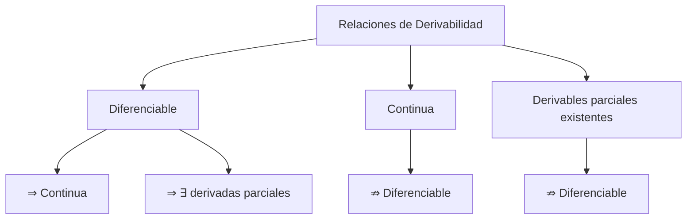
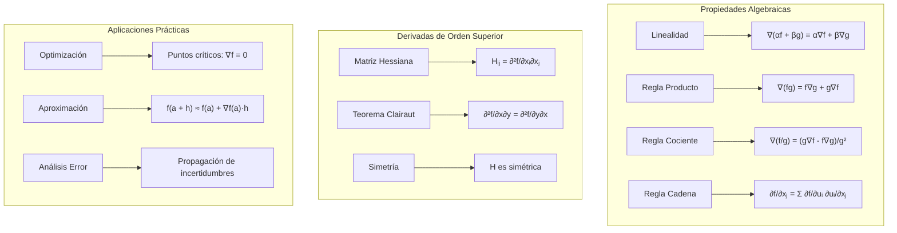

# Matemáticas para Ciencias Aplicadas II - Campos escalares

## 4.3 Propiedades de la derivada.

---

### 1. Conceptos Fundamentales de Derivación

#### 1.1 Diferenciabilidad

Un campo escalar $f: \mathbb{R}^n \rightarrow \mathbb{R}$ es **diferenciable** en $\vec{a}$ si existe una transformación lineal $L: \mathbb{R}^n \rightarrow \mathbb{R}$ tal que:

$$\lim_{\vec{h} \to \vec{0}} \frac{f(\vec{a} + \vec{h}) - f(\vec{a}) - L(\vec{h})}{\|\vec{h}\|} = 0$$

Donde $L(\vec{h}) = \nabla f(\vec{a}) \cdot \vec{h}$ es la **derivada total**.

#### 1.2 Relación entre Continuidad y Diferenciabilidad



### 2. Propiedades Algebraicas de la Derivada

#### 2.1 Linealidad del Gradiente

Para constantes $\alpha, \beta \in \mathbb{R}$ y funciones $f, g$ diferenciables:

$$\nabla(\alpha f + \beta g) = \alpha \nabla f + \beta \nabla g$$

#### 2.2 Reglas del Producto y Cociente

- **Producto**: $\nabla(f \cdot g) = f \nabla g + g \nabla f$
- **Cociente**: $\nabla\left(\frac{f}{g}\right) = \frac{g \nabla f - f \nabla g}{g^2}$ para $g \neq 0$

#### 2.3 Regla de la Cadena

Para $f(\vec{u})$ donde $\vec{u} = \vec{u}(\vec{x})$:

$$\frac{\partial f}{\partial x_i} = \sum_{j=1}^m \frac{\partial f}{\partial u_j} \frac{\partial u_j}{\partial x_i}$$

### 3. Derivadas de Orden Superior

#### 3.1 Matriz Hessiana

La **matriz Hessiana** contiene las segundas derivadas parciales:

$$ H_f(\vec{a}) = \begin{bmatrix} \frac{\partial^2 f}{\partial x_1^2} & \frac{\partial^2 f}{\partial x_1 \partial x_2} & \cdots \\\ \frac{\partial^2 f}{\partial x_2 \partial x_1} & \frac{\partial^2 f}{\partial x_2^2} & \cdots \\\ \vdots & \vdots & \ddots \\\ \end{bmatrix} $$

#### 3.2 Teorema de Clairaut (Schwarz)

Si las segundas derivadas parciales son continuas, entonces:

$$ \frac{\partial^2 f}{\partial x_i \partial x_j} = \frac{\partial^2 f}{\partial x_j \partial x_i} $$

### 4. Implementación Computacional

```python
import numpy as np
from math import comb

def derivative(func, x0, dx=1e-5, n=1, order=None):
    """Derivada numérica de orden n por diferencias centrales.
    Sustituye a scipy.misc.derivative, que se eliminó en SciPy 1.12."""
    return sum((-1)**k * comb(n, k) * func(x0 + (n / 2 - k) * dx)
               for k in range(n + 1)) / dx**n
import matplotlib.pyplot as plt
from mpl_toolkits.mplot3d import Axes3D
import sympy as sp

class PropiedadesDerivada:
    def __init__(self, funcion):
        self.funcion = funcion

    def verificar_diferenciabilidad(self, punto, h=1e-6, tolerancia=1e-4):
        """Verifica diferenciabilidad comparando con aproximación lineal"""
        a = np.array(punto)
        f_a = self.funcion(*a)
        gradiente = self.gradiente(a, h)

        # Generar puntos aleatorios cerca de a
        num_puntos = 100
        errores = []

        for _ in range(num_puntos):
            # Vector dirección aleatorio
            direccion = np.random.randn(len(a))
            direccion = direccion / np.linalg.norm(direccion)

            h_vec = h * direccion
            punto_vecino = a + h_vec

            # Valor real y aproximación lineal
            f_real = self.funcion(*punto_vecino)
            f_aprox = f_a + np.dot(gradiente, h_vec)

            error = abs(f_real - f_aprox) / np.linalg.norm(h_vec)
            errores.append(error)

        # Verificar si el error es o(h)
        return all(error < tolerancia for error in errores), np.mean(errores)

    def gradiente(self, punto, h=1e-6):
        """Calcula el gradiente numéricamente"""
        n = len(punto)
        grad = np.zeros(n)

        for i in range(n):
            punto_plus = punto.copy()
            punto_minus = punto.copy()
            punto_plus[i] += h
            punto_minus[i] -= h

            f_plus = self.funcion(*punto_plus)
            f_minus = self.funcion(*punto_minus)

            grad[i] = (f_plus - f_minus) / (2 * h)

        return grad

    def hessiana(self, punto, h=1e-4):
        """Calcula la matriz Hessiana numéricamente"""
        n = len(punto)
        hess = np.zeros((n, n))

        for i in range(n):
            for j in range(n):
                # Cuatro puntos para aproximación de segunda derivada
                punto_pp = punto.copy(); punto_pp[i] += h; punto_pp[j] += h
                punto_pm = punto.copy(); punto_pm[i] += h; punto_pm[j] -= h
                punto_mp = punto.copy(); punto_mp[i] -= h; punto_mp[j] += h
                punto_mm = punto.copy(); punto_mm[i] -= h; punto_mm[j] -= h

                f_pp = self.funcion(*punto_pp)
                f_pm = self.funcion(*punto_pm)
                f_mp = self.funcion(*punto_mp)
                f_mm = self.funcion(*punto_mm)

                hess[i, j] = (f_pp - f_pm - f_mp + f_mm) / (4 * h**2)

        return hess

    def verificar_clairaut(self, punto, h=1e-4, tolerancia=1e-6):
        """Verifica el teorema de Clairaut (simetría de la Hessiana)"""
        hess = self.hessiana(punto, h)
        n = len(punto)

        for i in range(n):
            for j in range(i+1, n):
                if abs(hess[i, j] - hess[j, i]) > tolerancia:
                    return False, (i, j, hess[i, j], hess[j, i])

        return True, hess

    def derivada_direccional(self, punto, direccion, h=1e-6):
        """Calcula la derivada direccional"""
        direccion_unit = direccion / np.linalg.norm(direccion)
        grad = self.gradiente(punto, h)
        return np.dot(grad, direccion_unit)

    def regla_cadena(self, punto, funciones_intermedias, h=1e-6):
        """Aplica la regla de la cadena para composición de funciones"""
        # f(u(x,y), v(x,y))
        u_func, v_func = funciones_intermedias

        # Derivadas de u y v respecto a x e y
        u_x = derivative(lambda x: u_func(x, punto[1]), punto[0], dx=h)
        u_y = derivative(lambda y: u_func(punto[0], y), punto[1], dx=h)
        v_x = derivative(lambda x: v_func(x, punto[1]), punto[0], dx=h)
        v_y = derivative(lambda y: v_func(punto[0], y), punto[1], dx=h)

        # Evaluar f en (u(a), v(a))
        u_val = u_func(*punto)
        v_val = v_func(*punto)
        punto_uv = [u_val, v_val]

        # Gradiente de f respecto a u y v
        grad_f_uv = self.gradiente(punto_uv, h)

        # Aplicar regla de la cadena
        df_dx = grad_f_uv[0] * u_x + grad_f_uv[1] * v_x
        df_dy = grad_f_uv[0] * u_y + grad_f_uv[1] * v_y

        return np.array([df_dx, df_dy])

    def aproximacion_lineal(self, punto, punto_evaluacion):
        """Aproximación lineal usando el gradiente"""
        f_punto = self.funcion(*punto)
        grad = self.gradiente(punto)
        desplazamiento = np.array(punto_evaluacion) - np.array(punto)

        return f_punto + np.dot(grad, desplazamiento)

    def graficar_comparacion_aproximacion(self, punto, rango=0.5, resolucion=50):
        """Compara la función real con su aproximación lineal"""
        x0, y0 = punto
        x = np.linspace(x0 - rango, x0 + rango, resolucion)
        y = np.linspace(y0 - rango, y0 + rango, resolucion)
        X, Y = np.meshgrid(x, y)

        # Valores reales
        Z_real = np.zeros_like(X)
        for i in range(len(x)):
            for j in range(len(y)):
                Z_real[i, j] = self.funcion(X[i, j], Y[i, j])

        # Aproximación lineal
        Z_aprox = np.zeros_like(X)
        for i in range(len(x)):
            for j in range(len(y)):
                Z_aprox[i, j] = self.aproximacion_lineal(punto, [X[i, j], Y[i, j]])

        # Error
        Z_error = np.abs(Z_real - Z_aprox)

        fig, axes = plt.subplots(1, 3, figsize=(18, 6))

        # Gráfica de la función real
        im1 = axes[0].contourf(X, Y, Z_real, levels=50, cmap='viridis')
        axes[0].set_title('Función Real')
        axes[0].set_xlabel('X')
        axes[0].set_ylabel('Y')
        plt.colorbar(im1, ax=axes[0])

        # Gráfica de la aproximación lineal
        im2 = axes[1].contourf(X, Y, Z_aprox, levels=50, cmap='plasma')
        axes[1].set_title('Aproximación Lineal')
        axes[1].set_xlabel('X')
        axes[1].set_ylabel('Y')
        plt.colorbar(im2, ax=axes[1])

        # Gráfica del error
        im3 = axes[2].contourf(X, Y, Z_error, levels=50, cmap='hot')
        axes[2].set_title('Error de Aproximación')
        axes[2].set_xlabel('X')
        axes[2].set_ylabel('Y')
        plt.colorbar(im3, ax=axes[2])

        plt.tight_layout()
        plt.show()

# Ejemplos de funciones para probar propiedades
def funcion_suave(x, y):
    """Función diferenciable en todos los puntos"""
    return x**3 + y**3 + 2*x*y + np.sin(x*y)

def funcion_no_diferenciable(x, y):
    """Función con punto no diferenciable en (0,0)"""
    return np.sqrt(x**2 + y**2)  # Norma euclidiana: un cono, no diferenciable en (0,0)

def funcion_producto(x, y):
    """Función producto para probar regla del producto"""
    return x * np.exp(y) * np.sin(x*y)

def funcion_compuesta(x, y):
    """Función para probar regla de la cadena: f(u,v) donde u=x+y, v=x-y"""
    u = x + y
    v = x - y
    return u**2 + v**2 + np.sin(u*v)

# Uso de la clase
print("=== Análisis de Propiedades de la Derivada ===")

# Función suave
propiedades = PropiedadesDerivada(funcion_suave)
punto = [1.0, 2.0]

# Verificar diferenciabilidad
diferenciable, error_medio = propiedades.verificar_diferenciabilidad(punto)
print(f"¿Función diferenciable en {punto}? {diferenciable}")
print(f"Error medio de aproximación: {error_medio:.2e}")

# Calcular Hessiana y verificar Clairaut
hessiana = propiedades.hessiana(punto)
clairaut_ok, resultado = propiedades.verificar_clairaut(punto)
print(f"¿Se cumple Clairaut? {clairaut_ok}")
print(f"Matriz Hessiana:\n{hessiana}")

# Probando regla del producto (numéricamente)
def f(x, y): return x
def g(x, y): return np.exp(y) * np.sin(x*y)

grad_f = PropiedadesDerivada(f).gradiente(punto)
grad_g = PropiedadesDerivada(g).gradiente(punto)
grad_producto = PropiedadesDerivada(funcion_producto).gradiente(punto)   # ∇(f·g) directo

# Verificar ∇(fg) = f∇g + g∇f
producto_teorico = f(*punto) * grad_g + g(*punto) * grad_f
error_producto = np.linalg.norm(grad_producto - producto_teorico)
print(f"Error en regla del producto: {error_producto:.2e}")

# Probando regla de la cadena: F(u, v) = u² + v² + sen(uv) con u = x + y, v = x - y
def u(x, y): return x + y
def v(x, y): return x - y
def F(u, v): return u**2 + v**2 + np.sin(u*v)

grad_cadena = PropiedadesDerivada(F).regla_cadena(punto, [u, v])
grad_directo = PropiedadesDerivada(funcion_compuesta).gradiente(punto)   # derivando la composición
error_cadena = np.linalg.norm(grad_cadena - grad_directo)
print(f"Error en regla de la cadena: {error_cadena:.2e}")

# Graficar comparación
propiedades.graficar_comparacion_aproximacion(punto)

# Analizar función no diferenciable
propiedades_nd = PropiedadesDerivada(funcion_no_diferenciable)
diferenciable_00, error_00 = propiedades_nd.verificar_diferenciabilidad([0, 0])
print(f"¿Función √(x² + y²) diferenciable en (0,0)? {diferenciable_00}")
print(f"Error en (0,0): {error_00:.2e}")
```

### 5. Ejemplos y Ejercicios

#### Ejemplo 1: Regla del Producto

$$f(x,y) = x e^y \sin(xy)$$

Con $f = x \cdot g$, donde $g(x,y) = e^y \sin(xy)$ y $\nabla g = \big( y e^y \cos(xy), \; e^y \sin(xy) + x e^y \cos(xy) \big)$:

$$\nabla f = g \nabla x + x \nabla g = e^y \sin(xy) \begin{pmatrix} 1 \\ 0 \end{pmatrix} + x e^y \begin{pmatrix} y \cos(xy) \\ \sin(xy) + x \cos(xy) \end{pmatrix}$$

#### Ejemplo 2: Regla de la Cadena

$$f(u,v) = u^2 + v^2 + \sin(uv)$$

donde $u = x + y$, $v = x - y$:

$$\frac{\partial f}{\partial x} = 2u + 2v + v\cos(uv) + u\cos(uv)$$

#### Ejemplo 3: Verificación de Clairaut

$$g(x,y) = x^3 y + y^2 \cos(x)$$

$$\frac{\partial^2 g}{\partial x \partial y} = \frac{\partial^2 g}{\partial y \partial x} = 3x^2 - 2y\sin(x)$$

#### Ejercicio 1:

Para $h(x,y) = \ln(x^2 + y^2)$:

1. Verificar la regla del cociente
2. Calcular la matriz Hessiana
3. Comprobar el teorema de Clairaut

### 6. Aplicaciones de las Propiedades

#### 6.1 Optimización Numérica

- Gradiente descendente utiliza $\nabla f$
- Método de Newton usa la Hessiana
- Condiciones de optimalidad: $\nabla f = 0$

#### 6.2 Análisis de Error

- Aproximación lineal para estimaciones
- Análisis de propagación de errores
- Sensibilidad a parámetros

#### 6.3 Física Matemática

- Ecuaciones en derivadas parciales
- Campos conservativos: $\nabla \times \nabla f = 0$
- Potenciales y fuerzas

### 7. Teoremas Importantes

#### 7.1 Teorema del Valor Medio

Para $f$ diferenciable en segmento $[\vec{a}, \vec{b}]$:

$$f(\vec{b}) - f(\vec{a}) = \nabla f(\vec{c}) \cdot (\vec{b} - \vec{a})$$

para algún $\vec{c}$ en el segmento.

#### 7.2 Desigualdad del Gradiente

$$|f(\vec{b}) - f(\vec{a})| \leq \max_{\vec{c} \in [\vec{a},\vec{b}]} \|\nabla f(\vec{c})\| \cdot \|\vec{b} - \vec{a}\|$$

#### 7.3 Fórmula de Taylor de Segundo Orden

$$f(\vec{a} + \vec{h}) = f(\vec{a}) + \nabla f(\vec{a}) \cdot \vec{h} + \frac{1}{2} \vec{h}^T H_f(\vec{a}) \vec{h} + o(\|\vec{h}\|^2)$$

### 8. Visualización de Propiedades



### 9. Casos Especiales

#### 9.1 Funciones Armónicas

$\nabla^2 f = 0$ donde $\nabla^2$ es el Laplaciano:

$$\nabla^2 f = \frac{\partial^2 f}{\partial x^2} + \frac{\partial^2 f}{\partial y^2}$$

#### 9.2 Campos Conservativos

$f$ es potencial de $\vec{F}$ si $\vec{F} = \nabla f$

#### 9.3 Puntos Críticos

Clasificación usando la Hessiana:

- Mínimo: Hessiana definida positiva
- Máximo: Hessiana definida negativa
- Punto silla: Hessiana indefinida
- Si la Hessiana es semidefinida y singular, el criterio no decide

### 10. Recursos Adicionales

- "Calculus" por James Stewart
- "Advanced Engineering Mathematics" por Erwin Kreyszig
- "Vector Calculus" por Jerrold E. Marsden
- Software: Mathematica, MATLAB, SymPy
- Librerías Python: NumPy, SciPy, Autograd
- Tutoriales online de cálculo multivariable
- Visualizaciones interactivas de derivadas
