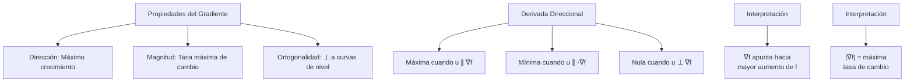
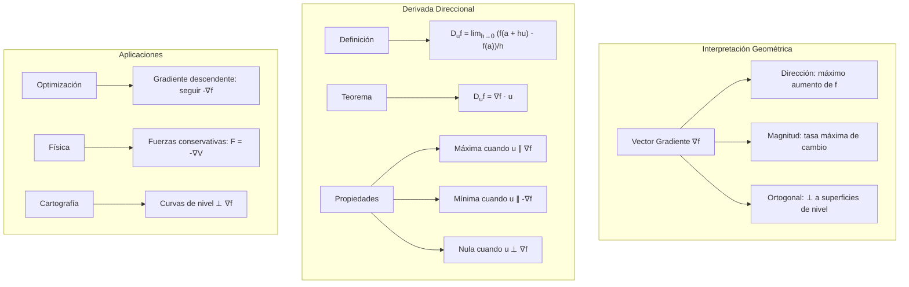

# Matemáticas para Ciencias Aplicadas II - Campos escalares

## 4.4 Gradiente y derivada direccional.

---

### 1. Conceptos Fundamentales

#### 1.1 Vector Gradiente

El **gradiente** de un campo escalar $f: \mathbb{R}^n \rightarrow \mathbb{R}$ en un punto $\vec{a}$ es el vector de sus derivadas parciales:

$$\nabla f(\vec{a}) = \left( \frac{\partial f}{\partial x_1}(\vec{a}), \frac{\partial f}{\partial x_2}(\vec{a}), \ldots, \frac{\partial f}{\partial x_n}(\vec{a}) \right)$$

#### 1.2 Derivada Direccional

La **derivada direccional** de $f$ en $\vec{a}$ en la dirección del vector unitario $\vec{u}$ es:

$$D_{\vec{u}} f(\vec{a}) = \lim_{h \to 0} \frac{f(\vec{a} + h\vec{u}) - f(\vec{a})}{h}$$

### 2. Relación entre Gradiente y Derivada Direccional

#### 2.1 Teorema Fundamental

Si $f$ es diferenciable en $\vec{a}$, entonces:

$$D_{\vec{u}} f(\vec{a}) = \nabla f(\vec{a}) \cdot \vec{u}$$

#### 2.2 Propiedades Geométricas



### 3. Interpretación Geométrica del Gradiente

#### 3.1 Dirección de Máximo Crecimiento

El gradiente $\nabla f(\vec{a})$ apunta en la dirección donde $f$ crece más rápidamente.

#### 3.2 Tasa Máxima de Cambio

La magnitud del gradiente $\|\nabla f(\vec{a})\|$ representa la máxima tasa de cambio de $f$ en $\vec{a}$.

#### 3.3 Ortogonalidad a Curvas de Nivel

Si $\nabla f(\vec{a}) \neq \vec{0}$, el gradiente es perpendicular (ortogonal) a la curva de nivel $f(\vec{x}) = c$ que pasa por $\vec{a}$.

### 4. Implementación Computacional

```python
import numpy as np
import matplotlib.pyplot as plt
from mpl_toolkits.mplot3d import Axes3D
import sympy as sp

class GradienteDerivadaDireccional:
    def __init__(self, funcion):
        self.funcion = funcion

    def gradiente(self, punto, h=1e-6):
        """Calcula el gradiente numéricamente usando diferencias centradas"""
        punto = np.array(punto, dtype=float)
        n = len(punto)
        grad = np.zeros(n)

        for i in range(n):
            punto_plus = punto.copy()
            punto_minus = punto.copy()
            punto_plus[i] += h
            punto_minus[i] -= h

            f_plus = self.funcion(*punto_plus)
            f_minus = self.funcion(*punto_minus)

            grad[i] = (f_plus - f_minus) / (2 * h)

        return grad

    def derivada_direccional(self, punto, direccion, h=1e-6):
        """Calcula la derivada direccional usando la definición"""
        direccion_unit = direccion / np.linalg.norm(direccion)
        punto_desp = punto + h * direccion_unit

        f_punto = self.funcion(*punto)
        f_desp = self.funcion(*punto_desp)

        return (f_desp - f_punto) / h

    def derivada_direccional_gradiente(self, punto, direccion):
        """Calcula la derivada direccional usando el gradiente"""
        direccion_unit = direccion / np.linalg.norm(direccion)
        grad = self.gradiente(punto)
        return np.dot(grad, direccion_unit)

    def direccion_maximo_crecimiento(self, punto):
        """Encuentra la dirección de máximo crecimiento"""
        grad = self.gradiente(punto)
        if np.linalg.norm(grad) < 1e-10:
            return np.zeros_like(grad)
        return grad / np.linalg.norm(grad)

    def tasa_maxima_cambio(self, punto):
        """Calcula la tasa máxima de cambio"""
        return np.linalg.norm(self.gradiente(punto))

    def direcciones_ortogonales_nivel(self, punto, num_direcciones=8):
        """Encuentra direcciones ortogonales al gradiente (tangentes a curvas de nivel)"""
        grad = self.gradiente(punto)
        if np.linalg.norm(grad) < 1e-10:
            return []

        # Base ortonormal que incluye el gradiente
        n = len(punto)
        base = [grad / np.linalg.norm(grad)]

        # Completar la base con vectores ortogonales
        for i in range(1, n):
            vec = np.random.randn(n)
            # Ortogonalizar respecto a los vectores existentes
            for j in range(i):
                vec = vec - np.dot(vec, base[j]) * base[j]
            if np.linalg.norm(vec) > 1e-10:
                base.append(vec / np.linalg.norm(vec))

        # Las direcciones ortogonales son todos los vectores excepto el primero
        return base[1:min(num_direcciones+1, n)]

    def graficar_gradiente_curvas_nivel(self, punto, rango=2.0, resolucion=50):
        """Grafica curvas de nivel y el vector gradiente"""
        x0, y0 = punto
        x = np.linspace(x0 - rango, x0 + rango, resolucion)
        y = np.linspace(y0 - rango, y0 + rango, resolucion)
        X, Y = np.meshgrid(x, y)

        Z = np.zeros_like(X)
        for i in range(len(x)):
            for j in range(len(y)):
                Z[i, j] = self.funcion(X[i, j], Y[i, j])

        plt.figure(figsize=(12, 10))

        # Curvas de nivel
        contour = plt.contour(X, Y, Z, levels=20, cmap='viridis', alpha=0.8)
        plt.clabel(contour, inline=True, fontsize=8)

        # Vector gradiente
        grad = self.gradiente(punto)
        grad_norm = grad / np.linalg.norm(grad) * 0.5  # Escalar para visualización

        plt.quiver(x0, y0, grad_norm[0], grad_norm[1],
                  color='red', scale=1, scale_units='xy', angles='xy',
                  width=0.01, label=f'∇f = ({grad[0]:.2f}, {grad[1]:.2f})')

        # Punto de referencia
        plt.scatter([x0], [y0], color='blue', s=100, label='Punto')

        # Direcciones ortogonales (tangentes a curvas de nivel)
        direcciones_ortog = self.direcciones_ortogonales_nivel(punto, 4)
        for direccion in direcciones_ortog:
            plt.quiver(x0, y0, direccion[0]*0.3, direccion[1]*0.3,
                      color='green', alpha=0.6, width=0.005)

        plt.xlabel('X')
        plt.ylabel('Y')
        plt.title('Curvas de Nivel y Vector Gradiente')
        plt.legend()
        plt.grid(True, alpha=0.3)
        plt.axis('equal')
        plt.show()

    def comparar_metodos_derivada(self, punto, direcciones):
        """Compara derivada direccional por definición vs por gradiente"""
        resultados = []

        for direccion in direcciones:
            dd_definicion = self.derivada_direccional(punto, direccion)
            dd_gradiente = self.derivada_direccional_gradiente(punto, direccion)
            error = abs(dd_definicion - dd_gradiente)

            resultados.append({
                'direccion': direccion,
                'definicion': dd_definicion,
                'gradiente': dd_gradiente,
                'error': error
            })

        return resultados

    def superficie_tangente(self, punto, rango=1.0, resolucion=30):
        """Grafica la superficie y el plano tangente"""
        x0, y0 = punto
        x = np.linspace(x0 - rango, x0 + rango, resolucion)
        y = np.linspace(y0 - rango, y0 + rango, resolucion)
        X, Y = np.meshgrid(x, y)

        # Superficie original
        Z_superficie = np.zeros_like(X)
        for i in range(len(x)):
            for j in range(len(y)):
                Z_superficie[i, j] = self.funcion(X[i, j], Y[i, j])

        # Plano tangente (usando gradiente)
        f0 = self.funcion(x0, y0)
        grad = self.gradiente(punto)
        Z_tangente = f0 + grad[0]*(X - x0) + grad[1]*(Y - y0)

        fig = plt.figure(figsize=(15, 10))
        ax = fig.add_subplot(111, projection='3d')

        # Superficie original
        surf1 = ax.plot_surface(X, Y, Z_superficie, cmap='viridis',
                               alpha=0.7, label='Superficie')

        # Plano tangente
        surf2 = ax.plot_surface(X, Y, Z_tangente, cmap='plasma',
                               alpha=0.5, label='Plano Tangente')

        # Vector gradiente en 3D
        ax.quiver(x0, y0, f0, grad[0], grad[1], 0,
                 color='red', length=0.5, label='∇f')

        ax.set_xlabel('X')
        ax.set_ylabel('Y')
        ax.set_zlabel('Z')
        ax.set_title('Superficie, Plano Tangente y Gradiente')
        ax.legend()
        plt.show()

# Ejemplos de funciones
def funcion_paraboloide(x, y):
    return x**2 + y**2

def funcion_silla_montar(x, y):
    return x**2 - y**2

def funcion_gaussiana(x, y):
    return np.exp(-(x**2 + y**2)/2)

def funcion_compleja(x, y):
    return np.sin(x) * np.cos(y) + 0.1*x*y

# Uso de la clase
print("=== Análisis de Gradiente y Derivada Direccional ===")

# Crear instancia con función paraboloide
analizador = GradienteDerivadaDireccional(funcion_paraboloide)
punto = [1.0, 2.0]

# Calcular gradiente
gradiente = analizador.gradiente(punto)
print(f"Gradiente en {punto}: {gradiente}")

# Dirección de máximo crecimiento
dir_max_crec = analizador.direccion_maximo_crecimiento(punto)
print(f"Dirección máximo crecimiento: {dir_max_crec}")

# Tasa máxima de cambio
tasa_max = analizador.tasa_maxima_cambio(punto)
print(f"Tasa máxima de cambio: {tasa_max:.4f}")

# Derivadas direccionales en diferentes direcciones
direcciones = [
    np.array([1, 0]),    # Dirección x
    np.array([0, 1]),    # Dirección y
    np.array([1, 1]),    # Diagonal
    dir_max_crec,        # Máximo crecimiento
    np.array([1, -1])    # Otra dirección
]

resultados = analizador.comparar_metodos_derivada(punto, direcciones)
for res in resultados:
    print(f"Dirección {res['direccion']}:")
    print(f"  Por definición: {res['definicion']:.4f}")
    print(f"  Por gradiente: {res['gradiente']:.4f}")
    print(f"  Error: {res['error']:.2e}")

# Verificar ortogonalidad a curvas de nivel
direcciones_ortog = analizador.direcciones_ortogonales_nivel(punto)
print(f"\nDirecciones ortogonales al gradiente (tangentes a curvas de nivel):")
for i, dir_ortog in enumerate(direcciones_ortog):
    producto_escalar = np.dot(gradiente, dir_ortog)
    print(f"  Dirección {i+1}: {dir_ortog}, ∇f·u = {producto_escalar:.2e}")

# Graficar
analizador.graficar_gradiente_curvas_nivel(punto)
analizador.superficie_tangente(punto)

# Probar con función diferente
print("\n=== Análisis con función gaussiana ===")
analizador_gauss = GradienteDerivadaDireccional(funcion_gaussiana)
punto_gauss = [1.0, 0.5]

grad_gauss = analizador_gauss.gradiente(punto_gauss)
print(f"Gradiente gaussiano: {grad_gauss}")
analizador_gauss.graficar_gradiente_curvas_nivel(punto_gauss)
```

### 5. Ejemplos y Ejercicios

#### Ejemplo 1: Paraboloide Simple

$$f(x,y) = x^2 + y^2$$

$$\nabla f(x,y) = (2x, 2y)$$

- En $(1,2)$: $\nabla f = (2, 4)$
- Dirección máximo crecimiento: $\frac{(1,2)}{\sqrt{5}}$
- Tasa máxima cambio: $2\sqrt{5}$

#### Ejemplo 2: Campo Gaussiano

$$g(x,y) = e^{-(x^2 + y^2)/2}$$

$$\nabla g(x,y) = (-x e^{-(x^2+y^2)/2}, -y e^{-(x^2+y^2)/2})$$

- El gradiente apunta hacia el origen
- Magnitud máxima en el círculo unitario

#### Ejemplo 3: Derivada Direccional

Para $f(x,y) = x^2 + y^2$ en $(1,2)$ en dirección $(3,4)$:

$$D_{\vec{u}} f = \nabla f \cdot \vec{u} = (2,4) \cdot \frac{(3,4)}{5} = \frac{6 + 16}{5} = 4.4$$

#### Ejercicio 1:

Para $h(x,y) = \ln(x^2 + y^2)$:

1. Calcular $\nabla h$ en $(2,1)$
2. Encontrar la derivada direccional en dirección $(1,-1)$
3. Verificar ortogonalidad a curvas de nivel

### 6. Aplicaciones Prácticas

#### 6.1 Optimización y Machine Learning

- **Gradiente descendente**: Seguir dirección $-\nabla f$ para minimizar
- **Tasa de aprendizaje** $\eta$: en cada paso $\vec{x} \leftarrow \vec{x} - \eta \nabla f(\vec{x})$, así que el desplazamiento mide $\eta \|\nabla f\|$
- **Algoritmos de optimización**: SGD, Adam, RMSprop

#### 6.2 Física e Ingeniería

- **Campos de fuerza**: $\vec{F} = -\nabla V$ (campo conservativo)
- **Transferencia de calor**: Flujo proporcional a $-\nabla T$
- **Mecánica de fluidos**: Gradientes de presión

#### 6.3 Geografía y Cartografía

- **Mapas topográficos**: Curvas de nivel perpendiculares al gradiente
- **Rutas óptimas**: Seguir dirección del gradiente para ascenso/descenso más rápido
- **Análisis de pendientes**: $\|\nabla f\|$ indica inclinación del terreno

### 7. Propiedades Matemáticas

#### 7.1 Linealidad del Gradiente

$$\nabla(\alpha f + \beta g) = \alpha \nabla f + \beta \nabla g$$

#### 7.2 Regla del Producto

$$\nabla(f \cdot g) = f \nabla g + g \nabla f$$

#### 7.3 Regla de la Cadena

Para $h(\vec{x}) = f(g(\vec{x}))$, con $g: \mathbb{R}^n \rightarrow \mathbb{R}$ y $f: \mathbb{R} \rightarrow \mathbb{R}$:

$$\nabla h(\vec{x}) = f'(g(\vec{x})) \nabla g(\vec{x})$$

### 8. Visualización de Conceptos



### 9. Casos Especiales

#### 9.1 Puntos Críticos

Donde $\nabla f = \vec{0}$:

- Máximos locales
- Mínimos locales
- Puntos de silla

#### 9.2 Funciones Armónicas

Donde $\nabla^2 f = 0$:

- Propiedades especiales de suavidad
- Valor medio sobre esferas
- Principio del máximo

#### 9.3 Campos Conservativos

$\vec{F} = \nabla f$ implica:

- Integral de línea independiente del camino
- $\nabla \times \vec{F} = \vec{0}$
- Existencia de potencial

### 10. Recursos Adicionales

- "Calculus" por James Stewart
- "Vector Calculus" por Jerrold E. Marsden
- "Advanced Engineering Mathematics" por Erwin Kreyszig
- Software: Mathematica, MATLAB, GeoGebra
- Librerías Python: NumPy, SciPy, Matplotlib, Plotly
- Tutoriales online de cálculo multivariable
- Visualizaciones interactivas de campos vectoriales
