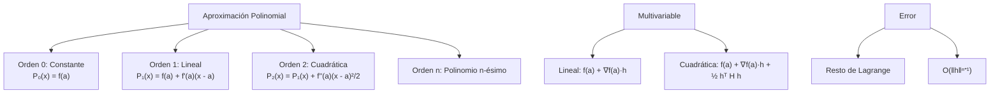
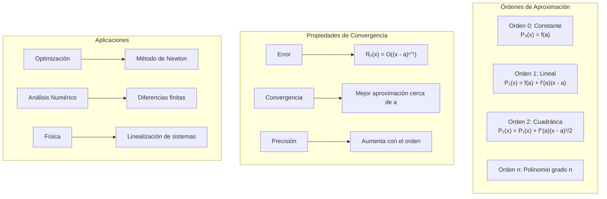

# Matemáticas para Ciencias Aplicadas II - Máximos y mínimos

## 5.1 Aproximación polinomial.

---

### 1. Conceptos Fundamentales de Aproximación Polinomial

#### 1.1 Polinomio de Taylor

El **polinomio de Taylor** de orden $n$ para una función $f$ alrededor de un punto $a$ es:

$$P_n(x) = f(a) + f'(a)(x-a) + \frac{f''(a)}{2!}(x-a)^2 + \cdots + \frac{f^{(n)}(a)}{n!}(x-a)^n$$

#### 1.2 Polinomio de Taylor Multivariable

Para $f: \mathbb{R}^m \rightarrow \mathbb{R}$ alrededor de $\vec{a}$:

$$P_n(\vec{x}) = \sum_{k=0}^n \frac{1}{k!} \left[(\vec{x} - \vec{a}) \cdot \nabla\right]^k f(\vec{a})$$

donde $[(\vec{x} - \vec{a}) \cdot \nabla]^k$ es el operador diferencial de orden $k$.

### 2. Aproximaciones de Diferentes Órdenes

#### 2.1 Aproximación Lineal (Primer Orden)

$$P_1(\vec{x}) = f(\vec{a}) + \nabla f(\vec{a}) \cdot (\vec{x} - \vec{a})$$

#### 2.2 Aproximación Cuadrática (Segundo Orden)

$$P_2(\vec{x}) = f(\vec{a}) + \nabla f(\vec{a}) \cdot (\vec{x} - \vec{a}) + \frac{1}{2} (\vec{x} - \vec{a})^T H_f(\vec{a}) (\vec{x} - \vec{a})$$

donde $H_f(\vec{a})$ es la matriz Hessiana.

#### 2.3 Término de Error

$$f(\vec{x}) = P_n(\vec{x}) + R_n(\vec{x})$$
donde $R_n(\vec{x}) = O(\|\vec{x} - \vec{a}\|^{n+1})$



### 3. Implementación Computacional

```python
import numpy as np
from math import comb, factorial
def derivative(func, x0, dx=1e-5, n=1, order=None):
    """Derivada numérica de orden n por diferencias centrales.
    Sustituye a scipy.misc.derivative, que se eliminó en SciPy 1.12."""
    return sum((-1)**k * comb(n, k) * func(x0 + (n / 2 - k) * dx)
               for k in range(n + 1)) / dx**n
import matplotlib.pyplot as plt
import warnings
warnings.filterwarnings('ignore')

class AproximacionPolinomial:
    def __init__(self, funcion):
        self.funcion = funcion

    def taylor_univariable(self, punto, orden, x_range=(-2, 2), num_puntos=1000):
        """Aproximación de Taylor para funciones univariables"""
        x_vals = np.linspace(x_range[0], x_range[1], num_puntos)
        f_vals = np.array([self.funcion(x) for x in x_vals])

        # Calcular derivadas
        derivadas = [self.funcion(punto)]  # f(a)
        for n in range(1, orden + 1):
            # Paso h ≈ eps^(1/(n+2)): con h muy pequeño el redondeo domina,
            # porque el error de redondeo crece como eps/h^n
            derivada_n = derivative(self.funcion, punto, dx=np.finfo(float).eps**(1/(n+2)), n=n)
            derivadas.append(derivada_n)

        # Calcular polinomios de Taylor de diferentes órdenes
        polinomios = []
        for k in range(orden + 1):
            P_k = np.zeros_like(x_vals)
            for n in range(k + 1):
                termino = derivadas[n] * (x_vals - punto)**n / factorial(n)
                P_k += termino
            polinomios.append(P_k)

        return x_vals, f_vals, polinomios

    def taylor_multivariable(self, punto, orden, delta=0.5, resolucion=50):
        """Aproximación de Taylor para funciones multivariables (2D)"""
        x0, y0 = punto
        x = np.linspace(x0 - delta, x0 + delta, resolucion)
        y = np.linspace(y0 - delta, y0 + delta, resolucion)
        X, Y = np.meshgrid(x, y)

        # Función original
        Z_real = np.zeros_like(X)
        for i in range(len(x)):
            for j in range(len(y)):
                Z_real[i, j] = self.funcion(X[i, j], Y[i, j])

        # Calcular derivadas necesarias
        f_a = self.funcion(x0, y0)

        # Derivadas primeras
        f_x = derivative(lambda x: self.funcion(x, y0), x0, dx=1e-6)
        f_y = derivative(lambda y: self.funcion(x0, y), y0, dx=1e-6)

        # Derivadas segundas
        f_xx = derivative(lambda x: self.funcion(x, y0), x0, dx=1e-4, n=2)
        f_yy = derivative(lambda y: self.funcion(x0, y), y0, dx=1e-4, n=2)
        f_xy = derivative(lambda x: derivative(lambda y: self.funcion(x, y), y0, dx=1e-4), x0, dx=1e-4)

        # Aproximaciones
        Z_lineal = np.zeros_like(X)
        Z_cuadratica = np.zeros_like(X)

        for i in range(len(x)):
            for j in range(len(y)):
                hx = X[i, j] - x0
                hy = Y[i, j] - y0

                # Aproximación lineal
                Z_lineal[i, j] = f_a + f_x * hx + f_y * hy

                # Aproximación cuadrática
                Z_cuadratica[i, j] = f_a + f_x * hx + f_y * hy + \
                                    0.5 * (f_xx * hx**2 + 2 * f_xy * hx * hy + f_yy * hy**2)

        return X, Y, Z_real, Z_lineal, Z_cuadratica

    def error_aproximacion(self, punto, orden_max=4, num_puntos=100):
        """Analiza el error de diferentes órdenes de aproximación"""
        errores = []
        h_values = np.logspace(-3, 0, num_puntos)

        for h in h_values:
            punto_vecino = punto + h
            f_real = self.funcion(punto_vecino)

            # Calcular diferentes aproximaciones
            aproximaciones = []
            for orden in range(orden_max + 1):
                # Calcular polinomio de Taylor de orden 'orden'
                aprox = self.funcion(punto)
                for n in range(1, orden + 1):
                    derivada = derivative(self.funcion, punto, dx=np.finfo(float).eps**(1/(n+2)), n=n)
                    aprox += derivada * h**n / factorial(n)
                aproximaciones.append(aprox)

            errores_orden = [abs(f_real - aprox) for aprox in aproximaciones]
            errores.append(errores_orden)

        return h_values, np.array(errores)

    def graficar_aproximaciones_univariable(self, punto, orden_max=3, x_range=(-2, 2)):
        """Grafica aproximaciones de Taylor para función univariable"""
        x_vals, f_vals, polinomios = self.taylor_univariable(punto, orden_max, x_range)

        plt.figure(figsize=(12, 8))
        plt.plot(x_vals, f_vals, 'k-', linewidth=3, label='Función real')

        colors = ['red', 'blue', 'green', 'orange', 'purple']
        for orden in range(orden_max + 1):
            plt.plot(x_vals, polinomios[orden], '--',
                    color=colors[orden % len(colors)],
                    linewidth=2,
                    label=f'Orden {orden}')

        plt.axvline(x=punto, color='gray', linestyle=':', alpha=0.7)
        plt.scatter([punto], [self.funcion(punto)], color='black', s=100, zorder=5)

        plt.xlabel('x')
        plt.ylabel('f(x)')
        plt.title(f'Aproximaciones de Taylor alrededor de x = {punto}')
        plt.legend()
        plt.grid(True, alpha=0.3)
        plt.show()

    def graficar_aproximaciones_multivariable(self, punto, delta=1.0):
        """Grafica aproximaciones para función multivariable"""
        X, Y, Z_real, Z_lineal, Z_cuadratica = self.taylor_multivariable(punto, 2, delta)

        fig, axes = plt.subplots(2, 2, figsize=(15, 12), subplot_kw={'projection': '3d'})

        # Función real
        ax = axes[0, 0]
        surf = ax.plot_surface(X, Y, Z_real, cmap='viridis', alpha=0.8)
        ax.set_title('Función Real')
        ax.set_xlabel('X')
        ax.set_ylabel('Y')
        ax.set_zlabel('Z')

        # Aproximación lineal
        ax = axes[0, 1]
        surf = ax.plot_surface(X, Y, Z_lineal, cmap='plasma', alpha=0.8)
        ax.set_title('Aproximación Lineal (Orden 1)')
        ax.set_xlabel('X')
        ax.set_ylabel('Y')
        ax.set_zlabel('Z')

        # Aproximación cuadrática
        ax = axes[1, 0]
        surf = ax.plot_surface(X, Y, Z_cuadratica, cmap='cool', alpha=0.8)
        ax.set_title('Aproximación Cuadrática (Orden 2)')
        ax.set_xlabel('X')
        ax.set_ylabel('Y')
        ax.set_zlabel('Z')

        # Error
        ax = axes[1, 1]
        error = np.abs(Z_real - Z_cuadratica)
        surf = ax.plot_surface(X, Y, error, cmap='hot', alpha=0.8)
        ax.set_title('Error Cuadrático')
        ax.set_xlabel('X')
        ax.set_ylabel('Y')
        ax.set_zlabel('Error')

        plt.tight_layout()
        plt.show()

    def analizar_convergencia(self, punto, orden_max=5):
        """Analiza la convergencia de las aproximaciones"""
        h_values, errores = self.error_aproximacion(punto, orden_max)

        plt.figure(figsize=(12, 8))
        colors = ['red', 'blue', 'green', 'orange', 'purple', 'brown']

        for orden in range(orden_max + 1):
            plt.loglog(h_values, errores[:, orden],
                      color=colors[orden % len(colors)],
                      linewidth=2,
                      label=f'Orden {orden}')

            # Añadir línea teórica de convergencia O(h^{n+1})
            if orden > 0:
                referencia = h_values**(orden + 1) * (errores[0, orden] / h_values[0]**(orden + 1))
                plt.loglog(h_values, referencia, ':',
                          color=colors[orden % len(colors)],
                          alpha=0.7)

        plt.xlabel('h (distancia al punto)')
        plt.ylabel('Error de aproximación')
        plt.title('Convergencia de Aproximaciones de Taylor')
        plt.legend()
        plt.grid(True, alpha=0.3)
        plt.show()

    def aproximacion_optimizacion(self, punto, orden=2):
        """Usa aproximación polinomial para optimización"""
        if orden == 1:
            # Aproximación lineal: mínimo en dirección opuesta al gradiente
            grad = derivative(self.funcion, punto, dx=1e-6)
            punto_optimo = punto - grad * 0.1  # Paso pequeño
            return punto_optimo

        elif orden == 2:
            # Aproximación cuadrática: encontrar mínimo analíticamente
            f_a = self.funcion(punto)
            f_prime = derivative(self.funcion, punto, dx=1e-6)
            f_double_prime = derivative(self.funcion, punto, dx=1e-6, n=2)

            if abs(f_double_prime) > 1e-10:
                punto_optimo = punto - f_prime / f_double_prime
                return punto_optimo
            else:
                return punto

        return punto

# Funciones de ejemplo
def funcion_seno(x):
    return np.sin(x)

def funcion_exponencial(x):
    return np.exp(x)

def funcion_polinomio(x):
    return x**3 - 2*x**2 + x + 1

def funcion_2d(x, y):
    return np.sin(x) * np.cos(y) + 0.1*(x**2 + y**2)

def funcion_compleja(x):
    return np.exp(np.sin(x)) + 0.1*x**2

# Ejemplos de uso
print("=== Análisis de Aproximación Polinomial ===")

# Ejemplo univariable
print("\n1. Función sin(x) alrededor de x = π/4")
aprox_sin = AproximacionPolinomial(funcion_seno)
aprox_sin.graficar_aproximaciones_univariable(np.pi/4, 3, [0, np.pi/2])
aprox_sin.analizar_convergencia(np.pi/4)

# Ejemplo multivariable
print("\n2. Función 2D alrededor de (0,0)")
aprox_2d = AproximacionPolinomial(funcion_2d)
aprox_2d.graficar_aproximaciones_multivariable([0, 0], 2.0)

# Análisis de error
print("\n3. Análisis de convergencia para diferentes funciones")
funciones = [funcion_seno, funcion_exponencial, funcion_compleja]
nombres = ["sin(x)", "exp(x)", "exp(sin(x)) + 0.1x²"]

plt.figure(figsize=(12, 8))
for i, (func, nombre) in enumerate(zip(funciones, nombres)):
    aprox = AproximacionPolinomial(func)
    h_vals, errores = aprox.error_aproximacion(1.0, 3)
    plt.loglog(h_vals, errores[:, 2], linewidth=2, label=nombre)  # Error orden 2

plt.xlabel('h')
plt.ylabel('Error (orden 2)')
plt.title('Comparación de Error de Aproximación Cuadrática')
plt.legend()
plt.grid(True, alpha=0.3)
plt.show()

# Aplicación a optimización
print("\n4. Aplicación a optimización")
def funcion_optimizar(x):
    return (x - 2)**4 + 3*(x - 1)**2

aprox_opt = AproximacionPolinomial(funcion_optimizar)
punto_inicial = 0.0

# Optimización usando aproximación cuadrática
punto_optimo = aprox_opt.aproximacion_optimizacion(punto_inicial, 2)
valor_optimo = funcion_optimizar(punto_optimo)

print(f"Punto inicial: {punto_inicial}")
print(f"Punto óptimo aproximado: {punto_optimo:.4f}")
print(f"Valor óptimo: {valor_optimo:.4f}")
print(f"Error: {abs(punto_optimo - 1.2649):.4f}")  # Mínimo real en x ≈ 1.2649
# Un solo paso de Newton desde 0 llega a 0.7037; repitiendo el paso
# desde cada nuevo punto, el método converge al mínimo

# Graficar optimización
x_vals = np.linspace(0, 3, 100)
y_vals = funcion_optimizar(x_vals)
plt.figure(figsize=(10, 6))
plt.plot(x_vals, y_vals, 'b-', label='Función')
plt.scatter([punto_inicial], [funcion_optimizar(punto_inicial)], color='red', s=100, label='Inicio')
plt.scatter([punto_optimo], [valor_optimo], color='green', s=100, label='Óptimo aprox.')
plt.xlabel('x')
plt.ylabel('f(x)')
plt.title('Optimización usando Aproximación Cuadrática')
plt.legend()
plt.grid(True, alpha=0.3)
plt.show()
```

### 5. Ejemplos y Ejercicios

#### Ejemplo 1: Aproximación de sin(x)

$$f(x) = \sin(x), \quad a = \frac{\pi}{4}$$
$$P_3(x) = \frac{\sqrt{2}}{2} + \frac{\sqrt{2}}{2}(x-\frac{\pi}{4}) - \frac{\sqrt{2}}{4}(x-\frac{\pi}{4})^2 - \frac{\sqrt{2}}{12}(x-\frac{\pi}{4})^3$$

#### Ejemplo 2: Aproximación Cuadrática 2D

$$f(x,y) = x^2 + y^2 + \sin(xy), \quad \vec{a} = (0,0)$$
$$P_2(x,y) = 0 + 0\cdot x + 0\cdot y + \frac{1}{2}(2x^2 + 2y^2 + 2xy) = x^2 + y^2 + xy$$

#### Ejemplo 3: Error de Aproximación

Para $f(x) = e^x$ alrededor de $x=0$:

- Orden 1: Error $\approx \frac{e^\xi}{2}h^2$
- Orden 2: Error $\approx \frac{e^\xi}{6}h^3$

#### Ejercicio 1:

Para $f(x) = \ln(1+x)$ alrededor de $x=0$:

1. Calcular $P_3(x)$
2. Estimar el error en $x=0.1$
3. Comparar con el valor real

### 6. Aplicaciones Prácticas

#### 6.1 Optimización Numérica

- **Método de Newton**: Usa aproximación cuadrática
- **Gradiente descendente**: Aproximación lineal
- **Algoritmos quasi-Newton**: Aproximan la Hessiana

#### 6.2 Análisis Numérico

- **Diferencias finitas**: Aproximación de derivadas
- **Interpolación**: Aproximación polinomial
- **Extrapolación**: Predecir valores fuera del rango

#### 6.3 Física e Ingeniería

- **Desarrollos en serie**: Soluciones aproximadas de EDOs
- **Teoría de perturbaciones**: Pequeñas desviaciones
- **Análisis de estabilidad**: Linealización alrededor de puntos críticos

### 7. Teoremas Importantes

#### 7.1 Teorema de Taylor

$$f(x) = P_n(x) + R_n(x)$$
con $R_n(x) = \frac{f^{(n+1)}(\xi)}{(n+1)!}(x-a)^{n+1}$ para algún $\xi$ entre $a$ y $x$.

#### 7.2 Convergencia Uniforme

Para funciones analíticas, la serie de Taylor alrededor de $a$ converge uniformemente en todo intervalo cerrado contenido en su intervalo de convergencia $(a - R, a + R)$. No necesariamente en cualquier intervalo compacto. Por ejemplo, la serie de $\frac{1}{1 + x^2}$ en $a = 0$ solo converge para $|x| < 1$.

#### 7.3 Radio de Convergencia

Para la serie de Taylor de una función analítica, el radio de convergencia es la distancia de $a$ a la singularidad más cercana **en el plano complejo**. Así, $\frac{1}{1 + x^2}$ es suave en todo $\mathbb{R}$, pero sus singularidades en $\pm i$ limitan el radio en $a = 0$ a 1.

### 8. Visualización de Conceptos



### 9. Casos Especiales

#### 9.1 Funciones Analíticas

- Serie de Taylor converge a la función
- Ejemplos: $e^x$, $\sin x$, $\cos x$, polinomios

#### 9.2 Funciones No Analíticas

- Serie diverge o converge a valor incorrecto
- Ejemplo: $f(x) = e^{-1/x^2}$ (todas derivadas en 0 son 0)

#### 9.3 Puntos Singulares

- Donde la función o sus derivadas no están definidas
- Radio de convergencia determinado por singularidades

### 10. Recursos Adicionales

- "Calculus" por James Stewart
- "Numerical Analysis" por Richard L. Burden
- "Advanced Engineering Mathematics" por Erwin Kreyszig
- Software: Mathematica, MATLAB, SymPy
- Librerías Python: NumPy, SciPy, Matplotlib
- Tutoriales online de series de Taylor
- Visualizaciones interactivas de aproximación polinomial
