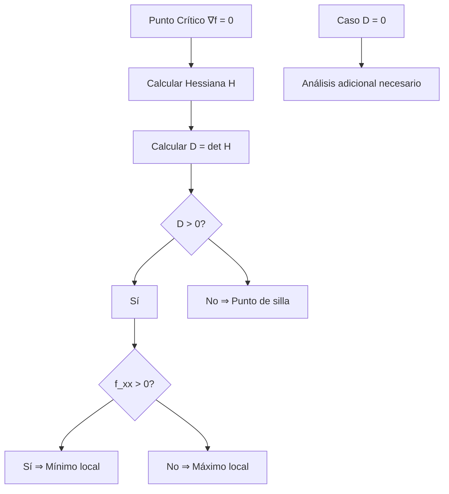
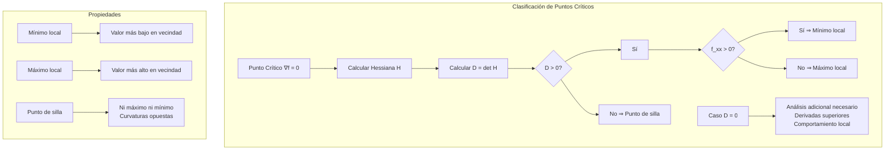

# Matemáticas para Ciencias Aplicadas II - Máximos y mínimos

## 5.2 Puntos críticos de funciones reales.

---

### 1. Conceptos Fundamentales de Puntos Críticos

#### 1.1 Definición de Punto Crítico

Un **punto crítico** de una función $f: \mathbb{R}^n \rightarrow \mathbb{R}$ es un punto $\vec{a}$ donde:

$$\nabla f(\vec{a}) = \vec{0} \quad \text{o} \quad \nabla f(\vec{a}) \text{ no existe}$$

#### 1.2 Clasificación de Puntos Críticos

- **Mínimo local**: $f(\vec{a}) \leq f(\vec{x})$ para todo $\vec{x}$ cerca de $\vec{a}$
- **Máximo local**: $f(\vec{a}) \geq f(\vec{x})$ para todo $\vec{x}$ cerca de $\vec{a}$
- **Punto de silla**: Ni máximo ni mínimo local
- **Punto singular**: Donde $\nabla f$ no existe

### 2. Condiciones para Extremos Locales

#### 2.1 Condición Necesaria (Primer Orden)

Si $f$ es diferenciable en $\vec{a}$ y $\vec{a}$ es extremo local, entonces:

$$\nabla f(\vec{a}) = \vec{0}$$

#### 2.2 Condición Suficiente (Segundo Orden)

Para $f: \mathbb{R}^2 \rightarrow \mathbb{R}$, sea $D = f_{xx}f_{yy} - (f_{xy})^2$ el determinante Hessiano:

- $D > 0$ y $f_{xx} > 0$ ⇒ **Mínimo local**
- $D > 0$ y $f_{xx} < 0$ ⇒ **Máximo local**
- $D < 0$ ⇒ **Punto de silla**
- $D = 0$ ⇒ **Prueba no concluyente**



### 3. Métodos para Encontrar Puntos Críticos

#### 3.1 Resolución Analítica del Sistema

Resolver el sistema de ecuaciones:

$$ \begin{cases} \frac{\partial f}{\partial x_1} = 0 \\\ \frac{\partial f}{\partial x_2} = 0 \\\ \vdots \\\ \frac{\partial f}{\partial x_n} = 0 \\\ \end{cases} $$

#### 3.2 Métodos Numéricos

- **Newton-Raphson**: Para sistemas no lineales
- **Gradiente descendente**: Para encontrar mínimos
- **Métodos de optimización**: Algoritmos especializados

### 4. Implementación Computacional

```python
import numpy as np
from scipy import misc, optimize
import matplotlib.pyplot as plt
from mpl_toolkits.mplot3d import Axes3D
import sympy as sp

class PuntosCriticos:
    def __init__(self, funcion):
        self.funcion = funcion

    def gradiente(self, punto, h=1e-6):
        """Calcula el gradiente numéricamente"""
        punto = np.array(punto, dtype=float)
        n = len(punto)
        grad = np.zeros(n)

        for i in range(n):
            punto_plus = punto.copy()
            punto_minus = punto.copy()
            punto_plus[i] += h
            punto_minus[i] -= h

            f_plus = self.funcion(*punto_plus)
            f_minus = self.funcion(*punto_minus)

            grad[i] = (f_plus - f_minus) / (2 * h)

        return grad

    def hessiana(self, punto, h=1e-4):
        """Calcula la matriz Hessiana numéricamente"""
        n = len(punto)
        hess = np.zeros((n, n))

        for i in range(n):
            for j in range(n):
                # Aproximación de segunda derivada
                punto_pp = punto.copy(); punto_pp[i] += h; punto_pp[j] += h
                punto_pm = punto.copy(); punto_pm[i] += h; punto_pm[j] -= h
                punto_mp = punto.copy(); punto_mp[i] -= h; punto_mp[j] += h
                punto_mm = punto.copy(); punto_mm[i] -= h; punto_mm[j] -= h

                f_pp = self.funcion(*punto_pp)
                f_pm = self.funcion(*punto_pm)
                f_mp = self.funcion(*punto_mp)
                f_mm = self.funcion(*punto_mm)

                hess[i, j] = (f_pp - f_pm - f_mp + f_mm) / (4 * h**2)

        return hess

    def encontrar_puntos_criticos(self, dominio, num_puntos=1000, tolerancia=1e-4):
        """Encuentra puntos críticos muestreando el dominio"""
        if len(dominio) != 4:
            raise ValueError("Dominio debe ser [x_min, x_max, y_min, y_max]")

        x_min, x_max, y_min, y_max = dominio
        puntos_criticos = []

        # Muestrear puntos en el dominio
        x_vals = np.random.uniform(x_min, x_max, num_puntos)
        y_vals = np.random.uniform(y_min, y_max, num_puntos)

        for x, y in zip(x_vals, y_vals):
            punto = np.array([x, y])
            grad = self.gradiente(punto)

            if np.linalg.norm(grad) < tolerancia:
                # Verificar que no sea un punto ya encontrado
                es_nuevo = True
                for pc in puntos_criticos:
                    if np.linalg.norm(punto - pc) < tolerancia:
                        es_nuevo = False
                        break

                if es_nuevo:
                    puntos_criticos.append(punto)

        return np.array(puntos_criticos)

    def clasificar_punto(self, punto, h=1e-4):
        """Clasifica un punto crítico usando el criterio de la Hessiana"""
        hess = self.hessiana(punto, h)
        f_xx = hess[0, 0]
        f_yy = hess[1, 1]
        f_xy = hess[0, 1]

        determinante = f_xx * f_yy - f_xy**2
        valor_funcion = self.funcion(*punto)

        if determinante > 0:
            if f_xx > 0:
                return "Mínimo local", determinante, valor_funcion
            else:
                return "Máximo local", determinante, valor_funcion
        elif determinante < 0:
            return "Punto de silla", determinante, valor_funcion
        else:
            return "Indeterminado", determinante, valor_funcion

    def graficar_puntos_criticos(self, dominio, puntos_criticos, resolucion=50):
        """Grafica la función y los puntos críticos"""
        x_min, x_max, y_min, y_max = dominio
        x = np.linspace(x_min, x_max, resolucion)
        y = np.linspace(y_min, y_max, resolucion)
        X, Y = np.meshgrid(x, y)

        Z = np.zeros_like(X)
        for i in range(len(x)):
            for j in range(len(y)):
                Z[i, j] = self.funcion(X[i, j], Y[i, j])

        fig, axes = plt.subplots(1, 2, figsize=(15, 6))

        # Gráfica de superficie
        ax = axes[0]
        contour = ax.contour(X, Y, Z, levels=20, cmap='viridis', alpha=0.8)
        ax.clabel(contour, inline=True, fontsize=8)

        # Marcar puntos críticos
        colores = {'Mínimo local': 'green', 'Máximo local': 'red', 'Punto de silla': 'blue', 'Indeterminado': 'orange'}
        for punto in puntos_criticos:
            clasificacion, _, _ = self.clasificar_punto(punto)
            color = colores.get(clasificacion, 'black')
            ax.scatter(punto[0], punto[1], color=color, s=100, label=clasificacion)

        ax.set_xlabel('X')
        ax.set_ylabel('Y')
        ax.set_title('Puntos Críticos en el Plano')
        ax.legend()
        ax.grid(True, alpha=0.3)

        # Gráfica 3D
        ax = axes[1]
        if hasattr(ax, 'plot_surface'):  # Verificar si es 3D
            surf = ax.plot_surface(X, Y, Z, cmap='viridis', alpha=0.7)
            for punto in puntos_criticos:
                clasificacion, _, valor = self.clasificar_punto(punto)
                color = colores.get(clasificacion, 'black')
                ax.scatter([punto[0]], [punto[1]], [valor], color=color, s=100)

            ax.set_xlabel('X')
            ax.set_ylabel('Y')
            ax.set_zlabel('Z')
            ax.set_title('Superficie con Puntos Críticos')

        plt.tight_layout()
        plt.show()

    def optimizar_newton(self, punto_inicial, max_iter=100, tolerancia=1e-6):
        """Método de Newton para optimización"""
        punto_actual = np.array(punto_inicial, dtype=float)
        historial = [punto_actual.copy()]

        for iteracion in range(max_iter):
            grad = self.gradiente(punto_actual)
            hess = self.hessiana(punto_actual)

            if np.linalg.norm(grad) < tolerancia:
                break

            try:
                # Resolver HΔx = -∇f
                delta = np.linalg.solve(hess, -grad)
                punto_actual += delta
                historial.append(punto_actual.copy())
            except np.linalg.LinAlgError:
                break

        return punto_actual, historial

    def analizar_funcion(self, dominio):
        """Análisis completo de puntos críticos"""
        puntos = self.encontrar_puntos_criticos(dominio)
        resultados = []

        print("=== ANÁLISIS DE PUNTOS CRÍTICOS ===")
        for i, punto in enumerate(puntos):
            clasificacion, det, valor = self.clasificar_punto(punto)
            resultados.append({
                'punto': punto,
                'clasificacion': clasificacion,
                'determinante': det,
                'valor': valor
            })

            print(f"\nPunto {i+1}: ({punto[0]:.3f}, {punto[1]:.3f})")
            print(f"Clasificación: {clasificacion}")
            print(f"Determinante Hessiano: {det:.4f}")
            print(f"Valor de f: {valor:.4f}")
            print(f"Gradiente: {self.gradiente(punto)}")

        self.graficar_puntos_criticos(dominio, puntos)
        return resultados

# Funciones de ejemplo para análisis
def funcion_paraboloide(x, y):
    return x**2 + y**2

def funcion_silla_montar(x, y):
    return x**2 - y**2

def funcion_compleja_1(x, y):
    return x**3 + y**3 - 3*x*y

def funcion_compleja_2(x, y):
    return np.sin(x) * np.cos(y) + 0.1*(x**2 + y**2)

def funcion_multimodal(x, y):
    return (x**2 - 1)**2 + (y**2 - 1)**2 - 0.5*x*y

# Ejemplos de uso
print("=== ANÁLISIS DE PUNTOS CRÍTICOS ===")

# 1. Paraboloide (mínimo en (0,0))
print("\n1. PARABOLOIDE: f(x,y) = x² + y²")
paraboloide = PuntosCriticos(funcion_paraboloide)
resultados = paraboloide.analizar_funcion([-2, 2, -2, 2])

# 2. Silla de montar
print("\n2. SILLA DE MONTAR: f(x,y) = x² - y²")
silla = PuntosCriticos(funcion_silla_montar)
resultados = silla.analizar_funcion([-2, 2, -2, 2])

# 3. Función compleja con múltiples puntos críticos
print("\n3. FUNCIÓN COMPLEJA: f(x,y) = x³ + y³ - 3xy")
compleja = PuntosCriticos(funcion_compleja_1)
resultados = compleja.analizar_funcion([-2, 2, -2, 2])

# 4. Optimización con Newton
print("\n4. OPTIMIZACIÓN CON MÉTODO DE NEWTON")
punto_inicial = [1.5, 1.5]
punto_optimo, historial = compleja.optimizar_newton(punto_inicial)
print(f"Punto inicial: {punto_inicial}")
print(f"Punto óptimo encontrado: {punto_optimo}")
print(f"Valor en óptimo: {funcion_compleja_1(*punto_optimo):.6f}")
print(f"Número de iteraciones: {len(historial)}")

# 5. Función multimodal
print("\n5. FUNCIÓN MULTIMODAL")
multimodal = PuntosCriticos(funcion_multimodal)
resultados = multimodal.analizar_funcion([-2, 2, -2, 2])

# 6. Análisis de clasificación detallada
print("\n6. ANÁLISIS DETALLADO DE CLASIFICACIÓN")
puntos_ejemplo = [[0,0], [1,1], [-1,-1], [0.5, -0.5]]
for punto in puntos_ejemplo:
    clasificacion, det, valor = compleja.clasificar_punto(punto)
    print(f"Punto {punto}: {clasificacion} (det={det:.3f}, f={valor:.3f})")
```

### 5. Ejemplos y Ejercicios

#### Ejemplo 1: Paraboloide Simple

$$f(x,y) = x^2 + y^2$$

- Punto crítico: $(0,0)$
- Hessiana: $\begin{bmatrix} 2 & 0 \\ 0 & 2 \end{bmatrix}$
- $D = 4 > 0$, $f_{xx} = 2 > 0$ ⇒ **Mínimo local**

#### Ejemplo 2: Silla de Montar

$$f(x,y) = x^2 - y^2$$

- Punto crítico: $(0,0)$
- Hessiana: $\begin{bmatrix} 2 & 0 \\\ 0 & -2 \end{bmatrix}$
- $D = -4 < 0$ ⇒ **Punto de silla**

#### Ejemplo 3: Función Cúbica

$$f(x,y) = x^3 + y^3 - 3xy$$

- Puntos críticos: $(0,0)$ y $(1,1)$
- $(0,0)$: Punto de silla ( $D = -9 < 0$ )
- $(1,1)$: Mínimo local ( $D = 27 > 0$, $f_{xx} = 6 > 0$ )

#### Ejercicio 1:

Para $f(x,y) = x^4 + y^4 - 4xy + 1$:

1. Encontrar todos los puntos críticos
2. Clasificar cada punto crítico
3. Graficar la función y los puntos

### 6. Aplicaciones Prácticas

#### 6.1 Optimización en Machine Learning

- **Función de pérdida**: Encontrar mínimos para entrenar modelos
- **Regularización**: Evitar sobreajuste con puntos críticos
- **Algoritmos**: Gradiente descendente, Newton, quasi-Newton

#### 6.2 Física e Ingeniería

- **Equilibrio estable**: Mínimos de energía potencial
- **Equilibrio inestable**: Máximos o puntos de silla
- **Puntos de bifurcación**: Donde cambia la estabilidad

#### 6.3 Economía y Finanzas

- **Maximización de utilidad**: Encontrar máximos de funciones
- **Minimización de costos**: Encontrar mínimos
- **Puntos de equilibrio**: En teoría de juegos y mercados

### 7. Teoremas Importantes

#### 7.1 Teorema de Fermat

Si $f$ tiene un extremo local en $\vec{a}$ y es diferenciable allí, entonces $\nabla f(\vec{a}) = \vec{0}$.

#### 7.2 Test de la Segunda Derivada

Para funciones $C^2$, la Hessiana determina la naturaleza de los puntos críticos.

#### 7.3 Lemas de Morse

En torno a puntos críticos no degenerados, la función se comporta como una forma cuadrática.

### 8. Visualización de Conceptos



### 9. Casos Especiales

#### 9.1 Puntos Degenerados

Donde $D = 0$:

- Requieren análisis de derivadas superiores
- Pueden ser mínimos, máximos o puntos de silla degenerados

#### 9.2 Funciones No Diferenciables

- Puntos angulosos o cúspides
- Donde el gradiente no existe
- Requieren análisis especializado

#### 9.3 Optimización Global vs Local

- Múltiples mínimos locales
- Problema de encontrar el mínimo global
- Algoritmos de optimización global

### 10. Recursos Adicionales

- "Calculus" por James Stewart
- "Numerical Optimization" por Jorge Nocedal
- "Advanced Engineering Mathematics" por Erwin Kreyszig
- Software: Mathematica, MATLAB, GeoGebra
- Librerías Python: SciPy, NumPy, Matplotlib
- Tutoriales online de optimización
- Visualizaciones interactivas de superficies
