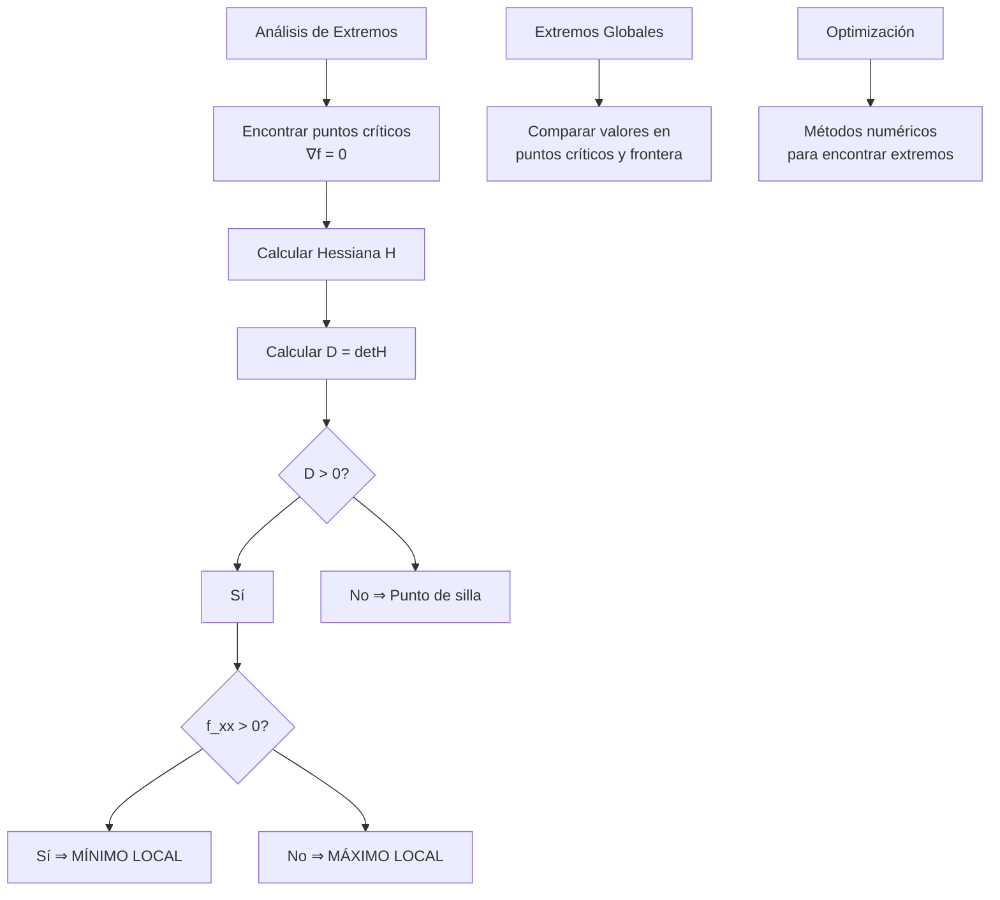
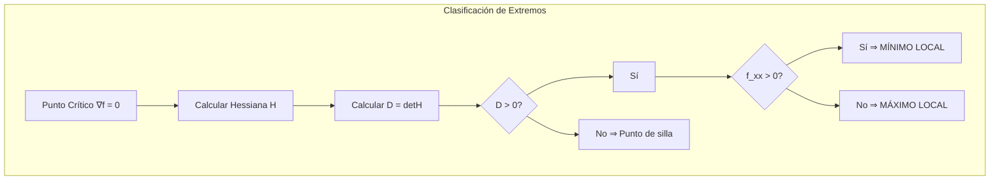
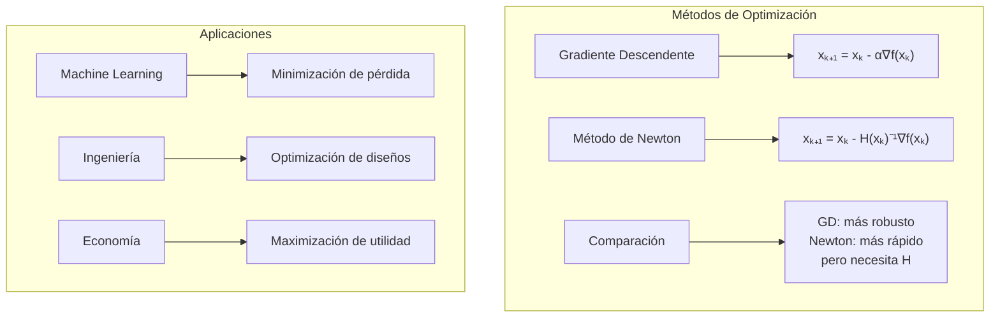

# Matemáticas para Ciencias Aplicadas II - Máximos y mínimos

## 5.3 Máximos y mínimos.

---

### 1. Conceptos Fundamentales de Extremos

#### 1.1 Definiciones Básicas

Un **máximo local** de una función $ f: \mathbb{R}^n \rightarrow \mathbb{R} $ en $ \vec{a} $ existe si:

$$ f(\vec{a}) \geq f(\vec{x}) \quad \text{para todo } \vec{x} \text{ en una vecindad de } \vec{a} $$

Un **mínimo local** de $f$ en $\vec{a}$ existe si:

$$ f(\vec{a}) \leq f(\vec{x}) \quad \text{para todo } \vec{x} \text{ en una vecindad de } \vec{a} $$

#### 1.2 Extremos Globales vs Locales

- **Extremo local**: Valor óptimo en una región pequeña
- **Extremo global**: Valor óptimo en todo el dominio
- **Punto crítico**: Donde $\nabla f = \vec{0}$ o $\nabla f$ no existe

### 2. Condiciones para Extremos

#### 2.1 Condición Necesaria (Primer Orden)

Si $f$ es diferenciable en $\vec{a}$ y $\vec{a}$ es extremo local, entonces:

$$ \nabla f(\vec{a}) = \vec{0} $$

#### 2.2 Condición Suficiente (Segundo Orden)

Para $f: \mathbb{R}^2 \rightarrow \mathbb{R}$, sea $D = f_{xx}f_{yy} - (f_{xy})^2$:

- $D > 0$ y $f_{xx} > 0$ ⇒ **Mínimo local**
- $D > 0$ y $f_{xx} < 0$ ⇒ **Máximo local**
- $D < 0$ ⇒ **Punto de silla**
- $D = 0$ ⇒ **Prueba no concluyente**



### 3. Métodos de Optimización

#### 3.1 Método del Gradiente Descendente

Iteración para encontrar mínimos:

$$ \vec{x}_{k+1} = \vec{x}_k - \alpha \nabla f(\vec{x}_k) $$

donde $\alpha$ es la tasa de aprendizaje.

#### 3.2 Método de Newton

Iteración para optimización:

$$ \vec{x}_{k+1} = \vec{x}_k - H_f^{-1}(\vec{x}_k) \nabla f(\vec{x}_k) $$

### 4. Implementación Computacional

```python
import numpy as np
from scipy import optimize
import matplotlib.pyplot as plt
from mpl_toolkits.mplot3d import Axes3D
from matplotlib import cm

class OptimizacionExtremos:
    def __init__(self, funcion):
        self.funcion = funcion

    def gradiente(self, punto, h=1e-6):
        """Calcula el gradiente numéricamente"""
        punto = np.array(punto, dtype=float)
        n = len(punto)
        grad = np.zeros(n)

        for i in range(n):
            punto_plus = punto.copy()
            punto_minus = punto.copy()
            punto_plus[i] += h
            punto_minus[i] -= h

            f_plus = self.funcion(*punto_plus)
            f_minus = self.funcion(*punto_minus)

            grad[i] = (f_plus - f_minus) / (2 * h)

        return grad

    def hessiana(self, punto, h=1e-4):
        """Calcula la matriz Hessiana numéricamente"""
        punto = np.array(punto, dtype=float)   # con enteros, punto[i] += h no cambiaría nada
        n = len(punto)
        hess = np.zeros((n, n))

        for i in range(n):
            for j in range(n):
                # Aproximación de segunda derivada
                punto_pp = punto.copy(); punto_pp[i] += h; punto_pp[j] += h
                punto_pm = punto.copy(); punto_pm[i] += h; punto_pm[j] -= h
                punto_mp = punto.copy(); punto_mp[i] -= h; punto_mp[j] += h
                punto_mm = punto.copy(); punto_mm[i] -= h; punto_mm[j] -= h

                f_pp = self.funcion(*punto_pp)
                f_pm = self.funcion(*punto_pm)
                f_mp = self.funcion(*punto_mp)
                f_mm = self.funcion(*punto_mm)

                hess[i, j] = (f_pp - f_pm - f_mp + f_mm) / (4 * h**2)

        return hess

    def encontrar_extremos(self, dominio, num_inicios=8, tol=1e-4):
        """
        Encuentra y clasifica los puntos críticos resolviendo ∇f = 0 con
        optimize.root desde una rejilla de puntos iniciales. Muestrear puntos
        al azar y quedarse con los de gradiente casi nulo casi nunca encuentra
        alguno, porque esos puntos son aislados.
        """
        x_min, x_max, y_min, y_max = dominio
        puntos_criticos = []

        for x0 in np.linspace(x_min, x_max, num_inicios):
            for y0 in np.linspace(y_min, y_max, num_inicios):
                sol = optimize.root(self.gradiente, [x0, y0])
                punto = sol.x
                dentro = x_min <= punto[0] <= x_max and y_min <= punto[1] <= y_max
                if not (sol.success and dentro) or np.linalg.norm(self.gradiente(punto)) > tol:
                    continue
                # Evitar duplicados
                if any(np.linalg.norm(punto - pc['punto']) < 1e-3 for pc in puntos_criticos):
                    continue
                clasificacion, det, valor = self.clasificar_punto(punto)
                puntos_criticos.append({
                    'punto': punto,
                    'clasificacion': clasificacion,
                    'determinante': det,
                    'valor': valor
                })

        return puntos_criticos

    def clasificar_punto(self, punto):
        """Clasifica un punto crítico"""
        hess = self.hessiana(punto)
        f_xx = hess[0, 0]
        f_yy = hess[1, 1]
        f_xy = hess[0, 1]

        D = f_xx * f_yy - f_xy**2
        valor = self.funcion(*punto)

        if D > 0:
            if f_xx > 0:
                return "Mínimo local", D, valor
            else:
                return "Máximo local", D, valor
        elif D < 0:
            return "Punto de silla", D, valor
        else:
            return "Indeterminado", D, valor

    def gradiente_descendente(self, punto_inicial, alpha=0.1, max_iter=1000, tol=1e-6):
        """Algoritmo de gradiente descendente para minimización"""
        punto_actual = np.array(punto_inicial, dtype=float)
        historial = [punto_actual.copy()]
        valores = [self.funcion(*punto_actual)]

        for i in range(max_iter):
            grad = self.gradiente(punto_actual)

            if np.linalg.norm(grad) < tol:
                break

            punto_actual = punto_actual - alpha * grad
            historial.append(punto_actual.copy())
            valores.append(self.funcion(*punto_actual))

        return punto_actual, historial, valores

    def metodo_newton(self, punto_inicial, max_iter=100, tol=1e-6):
        """Método de Newton para optimización"""
        punto_actual = np.array(punto_inicial, dtype=float)
        historial = [punto_actual.copy()]

        for i in range(max_iter):
            grad = self.gradiente(punto_actual)
            hess = self.hessiana(punto_actual)

            if np.linalg.norm(grad) < tol:
                break

            try:
                paso = np.linalg.solve(hess, -grad)
                punto_actual += paso
                historial.append(punto_actual.copy())
            except np.linalg.LinAlgError:
                break

        return punto_actual, historial

    def visualizar_optimizacion(self, dominio, historial, titulo):
        """Visualiza el proceso de optimización"""
        x_min, x_max, y_min, y_max = dominio
        x = np.linspace(x_min, x_max, 50)
        y = np.linspace(y_min, y_max, 50)
        X, Y = np.meshgrid(x, y)

        Z = np.zeros_like(X)
        for i in range(len(x)):
            for j in range(len(y)):
                Z[i, j] = self.funcion(X[i, j], Y[i, j])

        fig, axes = plt.subplots(1, 2, figsize=(15, 6))

        # Contorno y trayectoria
        ax = axes[0]
        contour = ax.contour(X, Y, Z, levels=20, cmap='viridis', alpha=0.6)
        ax.clabel(contour, inline=True, fontsize=8)

        historial = np.array(historial)
        ax.plot(historial[:, 0], historial[:, 1], 'ro-', markersize=4, linewidth=1)
        ax.scatter(historial[0, 0], historial[0, 1], color='green', s=100, label='Inicio')
        ax.scatter(historial[-1, 0], historial[-1, 1], color='red', s=100, label='Final')

        ax.set_xlabel('X')
        ax.set_ylabel('Y')
        ax.set_title(f'{titulo} - Trayectoria')
        ax.legend()
        ax.grid(True, alpha=0.3)

        # Superficie 3D
        ax = axes[1]
        if hasattr(ax, 'plot_surface'):
            surf = ax.plot_surface(X, Y, Z, cmap='viridis', alpha=0.7)

            # Calcular valores Z para la trayectoria
            z_vals = [self.funcion(*p) for p in historial]
            ax.plot(historial[:, 0], historial[:, 1], z_vals, 'ro-', markersize=4)

            ax.set_xlabel('X')
            ax.set_ylabel('Y')
            ax.set_zlabel('Z')
            ax.set_title(f'{titulo} - Superficie')

        plt.tight_layout()
        plt.show()

    def analizar_completo(self, dominio):
        """Análisis completo de extremos"""
        print("=== ANÁLISIS COMPLETO DE EXTREMOS ===")

        # Encontrar extremos locales
        extremos = self.encontrar_extremos(dominio)

        print("\nEXTREMOS LOCALES ENCONTRADOS:")
        for i, extremo in enumerate(extremos):
            print(f"\nExtremo {i+1}:")
            print(f"  Punto: ({extremo['punto'][0]:.4f}, {extremo['punto'][1]:.4f})")
            print(f"  Tipo: {extremo['clasificacion']}")
            print(f"  Valor: {extremo['valor']:.4f}")
            print(f"  Determinante: {extremo['determinante']:.4f}")

        # Menor y mayor valor ENTRE LOS PUNTOS CRÍTICOS. No son necesariamente
        # los extremos globales en el dominio: falta comparar con la frontera,
        # donde f puede ser mayor o menor (por ejemplo, x² - y² no tiene ningún
        # extremo local, pero en el cuadrado alcanza su máximo en la frontera)
        if not extremos:
            print("\nNo se encontraron puntos críticos en el dominio")
            return extremos
        menor = min(extremos, key=lambda x: x['valor'])
        mayor = max(extremos, key=lambda x: x['valor'])

        print(f"\nMENOR VALOR ENTRE PUNTOS CRÍTICOS: {menor['punto']}, Valor: {menor['valor']:.4f}")
        print(f"MAYOR VALOR ENTRE PUNTOS CRÍTICOS: {mayor['punto']}, Valor: {mayor['valor']:.4f}")

        return extremos

# Funciones de ejemplo para optimización
def funcion_paraboloide(x, y):
    return x**2 + y**2

def funcion_silla(x, y):
    return x**2 - y**2

def funcion_rosenbrock(x, y):
    """Función de Rosenbrock - clásica en optimización"""
    return (1 - x)**2 + 100 * (y - x**2)**2

def funcion_himmelblau(x, y):
    """Función de Himmelblau - múltiples mínimos"""
    return (x**2 + y - 11)**2 + (x + y**2 - 7)**2

def funcion_compleja(x, y):
    return np.sin(x) * np.cos(y) + 0.1 * (x**2 + y**2)

# Ejemplos de uso
print("=== OPTIMIZACIÓN Y EXTREMOS ===")

# 1. Paraboloide (mínimo simple)
print("\n1. PARABOLOIDE: f(x,y) = x² + y²")
paraboloide = OptimizacionExtremos(funcion_paraboloide)
extremos = paraboloide.analizar_completo([-2, 2, -2, 2])

# Gradiente descendente
punto_optimo, historial, valores = paraboloide.gradiente_descendente([1.5, 1.5], alpha=0.1)
paraboloide.visualizar_optimizacion([-2, 2, -2, 2], historial, "Gradiente Descendente - Paraboloide")

# 2. Función de Rosenbrock (difícil de optimizar)
print("\n2. FUNCIÓN DE ROSENBROCK")
rosenbrock = OptimizacionExtremos(funcion_rosenbrock)
extremos = rosenbrock.analizar_completo([-2, 2, -1, 3])

# Método de Newton para Rosenbrock
punto_newton, hist_newton = rosenbrock.metodo_newton([0, 0])
rosenbrock.visualizar_optimizacion([-2, 2, -1, 3], hist_newton, "Método de Newton - Rosenbrock")

# 3. Función de Himmelblau (múltiples mínimos)
print("\n3. FUNCIÓN DE HIMMELBLAU")
himmelblau = OptimizacionExtremos(funcion_himmelblau)
extremos = himmelblau.analizar_completo([-5, 5, -5, 5])

# Probar diferentes puntos iniciales
puntos_iniciales = [[0,0], [3,3], [-3,-3], [3,-2], [-2,3]]
for i, punto_inicial in enumerate(puntos_iniciales):
    punto_opt, historial, valores = himmelblau.gradiente_descendente(punto_inicial, alpha=0.01)
    print(f"Punto inicial {punto_inicial} → Mínimo: {punto_opt}, Valor: {funcion_himmelblau(*punto_opt):.4f}")

# 4. Comparación de métodos
print("\n4. COMPARACIÓN DE MÉTODOS DE OPTIMIZACIÓN")
funcion = funcion_rosenbrock
optimizador = OptimizacionExtremos(funcion)

# Gradiente descendente
punto_gd, hist_gd, vals_gd = optimizador.gradiente_descendente([0, 0], alpha=0.001)
print(f"GD: {punto_gd}, Valor: {funcion(*punto_gd):.6f}, Iteraciones: {len(hist_gd)}")

# Método de Newton
punto_nt, hist_nt = optimizador.metodo_newton([0, 0])
print(f"Newton: {punto_nt}, Valor: {funcion(*punto_nt):.6f}, Iteraciones: {len(hist_nt)}")

# 5. Visualización de convergencia
plt.figure(figsize=(12, 5))
plt.subplot(1, 2, 1)
plt.plot(vals_gd, 'b-', linewidth=2)
plt.xlabel('Iteración')
plt.ylabel('Valor de la función')
plt.title('Convergencia - Gradiente Descendente')
plt.grid(True, alpha=0.3)

plt.subplot(1, 2, 2)
vals_nt = [funcion(*p) for p in hist_nt]
plt.plot(vals_nt, 'r-', linewidth=2)
plt.xlabel('Iteración')
plt.ylabel('Valor de la función')
plt.title('Convergencia - Método de Newton')
plt.grid(True, alpha=0.3)

plt.tight_layout()
plt.show()

# 6. Análisis de sensibilidad al paso de aprendizaje
print("\n6. ANÁLISIS DE SENSIBILIDAD AL LEARNING RATE")
alphas = [0.001, 0.01, 0.1, 0.5]
resultados = []

for alpha in alphas:
    punto_opt, historial, valores = optimizador.gradiente_descendente([0, 0], alpha=alpha)
    resultados.append({
        'alpha': alpha,
        'punto_optimo': punto_opt,
        'valor_optimo': funcion(*punto_opt),
        'iteraciones': len(historial),
        'convergio': len(historial) < 1000
    })

for res in resultados:
    print(f"α={res['alpha']}: {res['punto_optimo']}, Valor: {res['valor_optimo']:.6f}, Iter: {res['iteraciones']}")

# Con α = 0.001 el método avanza muy lento por el valle de Rosenbrock y no llega
# a (1, 1) en 1000 iteraciones. Con α >= 0.01 DIVERGE: cerca del valle la
# Hessiana tiene un valor propio de orden 10^3, y el gradiente descendente solo
# es estable si α < 2/λ_max. Newton, en cambio, llega a (1, 1) en pocos pasos.
```

### 5. Ejemplos y Ejercicios

#### Ejemplo 1: Paraboloide Simple

$$f(x,y) = x^2 + y^2$$

- **Mínimo global**: $(0,0)$ con valor $0$
- **Hessiana**: $\begin{bmatrix} 2 & 0 \\ 0 & 2 \end{bmatrix}$
- **Clasificación**: Mínimo local (y global)

#### Ejemplo 2: Función de Rosenbrock

$$f(x,y) = (1-x)^2 + 100(y-x^2)^2$$

- **Mínimo global**: $(1,1)$ con valor $0$
- **Valle curvo**: Dificulta la optimización
- **Prueba de algoritmos**: Clásica en optimización

#### Ejemplo 3: Función de Himmelblau

$$f(x,y) = (x^2 + y - 11)^2 + (x + y^2 - 7)^2$$

- **Cuatro mínimos locales**:
  - $(3.0, 2.0)$
  - $(-2.805, 3.131)$
  - $(-3.779, -3.283)$
  - $(3.584, -1.848)$
- **Valor**: $0$ en cada mínimo

#### Ejercicio 1:

Para $f(x,y) = x^4 + y^4 - 4xy + 1$:

1. Encontrar todos los puntos críticos
2. Clasificar cada punto como mínimo, máximo o silla
3. Aplicar gradiente descendente desde $(1,1)$
4. Comparar con el método de Newton

### 6. Aplicaciones Prácticas

#### 6.1 Machine Learning

- **Minimización de funciones de pérdida**
- **Entrenamiento de redes neuronales**
- **Ajuste de parámetros con gradiente descendente**

#### 6.2 Ingeniería y Física

- **Optimización de diseños**
- **Minimización de energía potencial**
- **Análisis de estabilidad en sistemas**

#### 6.3 Economía y Finanzas

- **Maximización de utilidad**
- **Minimización de costos**
- **Optimización de portafolios**

### 7. Teoremas Importantes

#### 7.1 Teorema de Fermat

Si $f$ tiene un extremo local en $\vec{a}$ y es diferenciable, entonces $\nabla f(\vec{a}) = \vec{0}$.

#### 7.2 Teorema del Valor Extremo

Si $f$ es continua en un conjunto compacto, entonces alcanza máximo y mínimo global.

#### 7.3 Condiciones de Karush-Kuhn-Tucker (KKT)

Extensión para optimización con restricciones.

### 8. Visualización de Conceptos





### 9. Casos Especiales

#### 9.1 Funciones Convexas

- Todo mínimo local es global; si la función es estrictamente convexa, el mínimo, si existe, es único
- Hessiana semidefinida positiva en todo punto, para funciones $C^2$
- Gradiente descendente con un paso adecuado converge a un mínimo global, cuando existe

#### 9.2 Funciones No Convexas

- Múltiples mínimos locales
- Puntos de silla
- Optimización más difícil

#### 9.3 Problemas de Gran Escala

- Gradiente estocástico (SGD)
- Métodos de minibatch
- Optimizadores adaptativos (Adam, RMSprop)

### 10. Recursos Adicionales

- "Numerical Optimization" por Jorge Nocedal
- "Convex Optimization" por Stephen Boyd
- "Deep Learning" por Ian Goodfellow
- Software: MATLAB Optimization Toolbox, SciPy
- Librerías Python: TensorFlow, PyTorch, Scikit-learn
- Tutoriales online de optimización
- Visualizaciones interactivas de funciones
