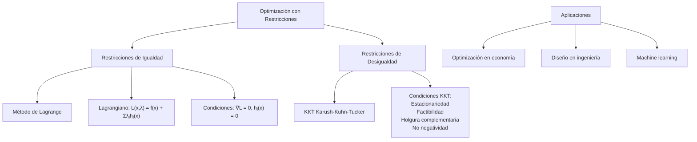
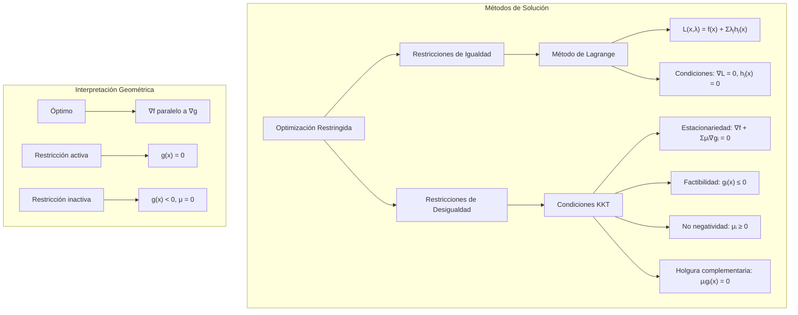

# Matemáticas para Ciencias Aplicadas II - Máximos y mínimos

## 5.4 Máximos y mínimos con restricciones.

---

### 1. Conceptos Fundamentales de Optimización con Restricciones

#### 1.1 Formulación del Problema

Dada una función objetivo $f: \mathbb{R}^n \rightarrow \mathbb{R}$ y restricciones $g_i: \mathbb{R}^n \rightarrow \mathbb{R}$, el problema es:

$$ \text{minimizar } f(\vec{x}) \quad \text{sujeto a} \quad g_i(\vec{x}) \leq 0, \quad i = 1, \ldots, m $$
$$ \text{y} \quad h_j(\vec{x}) = 0, \quad j = 1, \ldots, p $$

#### 1.2 Tipos de Restricciones

- **Restricciones de desigualdad**: $g_i(\vec{x}) \leq 0$
- **Restricciones de igualdad**: $h_j(\vec{x}) = 0$
- **Restricciones de caja**: $l_i \leq x_i \leq u_i$

### 2. Método de los Multiplicadores de Lagrange

#### 2.1 Formulación del Lagrangiano

Para restricciones de igualdad $h_j(\vec{x}) = 0$, el Lagrangiano es:

$$\mathcal{L}(\vec{x}, \vec{\lambda}) = f(\vec{x}) + \sum_{j=1}^p \lambda_j h_j(\vec{x})$$

#### 2.2 Condiciones Necesarias de Primer Orden

$$\nabla f(\vec{x}^*) + \sum_{j=1}^p \lambda_j^* \nabla h_j(\vec{x}^*) = \vec{0}$$
$$h_j(\vec{x}^*) = 0, \quad j = 1, \ldots, p$$



### 3. Condiciones KKT (Karush-Kuhn-Tucker)

#### 3.1 Formulación General

Para el problema con restricciones de desigualdad:

$$ \text{minimizar } f(\vec{x}) \quad \text{sujeto a} \quad g_i(\vec{x}) \leq 0, \quad i = 1, \ldots, m$$

#### 3.2 Condiciones KKT

1. **Estacionariedad**: $\nabla f(\vec{x}^*) + \sum_{i=1}^m \mu_i^* \nabla g_i(\vec{x}^*) = \vec{0}$
2. **Factibilidad primal**: $g_i(\vec{x}^*) \leq 0$
3. **Factibilidad dual**: $\mu_i^* \geq 0$
4. **Holgura complementaria**: $\mu_i^* g_i(\vec{x}^*) = 0$

### 4. Implementación Computacional

```python
import numpy as np
from scipy import optimize
from math import comb

def derivative(func, x0, dx=1e-5, n=1, order=None):
    """Derivada numérica de orden n por diferencias centrales.
    Sustituye a scipy.misc.derivative, que se eliminó en SciPy 1.12."""
    return sum((-1)**k * comb(n, k) * func(x0 + (n / 2 - k) * dx)
               for k in range(n + 1)) / dx**n
import matplotlib.pyplot as plt
from mpl_toolkits.mplot3d import Axes3D
import sympy as sp

class OptimizacionRestricciones:
    def __init__(self, funcion_objetivo):
        self.f_obj = funcion_objetivo

    def metodo_lagrange(self, restricciones_igualdad, punto_inicial, lambdas_iniciales):
        """Método de multiplicadores de Lagrange para restricciones de igualdad"""
        n_variables = len(punto_inicial)
        n_restricciones = len(restricciones_igualdad)

        def lagrangiano(variables):
            x = variables[:n_variables]
            lambdas = variables[n_variables:]
            L = self.f_obj(*x)
            for j in range(n_restricciones):
                L += lambdas[j] * restricciones_igualdad[j](*x)
            return L

        def ecuaciones(variables):
            x = variables[:n_variables]
            lambdas = variables[n_variables:]

            # Gradiente del Lagrangiano
            grad_L = np.zeros(n_variables + n_restricciones)

            # Derivadas parciales ∂L/∂x_i por diferencias centrales,
            # moviendo solo la coordenada i y dejando fijas las demás y las λ
            h = 1e-6
            for i in range(n_variables):
                e_i = np.zeros(n_variables + n_restricciones)
                e_i[i] = h
                grad_L[i] = (lagrangiano(variables + e_i) - lagrangiano(variables - e_i)) / (2 * h)

            # Restricciones de igualdad
            for j in range(n_restricciones):
                grad_L[n_variables + j] = restricciones_igualdad[j](*x)

            return grad_L

        # Resolver el sistema de ecuaciones
        solucion = optimize.root(ecuaciones, np.concatenate([punto_inicial, lambdas_iniciales]))
        if not solucion.success:
            raise RuntimeError("El sistema de Lagrange no convergió: " + solucion.message)
        # Ojo: la solución es un punto ESTACIONARIO del Lagrangiano; puede ser un
        # mínimo, un máximo o ninguno de los dos sobre la restricción
        x_opt = solucion.x[:n_variables]
        lambdas_opt = solucion.x[n_variables:]

        return x_opt, lambdas_opt

    def metodo_penalidad(self, restricciones, punto_inicial, mu=1.0, max_iter=100, tol=1e-6):
        """Método de penalidad cuadrática"""
        def funcion_penalizada(x, mu):
            penalty = 0.0
            for restriccion in restricciones:
                if restriccion['tipo'] == 'igualdad':
                    penalty += mu * (restriccion['func'](*x))**2
                elif restriccion['tipo'] == 'desigualdad':
                    penalty += mu * (max(0, restriccion['func'](*x)))**2
            return self.f_obj(*x) + penalty

        x_actual = np.array(punto_inicial)
        historial = [x_actual.copy()]

        for iteracion in range(max_iter):
            # Minimizar función penalizada
            resultado = optimize.minimize(lambda x: funcion_penalizada(x, mu), x_actual)
            x_actual = resultado.x
            historial.append(x_actual.copy())

            # Verificar factibilidad
            factible = True
            for restriccion in restricciones:
                if restriccion['tipo'] == 'igualdad':
                    if abs(restriccion['func'](*x_actual)) > tol:
                        factible = False
                elif restriccion['tipo'] == 'desigualdad':
                    if restriccion['func'](*x_actual) > tol:
                        factible = False

            if factible:
                break

            # Aumentar parámetro de penalidad
            mu *= 10

        return x_actual, historial

    def verificar_condiciones_kkt(self, x, restricciones_desigualdad, mu_tol=1e-6):
        """Verifica las condiciones KKT para un punto"""
        resultados = []

        # Calcular gradiente de f
        grad_f = np.zeros(len(x))
        for i in range(len(x)):
            def f_i(xi):
                x_temp = x.copy()
                x_temp[i] = xi
                return self.f_obj(*x_temp)
            grad_f[i] = derivative(f_i, x[i], dx=1e-6)

        for restriccion in restricciones_desigualdad:
            g = restriccion['func']
            g_val = g(*x)

            # Calcular gradiente de g
            grad_g = np.zeros(len(x))
            for i in range(len(x)):
                def g_i(xi):
                    x_temp = x.copy()
                    x_temp[i] = xi
                    return g(*x_temp)
                grad_g[i] = derivative(g_i, x[i], dx=1e-6)

            # Condición de holgura complementaria
            mu_estimado = 0.0
            if abs(g_val) < mu_tol:
                # Restricción activa, estimar multiplicador
                try:
                    # Resolver ∇f + μ∇g = 0
                    A = np.outer(grad_g, grad_g)
                    b = -np.dot(grad_f, grad_g)
                    mu_estimado = b / np.dot(grad_g, grad_g) if np.dot(grad_g, grad_g) > 1e-10 else 0.0
                except:
                    mu_estimado = 0.0

            resultados.append({
                'restriccion': restriccion['nombre'],
                'g(x)': g_val,
                'activa': g_val >= -mu_tol,
                'mu_estimado': max(0, mu_estimado),
                'violacion': max(0, g_val) if restriccion['tipo'] == 'desigualdad' else abs(g_val)
            })

        return resultados

    def visualizar_optimizacion_restringida(self, dominio, restricciones, historial=None):
        """Visualiza la región factible y el proceso de optimización"""
        x_min, x_max, y_min, y_max = dominio
        x = np.linspace(x_min, x_max, 100)
        y = np.linspace(y_min, y_max, 100)
        X, Y = np.meshgrid(x, y)

        # Evaluar función objetivo
        Z = np.zeros_like(X)
        for i in range(len(x)):
            for j in range(len(y)):
                Z[i, j] = self.f_obj(X[i, j], Y[i, j])

        # Crear máscara para región factible
        factible = np.ones_like(X, dtype=bool)
        for restriccion in restricciones:
            for i in range(len(x)):
                for j in range(len(y)):
                    if restriccion['tipo'] == 'desigualdad':
                        if restriccion['func'](X[i, j], Y[i, j]) > 0:
                            factible[i, j] = False
                    elif restriccion['tipo'] == 'igualdad':
                        if abs(restriccion['func'](X[i, j], Y[i, j])) > 0.1:
                            factible[i, j] = False

        fig, axes = plt.subplots(1, 2, figsize=(15, 6))

        # Gráfica de contorno con región factible
        ax = axes[0]
        contour = ax.contour(X, Y, Z, levels=20, cmap='viridis', alpha=0.6)
        ax.clabel(contour, inline=True, fontsize=8)

        # Sombrear región factible
        ax.contourf(X, Y, factible, levels=[0, 0.5], colors=['lightgray'], alpha=0.3)

        if historial is not None:
            historial = np.array(historial)
            ax.plot(historial[:, 0], historial[:, 1], 'ro-', markersize=4, linewidth=1)
            ax.scatter(historial[0, 0], historial[0, 1], color='green', s=100, label='Inicio')
            ax.scatter(historial[-1, 0], historial[-1, 1], color='red', s=100, label='Óptimo')

        ax.set_xlabel('X')
        ax.set_ylabel('Y')
        ax.set_title('Región Factible y Curvas de Nivel')
        ax.legend()
        ax.grid(True, alpha=0.3)

        # Gráfica 3D
        ax = axes[1]
        if hasattr(ax, 'plot_surface'):
            # Solo mostrar región factible en 3D
            Z_masked = np.ma.masked_where(~factible, Z)
            surf = ax.plot_surface(X, Y, Z_masked, cmap='viridis', alpha=0.7)

            if historial is not None:
                z_vals = [self.f_obj(*p) for p in historial]
                ax.plot(historial[:, 0], historial[:, 1], z_vals, 'ro-', markersize=4)

            ax.set_xlabel('X')
            ax.set_ylabel('Y')
            ax.set_zlabel('f(x,y)')
            ax.set_title('Función Objetivo en Región Factible')

        plt.tight_layout()
        plt.show()

    def resolver_scipy(self, restricciones, punto_inicial):
        """Resuelve usando los optimizadores de SciPy"""
        constraints = []

        for restriccion in restricciones:
            # r=restriccion fija la restricción de ESTA iteración: sin el argumento
            # por defecto, todas las lambdas usarían la última restricción del ciclo
            if restriccion['tipo'] == 'igualdad':
                constraints.append({
                    'type': 'eq',
                    'fun': lambda x, r=restriccion: r['func'](*x)   # SciPy pasa un arreglo x
                })
            elif restriccion['tipo'] == 'desigualdad':
                constraints.append({
                    'type': 'ineq',
                    'fun': lambda x, r=restriccion: -r['func'](*x)  # SciPy usa g(x) >= 0
                })

        resultado = optimize.minimize(
            lambda x: self.f_obj(*x),
            punto_inicial,
            constraints=constraints,
            method='SLSQP'
        )

        return resultado.x, resultado.fun

# Funciones de ejemplo y restricciones
def funcion_objetivo_1(x, y):
    return x**2 + y**2

def funcion_objetivo_2(x, y):
    return (x-1)**2 + (y-2)**2

def funcion_objetivo_3(x, y):
    return np.sin(x) * np.cos(y) + 0.1*(x**2 + y**2)

# Restricciones
def restriccion_circulo(x, y):
    return x**2 + y**2 - 1  # x² + y² ≤ 1

def restriccion_lineal(x, y):
    return x + y - 1.5  # x + y ≤ 1.5

def restriccion_igualdad(x, y):
    return x - y  # x = y

# Ejemplos de uso
print("=== OPTIMIZACIÓN CON RESTRICCIONES ===")

# 1. Minimizar x² + y² sujeto a x² + y² ≤ 1
print("\n1. MÍNIMO EN CÍRCULO UNITARIO")
optimizador = OptimizacionRestricciones(funcion_objetivo_1)

restricciones = [
    {'tipo': 'desigualdad', 'func': restriccion_circulo, 'nombre': 'Círculo unitario'}
]

# Usar método de penalidad
x_opt, historial = optimizador.metodo_penalidad(restricciones, [2.0, 2.0], mu=1.0)
print(f"Solución: ({x_opt[0]:.4f}, {x_opt[1]:.4f})")
print(f"Valor óptimo: {funcion_objetivo_1(*x_opt):.4f}")

# Verificar condiciones KKT
condiciones = optimizador.verificar_condiciones_kkt(x_opt, restricciones)
for cond in condiciones:
    print(f"Restricción {cond['restriccion']}: g(x)={cond['g(x)']:.4f}, μ={cond['mu_estimado']:.4f}")

optimizador.visualizar_optimizacion_restringida([-2, 2, -2, 2], restricciones, historial)

# 2. Problema con múltiples restricciones
print("\n2. MÚLTIPLES RESTRICCIONES")
optimizador2 = OptimizacionRestricciones(funcion_objetivo_2)

restricciones2 = [
    {'tipo': 'desigualdad', 'func': restriccion_circulo, 'nombre': 'Círculo'},
    {'tipo': 'desigualdad', 'func': restriccion_lineal, 'nombre': 'Lineal'},
    {'tipo': 'igualdad', 'func': restriccion_igualdad, 'nombre': 'x = y'}
]

x_opt2, historial2 = optimizador2.metodo_penalidad(restricciones2, [0.5, 0.5])
print(f"Solución: ({x_opt2[0]:.4f}, {x_opt2[1]:.4f})")
print(f"Valor óptimo: {funcion_objetivo_2(*x_opt2):.4f}")

# 3. Usando SciPy
print("\n3. SOLUCIÓN CON SCIPY")
x_opt_scipy, f_opt = optimizador2.resolver_scipy(restricciones2, [0.5, 0.5])
print(f"Solución SciPy: ({x_opt_scipy[0]:.4f}, {x_opt_scipy[1]:.4f})")
print(f"Valor óptimo: {f_opt:.4f}")

# 4. Método de Lagrange para restricciones de igualdad
print("\n4. MÉTODO DE LAGRANGE")
def restriccion_igualdad2(x, y):
    return x**2 + y**2 - 1  # x² + y² = 1

# Punto de la circunferencia unitaria más cercano a (1, 2): la respuesta exacta
# es (1, 2)/√5 ≈ (0.4472, 0.8944), con λ = √5 - 1 ≈ 1.2361
optimizador3 = OptimizacionRestricciones(funcion_objetivo_2)
x_opt_lagrange, lambdas = optimizador3.metodo_lagrange(
    [restriccion_igualdad2], [0.5, 0.5], [1.0]
)
print(f"Solución Lagrange: ({x_opt_lagrange[0]:.4f}, {x_opt_lagrange[1]:.4f})")
print(f"Multiplicadores: {lambdas}")
print(f"Valor óptimo: {funcion_objetivo_2(*x_opt_lagrange):.4f}")   # (√5 - 1)² ≈ 1.5279

# 5. Análisis de sensibilidad
print("\n5. ANÁLISIS DE SENSIBILIDAD")
print("Los multiplicadores de Lagrange indican la sensibilidad")
# Con L = f + λh, si la restricción h(x) = 0 se cambia por h(x) = ε,
# el valor óptimo cambia aproximadamente en -λε
print(f"λ = {lambdas[0]:.4f} significa que si la restricción pasa a h(x) = ε,")
print(f"el valor óptimo cambiará aproximadamente en {-lambdas[0]:.4f}ε")
```

### 5. Ejemplos y Ejercicios

#### Ejemplo 1: Optimización en Círculo Unitario

$$ \text{minimizar } x^2 + y^2 \quad \text{sujeto a} \quad x^2 + y^2 \leq 1$$

- **Solución**: $(0,0)$ con valor $0$
- **Multiplicador**: $\mu = 0$ (restricción inactiva)

#### Ejemplo 2: Optimización con Restricción Activa

$$ \text{minimizar } (x-1)^2 + (y-2)^2 \quad \text{sujeto a} \quad x + y \leq 1.5$$

- **Solución**: el centro $(1, 2)$ no cumple la restricción, porque $1 + 2 = 3 > 1.5$, así que el óptimo está sobre la recta $x + y = 1.5$: es la proyección de $(1, 2)$ sobre ella, $(1, 2) - \frac{3 - 1.5}{2}(1, 1) = (0.25, 1.25)$, con valor $0.75^2 + 0.75^2 = 1.125$
- **Multiplicador**: de $2(x - 1) + \mu = 0$ se obtiene $\mu = 1.5 > 0$ (restricción activa)

#### Ejemplo 3: Método de Lagrange

$$ \text{minimizar } x^2 + y^2 \quad \text{sujeto a} \quad x + y = 1$$

- **Lagrangiano**: $\mathcal{L} = x^2 + y^2 + \lambda(1 - x - y)$
- **Solución**: $(0.5, 0.5)$ con $\lambda = 1$

#### Ejercicio 1:

Para minimizar $x^2 + 2y^2$ sujeto a $x + y = 1$:

1. Plantear el Lagrangiano
2. Encontrar el punto óptimo y multiplicador
3. Interpretar el significado del multiplicador

### 6. Aplicaciones Prácticas

#### 6.1 Economía y Finanzas

- **Maximización de utilidad** con restricción presupuestaria
- **Optimización de portafolios** con restricciones de riesgo
- **Planificación de producción** con recursos limitados

#### 6.2 Ingeniería y Diseño

- **Diseño óptimo** con restricciones físicas
- **Minimización de peso** con restricciones de resistencia
- **Optimización de formas** con restricciones geométricas

#### 6.3 Machine Learning

- **Regularización** (L1, L2) como restricciones
- **Support Vector Machines** con restricciones de margen
- **Optimización con restricciones** en redes neuronales

### 7. Teoremas Importantes

#### 7.1 Teorema de Lagrange

Si $\vec{x}^*$ es un extremo local con restricciones $h_j(\vec{x}) = 0$ y los gradientes $\nabla h_j(\vec{x}^*)$ son linealmente independientes, existen multiplicadores con $\nabla f(\vec{x}^*) + \sum_j \lambda_j^* \nabla h_j(\vec{x}^*) = \vec{0}$. Con el Lagrangiano $f - \sum \lambda_j h_j$ el signo de los multiplicadores se invierte.

#### 7.2 Condiciones KKT

Generalización del método de Lagrange para restricciones de desigualdad.

#### 7.3 Dualidad en Optimización

Todo problema de optimización (primal) tiene un problema dual asociado.

### 8. Visualización de Conceptos



### 9. Casos Especiales

#### 9.1 Restricciones Lineales

- Programación lineal y cuadrática
- Métodos simplex y puntos interiores

#### 9.2 Restricciones No Lineales

- Métodos de penalidad y barrera
- Programación secuencial cuadrática (SQP)

#### 9.3 Problemas Convexos

- Todo mínimo local es global
- Dualidad fuerte, si además se cumple una condición de regularidad como la de Slater: existe un punto que cumple todas las desigualdades estrictamente
- Algoritmos eficientes

### 10. Recursos Adicionales

- "Nonlinear Programming" por Dimitri Bertsekas
- "Convex Optimization" por Stephen Boyd
- "Numerical Optimization" por Jorge Nocedal
- Software: MATLAB Optimization Toolbox, SciPy
- Librerías Python: CVXPY, Pyomo, CasADi
- Tutoriales online de optimización restringida
- Visualizaciones interactivas de regiones factibles
