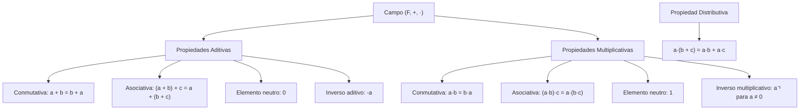
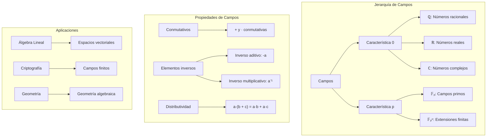

# Álgebra Lineal I - Espacios vectoriales

## 1.1 Campos.

---

### 1. Conceptos Fundamentales de Campos

#### 1.1 Definición de Campo

Un **campo** es una terna $(F, +, \cdot)$ donde $F$ es un conjunto y $+,$ $\cdot$ son operaciones binarias que satisfacen:

1. **Asociatividad**: $a + (b + c) = (a + b) + c$ y $a \cdot (b \cdot c) = (a \cdot b) \cdot c$
2. **Conmutatividad**: $a + b = b + a$ y $a \cdot b = b \cdot a$
3. **Elementos neutros**: $\exists 0, 1 \in F$ tal que $a + 0 = a$ y $a \cdot 1 = a$
4. **Elementos inversos**: $\forall a \in F, \exists (-a) \in F$ y $\forall a \neq 0, \exists a^{-1} \in F$
5. **Distributividad**: $a \cdot (b + c) = a \cdot b + a \cdot c$
6. **No trivialidad**: $0 \neq 1,$ así que un campo tiene al menos dos elementos

Las operaciones son **cerradas**: si $a, b \in F,$ entonces $a + b \in F$ y $a \cdot b \in F.$ Los axiomas valen para todos los $a, b, c \in F.$

#### 1.2 Ejemplos de Campos Comunes

- $\mathbb{R}:$ Números reales
- $\mathbb{C}:$ Números complejos
- $\mathbb{Q}:$ Números racionales
- $\mathbb{Z}_p:$ Enteros módulo p (con p primo)

### 2. Estructura Algebraica de los Campos

#### 2.1 Propiedades Básicas



#### 2.2 Subcampos

Un **subcampo** $K$ de un campo $F$ es un subconjunto que es, él mismo, un campo con las mismas operaciones. Basta verificar que $0, 1 \in K$ y que $K$ es cerrado bajo suma, producto, inversos aditivos e inversos multiplicativos de elementos no nulos. Por ejemplo, $\mathbb{Q}$ es subcampo de $\mathbb{R}$ y $\mathbb{R}$ es subcampo de $\mathbb{C}.$ En cambio, $\mathbb{Z}$ no es subcampo de $\mathbb{Q}$ porque $2^{-1} = \frac{1}{2} \notin \mathbb{Z}.$

### 3. Campos Finitos y Característica

#### 3.1 Campos Finitos $(\mathbb{F}_p)$

Para p primo, $\mathbb{F}_p = \{0, 1, 2, ..., p-1\}$ con operaciones módulo p.

**¿Por qué p debe ser primo?** Si $n = ab$ con $1 < a, b < n,$ entonces en $\mathbb{Z}_n$ se tiene $a \cdot b = 0$ con $a, b \neq 0.$ Pero en un campo eso es imposible: si $a \neq 0,$ multiplicando $ab = 0$ por $a^{-1}$ queda $b = 0.$ Por ejemplo, en $\mathbb{Z}_4$ se tiene $2 \cdot 2 = 0,$ y 2 no tiene inverso. Si $p$ es primo y $a \not\equiv 0,$ entonces $\gcd(a, p) = 1$ y la identidad de Bézout $ax + py = 1$ da el inverso $a^{-1} \equiv x \pmod{p}.$

**Campos finitos que no son de la forma** $\mathbb{Z}_n.$ Existe un campo con 4 elementos, $\mathbb{F}_4 = \{0, 1, \alpha, \alpha + 1\},$ donde las operaciones se hacen con coeficientes módulo 2 y la regla $\alpha^2 = \alpha + 1.$ Su tabla de multiplicación es

| $\cdot$ | $0$ | $1$ | $\alpha$ | $\alpha + 1$ |
| --- | --- | --- | --- | --- |
| $0$ | $0$ | $0$ | $0$ | $0$ |
| $1$ | $0$ | $1$ | $\alpha$ | $\alpha + 1$ |
| $\alpha$ | $0$ | $\alpha$ | $\alpha + 1$ | $1$ |
| $\alpha + 1$ | $0$ | $\alpha + 1$ | $1$ | $\alpha$ |

y todo elemento no nulo tiene inverso: $\alpha^{-1} = \alpha + 1.$ Así, $\mathbb{F}_4$ y $\mathbb{Z}_4$ tienen 4 elementos, pero solo el primero es campo.

#### 3.2 Característica de un Campo

La **característica** de un campo es el menor entero positivo $n$ tal que:

$$ \underbrace{1 + 1 + \cdots + 1}_{n \text{ veces}} = 0 $$

Si no existe tal $n,$ la característica es 0.

### 4. Implementación Computacional de Campos

```python
import numpy as np
from sympy import symbols, FF, factor, expand
import matplotlib.pyplot as plt
import cmath

class Campo:
    def __init__(self, caracteristica=0):
        self.caracteristica = caracteristica

    def verificar_axiomas(self, elementos, operacion_suma, operacion_mult):
        """Verifica los axiomas de campo para un conjunto dado"""
        resultados = {}

        # 1. Cerradura
        resultados['cerradura_suma'] = self._verificar_cerradura(elementos, operacion_suma)
        resultados['cerradura_mult'] = self._verificar_cerradura(elementos, operacion_mult)

        # 2. Asociatividad
        resultados['asociatividad_suma'] = self._verificar_asociatividad(elementos, operacion_suma)
        resultados['asociatividad_mult'] = self._verificar_asociatividad(elementos, operacion_mult)

        # 3. Conmutatividad
        resultados['conmutatividad_suma'] = self._verificar_conmutatividad(elementos, operacion_suma)
        resultados['conmutatividad_mult'] = self._verificar_conmutatividad(elementos, operacion_mult)

        # 4. Elementos neutros
        resultados['neutro_suma'] = self._verificar_neutro(elementos, operacion_suma, 0)
        resultados['neutro_mult'] = self._verificar_neutro(elementos, operacion_mult, 1)

        # 5. Elementos inversos
        resultados['inversos_suma'] = self._verificar_inversos_suma(elementos, operacion_suma)
        resultados['inversos_mult'] = self._verificar_inversos_mult(elementos, operacion_mult)

        # 6. Distributividad
        resultados['distributividad'] = self._verificar_distributividad(elementos, operacion_suma, operacion_mult)

        return resultados

    def _verificar_cerradura(self, elementos, operacion):
        """Verifica cerradura de una operación"""
        for a in elementos:
            for b in elementos:
                resultado = operacion(a, b)
                if resultado not in elementos:
                    return False
        return True

    def _verificar_asociatividad(self, elementos, operacion):
        """Verifica asociatividad"""
        for a in elementos:
            for b in elementos:
                for c in elementos:
                    if operacion(operacion(a, b), c) != operacion(a, operacion(b, c)):
                        return False
        return True

    def _verificar_conmutatividad(self, elementos, operacion):
        """Verifica conmutatividad"""
        for a in elementos:
            for b in elementos:
                if operacion(a, b) != operacion(b, a):
                    return False
        return True

    def _verificar_neutro(self, elementos, operacion, neutro):
        """Verifica existencia de elemento neutro"""
        if neutro not in elementos:
            return False
        for a in elementos:
            if operacion(a, neutro) != a:
                return False
        return True

    def _verificar_inversos_suma(self, elementos, operacion_suma):
        """Verifica inversos aditivos"""
        for a in elementos:
            encontrado = False
            for b in elementos:
                if operacion_suma(a, b) == 0:
                    encontrado = True
                    break
            if not encontrado:
                return False
        return True

    def _verificar_inversos_mult(self, elementos, operacion_mult):
        """Verifica inversos multiplicativos"""
        for a in elementos:
            if a == 0:
                continue
            encontrado = False
            for b in elementos:
                if operacion_mult(a, b) == 1:
                    encontrado = True
                    break
            if not encontrado:
                return False
        return True

    def _verificar_distributividad(self, elementos, operacion_suma, operacion_mult):
        """Verifica distributividad"""
        for a in elementos:
            for b in elementos:
                for c in elementos:
                    izquierda = operacion_mult(a, operacion_suma(b, c))
                    derecha = operacion_suma(operacion_mult(a, b), operacion_mult(a, c))
                    if izquierda != derecha:
                        return False
        return True

class CampoFinito:
    def __init__(self, p):
        if not self._es_primo(p):
            raise ValueError("Z_p solo es campo si p es primo (existen campos de p^n elementos, pero no son Z_{p^n})")
        self.p = p
        self.elementos = list(range(p))

    def _es_primo(self, n):
        """Verifica si un número es primo"""
        if n < 2:
            return False
        for i in range(2, int(np.sqrt(n)) + 1):
            if n % i == 0:
                return False
        return True

    def suma_mod(self, a, b):
        """Suma módulo p"""
        return (a + b) % self.p

    def mult_mod(self, a, b):
        """Multiplicación módulo p"""
        return (a * b) % self.p

    def inverso_aditivo(self, a):
        """Inverso aditivo módulo p"""
        return (-a) % self.p

    def inverso_multiplicativo(self, a):
        """Inverso multiplicativo módulo p"""
        if a == 0:
            raise ValueError("0 no tiene inverso multiplicativo")
        for x in range(1, self.p):
            if (a * x) % self.p == 1:
                return x
        return None

    def tablas_operaciones(self):
        """Genera tablas de suma y multiplicación"""
        print(f"Campo F_{self.p}")
        print("\nTabla de Suma:")
        print("+ | " + " ".join(f"{i:2}" for i in self.elementos))
        print("-" * (3 * (self.p + 1)))
        for i in self.elementos:
            fila = [self.suma_mod(i, j) for j in self.elementos]
            print(f"{i:1} | " + " ".join(f"{x:2}" for x in fila))

        print("\nTabla de Multiplicación:")
        print("× | " + " ".join(f"{i:2}" for i in self.elementos))
        print("-" * (3 * (self.p + 1)))
        for i in self.elementos:
            fila = [self.mult_mod(i, j) for j in self.elementos]
            print(f"{i:1} | " + " ".join(f"{x:2}" for x in fila))

    def visualizar_campo(self):
        """Visualización geométrica del campo (para campos pequeños)"""
        if self.p > 10:
            print("Visualización solo disponible para campos pequeños")
            return

        fig, axes = plt.subplots(1, 2, figsize=(12, 5))

        # Visualización de suma
        ax = axes[0]
        for i in self.elementos:
            for j in self.elementos:
                resultado = self.suma_mod(i, j)
                ax.plot([i], [j], 'o', markersize=10,
                       color=plt.cm.viridis(resultado / (self.p-1)))
                ax.text(i, j, str(resultado), ha='center', va='center', fontweight='bold')

        ax.set_xlabel('Primer sumando')
        ax.set_ylabel('Segundo sumando')
        ax.set_title(f'Suma en F_{self.p}')
        ax.set_xlim(-0.5, self.p-0.5)
        ax.set_ylim(-0.5, self.p-0.5)
        ax.grid(True, alpha=0.3)

        # Visualización de multiplicación
        ax = axes[1]
        for i in self.elementos:
            if i == 0:
                continue
            for j in self.elementos:
                if j == 0:
                    continue
                resultado = self.mult_mod(i, j)
                ax.plot([i], [j], 'o', markersize=10,
                       color=plt.cm.plasma(resultado / (self.p-1)))
                ax.text(i, j, str(resultado), ha='center', va='center', fontweight='bold')

        ax.set_xlabel('Primer factor')
        ax.set_ylabel('Segundo factor')
        ax.set_title(f'Multiplicación en F_{self.p} (excluyendo 0)')
        ax.set_xlim(0.5, self.p-0.5)
        ax.set_ylim(0.5, self.p-0.5)
        ax.grid(True, alpha=0.3)

        plt.tight_layout()
        plt.show()

# Ejemplos de uso
print("=== ANÁLISIS DE CAMPOS ===")

# 1. Campo de los números reales (característica 0)
# Ojo: con un subconjunto finito de ℝ solo se pueden comprobar las identidades
# (asociatividad, conmutatividad, distributividad) en esos elementos; la
# cerradura y los inversos fallan porque, por ejemplo, 2 + 2 = 4 no está en la
# lista. Eso NO significa que ℝ no sea campo: ℝ es infinito y no cabe en la prueba.
print("\n1. CAMPO DE LOS NÚMEROS REALES ℝ (muestra finita)")
campo_real = Campo(caracteristica=0)

def suma_real(a, b):
    return a + b

def mult_real(a, b):
    return a * b

elementos_reales = [0, 1, -1, 2, -2, 0.5, -0.5]
resultados_real = campo_real.verificar_axiomas(elementos_reales, suma_real, mult_real)
for propiedad, valor in resultados_real.items():
    print(f"{propiedad}: {valor}")

# 2. Campo finito F₅
print("\n2. CAMPO FINITO F₅")
campo_f5 = CampoFinito(5)
campo_f5.tablas_operaciones()

# Verificar axiomas para F₅
resultados_f5 = campo_real.verificar_axiomas(
    campo_f5.elementos,
    campo_f5.suma_mod,
    campo_f5.mult_mod
)
print("\nVerificación de axiomas para F₅:")
for propiedad, valor in resultados_f5.items():
    print(f"{propiedad}: {valor}")

# Visualizar F₅
campo_f5.visualizar_campo()

# 3. Campo de los números complejos ℂ
print("\n3. CAMPO DE LOS NÚMEROS COMPLEJOS ℂ")
def suma_compleja(a, b):
    return a + b

def mult_compleja(a, b):
    return a * b

elementos_complejos = [0, 1, -1, 1j, -1j, 1+1j, 1-1j]
resultados_complejos = campo_real.verificar_axiomas(elementos_complejos, suma_compleja, mult_compleja)
for propiedad, valor in resultados_complejos.items():
    print(f"{propiedad}: {valor}")

# 4. Campo F₂ (el campo más pequeño)
print("\n4. CAMPO FINITO F₂")
campo_f2 = CampoFinito(2)
campo_f2.tablas_operaciones()

# 5. Verificar que ℤ₄ no es un campo
print("\n5. ℤ₄ NO ES UN CAMPO (4 no es primo)")
try:
    campo_z4 = CampoFinito(4)
except ValueError as e:
    print(f"Error: {e}")

# Demostración de por qué ℤ₄ no es campo
elementos_z4 = [0, 1, 2, 3]
def suma_mod4(a, b):
    return (a + b) % 4

def mult_mod4(a, b):
    return (a * b) % 4

resultados_z4 = campo_real.verificar_axiomas(elementos_z4, suma_mod4, mult_mod4)
print("Verificación de ℤ₄:")
for propiedad, valor in resultados_z4.items():
    print(f"{propiedad}: {valor}")

# 6. Característica de campos
print("\n6. CARACTERÍSTICA DE CAMPOS")
def caracteristica_campo(elementos, operacion_suma):
    """Determina la característica de un campo"""
    n = len(elementos)
    for i in range(1, n+1):
        suma = 0
        for _ in range(i):
            suma = operacion_suma(suma, 1)
        if suma == 0:
            return i
    return 0

print(f"Característica de F₅: {caracteristica_campo(campo_f5.elementos, campo_f5.suma_mod)}")
print(f"Característica de ℝ: {caracteristica_campo([0, 1], suma_real)}")

# 7. Subcampos de un campo finito: en F₅ el único subcampo es F₅ mismo,
# porque un subcampo contiene a 1 y por cerradura a 1 + 1 + ... = todos los elementos
print("\n7. SUBCAMPOS")
def es_subcampo(K, campo):
    if 0 not in K or 1 not in K:
        return False
    return (campo._verificar_cerradura(K, campo_f5.suma_mod)
            and campo._verificar_cerradura(K, campo_f5.mult_mod)
            and campo._verificar_inversos_suma(K, campo_f5.suma_mod)
            and campo._verificar_inversos_mult(K, campo_f5.mult_mod))

print("¿{0, 1} es subcampo de F₅?", es_subcampo([0, 1], campo_real))           # False: 1 + 1 = 2
print("¿F₅ es subcampo de F₅?", es_subcampo(campo_f5.elementos, campo_real))   # True
```

### 5. Ejemplos y Ejercicios

#### Ejemplo 1: Campo $\mathbb{F}_2$

- Elementos: $\{0, 1\}$
- Suma: $0+0=0,$ $0+1=1,$ $1+0=1,$ $1+1=0$
- Multiplicación: $0\cdot0=0,$ $0\cdot1=0,$ $1\cdot0=0,$ $1\cdot1=1$

#### Ejemplo 2: Campo $\mathbb{F}_5$

- Elementos: $\{0, 1, 2, 3, 4\}$
- Inverso multiplicativo de 2: $2 \cdot 3 = 6 \equiv 1 \mod 5$

#### Ejemplo 3: Campo $\mathbb{C}$

- Elementos: $a + bi$ con $a, b \in \mathbb{R}$
- Inverso multiplicativo: $\frac{1}{a+bi} = \frac{a-bi}{a^2+b^2}$

#### Ejercicio 1:

Verificar que $\mathbb{F}_7$ es un campo encontrando:

1. Tablas de suma y multiplicación
2. Inversos multiplicativos de todos los elementos no nulos
3. Característica del campo

### 6. Aplicaciones de los Campos

#### 6.1 Teoría de Números

- Criptografía con campos finitos
- Teoría algebraica de números
- Curvas elípticas sobre campos finitos

#### 6.2 Álgebra Lineal

- Espacios vectoriales sobre campos arbitrarios
- Transformaciones lineales
- Valores y vectores propios

#### 6.3 Geometría Algebraica

- Variedades algebraicas sobre diferentes campos
- Teoría de campos de funciones
- Puntos racionales

### 7. Teoremas Importantes

#### 7.1 Teorema de Clasificación de Campos Finitos

Todo campo finito tiene $p^n$ elementos para algún primo $p$ y entero $n \geq 1.$ Recíprocamente, para cada potencia de primo $p^n$ existe un campo con $p^n$ elementos, único salvo isomorfismo. No hay, por ejemplo, campos con 6 o 10 elementos.

#### 7.2 Teorema del Elemento Primitivo

Toda extensión finita separable es simple.

#### 7.3 Teorema de Wedderburn

Todo anillo de división finito es un campo.

### 8. Visualización de Conceptos



### 9. Casos Especiales

#### 9.1 Campos de Característica Cero

- $\mathbb{Q},$ $\mathbb{R},$ $\mathbb{C}$
- Contienen una copia de $\mathbb{Q},$ así que se puede dividir entre cualquier entero no nulo
- Comportamiento similar a los números familiares

#### 9.2 Campos de Característica Prima

- $\mathbb{F}_p$ para p primo
- Comportamiento modular
- Aplicaciones en criptografía

#### 9.3 Campos Algebraicamente Cerrados

- $\mathbb{C}$ es algebraicamente cerrado
- Todo polinomio no constante con coeficientes en $\mathbb{C}$ tiene una raíz en $\mathbb{C}$ (teorema fundamental del álgebra)
- Fundamental en geometría algebraica

### 10. Recursos Adicionales

- "Abstract Algebra" por David S. Dummit
- "A First Course in Abstract Algebra" por John B. Fraleigh
- "Finite Fields" por Rudolf Lidl and Harald Niederreiter
- Software: SageMath, Mathematica, SymPy
- Librerías Python: SymPy, NumPy, Galois
- Tutoriales online de teoría de campos
- Visualizaciones interactivas de aritmética modular
