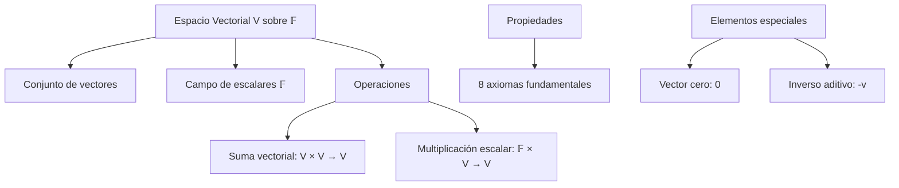
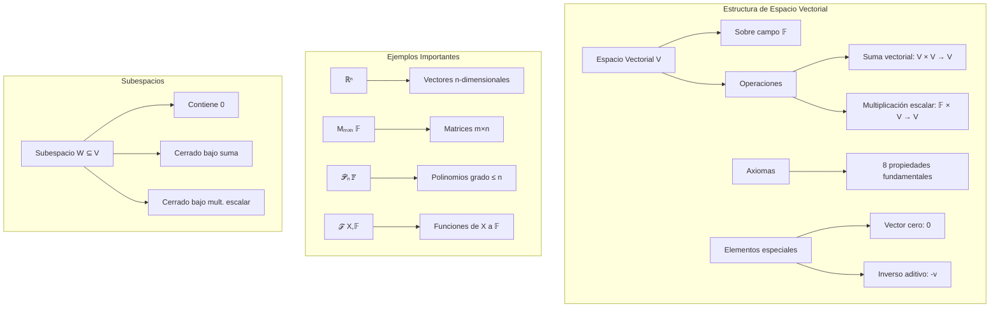

# Álgebra Lineal I - Espacios vectoriales

## 1.2 Espacios vectoriales.

---

### 1. Conceptos Fundamentales de Espacios Vectoriales

#### 1.1 Definición Formal

Un **espacio vectorial** sobre un campo $\mathbb{F}$ es un conjunto $V$ equipado con dos operaciones:

1. **Suma vectorial**: $+: V \times V \rightarrow V$
2. **Multiplicación por escalar**: $\cdot: \mathbb{F} \times V \rightarrow V$

que satisfacen los siguientes axiomas para todo $\vec{u}, \vec{v}, \vec{w} \in V$ y todo $\alpha, \beta \in \mathbb{F}$:

#### 1.2 Axiomas de Espacio Vectorial

1. **Conmutatividad**: $\vec{u} + \vec{v} = \vec{v} + \vec{u}$
2. **Asociatividad**: $(\vec{u} + \vec{v}) + \vec{w} = \vec{u} + (\vec{v} + \vec{w})$
3. **Elemento neutro**: $\exists \vec{0} \in V$ tal que $\vec{v} + \vec{0} = \vec{v}$
4. **Inverso aditivo**: $\forall \vec{v} \in V, \exists (-\vec{v}) \in V$ tal que $\vec{v} + (-\vec{v}) = \vec{0}$
5. **Distributividad**: $\alpha(\vec{u} + \vec{v}) = \alpha\vec{u} + \alpha\vec{v}$
6. **Distributividad**: $(\alpha + \beta)\vec{v} = \alpha\vec{v} + \beta\vec{v}$
7. **Compatibilidad**: $\alpha(\beta\vec{v}) = (\alpha\beta)\vec{v}$
8. **Identidad**: $1 \cdot \vec{v} = \vec{v}$

### 2. Estructura de los Espacios Vectoriales

#### 2.1 Componentes Fundamentales



#### 2.2 Ejemplos Clásicos de Espacios Vectoriales

1. $\mathbb{R}^n$: Vectores en dimensión n sobre $\mathbb{R}$
2. $\mathbb{C}^n$: Vectores complejos en dimensión n
3. $M_{m \times n}(\mathbb{F})$: Matrices de m×n sobre campo $\mathbb{F}$
4. $\mathcal{P}_n(\mathbb{F})$: Polinomios de grado ≤ n
5. $\mathcal{F}(X, \mathbb{F})$: Funciones de X a $\mathbb{F}$

### 3. Subespacios Vectoriales

#### 3.1 Definición de Subespacio

Un subconjunto $W \subseteq V$ es un **subespacio vectorial** si:

1. $\vec{0} \in W$
2. $\forall \vec{u}, \vec{v} \in W, \vec{u} + \vec{v} \in W$ (cerrado bajo suma)
3. $\forall \alpha \in \mathbb{F}, \forall \vec{v} \in W, \alpha\vec{v} \in W$ (cerrado bajo multiplicación escalar)

#### 3.2 Ejemplos de Subespacios

- $\{\vec{0}\}$: Subespacio trivial
- Líneas through el origen en $\mathbb{R}^2$
- Planos through el origen en $\mathbb{R}^3$
- Kernel e imagen de transformaciones lineales

### 4. Implementación Computacional

```python
import numpy as np
from sympy import symbols, Matrix, simplify
import matplotlib.pyplot as plt
from mpl_toolkits.mplot3d import Axes3D

class EspacioVectorial:
    def __init__(self, campo='real'):
        self.campo = campo
        self.vectores = []

    def verificar_axiomas(self, vectores, operacion_suma, operacion_mult_escalar, escalares):
        """Verifica los 8 axiomas de espacio vectorial"""
        resultados = {}

        # 1. Conmutatividad
        resultados['conmutatividad'] = self._verificar_conmutatividad(vectores, operacion_suma)

        # 2. Asociatividad
        resultados['asociatividad'] = self._verificar_asociatividad(vectores, operacion_suma)

        # 3. Elemento neutro
        resultados['elemento_neutro'] = self._verificar_elemento_neutro(vectores, operacion_suma)

        # 4. Inverso aditivo
        resultados['inverso_aditivo'] = self._verificar_inverso_aditivo(vectores, operacion_suma)

        # 5. Distributividad 1
        resultados['distributividad_1'] = self._verificar_distributividad_1(vectores, operacion_suma, operacion_mult_escalar, escalares)

        # 6. Distributividad 2
        resultados['distributividad_2'] = self._verificar_distributividad_2(vectores, operacion_mult_escalar, escalares)

        # 7. Compatibilidad
        resultados['compatibilidad'] = self._verificar_compatibilidad(vectores, operacion_mult_escalar, escalares)

        # 8. Identidad
        resultados['identidad'] = self._verificar_identidad(vectores, operacion_mult_escalar)

        return resultados

    def _verificar_conmutatividad(self, vectores, operacion_suma):
        for u in vectores:
            for v in vectores:
                if operacion_suma(u, v) != operacion_suma(v, u):
                    return False
        return True

    def _verificar_asociatividad(self, vectores, operacion_suma):
        for u in vectores:
            for v in vectores:
                for w in vectores:
                    left = operacion_suma(operacion_suma(u, v), w)
                    right = operacion_suma(u, operacion_suma(v, w))
                    if left != right:
                        return False
        return True

    def _verificar_elemento_neutro(self, vectores, operacion_suma):
        # Buscar vector cero
        for candidato in vectores:
            es_neutro = True
            for v in vectores:
                if operacion_suma(v, candidato) != v:
                    es_neutro = False
                    break
            if es_neutro:
                self.vector_cero = candidato
                return True
        return False

    def _verificar_inverso_aditivo(self, vectores, operacion_suma):
        for v in vectores:
            encontrado = False
            for w in vectores:
                if operacion_suma(v, w) == self.vector_cero:
                    encontrado = True
                    break
            if not encontrado:
                return False
        return True

    def _verificar_distributividad_1(self, vectores, operacion_suma, operacion_mult_escalar, escalares):
        for alpha in escalares:
            for u in vectores:
                for v in vectores:
                    left = operacion_mult_escalar(alpha, operacion_suma(u, v))
                    right = operacion_suma(operacion_mult_escalar(alpha, u), operacion_mult_escalar(alpha, v))
                    if left != right:
                        return False
        return True

    def _verificar_distributividad_2(self, vectores, operacion_mult_escalar, escalares):
        for alpha in escalares:
            for beta in escalares:
                for v in vectores:
                    left = operacion_mult_escalar(alpha + beta, v)
                    right = operacion_suma(operacion_mult_escalar(alpha, v), operacion_mult_escalar(beta, v))
                    if left != right:
                        return False
        return True

    def _verificar_compatibilidad(self, vectores, operacion_mult_escalar, escalares):
        for alpha in escalares:
            for beta in escalares:
                for v in vectores:
                    left = operacion_mult_escalar(alpha, operacion_mult_escalar(beta, v))
                    right = operacion_mult_escalar(alpha * beta, v)
                    if left != right:
                        return False
        return True

    def _verificar_identidad(self, vectores, operacion_mult_escalar):
        for v in vectores:
            if operacion_mult_escalar(1, v) != v:
                return False
        return True

class EspacioRn:
    def __init__(self, n):
        self.n = n
        self.vector_cero = np.zeros(n)

    def suma_vectores(self, u, v):
        return u + v

    def mult_escalar(self, alpha, v):
        return alpha * v

    def es_combinacion_lineal(self, vectores, v):
        """Verifica si v es combinación lineal de los vectores dados"""
        if len(vectores) == 0:
            return False

        # Construir matriz del sistema
        A = np.column_stack(vectores)

        try:
            # Resolver sistema A@x = v
            solucion = np.linalg.lstsq(A, v, rcond=None)[0]
            residual = np.linalg.norm(A @ solucion - v)
            return residual < 1e-10
        except np.linalg.LinAlgError:
            return False

    def generar_subespacio(self, vectores_generadores):
        """Genera todos los vectores del subespacio generado"""
        if not vectores_generadores:
            return [self.vector_cero]

        # Para espacios pequeños, generar combinaciones lineales
        subespacio = set()
        n = len(vectores_generadores)

        # Generar combinaciones con coeficientes enteros pequeños
        for coef in np.ndindex(*(3 for _ in range(n))):  # -1, 0, 1
            coef = np.array(coef) - 1  # Convertir a -1, 0, 1
            vector = sum(c * v for c, v in zip(coef, vectores_generadores))
            # Redondear para evitar errores numéricos
            vector = np.round(vector, 10)
            subespacio.add(tuple(vector))

        return [np.array(v) for v in subespacio]

    def visualizar_espacio_2d(self, vectores=None):
        """Visualización para R2"""
        if self.n != 2:
            print("Visualización solo disponible para R2")
            return

        fig, ax = plt.subplots(figsize=(10, 8))

        # Ejes
        ax.axhline(y=0, color='k', linestyle='-', alpha=0.3)
        ax.axvline(x=0, color='k', linestyle='-', alpha=0.3)
        ax.set_xlim(-3, 3)
        ax.set_ylim(-3, 3)
        ax.set_aspect('equal')

        # Vector cero
        ax.plot(0, 0, 'ko', markersize=8, label='Vector cero')

        # Vectores dados
        if vectores:
            for i, v in enumerate(vectores):
                ax.quiver(0, 0, v[0], v[1], angles='xy', scale_units='xy', scale=1,
                         color=f'C{i}', width=0.015, label=f'v{i+1} = {v}')

                # Generar subespacio
                subespacio = self.generar_subespacio([v])
                for w in subespacio:
                    if not np.allclose(w, [0, 0]):
                        ax.plot(w[0], w[1], 'o', color=f'C{i}', alpha=0.5, markersize=4)

        ax.legend()
        ax.set_title(f'Espacio Vectorial R²')
        ax.grid(True, alpha=0.3)
        plt.show()

    def visualizar_espacio_3d(self, vectores=None):
        """Visualización para R3"""
        if self.n != 3:
            print("Visualización solo disponible para R3")
            return

        fig = plt.figure(figsize=(12, 10))
        ax = fig.add_subplot(111, projection='3d')

        # Ejes
        ax.plot([0, 3], [0, 0], [0, 0], 'k-', alpha=0.3)
        ax.plot([0, 0], [0, 3], [0, 0], 'k-', alpha=0.3)
        ax.plot([0, 0], [0, 0], [0, 3], 'k-', alpha=0.3)

        # Vector cero
        ax.scatter([0], [0], [0], color='black', s=100, label='Vector cero')

        # Vectores dados
        if vectores:
            for i, v in enumerate(vectores):
                ax.quiver(0, 0, 0, v[0], v[1], v[2],
                         color=f'C{i}', arrow_length_ratio=0.1, linewidth=2,
                         label=f'v{i+1} = {v}')

        ax.set_xlim([-2, 2])
        ax.set_ylim([-2, 2])
        ax.set_zlim([-2, 2])
        ax.set_xlabel('X')
        ax.set_ylabel('Y')
        ax.set_zlabel('Z')
        ax.set_title('Espacio Vectorial R³')
        ax.legend()
        plt.show()

# Ejemplos de uso
print("=== ESPACIOS VECTORIALES ===")

# 1. Verificar que R² es espacio vectorial
print("\n1. R² COMO ESPACIO VECTORIAL")
espacio_r2 = EspacioRn(2)
vectores_r2 = [np.array([1, 0]), np.array([0, 1]), np.array([1, 1])]
escalares_r = [-1, 0, 1, 2]

resultados_r2 = espacio_r2.verificar_axiomas(
    vectores_r2,
    espacio_r2.suma_vectores,
    espacio_r2.mult_escalar,
    escalares_r
)

print("Axiomas verificados para R²:")
for axioma, cumple in resultados_r2.items():
    print(f"{axioma}: {cumple}")

# 2. Visualizar R²
espacio_r2.visualizar_espacio_2d(vectores_r2)

# 3. Verificar subespacios
print("\n2. SUBESPACIOS DE R²")
v1 = np.array([1, 2])
v2 = np.array([2, 4])

# Verificar si v2 es múltiplo de v1
print(f"v2 es combinación lineal de v1: {espacio_r2.es_combinacion_lineal([v1], v2)}")

# Generar subespacio
subespacio = espacio_r2.generar_subespacio([v1])
print(f"Subespacio generado por {v1}:")
for v in subespacio:
    print(f"  {v}")

# 4. Espacio de matrices 2x2
print("\n3. ESPACIO DE MATRICES 2x2")
def suma_matrices(A, B):
    return A + B

def mult_escalar_matriz(alpha, A):
    return alpha * A

# Matrices de ejemplo
matriz_cero = np.zeros((2, 2))
matriz_identidad = np.eye(2)
matriz_a = np.array([[1, 2], [3, 4]])
matriz_b = np.array([[0, 1], [1, 0]])

matrices = [matriz_cero, matriz_identidad, matriz_a, matriz_b]

espacio_matrices = EspacioVectorial()
resultados_matrices = espacio_matrices.verificar_axiomas(
    matrices, suma_matrices, mult_escalar_matriz, escalares_r
)

print("Axiomas verificados para M₂x₂:")
for axioma, cumple in resultados_matrices.items():
    print(f"{axioma}: {cumple}")

# 5. Espacio de polinomios de grado ≤ 2
print("\n4. ESPACIO DE POLINOMIOS P₂(x)")
x = symbols('x')
polinomios = [
    0,          # Polinomio cero
    1,          # Constante
    x,          # Lineal
    x**2,       # Cuadrático
    1 + x,      # Binomio
    1 + x + x**2 # Trinomio
]

def suma_polinomios(p, q):
    return p + q

def mult_escalar_polinomio(alpha, p):
    return alpha * p

espacio_polinomios = EspacioVectorial()
resultados_polinomios = espacio_polinomios.verificar_axiomas(
    polinomios, suma_polinomios, mult_escalar_polinomio, escalares_r
)

print("Axiomas verificados para P₂(x):")
for axioma, cumple in resultados_polinomios.items():
    print(f"{axioma}: {cumple}")

# 6. Espacio R³
print("\n5. ESPACIO R³")
espacio_r3 = EspacioRn(3)
vectores_r3 = [
    np.array([1, 0, 0]),
    np.array([0, 1, 0]),
    np.array([0, 0, 1]),
    np.array([1, 1, 1])
]

espacio_r3.visualizar_espacio_3d(vectores_r3)

# 7. Verificar si un conjunto es subespacio
print("\n6. VERIFICACIÓN DE SUBESPACIOS")
def es_subespacio(vectores, operacion_suma, operacion_mult_escalar):
    """Verifica si un conjunto de vectores forma un subespacio"""
    if len(vectores) == 0:
        return False

    # 1. Contiene el vector cero
    vector_cero = None
    for v in vectores:
        if np.allclose(v, 0):
            vector_cero = v
            break

    if vector_cero is None:
        return False

    # 2. Cerrado bajo suma
    for u in vectores:
        for v in vectores:
            suma = operacion_suma(u, v)
            encontrado = False
            for w in vectores:
                if np.allclose(suma, w):
                    encontrado = True
                    break
            if not encontrado:
                return False

    # 3. Cerrado bajo multiplicación escalar
    escalares = [-1, 0, 1, 2]
    for alpha in escalares:
        for v in vectores:
            mult = operacion_mult_escalar(alpha, v)
            encontrado = False
            for w in vectores:
                if np.allclose(mult, w):
                    encontrado = True
                    break
            if not encontrado:
                return False

    return True

# Ejemplo: ¿El conjunto {(x,y) en R² | y = 2x} es subespacio?
vectores_linea = [np.array([0, 0]), np.array([1, 2]), np.array([-1, -2]), np.array([2, 4])]
es_subesp = es_subespacio(vectores_linea, espacio_r2.suma_vectores, espacio_r2.mult_escalar)
print(f"El conjunto y = 2x es subespacio: {es_subesp}")
```

### 5. Ejemplos y Ejercicios

#### Ejemplo 1: $\mathbb{R}^2$ como Espacio Vectorial

- Vectores: $(x, y)$ con $x, y \in \mathbb{R}$
- Suma: $(x_1, y_1) + (x_2, y_2) = (x_1 + x_2, y_1 + y_2)$
- Multiplicación escalar: $\alpha(x, y) = (\alpha x, \alpha y)$

#### Ejemplo 2: Espacio de Matrices $M_{2 \times 2}$

- Vectores: Matrices $\begin{bmatrix} a & b \\ c & d \end{bmatrix}$
- Suma componente a componente
- Multiplicación escalar de cada componente

#### Ejemplo 3: Espacio de Polinomios $\mathcal{P}_2(\mathbb{R})$

- Vectores: $a + bx + cx^2$
- Suma de polinomios
- Multiplicación escalar de coeficientes

#### Ejercicio 1:

Verificar que el conjunto $\{(x, y, z) \in \mathbb{R}^3 | x + y + z = 0\}$ es un subespacio vectorial.

### 6. Aplicaciones de los Espacios Vectoriales

#### 6.1 Geometría Analítica

- Representación de puntos y vectores
- Transformaciones geométricas
- Sistemas de coordenadas

#### 6.2 Física e Ingeniería

- Espacios de estados en sistemas dinámicos
- Espacios de funciones en mecánica cuántica
- Análisis de señales y procesamiento de imágenes

#### 6.3 Ciencia de Datos

- Espacios de características en machine learning
- Reducción de dimensionalidad (PCA)
- Transformaciones lineales de datos

### 7. Teoremas Importantes

#### 7.1 Teorema de la Dimensión

Para cualquier espacio vectorial de dimensión finita, todas las bases tienen el mismo número de elementos.

#### 7.2 Teorema del Rango-Nulidad

Para una transformación lineal $T: V \rightarrow W$:

$$ \dim(V) = \dim(\ker(T)) + \dim(\operatorname{im}(T)) $$

#### 7.3 Teorema de Isomorfismo

Todo espacio vectorial de dimensión $n$ sobre $\mathbb{F}$ es isomorfo a $\mathbb{F}^n$.

### 8. Visualización de Conceptos



### 9. Casos Especiales

#### 9.1 Espacios de Dimensión Finita

- Tienen bases finitas
- $\mathbb{R}^n$, $M_{m \times n}$, $\mathcal{P}_n(\mathbb{F})$
- Comportamiento bien entendido

#### 9.2 Espacios de Dimensión Infinita

- $\mathcal{C}([a,b])$: Funciones continuas
- $\mathcal{L}^p$ espacios en análisis
- Espacios de Hilbert y Banach

#### 9.3 Espacios con Producto Interno

- Estructura adicional de producto interno
- Permiten definir ortogonalidad
- $\mathbb{R}^n$ con producto punto

### 10. Recursos Adicionales

- "Linear Algebra Done Right" por Sheldon Axler
- "Introduction to Linear Algebra" por Gilbert Strang
- "Álgebra Lineal" por Stanley Grossman
- Software: MATLAB, NumPy, SymPy
- Librerías Python: NumPy, SciPy, Matplotlib
- Tutoriales online de álgebra lineal
- Visualizaciones interactivas de espacios vectoriales
