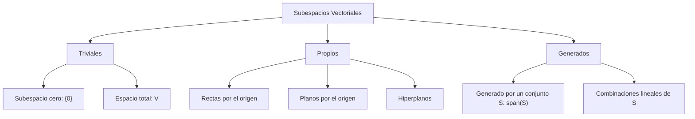
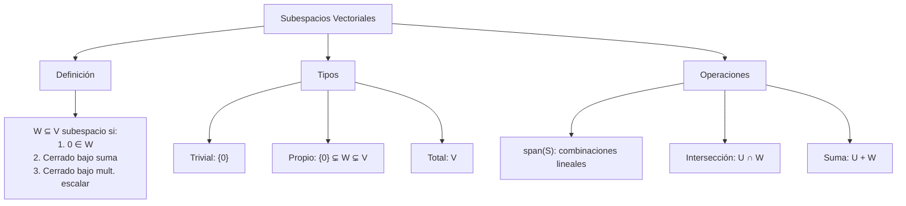
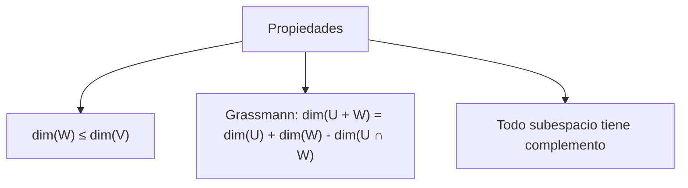

# Álgebra Lineal I - Espacios vectoriales

## 1.3 Subespacios vectoriales.

---

### 1. Conceptos Fundamentales de Subespacios Vectoriales

#### 1.1 Definición Formal

Un **subespacio vectorial** de un espacio vectorial $V$ sobre un campo $\mathbb{F}$ es un subconjunto $W \subseteq V$ que, con las mismas operaciones de $V,$ es él mismo un espacio vectorial. Basta verificar que:

1. **No vacío**: $W \neq \emptyset$
2. **Cerrado bajo suma**: $\forall \vec{u}, \vec{v} \in W, \vec{u} + \vec{v} \in W$
3. **Cerrado bajo multiplicación escalar**: $\forall \alpha \in \mathbb{F}, \forall \vec{v} \in W, \alpha\vec{v} \in W$

#### 1.2 Condiciones Equivalentes

Un subconjunto $W \subseteq V$ es subespacio si y solo si:

- $\vec{0} \in W$
- $\forall \alpha, \beta \in \mathbb{F}, \forall \vec{u}, \vec{v} \in W, \alpha\vec{u} + \beta\vec{v} \in W$

### 2. Tipos de Subespacios Vectoriales

#### 2.1 Subespacios Triviales

- **Subespacio cero**: $\{\vec{0}\}$
- **Subespacio total**: $V$ mismo

#### 2.2 Subespacios Propios

Subespacios diferentes de $\{\vec{0}\}$ y $V:$

- Rectas que pasan por el origen en $\mathbb{R}^2$
- Rectas y planos que pasan por el origen en $\mathbb{R}^3$
- Hiperplanos que pasan por el origen en $\mathbb{R}^n,$ de la forma $a_1x_1 + \cdots + a_nx_n = 0$

De hecho, los subespacios de $\mathbb{R}^2$ son exactamente $\{\vec{0}\},$ las rectas por el origen y $\mathbb{R}^2;$ los de $\mathbb{R}^3$ son $\{\vec{0}\},$ las rectas y los planos por el origen, y $\mathbb{R}^3.$



### 3. Subespacio Generado por un Conjunto

#### 3.1 Definición de Span

El **subespacio generado** por un conjunto $S = \{\vec{v}_1, \vec{v}_2, \ldots, \vec{v}_k\} \subseteq V$ es:

$$\operatorname{span}(S) = \{\alpha_1\vec{v}_1 + \alpha_2\vec{v}_2 + \cdots + \alpha_k\vec{v}_k \mid \alpha_i \in \mathbb{F}\}$$

#### 3.2 Propiedades del Span

- $\operatorname{span}(S)$ es el menor subespacio que contiene a $S:$ es un subespacio, y todo subespacio que contiene a $S$ contiene a todas sus combinaciones lineales
- Por convención, $\operatorname{span}(\emptyset) = \{\vec{0}\}$
- $S$ es conjunto generador de $\operatorname{span}(S)$
- Si $S \subseteq T,$ entonces $\operatorname{span}(S) \subseteq \operatorname{span}(T)$

### 4. Implementación Computacional

```python
import numpy as np
import sympy as sp

# Un subespacio de ℝⁿ distinto de {0} es INFINITO, así que no se puede guardar
# como lista de vectores: una lista finita como {(0,0), (1,2), (2,4)} nunca es
# cerrada bajo suma. Se trabaja con un conjunto GENERADOR y se usa el rango.

def dimension(generadores):
    """dim span(S) = rango de la matriz cuyas columnas son los vectores de S"""
    if len(generadores) == 0:
        return 0
    return sp.Matrix.hstack(*[sp.Matrix(v) for v in generadores]).rank()

def pertenece(v, generadores):
    """v ∈ span(S) si y solo si agregar v no aumenta el rango"""
    return dimension(list(generadores) + [v]) == dimension(generadores)

def base(generadores):
    """Extrae una base de span(S): las columnas pivote de la forma escalonada"""
    A = sp.Matrix.hstack(*[sp.Matrix(v) for v in generadores])
    _, pivotes = A.rref()
    return [generadores[j] for j in pivotes]

def interseccion(gen_U, gen_W):
    """U ∩ W: los vectores Σ aᵢuᵢ = Σ bⱼwⱼ salen del núcleo de [U | -W]"""
    U = sp.Matrix.hstack(*[sp.Matrix(u) for u in gen_U])
    W = sp.Matrix.hstack(*[sp.Matrix(w) for w in gen_W])
    nucleo = sp.Matrix.hstack(U, -W).nullspace()
    vectores = [U * n[:U.shape[1], :] for n in nucleo]
    return base(vectores) if vectores else []

def parece_subespacio(condicion, generar, n, pruebas=500, rng=np.random.default_rng(0)):
    """Prueba numérica (no demostración) de las tres condiciones de subespacio
    para un conjunto dado por una condición de pertenencia"""
    if not condicion(np.zeros(n)):
        return False
    for _ in range(pruebas):
        u, v, a = generar(rng), generar(rng), rng.normal()
        if not (condicion(u + v) and condicion(a * u)):
            return False
    return True

print("=== SUBESPACIOS VECTORIALES ===")

# 1. Subespacios en ℝ² dados por una condición
print("\n1. SUBESPACIOS EN ℝ²")
recta = lambda v: np.isclose(v[1], 2 * v[0])                       # y = 2x
gen_recta = lambda rng: rng.normal() * np.array([1.0, 2.0])
print("¿y = 2x es subespacio?", parece_subespacio(recta, gen_recta, 2))          # True
parabola = lambda v: np.isclose(v[1], v[0] ** 2)                    # y = x²
gen_parabola = lambda rng: np.array([t := rng.normal(), t ** 2])
print("¿y = x² es subespacio?", parece_subespacio(parabola, gen_parabola, 2))     # False

# 2. Span y dimensión
print("\n2. SPAN Y DIMENSIÓN")
S = [(1, 0), (0, 1)]
print("dim span{(1,0), (0,1)} =", dimension(S))                    # 2: es todo ℝ²
print("¿(3, -5) ∈ span{(1,0), (0,1)}?", pertenece((3, -5), S))      # True

# 3. Base de un subespacio generado por vectores dependientes
print("\n3. BASE Y DIMENSIÓN")
S = [(1, 2, 3), (2, 4, 6), (-1, -2, -3)]
print("Base:", base(S), " dimensión:", dimension(S))                # una recta: dim 1

# 4. Intersección del plano xy con el plano xz: el eje x
print("\n4. INTERSECCIÓN DE SUBESPACIOS")
xy = [(1, 0, 0), (0, 1, 0)]
xz = [(1, 0, 0), (0, 0, 1)]
I = interseccion(xy, xz)
print("Base de xy ∩ xz:", [list(v) for v in I])                     # [[1, 0, 0]]
# Grassmann: dim(U + W) = dim U + dim W - dim(U ∩ W) = 2 + 2 - 1 = 3
print("dim(xy + xz) =", dimension(xy + xz), "=", 2 + 2 - len(I))

# 5. Matrices simétricas 2x2: identificando [[a, b], [c, d]] con (a, b, c, d)
print("\n5. MATRICES SIMÉTRICAS 2x2")
simetrica = lambda v: np.isclose(v[1], v[2])                        # b = c
gen_sim = lambda rng: (lambda a, b, d: np.array([a, b, b, d]))(*rng.normal(size=3))
print("¿Las simétricas forman subespacio?", parece_subespacio(simetrica, gen_sim, 4))   # True
print("Dimensión:", dimension([(1, 0, 0, 0), (0, 1, 1, 0), (0, 0, 0, 1)]))             # 3

# 6. Polinomios de grado ≤ 1 dentro de P₂, como vectores de coeficientes (a₀, a₁, a₂)
print("\n6. POLINOMIOS DE GRADO ≤ 1 DENTRO DE P₂")
grado_le_1 = lambda c: np.isclose(c[2], 0)
gen_p1 = lambda rng: np.array([*rng.normal(size=2), 0.0])
print("¿Forman subespacio?", parece_subespacio(grado_le_1, gen_p1, 3))          # True
grado_exacto_2 = lambda c: not np.isclose(c[2], 0)                  # sin el cero
print("¿Los de grado exactamente 2 forman subespacio?", grado_exacto_2(np.zeros(3)))  # False
```

### 5. Ejemplos y Ejercicios

#### Ejemplo 1: Subespacio Línea en $\mathbb{R}^2$

$$W = \{(x, y) \in \mathbb{R}^2 \mid y = 2x\}$$

- **Generadores**: $\{(1, 2)\}$
- **Dimensión**: 1
- **Base**: $\{(1, 2)\}$

#### Ejemplo 2: Subespacio Plano en $\mathbb{R}^3$

$$W = \{(x, y, z) \in \mathbb{R}^3 \mid z = 0\}$$

- **Generadores**: $\{(1, 0, 0), (0, 1, 0)\}$
- **Dimensión**: 2
- **Base**: $\{(1, 0, 0), (0, 1, 0)\}$

#### Ejemplo 3: Subespacio de Matrices Simétricas

$$W = \{A \in M_{2 \times 2}(\mathbb{R}) \mid A = A^T\}$$

- **Generadores**: $ \left\lbrace \begin{bmatrix} 1&0 \\ 0&0 \end{bmatrix}, \begin{bmatrix} 0&1 \\ 1&0 \end{bmatrix}, \begin{bmatrix} 0&0 \\ 0&1\end{bmatrix} \right\rbrace $
- **Dimensión**: 3

#### Ejercicio 1:

Verificar que $W = \{(x, y, z) \in \mathbb{R}^3 \mid x + y + z = 0\}$ es subespacio y encontrar una base.

### 6. Aplicaciones de los Subespacios

#### 6.1 Soluciones de Sistemas Lineales

- El conjunto solución de $A\vec{x} = \vec{0}$ es un subespacio (núcleo)
- El espacio columna de $A$ es un subespacio

#### 6.2 Geometría Computacional

- Representación de planos y líneas
- Intersecciones de subespacios
- Proyecciones ortogonales

#### 6.3 Machine Learning

- Reducción de dimensionalidad (PCA)
- Subespacios de características
- Regularización en modelos lineales

### 7. Teoremas Importantes

#### 7.1 Teorema de la Dimensión para Subespacios

Si $W$ es subespacio de $V$ de dimensión finita, entonces

$$\dim(W) \leq \dim(V)$$

y la igualdad se da si y solo si $W = V.$

#### 7.2 Fórmula de Grassmann

Para subespacios $U$ y $W$ de dimensión finita de $V,$ donde $U + W = \{\vec{u} + \vec{w} \mid \vec{u} \in U, \vec{w} \in W\}$ es el menor subespacio que contiene a ambos,

$$\dim(U + W) = \dim(U) + \dim(W) - \dim(U \cap W)$$

#### 7.3 Teorema del Complemento

Si $V$ tiene dimensión finita, todo subespacio $W$ tiene un **complemento**: un subespacio $W'$ con $V = W \oplus W',$ es decir, $W + W' = V$ y $W \cap W' = \{\vec{0}\}.$ El complemento no es único: en $\mathbb{R}^2,$ cualquier recta por el origen distinta del eje $x$ es complemento del eje $x.$

#### 7.4 Intersección y Unión

La intersección de subespacios siempre es subespacio. La unión, en cambio, casi nunca lo es: $U \cup W$ es subespacio si y solo si $U \subseteq W$ o $W \subseteq U.$ Por eso se usa la suma $U + W$ en lugar de la unión.

### 8. Visualización de Conceptos





### 9. Casos Especiales

#### 9.1 Subespacios de $\mathbb{R}^n$

- Hiperplanos: $\dim = n-1$
- Líneas: $\dim = 1$
- El origen: $\dim = 0$

#### 9.2 Subespacios de Funciones

- Polinomios de grado ≤ n
- Funciones continuas en $[a,b]$
- Soluciones de una EDO lineal homogénea, como $y'' + y = 0$

#### 9.3 Subespacios Invariantes

- Bajo transformaciones lineales
- Autoespacios de operadores
- Subespacios estables

### 10. Recursos Adicionales

- "Linear Algebra Done Right" por Sheldon Axler
- "Introduction to Linear Algebra" por Gilbert Strang
- "Álgebra Lineal" por Stanley Grossman
- Software: MATLAB, NumPy, GeoGebra
- Librerías Python: NumPy, SciPy, Matplotlib
- Tutoriales online de subespacios vectoriales
- Visualizaciones interactivas de espacios vectoriales
